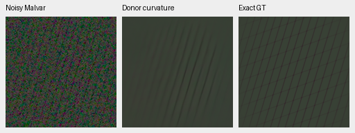
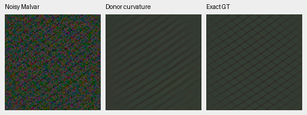

# Transporting wire geometry from nearby RAW

Curvature estimated in a stronger donor patch improves weak response
on the three lower-noise far-edge curved scenes. At equal quiet RMS,
their weak response rises from **2.60% to 4.29%** compared with the
same fixed center frequencies and a planar fit. Increment error
falls from **11.0580 to 11.0432 DN16**. Across all eight sources in
that noise and edge condition, the weak response is essentially
unchanged and both real GFX fences fall back to the earlier planar
fit. [Results, source snapshots and native viewing](results/donor-phase-geometry-v2/publication.json).

## Measured geometry and controls

Four windowed donor spectra estimate local frequencies. On each donor
fold, a symmetric quadratic phase model initialized from these
frequencies is refined by profiling out sine and cosine amplitudes,
while fitting the background and competing carrier. A second
initialization adds bounded normal/tangent curvature proposals
referenced to either patch center. Both versions use the same
continuous refinement and checks. The initial seed comes from the
previous disjoint straight donor on synthetic data and from the
retained real donor on the GFX crops. Continuous refinement uses
SciPy from the evaluation extra.

Each direction must reduce held-out donor error in both directions by
more than 16 whitened squared-error units. The two fitted gradients
at the query center must agree within 1.25 native frequency bins,
with Hessian difference at most three after scaling the Frobenius
norm by the squared query short side.
The search rejects overlapping boxes and falls back when donor and
query centers are farther apart than twice the donor short side.
Transport adds the Hessian times the center-to-center displacement
to the center frequency. The query receives geometry only. It still
fits its own waveform, color, phase and amplitude, with support
measured on separate Bayer samples.

The experiment reuses the 32 exact noisy and target groups from the
[direct query search](phase-drift.md), with the original V143 EMA
predictions and the near/far placements. A new stronger 256-pixel
donor is rendered immediately to the right of the query on the same
phase field, with its own noise draw. The two solver initializations
are compared on these same groups. Both fixed query arms use the
same transported center frequencies. The guarded comparison reuses
the saved planar fit with query-local frequency recentering.

## Recovery

The tighter frozen thresholds use a common cap at the smaller
observed quiet RMS across the three arms. Each cell gives
phase-correct weak response and weak increment RMS in DN16.

| Noise and geometry | Guarded planar | Fixed planar | Donor curvature | Quiet RMS |
| --- | ---: | ---: | ---: | ---: |
| ISO400 far, all | 8.807% / 11.1991 | 8.574% / 11.1946 | 8.543% / 11.1925 | 2.34372 |
| ISO400 far, curved | 3.622% / 11.0625 | 2.598% / 11.0580 | 4.293% / 11.0432 | 2.20852 |
| ISO400 far, spacing changes | 1.631% / 12.0980 | 2.094% / 12.0906 | 1.552% / 12.0920 | 2.54122 |
| ISO400 near, all | 3.875% / 14.1221 | 3.591% / 14.1223 | 3.604% / 14.1225 | 6.31827 |
| ISO6400 far, all | 1.895% / 22.9481 | 2.139% / 22.9420 | 1.937% / 22.9436 | 6.41558 |
| ISO6400 near, all | 3.007% / 30.2445 | 2.888% / 30.2452 | 2.872% / 30.2439 | 14.9765 |

The gradient-only initialization accepts 3 of 32 direction/profile
combinations. Adding curvature starts accepts 6. Five concern warped
carriers with lower phase error at the query after transport. One is
an accepted false curvature on a straight ISO6400 control. Both
accepted weak directions come from the same curved source, one under
each noise profile. Disagreement in the extrapolated center gradient
often persists despite lower error within the donor. This limits the
gain from single-donor geometry. The final analysis independently
recomputes 1,152 scalar reductions without fresh neural forwards.
[Independent error and geometry audit](results/donor-phase-geometry-v2/independent-audit.json).

## Native crops

The two displayed cases are the ISO400 far scenes with an accepted
donor direction, sources 81 and 85, both BGGR. This selection uses
donor acceptance. Both triplets use noisy Malvar, the donor-curvature
restoration and exact GT, with the same 160×160 native crop
`[176,176,160,160]`, shot/read `8e-5 / 2.56e-8`, exposure 2 and
shared contrast 5 around the target mean for display. Delivery uses
the frozen threshold 2 and scale 0.82212 above V143 EMA checkpoint
`96d146d017c54196288c585f8b7eddcf030e8a235061049c31e985b9380b7ce4`.
The stronger wire family remains visible. Most weak intersections stay
missing even in these accepted examples.

Both solver versions use the prior guarded V120 EMA output on all eight
real regions. The available sky, building and foliage donors fall
outside the distance limit. The donors beside both fences fail the
geometry checks. The sky stays smooth, the coarse crossings remain
visible, and the cab mesh still has incomplete intersections under
both noise profiles. The independent ISO100 AHD and JPEG images are
qualitative references. All 12 native final-variant boards were
inspected. The component has scoped synthetic and qualitative
evidence. Full427 and standard known/unseen numerical panels are unavailable.
[Sky](images/donor-phase-geometry-v2/main-overcast-sky.png) ·
[Building](images/donor-phase-geometry-v2/main-building-detail.png) ·
[Foliage](images/donor-phase-geometry-v2/main-foliage.png) ·
[Coarse fence](images/donor-phase-geometry-v2/main-chain-link-fence.png) ·
[Cab left](images/donor-phase-geometry-v2/mesh-nominal-left.png) ·
[Cab right](images/donor-phase-geometry-v2/mesh-nominal-right.png) ·
[Transferred left](images/donor-phase-geometry-v2/mesh-profile3879-left.png) ·
[Transferred right](images/donor-phase-geometry-v2/mesh-profile3879-right.png) ·
[All native metadata](images/donor-phase-geometry-v2/manifest.json).
