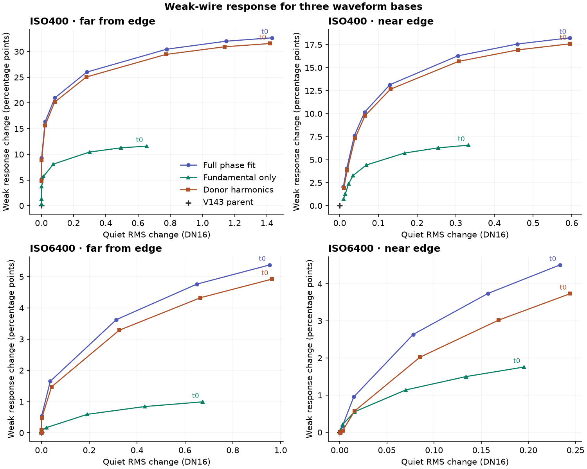
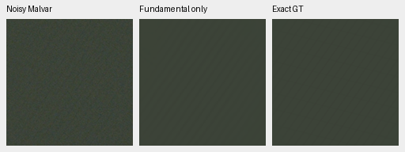
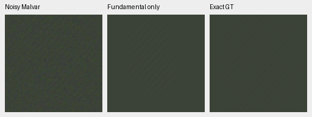

# Selecting waveform harmonics from a separate RAW region

The full eight-knot fit recovers more weak-wire signal than either
reduced basis in all 12 held-out noise, edge, and quiet-budget cells.
Donor-selected harmonics retain much more response than the
fundamental alone. They slightly lower ISO6400 increment error at the
tight budget, with lower weak response. The main sky matches V120.
The protected cab crops still lack convincing fine crossings.
[Complete evidence and executed sources](results/donor-phase-support-v1/publication.json).

## What the donor supplies

The [earlier direction guide](scene-wave-guides.md) transfers the
spacing and direction of two wire families between disjoint regions.
The [subharmonic follow-up](donor-subharmonics.md) corrected two
doubled guide frequencies. This test uses those same frequencies and
asks the donor which harmonics of each periodic profile have evidence.

The full fit has eight periodically interpolated knots, with seven
degrees of freedom after removing the mean. Expressing those knots
in Fourier modes gives pairs of sine and cosine columns at orders 1,
2, and 3, and one alternating column at order 4. Fitting every mode
spans the previous full knot basis. The fundamental-only arm uses
only order 1. Every arm evaluates its basis by the same circular
linear interpolation at native pixel coordinates.

For each donor and direction, the full model competes against a null
that drops one higher harmonic and refits all other columns. Nuisance,
color coefficients and the variance estimate for each prediction
come from that donor discovery fold. The score pools error reduction
across measured CFA sites using the noise prior. The guide frequencies
already use the entire donor, so these are empirical conditional
scores. The donor arm retains a higher harmonic only when each fold
improves the opposite fold's prediction with a score of at least 3.
The fundamental always remains an option. The donor passes only the selected harmonic
orders. Each query fold fits its own phase and amplitudes by color.
The query uses the existing discovery shrinkage, independent-color
pooled fold gate and 129×129 square support.
[Donor scoring](../src/demosaic/donor_phase_support.py) ·
[Query fit](../src/demosaic/local_validated_waves.py).

The query comparison reuses 384 views across eight synthetic
geometries, four CFAs, two edge placements, two noise profiles and
three paired roles. It sweeps all eight thresholds. At each quiet
budget, the other seven geometries choose the threshold and single
correction scale. The eighth supplies the held-out response and
actual error. Eight standing GFX cases use fixed threshold 2.

The 32 synthetic donor directions keep the second harmonic in 32
cases, the third in 31, and the fourth in 17. Among the 16 GFX
case-directions, those counts are 13, 9, and 3. Some GFX cases share
a donor. The independent donor audit reproduces all 288 scores using
residualized design columns and checks all camera donor/query boxes
for overlap.
[Donor orders and exact scores](results/donor-phase-support-v1/donor-harmonic-assessment.json) ·
[Independent donor audit](results/donor-phase-support-v1/donor-audit.json).

## Held-out response and errors

At the tight budget, calibration allows 0.02 DN16 of extra quiet
RMS over V143 on the seven other geometries. These results average
eight held-out geometries, with RMS pooled over the four Bayer
layouts within each geometry. The table reports achieved quiet error
and the projection on the exact weak-wire increment.

| Noise and placement | Fit | Weak response | Quiet RMS DN16 | Weak-increment RMS DN16 |
| --- | --- | ---: | ---: | ---: |
| ISO400 far | Full | 17.536% | 2.51694 | 10.02081 |
| ISO400 far | Fundamental | 7.448% | 2.50718 | 10.07744 |
| ISO400 far | Donor | 16.909% | 2.51674 | 10.02416 |
| ISO400 near | Full | 9.481% | 6.11456 | 13.02156 |
| ISO400 near | Fundamental | 6.136% | 6.11474 | 13.04030 |
| ISO400 near | Donor | 9.188% | 6.11507 | 13.02339 |
| ISO6400 far | Full | 2.294% | 6.74949 | 22.46433 |
| ISO6400 far | Fundamental | 1.105% | 6.74938 | 22.44704 |
| ISO6400 far | Donor | 2.087% | 6.74952 | 22.46015 |
| ISO6400 near | Full | 3.973% | 22.92022 | 30.82640 |
| ISO6400 near | Fundamental | 3.312% | 22.91977 | 30.83122 |
| ISO6400 near | Donor | 3.894% | 22.92017 | 30.82254 |

At both profile levels on the far placement, the donor fit and full
fit achieve almost identical quiet RMS. The donor fit also slightly
raises the absolute weak projection in the weak-absent role at
ISO6400. At fixed threshold 2, the three ISO6400 far arms have
essentially the same quiet RMS, about 6.7284 DN16. Strong response is
11.22% for the full basis, 5.62% for the fundamental, and 11.47% for
the donor basis. Weak response is about 1.1% in all three. Most of
the higher-harmonic benefit at that threshold occurs in the stronger
direction.
[All fixed and calibrated results](results/donor-phase-support-v1/summary.json).

The test controls the input frequencies, but donor selection also
changes fit dimension. A basis-size-matched unrelated-donor arm
would be needed to distinguish scene-specific selection from the
effect of fewer fitted coefficients.

## Native comparisons

Triplets show noisy Malvar, the fundamental-only fit at threshold 2,
and exact constructed GT. Cells are 160×160 original pixels. Synthetic
geometries 0 and 1 use RGGB draw 1, the far two-wire role, ROI
`[176,176,160,160]`, exposure 2, and shared white balance, matrix and
clipped-sRGB display. ADC16 black fraction is 0.03, with shot/read
`8e-5/2.56e-8` at ISO400 and `0.00128/6.5536e-6` at ISO6400.
Synthetic parent V143 EMA SHA256 is
`96d146d017c54196288c585f8b7eddcf030e8a235061049c31e985b9380b7ce4`.

The real parent is V120 EMA SHA256
`a9d9b6b4f974e24a6b11e5e740aab32314233a7f53c056cf37c7d2aac1c589fb`.
The main DSCF3879/3880 crops use exposure 4. The DSCF3842/3835 cab
crops use exposure 16 with both recorded noise profiles. The separate
ISO100 AHD and camera JPEG references are qualitative and differ in
aperture, exposure and motion.

Visible ISO400 diagonals remain softer than the exact targets. The
ISO6400 restorations look nearly flat at this exposure. The real
sky matches V120 in linear RGB and in the display cells. The coarse
fence retains its diamond crossings with subtle modulation changes.
The building and foliage remain soft. On the right side of the cab
the donor fit makes a smaller correction than the full fit under
both noise profiles. Neither side shows convincing new fine
crossings against the separate reference.
[ISO400 comparison](images/donor-phase-support-v1/iso400-index0025-comparison.png) ·
[ISO6400 comparison](images/donor-phase-support-v1/iso6400-index0009-comparison.png) ·
[Sky](images/donor-phase-support-v1/main-overcast-sky.png) ·
[Building](images/donor-phase-support-v1/main-building-detail.png) ·
[Foliage](images/donor-phase-support-v1/main-foliage.png) ·
[Coarse fence](images/donor-phase-support-v1/main-chain-link-fence.png) ·
[Cab left](images/donor-phase-support-v1/mesh-nominal-left.png) ·
[Cab right](images/donor-phase-support-v1/mesh-nominal-right.png) ·
[Transferred profile left](images/donor-phase-support-v1/mesh-profile3879-left.png) ·
[Transferred profile right](images/donor-phase-support-v1/mesh-profile3879-right.png).

The two-thread collector took 699.49 seconds and reproduced all 392
full-fit threshold-2 controls bit for bit. The separate query audit
checks the basis for each view, 1,728 reductions across 288 held-out
rows, 80 saved real-camera cells, and all four native triplet
subsets. All twelve comparison boards were opened.
[Independent query audit](results/donor-phase-support-v1/independent-audit.json) ·
[Native crop coordinates, noise conditioning, and observations](images/donor-phase-support-v1/manifest.json).
