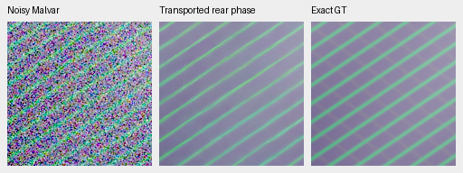
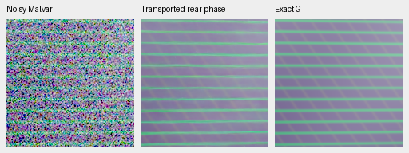

# Using nearby RAW to recover weak fence crossings

The optional adjacent-donor fit brings out both wire directions in the
right GFX100S cab crop under both noise profiles. Each direction improves
prediction on held-out Bayer samples. The other six standing crops keep
their previous outputs. A separate exterior-phase experiment improves
continuous synthetic ISO6400 wires and extends some of them across gaps.
[Measurements, source and native viewing](results/donor-phase-transport-v1/publication.json).

## Nearby donors in the crop helper

The earlier donor search requires two promising directions to recur across
its regular tile grid. A single nearby tile can contain enough evidence
when the grid misses one direction. The fallback tests up to four 160-pixel
tiles next to the 256-pixel query, each with a 32-pixel gap. Within a donor,
the two measured green planes propose frequencies and verify them on separate
sites. The reserved quarter of the local Bayer samples checks the weaker
direction in each proposed pair. The strongest pair proceeds to the same
local fit, crossed predictions and final audit as the usual donor fit. One
local frequency/phase search surrounds each proposed donor frequency. The
13 placements keep their reserve columns anchored to the sensor.

Enable the fallback with `adjacent_donors=True` in `refine_local_raw_mesh`.
It runs when the usual fit yields no correction. `suppress_gaps=True` can
also audit that result. Both right cab outputs are pixel-identical to the
archived fallback comparison and its output with the gap option enabled.
All eight default and default-with-gap outputs match the previous code
bit for bit. [Implementation](../src/demosaic/mesh_refinement.py) ·
[Package and native parity](results/donor-phase-transport-v1/port.json).

On the right, the adjacent window starts at `[186,188]` relative to the
768-pixel RAW context. It supplies both diagonal frequencies. All 13
placements support them at both priors. The final Bayer audit improves
the weaker direction's error by 40.27 nominal whitened squared-error units,
versus 24.37 for the phase-shifted control. The transferred prior gives
64.27 and 37.67. These values are predictive gains in the fixed crop, with
the supplied noise prior as the scale. The RGB comparison is qualitative,
and the audit uses empirical thresholds.

On the fresh synthetic panel, the nearby fallback reproduces all
previous outputs. Two replays with a single exterior patch also
reproduce the default output in every case. The direct crop test uses
a scene where the regular grid cannot supply a prior. The fallback
recovers the supported wire and preserves the paired flat query.
[Eight-case replay](results/donor-phase-transport-v1/one-donor.json) ·
[Four-case targeted replay](results/donor-phase-transport-v1/isolated-donor.json) ·
[Crop regression test](../tests/test_mesh_refinement.py).

## Carrying phase from the exterior

The transport test estimates the phase as well as spacing from separate
exterior RAW tiles. It concentrates the green measurements along a
projective phase field and requires each of two sets of tiles to predict
the other. The pooled fit then supplies the rear direction's phase. The
stronger direction still uses the local reserve. Both alternatives use
the same local RAW evidence, correction equations and 13-placement median.
The fit uses exact phase recentering for the overlapping native placements.

In the ISO6400 development replay, agreement of the rear template with
the exact target rises from 0.238 to 0.906 mean cosine. Two of six cases
pass the central RAW check, the same two as with exact carrier geometry.
The local phase estimate passes zero. The exterior phase is accurate
enough to help those paired cases, while several remain poorly supported
even with exact geometry.

## Fresh exact-target observations

The panel has 24 new pairs, with four groups of six. Each noise prior
includes continuous wires and a mix of strip and disk gaps beside an
intensity step. The rear amplitude varies from 0.0036 to 0.0100 in the
scene generator. Matching and phase-shifted exteriors use the same
local RAW and local predictions. Rotated donors are tested on two of
six geometries per group. All 264 case/variant measurements
are reproduced from the stored predictions.

| Prior and layout | Phase from query | Rear phase from exterior | Added gap RMS, query → exterior |
| --- | ---: | ---: | ---: |
| ISO6400 continuous | 52.32% / 93.55 | 66.38% / 88.45 | — |
| ISO6400 gaps | 28.86% / 96.98 | 47.57% / 86.01 | 3.54 → 22.60 |
| ISO400 continuous | 97.33% / 61.45 | 112.59% / 58.91 | — |
| ISO400 gaps | 88.29% / 57.66 | 97.31% / 58.73 | 75.63 → 83.19 |

Each pair of values is recovery as a percentage of the true weak-wire
increment and wire RMS error in camera-linear DN16. Values over 100%
indicate overshoot. In g150, the higher ISO6400 response comes with higher
wire error, 58.60 → 62.76 DN16. In g153, response rises from 40.62% to
95.61% and wire error falls from 87.54 to 54.11 DN16. Transport introduces
no changes relative to the previous fit when the exterior phases are
shifted or rotated. The front-only and flat roles also keep their pixels.
The adjacent-donor fallback reproduces the previous fit across the 24
pairs in this multi-donor test. [Score replay and controls](results/donor-phase-transport-v1/summary.json).

The existing column gap audit removes most of the added pattern in the
ISO6400 g154 disk. Averaged over all six high-noise gaps, added RMS falls
from 22.60 to 14.34 DN16 at nearly equal weak response. The short support
mask reduces added RMS further to 1.28 DN16. It drops continuous ISO6400
response from 66.38% to 38.54%. At ISO400 the distributed audit reduces
added gap RMS from 83.19 to 30.55 DN16 at nearly equal response. Total
gap error remains high because the local prediction has additional
errors. The fixed exterior-phase fit remains an experiment.

The two ISO6400 triplets share the native `[80,80,160,160]` region inside
320-pixel fields, noisy Malvar, ADC16 black fraction 0.03, shot/read
`0.00128/6.5536e-6`, identity WB and matrix, exposure ×1 and shared
reference-centered display contrast ×8. Case g151 uses GBRG and g153
uses BGGR. The synthetic parent is spatial 2k EMA with scene context
bypassed, SHA256 `97fd551bd0ae0b7aa97c67e1f6e8b513b722f70d5ad8b8814a96586b934eafac`.

[g151 comparison](images/donor-phase-transport-v1/iso6400-continuous-g151-comparison.png) ·
[g153 comparison](images/donor-phase-transport-v1/iso6400-continuous-g153-comparison.png) ·
[Continuous g150 regression](images/donor-phase-transport-v1/iso6400-continuous-g150-comparison.png) ·
[Round gap g154](images/donor-phase-transport-v1/iso6400-disk-g154-comparison.png) ·
[Strip gap g155](images/donor-phase-transport-v1/iso6400-band-g155-comparison.png).

## Standing GFX100S review

The absolute-phase fit is withheld on all standing crops. The coarse
fence has strong donor phase measurements but the two donor sets
disagree about the phase at the query. The adjacent-donor fallback uses
frequency from nearby RAW and phase from the query. It shows new right
cab crossings across much of the ROI, strongest in the nominal view.
Some crossings stay soft or uneven under the transferred profile.
The horizontal wire and mottled background remain visible. The added
lattice looks more regular than parts of the ISO100 reference. The
left cab, coarse fence, sky, foliage and building are pixel-identical to
their earlier outputs under the corresponding comparison policy.

All eight native boards for each experiment were viewed. The parent is
local-only 2k EMA SHA256
`ceb5ddaf23fce47806a01045bd86d34bb48d1f64031e382b0d5cfbabf0716880`.
The displayed boards compare the archived wider-donor correction with
the adjacent fallback. The right fallback result equals the packaged
output. Both scenes use the cached RAW and fixed 160×160 native crops.
Main DSCF3879 is exposure ×4 with shot/read `0.00128/6.5536e-6`. Cab
DSCF3842 is exposure ×16 with that nominal prior and transferred
`0.0014635775921166604/1.0715704128646712e-6` shot/read. DSCF3880 and
DSCF3835 ISO100 AHD and both cab JPEGs are qualitative references.
[Complete view provenance](results/donor-phase-transport-v1/viewing.json).

[Sky](images/donor-phase-transport-v1/main-overcast-sky-main-overcast-sky.png) ·
[Building](images/donor-phase-transport-v1/main-building-detail-main-building-detail.png) ·
[Foliage](images/donor-phase-transport-v1/main-foliage-main-foliage.png) ·
[Coarse fence](images/donor-phase-transport-v1/main-chain-link-fence-main-chain-link-fence.png).

| Cab profile | Native comparisons |
| --- | --- |
| Nominal | [Left](images/donor-phase-transport-v1/mesh-nominal-fine-green-mesh-left.png) · [Right](images/donor-phase-transport-v1/mesh-nominal-fine-green-mesh-right.png) |
| Transferred | [Left](images/donor-phase-transport-v1/mesh-profile3879-fine-green-mesh-left.png) · [Right](images/donor-phase-transport-v1/mesh-profile3879-fine-green-mesh-right.png) |

This is a scoped crop correction without new model training. The
fixed full-checkpoint panels remain in [PSNR history](performance-history.md).
