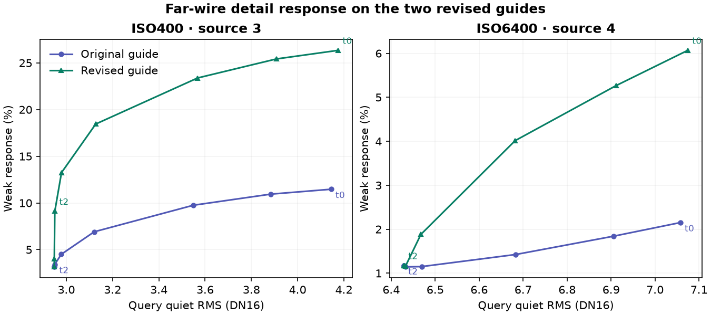
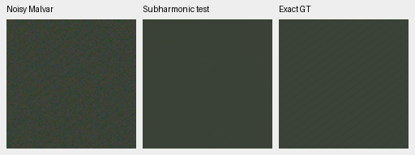
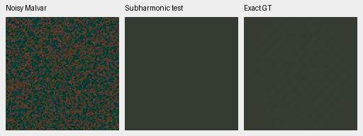

# Testing the longer repeat in donor RAW guides

The donor test recovers the two missed fundamentals, bringing coverage
from **14 of 16 to 16 of 16** retained donors within one native query
frequency bin. On the affected ISO400 far-wire case, weak response rises
from **3.42% to 9.10%** at threshold 2, with nearly equal quiet error
and lower increment error. The corrected ISO6400 case stays near 1.17%
at the same threshold. The real cab meshes retain the previous pooled
images and still lack convincing new crossings.
[Audited evidence](results/donor-subharmonics-v1/publication.json).

## Donor decision and matched inputs

In the two failed cases, the original guide already points along the
wire normal and selects its second harmonic. For each detected frequency
`f`, the donor test compares a null that fits both existing guide
frequencies with a fit that adds sine and cosine at `f/2`. Each donor
fold fits its own CFA-color coefficients and noise proxy, then predicts
the opposite fold. Summed whitened error improvement, normalized by the
change in prediction, must reach 3 in both fold directions.

The original frequencies and nuisance-edge geometry come from the same
donor RAW. The scores are empirical. Only the revised frequency enters
the disjoint query, which still fits and validates its own phase profiles
before delivering any correction. Neither targets nor the restored query
enter guide selection. The two exceptions have donor fold scores of
43.7/49.1 at ISO400 and 8.6/8.4 at ISO6400. Their errors drop from
15.19 and 12.61 bins to 0.039 and 0.044 bins. The other 14 donor decisions
retain their existing frequencies.
[Raw donor decisions](results/donor-subharmonics-v1/donor-assessment.json) ·
[Implementation](../src/demosaic/local_validated_waves.py).

The experiment reuses all 384 query views, four Bayer layouts, eight
geometries, both edge distances and both noise priors of the pooled gate.
It refits 48 views with revised guides and adopts the other 336 exactly.
Both report arms use the same eight gate thresholds, discovery shrinkage,
parent projection, and phase-fit capacity.

## Fixed-threshold and held-out results

The affected far cases below average the same four Bayer layouts.

| Source and threshold | Guide | Weak response | Quiet RMS DN16 | Weak-increment RMS DN16 |
| --- | --- | ---: | ---: | ---: |
| ISO400 source 3, t2 | Original | 3.4172% | 2.950085 | 8.51049 |
| ISO400 source 3, t2 | Revised | 9.1033% | 2.950230 | 8.49863 |
| ISO6400 source 4, t2 | Original | 1.1716% | 6.428806 | 18.67509 |
| ISO6400 source 4, t2 | Revised | 1.1726% | 6.428805 | 18.67468 |
| ISO6400 source 4, t0.5 | Original | 1.4248% | 6.682933 | 18.77801 |
| ISO6400 source 4, t0.5 | Revised | 4.0144% | 6.681799 | 18.77636 |

Across eight geometries, the tightest quiet-budget comparison calibrates
on seven and evaluates on the eighth. ISO400 far weak response increases
from 16.89% to 17.54%, quiet RMS rounds to 2.5169 DN16 in both arms,
and increment RMS falls from 10.02219 to 10.02081 DN16. At threshold 2,
mean absolute projection onto the absent weak-wire template stays at
0.479% in the affected ISO400 far geometry. ISO6400
far response moves from 2.22% to 2.29% with essentially the same quiet
and increment error. The larger ISO6400 gain at threshold 0.5 on the
affected geometry comes at higher quiet error than threshold 2. The
panel reuses the geometries that exposed this failure. It demonstrates a
specific guide repair, with the stronger high-noise recovery still open.
[Paired threshold results](results/donor-subharmonics-v1/summary.json).

## Native comparisons

The triplets show noisy Malvar, the revised guide, and exact constructed
GT at threshold 2. They use sources 3 and 4, RGGB draw 1, the far two-wire
role, ROI `[176,176,160,160]`, exposure 2 and shared WB and display transforms.
The ADC16 black fraction is 0.03. Shot/read coefficients are
`8e-5/2.56e-8` at ISO400 and `0.00128/6.5536e-6` at ISO6400. The synthetic
parent is V143 EMA
`96d146d017c54196288c585f8b7eddcf030e8a235061049c31e985b9380b7ce4`.

The real parent is V120 EMA
`a9d9b6b4f974e24a6b11e5e740aab32314233a7f53c056cf37c7d2aac1c589fb`.
One GFX guide changes, for the coarse DSCF3879 fence. Its donor supports
0.020 rather than 0.040 cycles per pixel in one direction, and the crop
changes by 1.21 DN16 RMS versus the original pooled result. The visible
crossings look similar. The sky, building, foliage and all four cab
windows reuse byte-identical predictions. The main crops use exposure 4
and both cab profiles use exposure 16. The ISO100 AHD and JPEG are
qualitative references from separate exposures, and the ISO6400 JPEG
shows the camera rendering of the input capture.
[Coarse fence](images/donor-subharmonics-v1/main-chain-link-fence.png) ·
[Sky](images/donor-subharmonics-v1/main-overcast-sky.png) ·
[Cab left](images/donor-subharmonics-v1/mesh-nominal-left.png) ·
[Cab right](images/donor-subharmonics-v1/mesh-profile3879-right.png).

All twelve boards were opened. An independent audit reproduced 1,152
direct-pixel reductions on held-out results, verified 72 original camera
display cells, and checked all four triplet subsets. Query collection took
35.70 seconds on the two-thread CPU allocation. The first donor run's
fixed 256-pixel size assertion failed on the saved 128-pixel coarse-fence
donor. The replay uses the existing native donor rectangles and preserves
both attempts in the evidence archive. The first audit's fixed triplet
count was stale. The repeated audit counts the subsets as it checks them
and confirms all four.
[Native provenance](images/donor-subharmonics-v1/manifest.json) ·
[Repeated independent audit](results/donor-subharmonics-v1/independent-audit-v2.json) ·
[Audit replay source and log](results/donor-subharmonics-v1/audit-v2-evidence.tar.gz).
