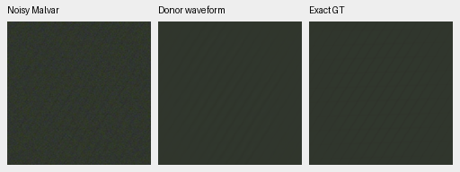
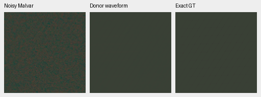

# Fit weak RAW detail with a waveform from a separate patch

The [shared query waveform](shared-phase-shape.md) lowered some chroma
error while losing near-edge weak response. This experiment asks whether
a stronger disjoint RAW region provides a more useful shape. Local RAW
data still determine the phase, signed amplitudes and spatial support.
[Executed comparison and native evidence](results/donor-waveform-v1/publication.json).

## What comes from the donor

The donor uses its existing measured frequency pair and an eight-knot
phase fit. For each direction the leading singular vector of the three
mean-free profiles gives one knot shape. Each color is weighted by the
square root of its summed inverse noise variance. The query receives the
shape and initial frequency, then estimates its own phase and amplitude.
A negative amplitude is allowed in any CFA color. The synthetic donors
have stronger wires, different phase, and separate sensor noise. The
real donors use disjoint native RAW boxes. The coarse fence supplies
an intentionally mismatched donor for sky, building and foliage.

Each query discovery fold keeps its earlier recentered frequencies and
8-pixel edge exclusion. At each of 24 evenly spaced shifts, it evaluates
the donor's shifted Fourier interpolant on the eight-knot grid. It removes
the nuisance and the competing full phase basis, then sums whitened
squared-error reduction across CFA colors to choose the shift. It refits
the chosen directions together and scores fixed predictions on the other
fold. The same seven-degree reliability penalty, per-color validation,
spatial weight and all-site delivery apply.

A second arm rotates the second harmonic by +90° and the third by −90°.
Both arms have the same harmonic magnitudes, number of fit coefficients,
and shift candidates.
This tests whether the donor's relative harmonic phases help. Independent
per-color query waveforms provide the baseline.
[Donor fit](../src/demosaic/donor_phase_support.py) ·
[Query fit](../src/demosaic/local_validated_waves.py) ·
[Frozen replay](../scripts/probe_donor_waveform.py).

The four synthetic conditions retain the 96 observations and V143 parent,
with frozen 0.02 and 0.10 DN16 development settings. The eight GFX views
retain the V120 parent and fixed threshold 2. The synthetic signed-color
fit is also checked on all four CFA layouts with exact shifted waveforms
and withheld NaNs.

## Response at the original operating points

Means across eight sources for the weighted refit at the frozen 0.02 DN16
setting. Triples read independent / donor / scrambled. Quiet delta is
the achieved RMS increase over V143.

| Noise and edge | Weak response | Quiet delta (DN16) | Weak increment RMS (DN16) |
| --- | ---: | ---: | ---: |
| ISO400 far | 22.36% / 22.36% / 15.83% | 0.03902 / 0.04193 / 0.01701 | 11.64371 / 11.63629 / 11.68571 |
| ISO400 near | 12.16% / 8.24% / 7.68% | 0.01229 / 0.01683 / 0.00756 | 15.72125 / 15.74183 / 15.74596 |
| ISO6400 far | 1.81% / 1.47% / 0.93% | 0.02551 / 0.02686 / 0.01573 | 26.60935 / 26.60141 / 26.59548 |
| ISO6400 near | 1.57% / 0.05% / −0.03% | 0.02529 / 0.01241 / 0.01290 | 36.82079 / 36.82205 / 36.81642 |

On ISO400 far fields, the real donor improves response relative to the
scrambled template on all eight sources at both frozen settings. The
scrambled arm also applies a weaker correction and incurs less quiet
error. At the tighter setting the donor lowers chroma increment RMS
from 3.68524 to 3.60645 DN16 relative to the independent fit. At ISO6400
far, both restricted bases slightly lower increment error on seven of
eight sources. Their weak response is lower than the independent fit.

At the independent fit's measured quiet RMS, scaling down the donor
keeps 21.59% weak response at ISO400 far and reduces increment RMS by
0.00378 DN16. Near the edge, the donor's response falls to 7.54% versus
12.16% for independent fitting, and increment error increases by
0.02308 DN16. When all three ISO400 far arms are compared at the
scrambled arm's lower quiet error, the donor recovers 14.50% versus
15.83% for scrambled and 14.99% for independent. The donor's decrement
in increment RMS versus scrambled is 0.00555 DN16 at that level.
The matched-error comparison uses one common multiplier across the
eight sources per arm, derived from the evaluation targets. The
original fits and validation margins use their frozen settings.
[Source-paired summaries and matched quiet checks](results/donor-waveform-v1/summary.json).

The donor's waveform provides a small far-edge error tradeoff.
Independent query waveforms remain the better near-edge choice.

## Native comparisons

The synthetic triplets show noisy Malvar, the donor-waveform weighted
refit and exact constructed GT at the frozen 0.02 DN16 setting.
The native 160×160 cells use parent ROI `[176,176,160,160]`, source
40 RGGB and source 41 BGGR, far two-wire placement, repeat 7311.
Both noise profiles use ADC16 black fraction 0.03. Shot/read are
`8e-5/2.56e-8` at ISO400 and `0.00128/6.5536e-6` at ISO6400.
Exposure 2, white balance, color matrix and clipped-sRGB display
match across the crops. V143 EMA SHA256 is
`96d146d017c54196288c585f8b7eddcf030e8a235061049c31e985b9380b7ce4`.

ISO400 source 40 shows faint diagonals in both independent and donor
fits, with clearer crossings in the exact target. Lower contrast in
source 41 makes the differences subtle. At ISO6400 the restored
examples remain nearly flat.
[ISO400 RGGB](images/donor-waveform-v1/iso400-source40-far-RGGB-comparison.png) ·
[ISO400 BGGR](images/donor-waveform-v1/iso400-source41-far-BGGR-comparison.png) ·
[ISO6400 RGGB](images/donor-waveform-v1/iso6400-source40-far-RGGB-comparison.png) ·
[ISO6400 BGGR](images/donor-waveform-v1/iso6400-source41-far-BGGR-comparison.png).

The real view parent is V120 EMA SHA256
`a9d9b6b4f974e24a6b11e5e740aab32314233a7f53c056cf37c7d2aac1c589fb`.
DSCF3879/3880 uses exposure 4 with shot/read
`0.00128/6.5536e-6`. DSCF3842/3835 uses exposure 16 with
this nominal profile and the transferred DSCF3879 estimate
`0.0014635776/1.0715704e-6`. The ISO100 AHD and low-ISO JPEG
are qualitative references from different aperture, exposure
and subject motion. Both camera JPEGs are included for the cab.

The sky matches V120 bit for bit in linear camera RGB and in the
display. The building matches the independent fit. Fine foliage
remains soft. The coarse fence retains its visible diamonds.
The matched donor changes the coarse fence by 25.78 DN16 RMS and
the four cab views by 1.71–2.25 DN16 RMS relative to the independent
fit. Cab diagonals remain visible with no convincing new
crossings in either template arm.
[Native crop and donor coordinates](images/donor-waveform-v1/manifest.json) ·
[Sky](images/donor-waveform-v1/main-overcast-sky.png) ·
[Building](images/donor-waveform-v1/main-building-detail.png) ·
[Foliage](images/donor-waveform-v1/main-foliage.png) ·
[Coarse fence](images/donor-waveform-v1/main-chain-link-fence.png) ·
[Cab left](images/donor-waveform-v1/mesh-nominal-left.png) ·
[Cab right](images/donor-waveform-v1/mesh-nominal-right.png) ·
[Transferred profile left](images/donor-waveform-v1/mesh-profile3879-left.png) ·
[Transferred profile right](images/donor-waveform-v1/mesh-profile3879-right.png).

The 192 synthetic and 16 real query fits, including donor preparation,
take 143.89 seconds on two CPU cores. The independent audit checks
4,224 saved-image reductions, 1,248 matched fold fields, 120 retained
camera cells and four triplet subsets. It checks camera crop disjointness
and the equality of the harmonic magnitudes. All twelve native
comparison boards were viewed.
[Independent audit](results/donor-waveform-v1/independent-audit.json) ·
[Native viewing receipt](results/donor-waveform-v1/actual-native-viewing.json).
