# TV phase fitting recovers more of the fine mesh

**Edge-preserving smoothing of local wave coefficients makes the real crossing
mesh clearer and reduces average procedural blank-region spill by 48.8% versus
Gaussian phase fitting.** Recovery remains soft and incomplete. Texture error is
slightly higher, some blank regions regress, and strong highlight changes remain
unverified. This is the current envelope within optional `--phase-harmonic`;
ordinary inference still leaves the stage disabled. V120 remains the validated
general model recommendation.

[CPU implementation](../src/demosaic/phase_tv.py) ·
[CUDA implementation](../src/demosaic/phase_tv_cuda.py) ·
[Execution and validation receipt](results/edge-phase-envelope-publication-v1.json) ·
[Source/ROI/checkpoint/noise/display metadata](images/edge-phase-envelope-v1/manifest.json).

## What changes

The [previous complex envelope](complex-phase-envelope.md) estimates local sine
and cosine coefficients with a native sigma 32 Gaussian. Smoothing across a
texture boundary can spread a weak oscillation into an adjacent blank region.
Simply demanding stronger agreement between the two green phases reduced useful
detail in development. Shrinking the RAW signal before subtracting the parent
also increased spill. Those experiments and their receipts remain preserved.

The new mode estimates the same two coefficients at sigma 16, then applies
vectorial total variation (TV) to that coefficient field. For two-component
field `z`, it approximately minimizes
`0.5*sum((u-z)^2) + sum(weight*norm(gradient(u)))`, sharing the gradient norm
across sine/cosine and both spatial axes. The per-location weight is 16 times
the sigma 16 fit's noise standard-deviation proxy. TV acts on the coefficients,
not the restored RGB pixels: it encourages a locally steady wave while allowing
its envelope to change more sharply.

The resulting phasor rotates/scales the global RGB residual phasors as before.
Post-filter power shrink 9 uses the original Gaussian32 covariance, magnitude is
capped at 3, and the existing global gate 9, 32-pixel aprons, even-origin 256 windows
and native stride 128 blending remain. The frequency selector is unchanged:
at most four peaks, radial 0.03–0.22, signed green coherence>0.8 and cross/noise>5.
Neither GT, references nor RNG enter refinement; no model weights change.

The covariance after nonlinear TV is unknown. Gaussian32 covariance is a
**heuristic noise proxy, not calibrated TV uncertainty or confidence**. The
selector, affine fit and variance also reuse the input. Shrink9 is a fixed
setting, not a false-positive probability.

## Running it

```bash
source scripts/env.sh
uv run demosaic infer /mnt/external/demosaic/models/v143-final5000.pt photo.raf \
  /mnt/external/demosaic/output/photo-TV-linear.tiff \
  --preview /mnt/external/demosaic/output/photo-TV-srgb.tiff \
  --shot 0.00128 --read 0.0000065536 --precision float 32 \
  --tile 512 --overlap 64 --batch-size 4 \
  --phase-harmonic --phase-harmonic-envelope edge
```

The optional stage defaults to `edge`. Select `complex` for the previous Gaussian
phase envelope or `scalar` for amplitude-only correction. The TV solver follows
the neural device by default; `--phase-harmonic-device cpu` selects the NumPy
reference. CUDA uses float64 FFTs and an eight-step CUDA graph; complete-frame
accumulators stay on the CPU. Noise coefficients above are the tested nominal
prior, not universal calibration. The sidecar records mode, device, elapsed time,
active windows, solver iterations, capped solves and maximum measured gap.

## Fresh locked validation

The fixed TV policy was selected using 80 previously used development recipes and
the standing real crops, then locked **before generating or inspecting 64 fresh
recipes**, seeds 2026110300–2026110363. Each has present/absent states and four
CFAs: **512 actual V143 root/DINO calls**, zero new V120 controls or training.
All model/backbone/input/RNG integrity checks pass. These are new observations,
not repeated correction calls counted as model inference.

Native 256 inputs use continuous 512→geometry→area2 generation, scene level 0.02,
zero optical PSF, shot 0.00128/read variance 6.5536×10⁻⁶, ADC16/black 0.03.
GT enters scoring only. Checkpoint SHA256:
`96d146d017c54196288c585f8b7eddcf030e8a235061049c31e985b9380b7ce4`.
[Locked policy](results/edge-phase-envelope-locked-policy-v1.json) ·
[All fresh results](results/edge-phase-envelope-prospective-v1.json).

Both correction modes change 54 present cases from 16 recipes; the remaining 48
recipes bypass both. The unchanged detector explains their identical activation.
The previous64-recipe sample had only two active recipes; the higher count here
is a different random sample, not increased sensitivity from TV. **All 256 absent
inputs retain every parent value.** These means cover all 256 present cases;
mean per-case RMS is not pooled-pixel RMS or independent training-run evidence.

| Fresh dark present cases | V143 parent | Gaussian complex | TV complex |
| --- | ---: | ---: | ---: |
| Known-template gain, ideal1 | .03690 | .07840 | .07810 |
| Native 160 spatial error, RMS DN16 | 15.70393 | 14.41925 | 14.44325 |
| Complete256 error, RMS DN16 | 12.45960 | 11.63479 | 11.66041 |
| Added field in complete-patch exact-blank pixels, RMS DN16 | 0 | .11528 | .05904 |
| Error in those blank pixels, RMS DN16 | 6.36751 | 6.37662 | 6.37101 |
| Worst per-case added blank-region RMS, DN16 | 0 | 2.19900 | 1.61145 |

TV cuts mean added blank structure 48.78% and the worst value 26.72% versus complex.
It retains 99.62% of complex's mean template gain, with spatial error 0.17% and
complete-patch error 0.22% higher. Blank error still exceeds the parent mean.
Seven of 54 changed cases have higher blank GT error than complex; five have
more added blank structure. The largest blank-error increase is 0.00734 DN16,
recipe 2026110335/GRBG. The gain is useful and nonuniform; it does not establish
flat-region safety beyond the tested inputs. Most weak recipes still bypass.

The reused 80 development recipes show 51.14% less average added blank field, with
slightly weaker texture recovery. They helped select the setting and are not
fresh validation.

## Native exact-GT examples

Noisy Malvar → TV correction on V143 → **exact procedural GT**. All cells are
unchanged 160×160 pixels at ROI `[48,48,160,160]`, sharing WB/matrix/+3EV display.
The first two active sources prefer RGGB; the largest blank-error regression and
first inactive source are also shown. Selection follows the completed results.
Five-way parent/complex/TV comparisons and complete metadata are in the manifest.

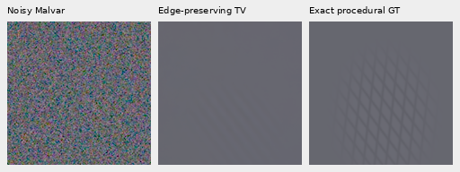

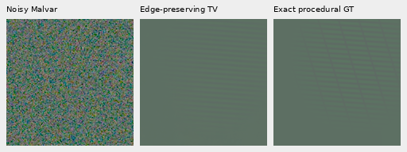

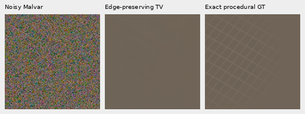

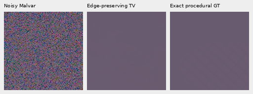

## Complete GFX frames

The three complete 101.996MP V143 FP32 parents and normalized RAW arrays are
reused exactly: main DSCF3879 fixed historical Haar, extra DSCF3842 nominal and
nearby-Haar priors. Full-frame refinement adds zero neural calls, RAW decoder
opens or noise draws. The new highlight controls below separately add four
decoder opens of two locally cached ISO100 RAFs, exclusively for reporting.
Originals remain read-only; no source drive is accessed. All test siblings stay
out of training. ISO100/AHD and camera JPEGs are **not exact GT**.

Main rows: noisy → V120 → V143 → complex → TV → independent DSCF3880 ISO100.
Original ROIs, native 160 pixels, WB/matrix and shared+2EV remain. Foliage stays
painterly; changes in building and larger fence detail are modest.

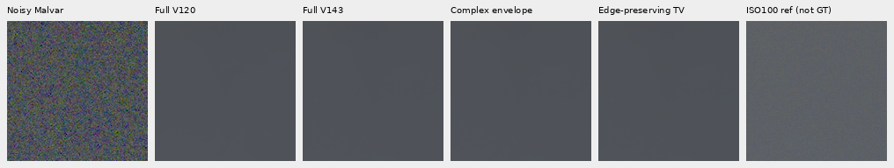

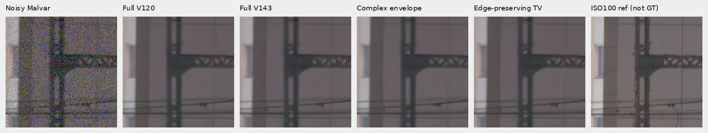

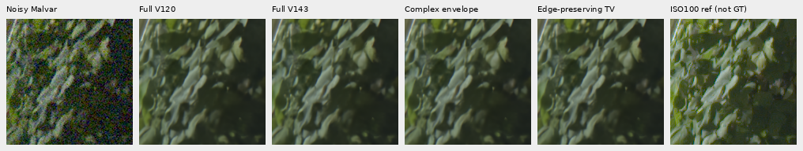

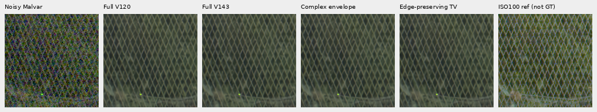

Fine mesh rows: noisy → V143 → complex → TV → independent DSCF3835 ISO100.
Left/right native ROIs start `[806,6489]`/`[1026,6449]`; common+4EV and the original
reference integer translation remain. Nominal shot/read is 0.00128/6.5536×10⁻⁶;
nearby is 0.0014635775921166604/1.0715704128646712×10⁻⁶, fixed from DSCF3879,
not calibrated to DSCF3842. References differ in aperture, exposure and motion.

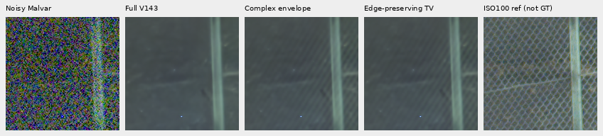

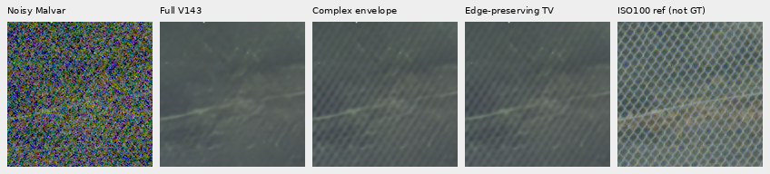

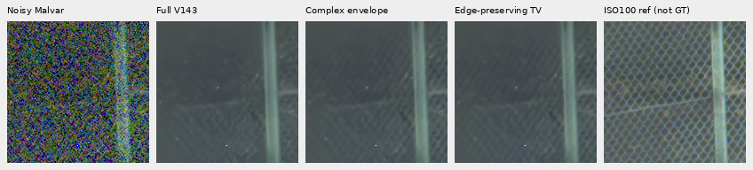

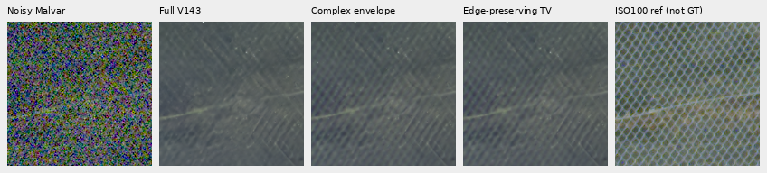

TV gives stronger crossing structure, especially on the right. It remains soft,
uneven and well below the independent ISO100 view. These are observations from
the complete regular-grid output; window placement still matters.

Both camera JPEGs remain visible: noisy → V143 → TV → ISO6400 camera JPEG →
ISO100 AHD → ISO100 camera JPEG. All native cells share+4EV; processing/capture
differences prevent pixelwise scoring.

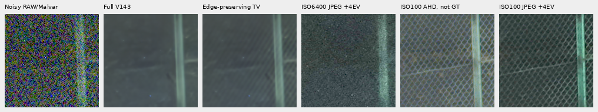

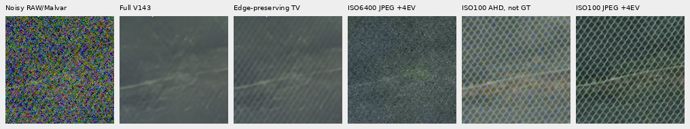

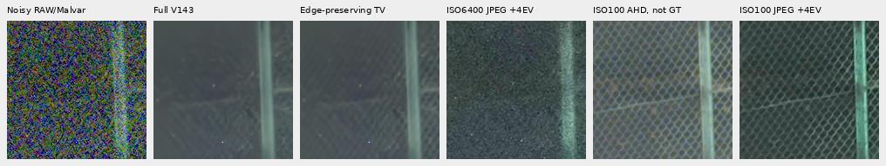


## Flat support and highlight costs

The same input-selected 2.88MP sky box `[5200,200,2400,1200]` retains every parent
channel. All 96 fixed photographic and 48 exact-uniform inputs **per V120/V143
parent** retain every value. The earlier 924 large uniform windows selected zero
frequencies; their unchanged bypass follows from the preserved selector and old
receipt, rather than a claimed fresh execution. Partial-texture spill remains
measurable in fresh procedural blank regions.

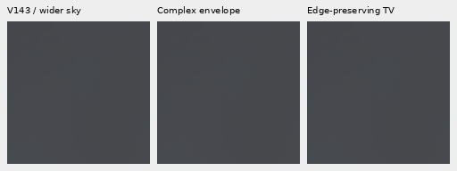

The outcome-selected largest 160px added-field regions remain around a bright
sign. At identical coordinates, complex→TV RGB RMS rises 1098→1403DN16 main,
1844→2276 nominal and1585→1937 nearby. Individual changes reach 12083 DN16.
The common−2EV views include newly decoded independent ISO100/AHD controls,
registered using only noisy input/reference integer translation, without warping.
About 7–8% of observed RAW sites in these ROIs are clipped.

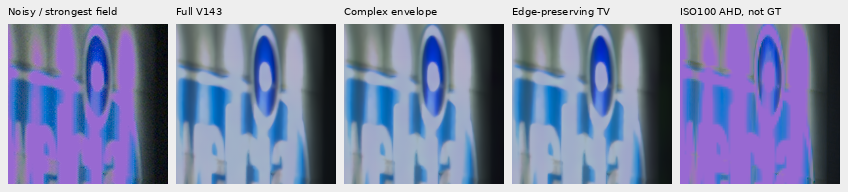

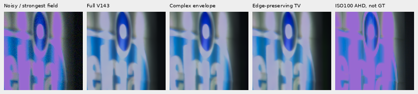


Restored color differs substantially from the noisy and independent render.
That disagreement alone does not identify the correct color. On unclipped
measured green sites within these 160px ROIs, TV increases mean prediction-minus-observation residuals:
approximately +1298–1837 DN16 versus parent +13–139 DN16. Conversely, over their
larger 256px contexts, the complete correction reduces weighted measured-CFA
error, excluding clipped sites; an optimal scalar step would exceed 1 in all
three. That check therefore did not justify an added damping gate. Neither
observed-data diagnostic is exact-GT validation; saturation and local color
changes remain a concrete limitation. No highlight safeguard was tuned on the
fresh results. [Measured-site diagnostics](results/edge-phase-envelope-highlight-CFA-v1.json) ·
[Context step probe](results/edge-phase-envelope-highlight-step-v1.json).

## Solver accuracy, cost and verification

ADMM uses rho 16, Neumann boundaries on the coefficient field, a 1024-step cap,
and a primal/feasible-dual gap check every 8 steps with target 1e−5 relative to
`0.5*sum(z²)`. The even FFT extension concerns coefficients, never RAW samples.
This is a bounded approximation: 78 of 85 fresh solves reach the cap, maximum
relative gap 8.85×10⁻⁵. Do not interpret capped outputs as fully converged TV.

| Complete refinement | Seconds | TV solves | Capped | Maximum relative gap |
| --- | ---: | ---: | ---: | ---: |
| Main fixed Haar | 592.51 | 1477 | 758 | 2.93×10⁻⁴ |
| Mesh nominal | 198.82 | 330 | 43 | 2.95×10⁻⁴ |
| Mesh nearby Haar | 600.83 | 1541 | 670 | 4.36×10⁻⁴ |

These are three contended CPU jobs sharing one locked CUDA solver, with one
BLAS/Torch CPU thread each. They measure refinement only, not a fresh end-to-end
neural run or a controlled speed comparison. A single actual 128px coefficient
field takes 1.964s CPU versus 0.232s warm CUDA, with 9.18s initialization and maximum
CPU/GPU difference 8.14×10⁻¹⁹. Batch, mixed-precision and fused prototypes were
preserved; none offered enough benefit to replace the float64 graph path.
Refinement remains much too slow for the 100MP/10s goal.

Independent joint 10-column affine/template solves check all 1536 fresh metric
rows, maximum gain difference 1.06×10⁻¹⁴. Public CPU correction matches 100,663,296
private fresh-candidate values exactly. Dense independent Laplacian solves,
analytic two-pixel TV, adjoint/rotation/flat/cap tests, all four CFAs, reused CUDA
buffers, RNG integrity and the CLI/export path are covered. **68 relevant tests
pass**; the CLI test declares its neural stub, separate from the 512 actual calls.

The complete executions froze 73 package modules. Current 72 match byte-for-byte;
the CUDA shim only adds writable copies for two input-staging arrays. An AST and
122,880-value audit verifies that copy-only change; all GPU math is unchanged,
and the CUDA test passes with warnings treated as errors. Historical source,
warning and receipts remain preserved. Execution records retain
`parent_invocation_metadata` separately from the new `refinement` diagnostics.

All 917,962,668 linear RGB16 channels match saved FP32 clip/round/orientation
exactly. Complete sRGB16 agrees with independent float64 rendering within 1 DN16;
16-bit/ICC tags verify. Independent rendering/native-copy checks cover 9,523,200
PNG channels across 26 actually viewed boards. No crop pixels resize.
[Native/export audit](results/edge-phase-envelope-native-audit-v1.json) ·
[Metric/port audit](results/edge-phase-envelope-independent-audit-v1.json) ·
[Staging equivalence](results/edge-phase-envelope-safe-staging-v1.json).

Incomplete weak-detail recovery, residual blank spill, local highlight/color
changes, uncalibrated uncertainty, window sensitivity and speed remain open.
Full427/camera quality for V143 remains unmeasured. The quality goal stays active.
