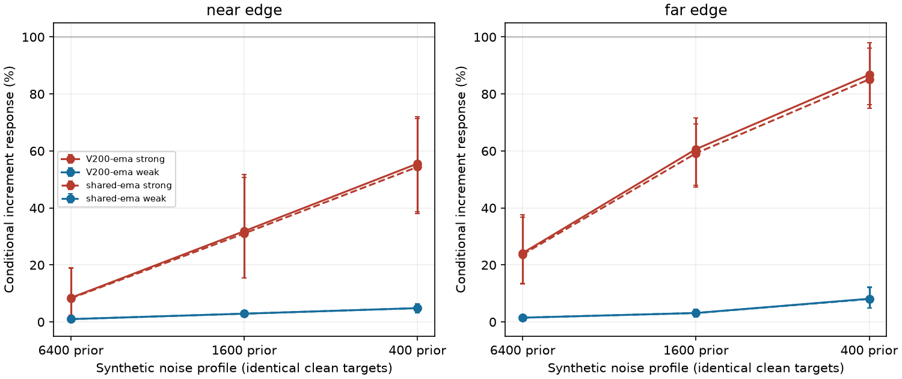
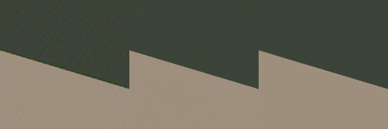
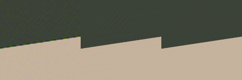

# Clearer measurements still favor the stronger wire family

The three-noise extension of the [finite-wire panel](near-edge-response.md) is
complete. **All clean targets, cameras and scoring masks match bit-for-bit**
across the lower-noise conditions. Strong-family response rises substantially;
the weaker family remains much more attenuated. Shared-edge training supplies
no clear improvement over V200 in this comparison.

These are 1,152 synthetic observations of the same eight sources, not 24
independent scenes or calibrated GFX captures. The original noisy condition is
retained. No checkpoint was trained or changed by this measurement.

## Noise, information and response

The normalized sensor priors below change shot/read coefficients while keeping
the exact clean image and exposure fixed. Every role/repeat has independent
noise, including between profiles. All four CFA layouts and both edge placements
remain present.

| Nominal prior | Shot / read variance | Median weaker sensor-pair oracle SNR, near / far |
| --- | --- | ---: |
| 6400 | 0.00128 / 6.5536e−6 | 2.15 / 2.79 |
| 1600 | 0.00032 / 4.096e−7 | 4.60 / 6.01 |
| 400 | 0.00008 / 2.56e−8 | 9.37 / 12.27 |

Oracle SNR uses the hidden true sensor increment, known shot/read coefficients
and approximate ADC variance. It is a diagnostic of known-template evidence,
not unknown-wire detection power, model confidence or a recovery guarantee.

| V200 EMA response (% of actual conditional increment) | 6400 prior | 1600 prior | 400 prior |
| --- | ---: | ---: | ---: |
| Near edge: strong family | 8.477 | 31.848 | 55.556 |
| Near edge: weaker family | 0.992 | 2.896 | 4.842 |
| Far edge: strong family | 24.181 | 60.637 | 86.741 |
| Far edge: weaker family | 1.496 | 3.133 | 8.140 |

Shared-edge EMA weaker response is 0.991/2.894/4.844% near and
1.495/3.117/8.037% far. It still slightly reduces strong-family response in these
conditions. At the 400 prior, quiet RMS is 7.74646→7.74902 DN16 near and
5.99346→5.99321 far for V200→shared EMA: the previously quieter operating point
does not improve every region/condition.

The horizontal line is exact 100% incremental amplitude. Intervals are 5,000
source-cluster percentile bootstrap draws, averaging CFA/repeat views within each
of eight sources. They are exploratory uncertainty intervals, not formal risk
control. Model differences use identical observations; comparisons between
profiles use fresh noise and the same clean targets.

The result supports investigating how the estimator allocates evidence between
competing structures. It does not prove that noise is irrelevant or that every
low-amplitude wire should be reconstructed at full strength.

## Native views and provenance

Noisy Malvar → **shared-edge EMA** → exact procedural GT, 400 prior. Each cell
retains 160×160 pixels from 512 context, ROI `[176,176,160,160]`, RGGB, repeat 0,
shot 0.00008/read 2.56e−8, display exposure 2/contrast 1 and shared source-specific
WB/matrix/sRGB display.

At lower noise the strong direction becomes clearer, particularly far from the
edge. The complete weaker crossing remains poorly reconstructed in the reviewed
views. All eight new near/far/source comparison boards were inspected:
[400 far0](images/edge-snr-ladder-v1/iso400-source0-far-comparison.png) /
[far1](images/edge-snr-ladder-v1/iso400-source1-far-comparison.png),
[1600 near0](images/edge-snr-ladder-v1/iso1600-source0-near-comparison.png) /
[near1](images/edge-snr-ladder-v1/iso1600-source1-near-comparison.png).
The retained arrays/manifests also contain the remaining near/far counterparts,
raw endpoints and correction-gain sweeps.

Shared EMA checkpoint SHA256:
`ad5fd84ea9b07cc2fc9bf671384c98fe8de5ff3f8257e6a29e8fb11ea59e4a9d`.
[Full source/ROI/noise/display and exact machine archives](results/edge-snr-ladder-v1/publication.json).
The same checkpoint's [standing real-photo review](shared-edge-comparison.md)
retains both protected GFX families, both cab profiles/JPEGs and independent
ISO100 references accurately labeled as qualitative references, not GT.

## Next measured intervention

An [input-only competing-family proposal comparison](competing-wave-candidates.md)
finds that the existing carrier bank often misses the weaker fundamental even
in the clearer condition. A completed matched training trial changes that allocation
while keeping the cache, initializer, parameter count, objectives and update
budget fixed. Its model-quality result remains unmeasured; candidate proximity
does not establish recovered detail or quiet-region safety.
