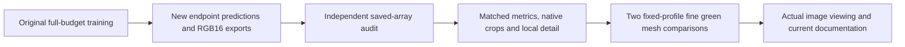

# Endpoint quality and native-image review

**Both active model pairs now have complete comparison and fine-mesh review
queues.** Their endpoint image quality remains unmeasured. The queues check
artifact correctness and prepare comparisons; they do not require positive
score changes or select a model automatically.

[Verified setup and repair evidence](results/endpoint-review-queues-v1.json) ·
[Saved-output comparison runner](../scripts/queue_quality_comparisons.py) ·
[RGB16 verifier](../scripts/verify_rgb16_exports.py) ·
[Fine-mesh runner](../scripts/queue_green_mesh_review.py).

Each dependency binds the exact original process identity and plan. A terminal
status cannot release work while its owner is still live, and an expired
observation window does not trigger a replacement training run. Partial outputs,
failed checks and executed source snapshots remain preserved.

## Matched comparisons

| Pair | Saved-output contrasts |
| --- | --- |
| V120/V121 data trials | V119→V120, V115→V120, V120→V121, V117→V121 |
| V122/V123 frequency scopes | V115→V122, V115→V123, V122→V123, V117→V122, V117→V123 |

Each contrast joins all 14,190 numerical observations, two native material
triplets and all six standing GFX regions. The local photographic-detail
analysis covers 427 sources, 5,124 source/noise/CFA cases and 96,075 unique GT
blocks. Those blocks and earlier controls are reused, not new independent
observations for each contrast. This work uses NumPy and saved arrays, with no
Torch, neural inference, noise generation or RAW decoding.

Each declared endpoint receives both complete 101.996MP TIFF hash, shape and
uint16 checks. Six native linear-camera regions are checked against exact
FP32 clip/round quantization: 460,800 channel values per endpoint, or 921,600
per pair. The sRGB exports receive file/type/shape checks; their native
quantization is not independently recomputed here. The verifier handles every
declared model and rejects missing/duplicate identities or regions.

The corrected verifier passes the already completed V114/V115 two-model exports
and all 921,600 native samples. The former one-model verifier rejects those
same valid files. The old waiting V120/V121 comparison controller was therefore
retired before producing comparisons; its files and retirement receipt remain
preserved. Training, endpoint prediction and independent-audit jobs continue.

## Standing fine green mesh

Both pairs also run the user-selected DSCF3842 ISO6400 / **DSCF3835 ISO100**
scene after the comparisons complete. This supplements the six main
DSCF3879/3880 regions. The two existing fixed noise profiles are:

| Profile | Shot | Read |
| --- | ---: | ---: |
| Nominal ISO6400 prior | .00128 | 6.5536e−6 |
| Previously measured nearby DSCF3879 profile | .0014635775921166604 | 1.0715704128646712e−6 |

The input-only profiles, observed 768px context, independent reference and
integer coordinates are fixed before new outputs exist. No profile search or
reference-dependent fit is performed. Both mesh regions remain 160×160 native
pixels. Matched nominal/nearby boards and noisy/restored/reference triplets
share +4EV display with recorded source, ROI, checkpoint, conditioning and
WB/matrix metadata.

Only new endpoints execute: two CPU IEEE-FP32 context forwards per model, eight
across V120–V123. Saved V115/V119 predictions are reused under both profiles;
the released RawNIND control is reused under the nominal prior. Model code comes
from each pair's actual frozen quality workspace. No original RAF is reopened,
new noise generated or control model rerun.

The separate DSCF3835 f/5.6, 2.5s capture precedes DSCF3842 by 46 seconds. Its
AHD RGB and camera JPEG are **qualitative references, not exact GT**. Camera
processing, aperture and moving subjects differ; no real-photo PSNR is computed.
These context comparisons supplement complete-frame evaluation, without
establishing full-frame mesh behavior or runtime.

The retained-control preflight forbids neural module calls. It reproduces four
existing V115/V119 native boards byte-for-byte and prepares four triplets with
zero neural calls, RAW decodes or new noise. Actual viewing and pixel checks of
the new endpoint outputs remain pending. Successful queue setup supplies no
evidence of improved lattice recovery.
