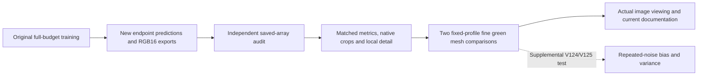

# Endpoint quality and native-image review

The [V131/V132 spatial trial](raw-spatial-training.md) also has a live full-panel
→ independent audit → matched native review → extra green-mesh queue chain.
All four new checks passed; production waits for V125's startup admission.
It uses the90,781/29 cohort and matched full-frame32px tile grids. Quality is pending.

**[V122/V123 full quality and selected native review](v122-v123-quality.md) are
complete; [V124's mean-loss control](conditional-mean-training.md) is training.**
V125 follows with the additional mean loss. Their complete comparison and
fine-mesh queues retain saved controls and original budgets. The original owners
exited after V123's memory guard; [explicit recovery and current queue roots](v123-memory-guard-recovery.md)
preserve completed work, all original failed receipts and remaining deadlines.
V123 completed20k and V122/V123 endpoint review is published after correcting
the legacy91-versus96-tensor identity assertion that stopped before any neural call.
The [repair receipt](results/v123-frequency-quality-identity-repair-v1.json) records
the current roots and adopted checks.
V120/V121 training, endpoint predictions and independent numerical
audits, four saved/local-detail contrasts and selected native review are
complete. V120/V121 mesh checks have no clear lattice-recovery gain over
V115/V119. V122/V123 endpoint review is now published; V124/V125 quality remains
unmeasured. The queues check
artifact correctness and prepare comparisons; they do not require positive
score changes or select a model automatically.

[Verified setup and repair evidence](results/endpoint-review-queues-v1.json) ·
[Saved-output comparison runner](../scripts/queue_quality_comparisons.py) ·
[RGB16 verifier](../scripts/verify_rgb16_exports.py) ·
[Fine-mesh runner](../scripts/queue_green_mesh_review.py).
[Completed V120 mesh and prediction adoption](results/v120-green-mesh-v1.json).
[Material-pair and conditioning repair](results/endpoint-material-and-conditioning-repair-v1.json).
[Completed native/local review](results/v120-v121-native-review-v1.json) ·
[Primary scores and native triplets](v120-v121-primary.md).

Each dependency binds the exact original process identity and plan. A terminal
status cannot release work while its owner is still live, and an expired
observation window does not trigger a replacement training run. Partial outputs,
failed checks and executed source snapshots remain preserved.

The [V124/V125 conditional-response supplement](conditional-noise-response.md#queued-trained-endpoint-comparison)
waits for the exact completed quality/mesh owners and evaluates only the new
checkpoints. It reuses all V120/V117 controls on the stored noise draws. Two
native exact-GT triplets per endpoint and separate single/mean8 boards accompany
the bias/variance statistics. This independent queue does not gate documenting
primary gains or change any existing job.

## Material selection and GFX conditioning

The original completed V120/V121 audit declared bark/raccoon-fur triplets, while
older audits declared bark/forest-canopy. The first report stopped rather than join
different examples. The builder now uses the candidate audit's declared pair,
reuses existing PNGs and renders only a missing control crop from its exact
saved FP32 prediction/supervision. Exact model/context/input/target bindings and
native noisy/GT pixels must agree. The original selections remain intact; no
inference, observation generation or output-based crop selection is added.
The [primary report](v120-v121-primary.md) corrects earlier repair prose that
misnamed these second sources. Source IDs and exact pixel bindings were always
matched; the original machine narratives remain preserved.

The next check found a **real main-GFX conditioning difference**. Older outputs
use the input-Haar coefficients `.0014635775921166604 / 1.0715704128646712e−6`.
The new evaluator's input estimator reports insufficient intensity span and
falls back to nominal ISO coefficients `.00128 / 6.553600000000001e−6`.
The source RAW/reference pixels, all six integer regions, WB/matrix and display
still match. This difference must remain visible when comparing saved pipelines.

The default matched-profile guard still rejects it. The new plans explicitly
allow a **labeled pipeline comparison**: image rows include their actual profile,
filenames say `conditioning-different`, and receipts flag that it cannot isolate
a model-only gain. All original RAW/reference/geometry/display checks remain
required. The additional V120/V121
[fixed-Haar complete-frame comparison](v120-v121-primary.md#matched-profile-full-frame-gfx)
now passes strict matching against older V115/V119 outputs, including every
five-argument input fingerprint before each forward. All six native regions,
both RGB16 exports per model and actual viewing are complete. Model differences
remain subtle, with continued foliage/neon detail loss. The supplied profile
skips estimation; it is an archived comparison convention, not revalidated camera
calibration. Current automatic ADC-floor handling and nominal outputs remain
preserved. This adds260 root/encoder calls and two shared cached RAW decodes;
primary panels and old controls are reused.
V120 versus V121 uses the same nominal profile. The independent primary/analytic
numerical joins remain matched, and the extra fine mesh uses its two fixed
matched profiles with V120 predictions reused.

Seventy-nine focused tests pass. The real saved-array proof reproduces both
original failures, prepares matched synthetic material crops, and renders all
six main GFX regions only after explicitly declaring the profile difference.
No Torch/model/noise/RAW work occurs. Failed executed sources/outputs are
preserved; only owned idle frequency report/mesh queues were retired to install
the proven reporting change. Training, endpoint inference and audits were
neither restarted nor signaled.

## Matched comparisons

| Pair | Saved-output contrasts |
| --- | --- |
| V120/V121 data trials | V119→V120, V115→V120, V120→V121, V117→V121 |
| V122/V123 frequency scopes | V115→V122, V115→V123, V122→V123, V117→V122, V117→V123 |
| V124/V125 independent-noise loss | V120→V124, V120→V125, V124→V125, V117→V124, V117→V125 |

Each contrast joins all 14,190 numerical observations, two native material
triplets and all six standing GFX regions with their conditioning disclosed.
The local photographic-detail
analysis covers 427 sources, 5,124 source/noise/CFA cases and 96,075 unique GT
blocks. Those blocks and earlier controls are reused, not new independent
observations for each contrast. This work uses NumPy and saved arrays, with no
Torch, neural inference, noise generation or RAW decoding.

Each declared endpoint receives both complete 101.996MP TIFF hash, shape and
uint16 checks. Six native linear-camera regions are checked against exact
FP32 clip/round quantization: 460,800 channel values per endpoint, or 921,600
per pair. The sRGB exports receive file/type/shape checks; their native
quantization is not independently recomputed here. The verifier handles every
declared model and rejects missing/duplicate identities or regions.

The corrected verifier passes the already completed V114/V115 two-model exports
and all 921,600 native samples. The former one-model verifier rejects those
same valid files. The old waiting V120/V121 comparison controller was therefore
retired before producing comparisons; its files and retirement receipt remain
preserved. Training, endpoint prediction and independent-audit jobs continue.

## Standing fine green mesh

Both pairs include the user-selected DSCF3842 ISO6400 / **DSCF3835 ISO100**
scene. V120's mesh predictions and actual viewing are already complete; later
family reports adopt those two predictions and run the remaining endpoints
after the comparisons complete. This supplements the six main
DSCF3879/3880 regions. The two existing fixed noise profiles are:

| Profile | Shot | Read |
| --- | ---: | ---: |
| Nominal ISO6400 prior | .00128 | 6.5536e−6 |
| Previously measured nearby DSCF3879 profile | .0014635775921166604 | 1.0715704128646712e−6 |

The input-only profiles, observed 768px context, independent reference and
integer coordinates are fixed before new outputs exist. No profile search or
reference-dependent fit is performed. Both mesh regions remain 160×160 native
pixels. Matched nominal/nearby boards and noisy/restored/reference triplets
share +4EV display with recorded source, ROI, checkpoint, conditioning and
WB/matrix metadata.

Only new endpoints execute: two CPU IEEE-FP32 context forwards per model, eight
across V120–V123. Saved V115/V119 predictions are reused under both profiles;
the released RawNIND control is reused under the nominal prior. Model code comes
from each pair's actual frozen quality workspace. No original RAF is reopened,
new noise generated or control model rerun.

The V120/V121 mesh queue adopted V120's two completed predictions instead of
evaluating it again. Adoption binds the exact observation, profile, completed
20,000-update execution, prediction and checkpoint hashes. The final report's
checkpoint SHA must agree even when its immutable copy has another path. Only
V121's two forwards then completed and were actually viewed. The previous owned idle mesh queue was
retired before producing predictions; all its original source and preflight
receipts remain preserved. V122/V123 retain their four planned mesh forwards;
their idle report/mesh dependencies were rebound to the repaired reporting code.

The separate DSCF3835 f/5.6, 2.5s capture precedes DSCF3842 by 46 seconds. Its
AHD RGB and camera JPEG are **qualitative references, not exact GT**. Camera
processing, aperture and moving subjects differ; no real-photo PSNR is computed.
These context comparisons supplement complete-frame evaluation, without
establishing full-frame mesh behavior or runtime.

The retained-control preflight forbids neural module calls. It reproduces four
existing V115/V119 native boards byte-for-byte and prepares four triplets with
zero neural calls, RAW decodes or new noise. Actual viewing and pixel checks of
V122/V123 endpoint native viewing and pixel checks are now
[complete](v122-v123-quality.md); V121's completed review is linked above.
A second preflight exercises the
actual frozen V120 adoption path with model construction and all neural calls
forbidden. Both +2EV boards, both +4EV boards and both triplets are byte-identical
to the completed V120 outputs. The
[actual V120 review](gfx-green-mesh.md#v120-after-correcting-the-paired-data-mix)
documents the remaining mesh loss without inferring a numerical quality ranking.
