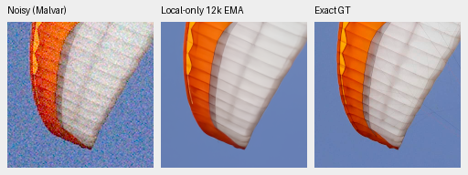
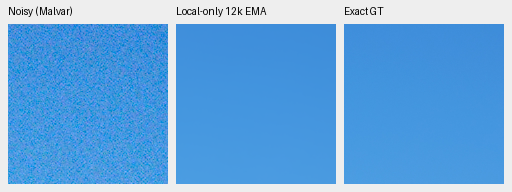

# Expanded scene training, local-only 12k endpoint

The local-only continuation improves the two fixed development conditions
by **0.09259 dB in shadows** and **0.08775 dB at ISO12800** versus its 100k
parent. Native GFX detail stays close to that parent. Fine suspension
lines and the finer cab fence crossings remain incomplete. The matched
spatial arm finished on the same observations. Its fixed synthetic
guide intervention shows little extra recovery from distant context.
[Completed spatial arm](expanded-scene-spatial12k.md).
[Checkpoint, realized training order and native results](results/expanded-scene-local12k-v1/publication.json).

## Endpoint and scoped scores

Experiment `expanded-scene-12000-v2 / none` starts with the completed
[100k EMA](full-corpus-long100k.md),
`87b96f3c487b9edaf1c477742b6c38f2a82cc6b20a94716d51cc8cf46a17a760`.
The evaluated endpoint is the **12,000-update EMA** in the checkpoint
`3eca5963cc49875b7e32e0e409870e88bf743b518d375b6b3346e8fce2f47ea2`.
It retains distinct raw and EMA weights. All 24,000 realized source IDs
match the fixed epoch order. Each source supplies four native 256×256
Bayer crops, for **96,000 examples** from the 90,692-image expanded scene
pool. The recipe uses the existing canonical sensor-valid objective and
frozen DINO. The worker reports 4,765.53 seconds of training. The subsequent
10-case native CPU collection takes 246.91 seconds including its input
and output handling.
[Matched recipe and corpus lineage](expanded-scene-corpus.md#matched-12000-update-continuation).

| Scoped development sRGB PSNR | V120 EMA | Parent 100k EMA | Local-only 12k EMA |
| --- | ---: | ---: | ---: |
| Shadows | 47.99155 | 48.03612 | 48.12871 |
| ISO12800 | 41.20822 | 41.33623 | 41.42399 |

Each condition averages eight crops across two development photographs.
All arms see identical retained Bayer samples, noise, CFA, WB and
camera transform. Mean rendered gradient error also falls slightly at
both conditions. The small development panel may include sources the
100k parent has seen. The fixed known and unseen camera
comparisons are complete with the paired spatial arm. Local-only
is −0.02934/+0.00040 dB versus its 100k parent on known/unseen measured CFA.
The fixed photo panel is collecting. [Fixed camera results](expanded-scene-12000-cameras.md).
The last completed broad three-panel endpoint is
[Corpus 20k](full-corpus-control20k-primary.md).
[Primary-panel history](performance-history.md).

## Native crops and standing GFX scenes

Both exact-GT triplets use the native ROI `[48,48,160,160]` inside
crop 0. The shadows canopy source is
`d4538e5aa578ec6de5ef2f5d253add05435a7211`, query origin `[388,458]`,
shot/read `0.00064/1.6384e-6`, exposure ×8. The ISO12800 sky source
is `7085fbd6e9a67c2965e7b40d8f43693ab6497ed1`, query origin `[992,402]`,
shot/read `0.00256/2.62144e-5`, exposure ×1. The full boards include
V120 and the matched 100k parent and apply the same display to all panels.
The canopy seams are close to both parents. Some of the thin suspension
lines from the exact target remain absent. The sky retains its smooth
blue gradient.
[Native source and display bindings](results/expanded-scene-local12k-v1/publication.json).

[Matched canopy board](images/expanded-scene-local12k-v1/development-0-shadows-crop0.png) ·
[Matched sky board](images/expanded-scene-local12k-v1/development-1-iso12800-prior-crop0.png).

The main DSCF3879 scene uses fixed native crops, shot/read
`0.00128/6.5536e-6` and exposure ×4. Sky stays smooth and the main fence
lattice stays coherent. Fine foliage and building hardware remain soft.
[Sky](images/expanded-scene-local12k-v1/main-overcast-sky-main-overcast-sky.png) ·
[Building](images/expanded-scene-local12k-v1/main-building-detail-main-building-detail.png) ·
[Foliage](images/expanded-scene-local12k-v1/main-foliage-main-foliage.png) ·
[Coarse fence](images/expanded-scene-local12k-v1/main-chain-link-fence-main-chain-link-fence.png).

The cab DSCF3842 crops use exposure ×16. Transferred conditioning keeps
more diagonal modulation than the nominal prior, close to the 100k parent.
Fine crossings remain incomplete. Independently demosaiced ISO100 and both
JPEGs are qualitative references. The four main views, four cab views,
four representative development boards and both triplets were viewed.
[Actual native viewing record](results/expanded-scene-local12k-v1/actual-viewing.json).

| Cab prior, shot/read | Native boards |
| --- | --- |
| Nominal, `0.00128/6.5536e-6` | [Left](images/expanded-scene-local12k-v1/mesh-nominal-fine-green-mesh-left.png) · [Right](images/expanded-scene-local12k-v1/mesh-nominal-fine-green-mesh-right.png) |
| Transferred, `0.0014635775921166604/1.0715704128646712e-6` | [Left](images/expanded-scene-local12k-v1/mesh-profile3879-fine-green-mesh-left.png) · [Right](images/expanded-scene-local12k-v1/mesh-profile3879-fine-green-mesh-right.png) |
