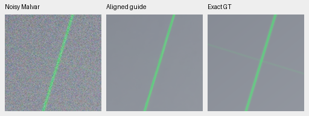
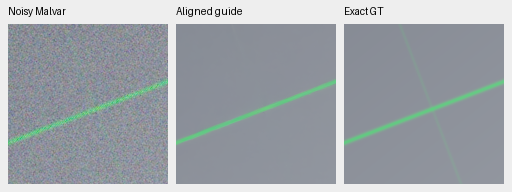
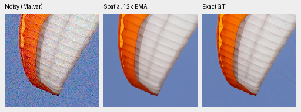
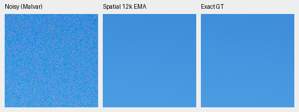

# Expanded scene training, spatial 12k endpoint

Both matched arms completed 12,000 updates on the same 24,000 distinct
photos. On a fixed synthetic weak-wire test, an aligned distant guide
raises ISO400 weak contrast recovery by 0.081 percentage points over the
neutral scene. It slightly lowers recovery and increases quiet-region error
at ISO6400. Matched native viewing finds smooth sky and visible coarse
crossings, with no clear new fine cab crossings or canopy cords. The broad
three-panel evaluation is collecting.
[Matched training and independently verified counts](results/expanded-scene-12000-v2/training-completion.json) ·
[Scoped intervention](results/expanded-scene-12000-v2/spatial12k-wire-gap.json).

## Matched training

Experiment `expanded-scene-12000-v2` starts from Corpus 100k EMA
`87b96f3c487b9edaf1c477742b6c38f2a82cc6b20a94716d51cc8cf46a17a760`.
Each arm uses 96,000 native 256×256 crops from the first 24,000 photos
of the 90,692-photo scene schedule. The arms share the sensor-valid
objective, frozen DINO, and exact Bayer, noise and crop observations.
Their full training traces match byte for byte. The spatial arm adds
the zero-initialized spatial adapter at eighth resolution.
[Recipe and corpus lineage](expanded-scene-corpus.md#matched-12000-update-continuation).

| Arm | 12k checkpoint SHA256 | Training time |
| --- | --- | ---: |
| Local-only | `3eca5963cc49875b7e32e0e409870e88bf743b518d375b6b3346e8fce2f47ea2` | 79.43 min |
| Spatial | `b5c8e776da2cf61b66fcf4a76ffc73df000145cdeb15bd14bd4a740949639183` | 85.75 min |

Each checkpoint file contains the raw and EMA weights. All reviewed
predictions use EMA. The spatial training took 7.97% longer. The training
timer excludes evaluation. [Original endpoint bindings](results/expanded-scene-12000-v2/matched-training.json).

## Distant guide with a fixed local RAW

All 32 local pairs and their exterior controls match the input fingerprints
of the [2k intervention](scene-wire-gap.md). Eight geometries and two draws
per geometry are tested at each noise profile. Within each case, the
neutral, aligned and orthogonal scenes give the model the same local Bayer
measurements. Only the surrounding RAW pixels differ. The spatial trunk
column bypasses the context adapter on the same weights. The local-only
column uses the independently trained matched arm.

| ISO profile | Policy | Weak response | Wire increment error, DN16 | Quiet RMS, DN16 |
| --- | --- | ---: | ---: | ---: |
| ISO400 | Matched local-only | 11.927% | 100.397 | 12.296 |
| ISO400 | Spatial trunk | 12.392% | 100.028 | 12.578 |
| ISO400 | Neutral | 12.129% | 100.197 | 12.550 |
| ISO400 | Aligned | 12.211% | 100.146 | 12.621 |
| ISO400 | Orthogonal | 12.155% | 100.185 | 12.598 |
| ISO6400 | Matched local-only | 4.414% | 107.829 | 33.078 |
| ISO6400 | Spatial trunk | 4.429% | 107.811 | 33.151 |
| ISO6400 | Neutral | 4.387% | 107.858 | 33.272 |
| ISO6400 | Aligned | 4.363% | 107.886 | 33.437 |
| ISO6400 | Orthogonal | 4.339% | 107.910 | 33.348 |

At ISO400, the aligned guide beats the orthogonal guide by 0.055 percentage
points and the neutral scene in 15 of 16 cases. It still trails the spatial
trunk with the adapter bypassed. The ISO6400 aligned guide improves on the
orthogonal scene in 15 of 16 cases, but trails the neutral scene and the
matched local-only arm. The mean absolute false-wire projection in absent
roles is 0.831% at ISO400 and 3.892% at ISO6400 under the aligned guide.
The earlier 2k trunk and guide had different weights. Their smaller
aligned-versus-neutral differences offer historical context.
[Per-arm summaries, retained inputs and executed code](results/expanded-scene-12000-v2/spatial12k-wire-gap.json).

The viewed crops show the strong green wire clearly. The faint crossing is
indistinct across policies, including under the aligned guide. The ISO6400
gap board shows no visible new wire and retains some background variation.
Both ISO400 triplets use ROI `[48,48,160,160]` in the 256-pixel native query,
RGGB, identity white balance and color matrix, ADC16 with black fraction
0.03, shot/read `8e-5/2.56e-8`, exposure ×1 and a common contrast of ×8.
The prediction is the spatial 12k EMA with the aligned guide.

[All policies for g0](images/expanded-scene-spatial12k-v1/iso400-g0-r0-wire-contrast8-comparison.png) ·
[All policies for g4](images/expanded-scene-spatial12k-v1/iso400-g4-r0-wire-contrast8-comparison.png) ·
[ISO6400 weak wire](images/expanded-scene-spatial12k-v1/iso6400-g4-r0-wire-contrast8-comparison.png) ·
[ISO6400 gap](images/expanded-scene-spatial12k-v1/iso6400-g4-r0-gap-comparison.png).

## Matched development and standing GFX review

The two conditions average eight native crops each from two development
photos. The parent 100k schedule may have included these sources. Every
arm sees the same packed Bayer input, CFA, noise and color settings.
The spatial EMA gains 0.01650 and 0.00442 dB over the matched local-only
arm. Its rendered gradient error is slightly higher in both conditions.

| Development sRGB PSNR | V120 EMA | Parent 100k EMA | Local-only 12k EMA | Spatial 12k EMA |
| --- | ---: | ---: | ---: | ---: |
| Shadows | 47.99155 | 48.03612 | 48.12871 | 48.14521 |
| ISO12800 | 41.20822 | 41.33623 | 41.42399 | 41.42841 |

The canopy retains the main seams and orange edge. Some thin suspension
lines visible in the exact target are still missing. The blue sky gradient
stays smooth. The two triplets use the native box `[48,48,160,160]`.
Shadows canopy source `d4538e5aa578ec6de5ef2f5d253add05435a7211` uses query
origin `[388,458]`, shot/read `0.00064/1.6384e-6` and exposure ×8.
ISO12800 sky source `7085fbd6e9a67c2965e7b40d8f43693ab6497ed1` uses query
origin `[992,402]`, shot/read `0.00256/2.62144e-5` and exposure ×1. Each
triplet uses the spatial 12k EMA and identical display across its panels.

[Canopy, all models](images/expanded-scene-spatial12k-v1/development-0-shadows-crop0.png) ·
[Blue sky, all models](images/expanded-scene-spatial12k-v1/development-1-iso12800-prior-crop0.png).

On the main GFX100S scene, the sky stays smooth and the coarse chain-link
crossings stay coherent. Leaf edges and fine building hardware remain
soft. With the transferred prior, the fine cab fence retains soft diagonal
modulation. Both 12k models miss many of the crossings visible in the
independent AHD and JPEG references. The spatial and local-only 12k outputs
differ by 1.98 DN16 RMS in the overcast sky, 9.79 in the coarse fence and
2.22–3.04 across the four fine cab views, measured in camera RGB before
display. These are model-to-model differences. The spatial native CPU
collection took 250.93 seconds for ten observations, including its input
and output handling. [Matched prediction, ROI and display bindings](results/expanded-scene-12000-v2/spatial12k-matched-native.json).

Main DSCF3879 uses shot/read `0.00128/6.5536e-6` and exposure ×4. Cab
DSCF3842 uses exposure ×16 under nominal `0.00128/6.5536e-6` and transferred
`0.0014635775921166604/1.0715704128646712e-6` shot/read. The main crop is
`[176,176,160,160]` inside each archived observation. The fine cab ROIs
are `[206,229,160,160]` and `[426,189,160,160]` within their common field.
The ISO100 captures and camera JPEGs are qualitative references across
different capture conditions. All eight boards were viewed at native size.
[Main sky](images/expanded-scene-spatial12k-v1/main-overcast-sky-main-overcast-sky.png) ·
[Building](images/expanded-scene-spatial12k-v1/main-building-detail-main-building-detail.png) ·
[Foliage](images/expanded-scene-spatial12k-v1/main-foliage-main-foliage.png) ·
[Coarse fence](images/expanded-scene-spatial12k-v1/main-chain-link-fence-main-chain-link-fence.png).

| Cab conditioning | Native comparisons |
| --- | --- |
| Nominal | [Left](images/expanded-scene-spatial12k-v1/mesh-nominal-fine-green-mesh-left.png) · [Right](images/expanded-scene-spatial12k-v1/mesh-nominal-fine-green-mesh-right.png) |
| Transferred | [Left](images/expanded-scene-spatial12k-v1/mesh-profile3879-fine-green-mesh-left.png) · [Right](images/expanded-scene-spatial12k-v1/mesh-profile3879-fine-green-mesh-right.png) |

## Review status

Scoped numerical evaluation and native viewing are complete on the synthetic
intervention, the two development conditions and both standing GFX families.
The fixed full427 and camera collector uses the matched plan with an explicit
checkpoint digest for each parent.
Its first preflight used the V120 preset digest for the independent 100k
control. The next used an older scene loader with the same assumption for
the two scene checkpoints. Both failed before case scoring. The corrected
attempt uses the bound parent hashes at both levels.
It passed one known-camera, one unseen-camera and one photo case and
launched the full fixed collection. [Admission and failed-attempt receipts](results/expanded-scene-12000-v2/matched-primary-admission.json).
The last complete three-panel comparison remains [Corpus 20k](full-corpus-control20k-primary.md).
[Broad panel history](performance-history.md).
