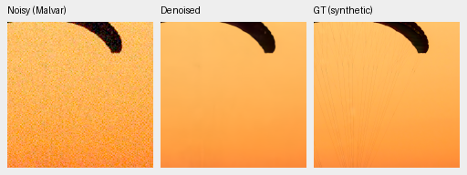
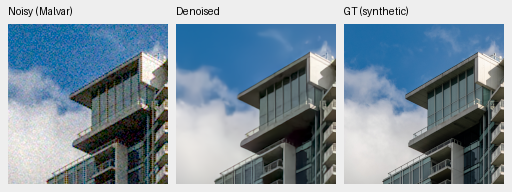
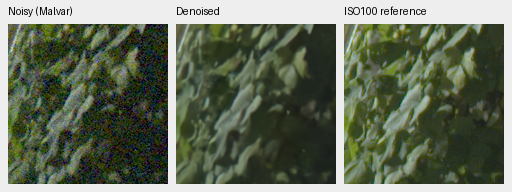
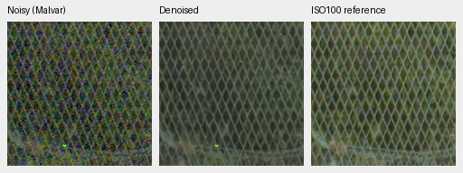

# V35: first review of the expanded Commons corpus

Adding 1,808 Commons training sources improves unseen measured-CFA PSNR by
**.04306 dB** versus the matched V32 control, but reduces the 16-photo synthetic
screen by **.06106 dB**. This first 1,000-step pilot does not establish a broad
quality gain. [Complete matched metrics and native-crop receipt](results/expanded-v35-1k-review.json).

Both arms start from the same V30 step1000 EMA with fresh AdamW/EMA, seed 46,
batch 16, LR 3e-5 / planned 3,000 steps and 25% paired / 25% native / 50% Commons.
Only Commons training membership changes: 40,170 → 41,978. Original 8× processing,
validation, native/paired manifests, runtime code and initializer hashes match.
All **27 logged paired/native observation-target hashes match**, from 41 logged
batches per arm. Commons draws change with the corpus; unlogged draws were not
separately hashed. Reserved/excluded sources, GFX/siblings and protected-final
are not training or transform-fitting inputs.

V35 checkpoint SHA256:
`09a491b65e618e5b33819717f57bf54f8b7dd520ce3108b8c888caeb71d65741`.
Dataset SHA256:
`38ac5fc61892ee31ddf841ad2b06ebf5ec68b6cb2196b4f7aa97b49775cbfb78`.
The [extension receipt](results/commons-extension-20261016-v1.json) retains
source licenses, duplicate screening and unchanged protected membership.

| Panel | Method | Measured-CFA PSNR | AHD RGB PSNR | AHD SSIM |
| --- | --- | ---: | ---: | ---: |
| Known4 | V32 original corpus | 54.22962 | 39.93072 | .930351 |
| Known4 | V35 expanded corpus | 54.25055 | 39.89707 | .930343 |
| Known4 | RawNIND channel CFA-LS | 54.08474 | 39.71710 | .928831 |
| Unseen5 | V32 original corpus | 53.76552 | 38.35791 | .917477 |
| Unseen5 | V35 expanded corpus | 53.80858 | 38.36566 | .919357 |
| Unseen5 | RawNIND channel CFA-LS | 53.76822 | 38.56191 | .922127 |

Known: 8 pairs / 72 crops; unseen: 10 pairs / 90 crops. Average crops/captures
within scenes, then scenes. V35−V32 unseen primary 95% scene-bootstrap interval
is **[+.00727,+.07886] dB**. Known primary is +.02092 dB with an interval crossing
zero. Unseen SSIM improves .001881 ([−.000018,+.004378]); its RGB PSNR difference
also has an interval crossing zero. This is one seed and two small development
panels. V35 exceeds RawNIND's unseen primary mean, but its auxiliary RGB PSNR
and SSIM still trail channel-calibrated RawNIND.

Primary references use registered low-noise measured CFA. Independently
demosaiced AHD RGB is an auxiliary reference, **not exact RGB GT**. Noise fits
and both RawNIND calibrations use noisy inputs only. Both calibrations and V30
are included in the complete receipt.

The same 16-photo synthetic screen changes sRGB PSNR/SSIM
35.15780/.960329 → **35.09675/.960338**. V35−V32 PSNR 95% source-bootstrap
interval is [−.12505,−.00066] dB. Four procedural sources change
33.09017/.973720 → **33.12291/.973387**. This candidate has no full427 or full
102 MP review; V32's completed full evaluation does not apply to these weights.

Noisy Malvar → V35 → **exact synthetic GT**, native 160×160 panels, ROI
[48,48,160,160] within each binned evaluation tile. RGGB, nominal ISO12800 prior
(`shot=.00256`, `read=.0000262144`), ×1 display, WB [2,1,1.5] and fixed protocol
matrix. No resizing; PNGs are 8-bit sRGB previews and metrics are unquantized.
The receipt records source/cache/checkpoint hashes, source/ROI, noise and display.

Fine canopy texture is still missing and cloud edges remain soft. Sources:
[Roy Egloff](https://commons.wikimedia.org/wiki/File:CH.VD.Villeneuve_2007-08-25_Vertigo-Swiss-Riviera_2392_3x2-R_4K.jpg)
and [Dietmar Rabich](https://commons.wikimedia.org/wiki/File:Vancouver_(BC,_Canada),_Coal_Harbour_Seaside_Park,_Blick_in_den_Himmel_--_2022_--_2158.jpg),
[CC BY-SA 4.0](https://creativecommons.org/licenses/by-sa/4.0/). Modified by linear
binning, cropping, simulated Bayer/noise, restoration and rendering; derivative
previews retain that license.

Standing GFX DSCF3879 ISO6400 → V35 → separate DSCF3880 ISO100 f/5.6.
Native 160px foliage [8890,5570] and fence [2240,6000] ROIs (reference fence
x2241), 512px context, shared +2 EV/WB/matrix and input-only prior
(`shot=.001463577592`, `read=.000001071570413`). Different aperture, time and
motion make the last panel a qualitative reference, **not GT**.

Foliage stays soft, mesh irregular, and a colored point persists. No decisive
visual gain is evident. All four regions and matched methods are retained in
the receipt. PNG hashes/dimensions, shared source/ROI/noise/display metadata and
identical noisy/reference panel bytes were checked.

V32 and V35 completed [the step2000 matched review](corpus-v32-v35-2k-review.md)
with their original schedules. The expanded arm improves known-camera means,
but its unseen primary mean declines versus first1k; both stop at this gate.
Neither arm changed geometry or data during continuation.
The [four-recipe pilot](training-pipeline.md#matched-corpus-and-augmentation-pilot)
will test the new augmentation separately after the complete 4× manifests freeze.
Protected-final remains unscored and the quality/speed goal remains open.
