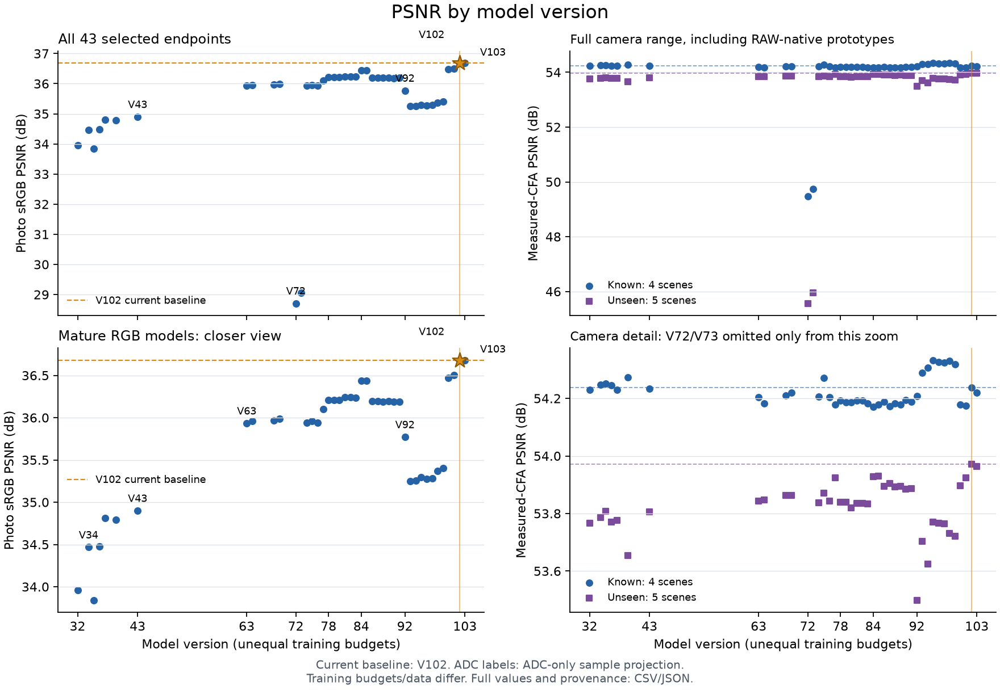

# Experiment index

The completed [V180 local phase-evidence comparison](local-phase-evidence-comparison.md)
raises mean mesh response **15.2–15.9% over global V178**, reaching 4.52–4.55%
of constructed GT amplitude with the same parameters and continuation recipe.
Quiet spatial RMS rises 0.76–1.05%; actual fine cab crossings and broad/fine
mottle remain unresolved. Both endpoints/all 822 cases and independent audits
pass, with 60 actually inspected native figures/12 triplets. Fifteen methods,
22 contrasts and 882 cells retain both V175 and all four V178 endpoints.
[Final evidence](results/v180-local-phase-evidence-final-v1.json) ·
[Local/global viewer](images/v180-local-phase-evidence-v1/native-viewer.html).

The completed [V181 flat spatial-error trial](flat-spatial-evidence-comparison.md)
keeps V180's architecture and original seven losses, adding one clean-target
spatial term. EMA quiet spatial RMS falls **0.47–1.15% on all 32 inputs versus
V180**, while mesh response falls **8.75% to 4.150% of GT**. It retains 5.78%
more mean response than global V178, with weaker natural fine-band response,
missing real crossings and persistent broad mottle. Both endpoints/all 822
cases, full 900-total/five-checkpoint audit, quality audit, two strict exports
and all 60 actual native figures/12 triplets are complete. Seventeen methods,
28 contrasts and 1,050 cells retain earlier strengths. The [implementation](flat-spatial-evidence.md)
preserves CPU/CUDA checks and preparation fixtures separately from actual quality.

The completed [V182 gradient-conflict diagnostic](flat-spatial-gradient-conflict.md)
uses ten fixed cached training batches at each completed raw V180/V181 state.
All 20 forwards/76 parameter backwards finish with no updates. Output flat/detail
gradients align on all 12 paired cases, while parameter gradients conflict on
10/12; fixed-denominator spatial descent opposes target-pair response on 12/12.
The independent CPU audit passes all 20 outputs/loss totals/masks, 140 geometry
matrices, 284 Adam denominators and 568 retained layer Grams. A variable-shadowing
failure in the first audit and the first plot layout remain preserved; no
scientific forward is repeated. Model-quality recommendations stay unchanged.

The [V183 bounded coherent pair-response loss](coherent-pair-response.md)
is implemented above the unchanged eight-term V181 objective. A 1-DN16 energy
floor limits pressure from vanishing differences; per-channel DC is removed.
All 25 focused CPU checks and the independent 20-native-batch replay pass:
53,477,376 output-gradient coordinates have zero observed FP32 differences.
Constant/orthogonal blind directions remain explicit. Actual admission now passes
two native updates,all142 finite/nonzero tensor gradients,6,291,456 CPU/GPU
output derivatives,both9term FP32 totals and model/Adam/EMA/RNG restoration;
both saved checkpoints pass strict CPU inspection. Matched900-update training
is running from V172 realAdam900/EMA and zero adapter. A live prefix checks514
totals;44 audit/14comparison/16publication guards and marked fixtures pass.
No trained V183 quality or actual new native viewing is claimed yet.

The completed [V178 matched phase-evidence trial](phase-evidence-comparison.md)
raises mean mesh response **0.92% over matched control**, reaching 3.924% of
constructed GT amplitude. Quiet spatial error rises slightly at both noise
levels; real fine cab crossings and broad colored mottle remain unresolved.
Both arms preserve V172's optimizer history and finish 900 further updates.
The independent audits pass all ten checkpoints, both full training traces,
3,288 review rows, 288 native arrays and 750 input-only evidence pairs.
All 72 native figures/24 triplets were actually inspected. Thirteen methods,
both V175 endpoints and 34 contrasts retain earlier strengths and costs.
[Four strict exports and final evidence](results/v178-phase-evidence-final-v1.json) ·
[Matched viewer](images/v178-phase-evidence-v1/native-viewer.html).

The completed [V175 fresh-noise continuation](fresh-noise-matching.md) reaches
9,000 total optimizer updates with 8,073 fresh sensor batches. Mesh response
rises only **0.03–0.05% versus V172**, reaching 3.878–3.879% of constructed GT;
raw quiet RMS falls **0.14–0.27%**, while EMA ISO12800 quiet RMS rises 0.21%.
Native512 flat results are mixed, natural band response slips and actual fine
cab crossings/mottle remain unresolved. Both endpoints, all 822 cases,
60 actually viewed native figures/12 triplets and independent audits are
complete. All 141 final Adam states are at 9,000; 8,100 recorded FP32 totals
match exactly, with no successful prefix repeated. The nine-method report
retains V161 detail and the earlier quiet/flat strengths. Strict exports and
[240 exact browser crops](results/v175-native-viewer-verification-v1.json) pass.

The [V180 local phase-evidence variant](local-phase-evidence-matching.md)
replaces global coefficient fields with locally measured, interpolated fields
at the same selected frequencies and parameter budget. All 112 focused CPU
checks and six cached native feature cases pass: 85,196,800 FP64 map values
match NumPy within 1.05e−12, and both V172 endpoints retain all 188 tensors
exactly beside one zero adapter. The first rounding-sensitive test expectation
and log are preserved. Actual CUDA admission now passes all 14 initial parity
rows, both 142-tensor gradient probes, restoration, 170,393,600 feature values
and 42,304 local powers. All 241 component events and two saved checkpoints pass
independent CPU inspection. The completed 900-update continuation preserves
V172's real Adam/EMA history and the same V178 recipe, retaining completed
V178 comparisons without rerunning them. Restored quality is measured above.

The [completed V179 local-support diagnostic](local-phase-support.md) measures
298,404 windows at 1,228 reused one-phase-selected bins. Local mean powers are
higher in mesh-containing footprints while blank means stay near 1; larger
windows gather signal but leave fewer pure blank footprints. Twenty CPU tests,
all input/journal bindings and 288 native independent QR rows pass. No model,
restored RGB, new noise or original capture is used; V175/V178 remain separate.

V178's [matched comparison and native viewer](phase-evidence-training.md#matched-tables-and-native-viewer)
now support both control/evidence endpoints with per-method checkpoint metadata.
The complete 13-method reused-value fixture and all 480 browser crops pass;
actual V178 quality now has separate completed scores and native views above.
Fourteen comparison tests pass, with
earlier detail/quiet/flat strengths retained in 34 contrasts.

A [four-pass V175 training-loss reduction](fresh-noise-matching.md#four-pass-training-losses)
finds mesh pair loss −0.094%, weak/photo pair losses +0.059%/+0.156%, and
standalone-flat anchor −0.558%. Photo flat-anchor rises 4.797%. These are
changing-model training means, not quality measurements. All 3,600 FP32 totals
and 350 independent Decimal means pass; training and final review stay fixed.

V178's [independent CPU audits](phase-evidence-training.md#independent-audit-preparation)
are implemented, with 34 checks, 2,000 adapted old trace rows, eight corruption
rejections and a real V172 checkpoint restore. These are auditor checks, not
new V178 quality results. The actual trial now passes both independent audits.

The completed [V178 one-pass matched trial](phase-evidence-training.md) implements control
and evidence training plus four-endpoint/822-case review. Real V172 checkpoint
proofs retain 141 old Adam states at 900 and zero new-adapter history; 13 CPU state
tests and frozen-entry gates pass. A marked CPU fixture checks 72 native figures/
24 triplets with reused V172/V174 pixels. Actual CUDA admission passes, and
both actual arms, four endpoints and native render are complete. Original
fixtures and their preserved rejection evidence remain separate from quality.

The completed [V178 CUDA admission](phase-evidence-admission.md) passes seven
native cases at both old endpoints: all 14 RGB comparisons are bit-exact, with
nonzero gradients on all 142 tensors in both probe updates. Model/Adam/RNG
restoration, CPU/GPU features and ADC invariants pass. Actual totals are 32
wrapper/frozen, 27 matching, 135 sampler and 15 projection calls; peak CUDA
allocation is 6.27 GiB. The two fresh-Adam probe checkpoints pass CPU inspection.
The matched trial separately restores V172's 900-update history. No V178 quality
result is established by this admission.

The [V178 model variant](phase-evidence-matching.md) is implemented and CPU
prepared, with a zero 80→39 measured-phase-evidence projection above V172's
matching features. It adds 3,120 weights, keeps the existing matching network
and frozen component, and applies no hard spectral cutoff or direct wave output.
All 68 CPU checks pass; native FP64 features match independent NumPy across
85,196,800 values, and both old endpoints retain all 188 tensors exactly.
The initial FP32 carrier-angle failure/source are preserved and fixed using
integer periodic phase, with unchanged tolerances. Actual CUDA admission now
passes and matched training plus full numerical/native quality are complete above.

The [completed V177 phase-split diagnostic](phase-frequency-evidence.md)
uses all 1,228 retained mesh member observations, selecting four frequencies
from each green CFA phase without target or other-phase selection inputs.
Primary other-phase nominal power≥16 occurs in 170/614 present and 0/614 absent
cases; power≥4 gives 231/6, with 303/71 when considering all eight records.
It misses many GT-conditional high-SNR cases and is not deployed as a gate.
All 33 CPU tests, 307 npz hashes, 1,535 used fingerprints, 9,824 journal bindings
and 384 independently selected/DFT-checked bins pass. No RGB restoration, neural,
noise or original-media calls; the fixed V175 recipe and model choices remain.

The [completed V176 conditional-template diagnostic](mesh-template-evidence.md)
analyzes all 614 noisy training mesh pairs at six context widths, using each
member's marginal RAW separately. Median green template SNR rises from 0.653
at native16 to 7.360 at native512; exact hidden templates/background/variances
are diagnostic inputs unavailable at inference. This produces no restored RGB
or new model-quality claim and changes no V175 training choices. All 2,456
input fingerprints, 307 parent arrays, 16 CPU tests, 48 independent QR fits and
7,368 window identities pass. Full rows remain on external storage, with
[source, plot points and verification](results/v176-template-information-v1.json)
published. The initial disk-reservation preparation rejection and first chart
render are retained.

The completed [V175 fresh-noise continuation](fresh-noise-matching.md) uses a
fixed nine-pass extension of V172: 8,100 additional updates/32,400 images,
8,073 fresh sensor batches/new frozen-parent roots, 27 retained noisy batches
and 900 ADC skips. Model, source/calibration/target bank and seven-term loss
stay fixed; training budget, noise realizations and learning-rate schedule
change together. All 1,000 input bindings are checked, including independent
Bayer reconstruction and explicit exclusion of three clipped-target cases
from re-noising. The v1 launch stopped before its training claim/CUDA work
because its snapshot omitted the sensor helper. That source, plan and log are
preserved; the new v2 frozen worker passes actual imports/strict CPU model,
parent and DINO loads plus 54 focused tests. No successful prefix was repeated.
Both endpoints/all 822 cases/native crops and final audits are complete above.
[Preparation](results/v175-fresh-noise-matching-preparation-v2.json) ·
[Actual frozen-worker readiness](results/v175-frozen-worker-readiness-v1.json).

The V175 comparison's array-only reduction checks all 822 old V161 EMA outputs
on identical current inputs/parents/ROIs and metric bytes. All 8,038 common
scalars match exactly with no neural/noise calls. The stronger 5.240%-of-GT
detail baseline and its quiet/flat costs enter the final nine-method tables.
The shared final training auditor passes on an actual 512-row prefix
(456 updates/454 fresh batches/1,820 events) and rejects eight corrupted copies.
Postprocessing sources, 378 table cells, 60 native figures and strict publication
checks are frozen before candidate quality; V172 uses its existing audited
label-only view. The local publication forecast rises from 0.2 to 0.4 GiB,
preserving earlier guards and receipt bytes.
[Postprocessing preparation](results/v175-postprocess-preparation-v1.json) ·
[V161 array audit](results/v175-V161-baseline-metric-audit-v1.json) ·
[Partial trace audit](results/v175-continuation-trace-audit-v1.json) ·
[Corruption rejection checks](results/v175-trace-auditor-rejection-checks-v1.json).

The [completed V174 spread-sampling experiment](spread-sample-matching.md)
changes only five existing offset bias vectors/60 scalar values at V172's model,
loss and cached inputs. Six observed coarsest p90 sample distances remain about
90.7 native pixels versus 12.04 for V172. EMA quiet total RMS falls
**0.12–0.17% versus V172**, spatial RMS 0.04–0.08% and DC error 0.36–0.43%.
Mesh response slips **0.25% to 3.868% of GT**; natural band response slips
0.016–0.023%. Full-flat changes are mixed and both coarse means worsen.
Native crops retain broad mottle and missing cab crossings. This is a small
quiet-color gain; V172 remains the balanced matching baseline.

Both endpoints/all 822 cases/60 actual native figures/12 triplets complete;
133 focused CPU tests, 900 updates, actual step-8 model/Adam/EMA/RNG restoration,
1,644 V169 replays and 144 ADC identities pass. Independent posthoc array checks
cover 36 selected cases; 30 captured offset tensors cover six primary EMA inputs.
Candidate matching work totals 2,404 CUDA calls plus six separate V172 baseline
probe calls. No CPU matching, parent/DINO, new source/noise or original/dataz
reads. The [viewer](images/v174-spread-matching-v1/native-viewer.html) verifies
240 displayed crops exactly. Original sources, receipts and checkpoints remain.

A separate posthoc [V175 shortcut probe](results/v175-local-shortcut-diagnostic-v1.json)
uses six head and six tail convolutions, with no full matching/frozen/sampler
forwards. Removing the matching pathway changes 18–84% of the added correction's
RMS on six selected inputs; that full correction is only 0.20–0.22 DN16 RMS.
Six saved corrections and compositions are independently checked. This rejects
complete bypass on the tested inputs, but does not isolate far samples or the
cause of missing detail. There is no trained V175 alternative or all-case ablation.

The [completed V173 gradient-loss experiment](weak-gradient-matching.md) lowers
EMA quiet spatial RMS **0.32–0.68% versus V172**, improving all 32 inputs. Quiet
total RMS falls 0.27–0.52%, and native512 total-flat means fall 0.25–0.30%.
**Mesh response falls 3.95% to 3.724% of GT**; natural fine-band response falls
2.63–2.88% on all 128 inputs. Broad mottle and real fine crossings remain
unresolved. Retain this modest quiet/spatial-error option alongside V172's
stronger response and V171's stronger flats. V172 remains the balanced matching
baseline for further detail work; V120 remains the general recommendation.
Both endpoints, 822 cases, 60 actual native figures, 12 triplets and scoped audits
are complete. All 162 focused checks pass (161 CPU tests and one CUDA stream
guard); no matching core or native sampler runs in that guard. An offline
[native-pixel viewer](images/v173-weak-gradient-matching-v1/native-viewer.html)
adds click/F-key flipping; all 240 browser crops match their PNG pixels exactly.

The matched 1,000-row schedule completes 900 updates/100 ADC skips and an actual
step-8 model/Adam/EMA/RNG restore without prefix replay. All six unchanged initial
loss terms and the mask reproduce V172 exactly on the actual first batch.
All 1,000 cache bindings, 900 independent NumPy FP32 loss totals, 141 Adam states,
1,644 V169 replays, 144 ADC identities and 6,576 actual input fingerprints pass.
Posthoc array checks cover 36 selected cases, 72 RGB plus 72 residuals. New
matching work totals 2,404 CUDA calls and no CPU matching-core calls; 2,548 frozen
component calls are nested, not parent/DINO calls. No new source/noise draws or
original/dataz reads. Preparation's import-order rejection and two unlaunched
follow-ups remain preserved, without a repeated scientific prefix. The precise
focused-test scope supersedes earlier broad CPU-check labels.

[Completed V172 local noise matching experiment](local-noise-matching.md)
reduces EMA quiet RMS **0.31–0.77%** and DC bias **1.33–2.55% versus V169**,
while mesh response rises **1.06% to3.877% of GT**. Quiet RMS falls21–24% versus
V171 and native crops show much less added purple/blue cast. Standalone-flat
full/coarse gains shrink to0.059–0.085%/0.021–0.050% versus V169; all48 inputs
worsen versus V171. Absent mesh RMS rises0.060% versus V169, broad mottle persists
and real fine crossings remain incomplete. Keep this local-unit variant beside
V171 flat,V161 detail and earlier quiet strengths; V120 remains the general choice.
Both endpoints/all822 cases/60 actual native figures complete;126 CPU checks,
900 updates,exact restoration,1644 V169 replays and144 ADC identities pass.
Independent posthoc metrics/addition cover36 selected cases,72 RGB+72 residuals.
An inherited output-label error is corrected by an audited derived view;original
records,arrays and frozen source remain unchanged,with no inference repeated.

The identical1,000-row V168 cache yields900 optimizer updates/100 ADC skips,
3,600 images and an actual step8 model/Adam/EMA/RNG restore without prefix replay.
New matching work totals2,404 CUDA calls and no CPU matching-core calls;2,548
frozen-component CUDA calls are nested,not parent/DINO calls. All6,576 quality
input fingerprints,900 NumPy FP32 loss totals,141 Adam states and both strict
endpoints pass. The three original CPU reporting failures are preserved;the
label correction changes only method strings/dictionary keys and reverses exactly.
All three scientific owners are terminal;no failed or repeated scientific phase.
No new source/noise draws,original/dataz reads or parent/DINO forwards.

[Completed V171 learned matching residual](learned-matching-residual.md): fresh
2.09M RGB correction above frozen V169 EMA and cached V143/DINO; same1,000 V168
rows,900 updates/100 ADC skips,actual step 8 restoration and no prefix replay.
EMA full-flat RMS −1.21–1.52%,coarse RMS −1.73% versus V169,all 48 inputs improve
in both measures; mesh response +1.26% to 3.885% of GT. Quiet RMS +26–31%,DC color
error +91–93%; real crossings remain missing. Both endpoints/all 822cases/60 actual
native figures/12 triplets complete. 114 CPU tests,141 final Adam states,900
independent loss totals and 900 inherited masks pass. All 1644 V169 outputs replay
exactly;144 ADC outputs retain V169. New matching work totals 2406 CUDA/3 CPU
calls;2548 frozen-component CUDA calls are nested,not DINO-parent calls. No new
parent/DINO,source/noise or original/dataz reads. All 6576 input fingerprints and
durable rows audited; separate posthoc new-array metrics/addition cover36 cases,
72 RGB+72 residual arrays. Two synthetic admission failures and one zero-forward
metric-import failure are preserved;all six recorded owners terminal. Retain the
flat gain beside earlier detail and quiet strengths,with explicit color costs.

[Completed V170 released RAW matching](nonlocal-raw-comparison.md): external
NLFeMF15.28M weights, one RAW call with two fixed RGB reconstructions. Native 512
coarse RMS −15.79–19.38% versus V169 EMA; quiet spatial RMS −6.26–32.71%.
Mesh response falls to 2.406–2.533% of GT; quiet total/DC error rises, ISO6400
total-flat error worsens17.67–19.03%, and all 72 ADC control inputs worsen with
visible periodic artifacts. All 822 cases/1644 RGB rows/60 actually viewed native
figures/12 triplets complete. Actual quality822 neural roots/4110 nested sampler
calls; admission separately adds2 CPU and 1 CUDA model call. No parent/DINO,
training, source/noise or original/dataz reads. 13 CPU tests, exact7-class ASTs,
CPU model parity, CUDA tolerance and 4 independent sampler fixtures pass.
All 3288 actual input fingerprints and durable journals audited; posthoc metrics
and NumPy reconstruction cover72 RGB/36 RAW arrays for 36 fixed native cases.
Both worker owners terminal; shape-preparation and missing-helper initialization
failures precede held-out calls and remain preserved. No repeated scientific
forward. External training data differ; keep this comparison and existing strengths.

[Completed V169 spatial balance](balanced-spatial-correction.md): fixed V168
weights;remove only the sigma8/radius24 native Gaussian component of direct RGB.
Quiet RMS −3.74–10.69% and DC bias −11.45–31.59%,with3.806–3.837% GT mesh response.
All48 coarse-flat errors worsen,total-flat means +0.389–0.705%,quiet spatial
+0.167–0.267%;local mottle/real crossings unresolved. Spectral-only/direct-only
ablations expose the broad-correction tradeoff. Both endpoints/all822cases/
72 actual native figures/24triplets complete.47 CPU checks,six CUDA filter cases,
1644 actual roots/exact original replays pass.6576 streamed method rows;216 new
full predictions plus72 corrections are saved for36 fixed native cases. Separate
audit checks19760 scalars and all saved native arrays;remaining new full outputs
were independently filter/norm-checked in process and not retained. Both review
owners terminal;one preparation assertion and one missing-import initialization
used no model calls. Resource pause resumed the same worker after70 byte-exact
fixture relocations,without repeating inference. Original evidence preserved.

[Completed V168 finer-wire training](fine-mesh-training.md): identical V167
heads/losses/init,171 changed mesh batches and829 archived input/parent adoptions.
Mesh response rises17.48–18.09%,to3.805–3.836% of GT; both-fine recipes gain
about59%,still1.8% of GT. All48 coarse-flat errors improve. Quiet RMS rises
1.49–5.44%,all32 spatial errors worsen,and total-flat means rise0.136–0.228%;
real fine crossings remain incomplete. Both1k heads/four endpoints/822cases/
72 native figures and independent audits complete. All288 CPU checks,94 Adam
states,1,000 exact V167 control rows/state and1,644 actual prediction replays pass.
Actual work5638 head roots/12688 images plus342 parent roots/1368 images;
342 DINO calls are nested. The915-step disk stop resumes the750 checkpoint,
replays165 completed rows exactly and finishes. Review adopts2770 completed
forwards and runs only518 unfinished cases after correcting the guard. All17
owners terminal; two model-stage guard stops,three dependent controller failures,
one recovery,no full-training restart. Parent-policy,read-only verifier and
publication-path corrections preserve original sources,logs and arrays.

[Completed V162 target-flat anchor](flat-target-anchor.md): identical V161
harmonic heads, only anchor weight 0 versus 0.25. Quiet spatial RMS falls
4.73–7.73% on all 32 inputs; total quiet RMS falls 1.68–5.29%, improving 26/32
inputs at both endpoints. Mesh response falls 20–22% to 3.846–4.112% of GT.
Native512 total flat RMS falls 1.28–2.55% versus V161; mean ISO12800 quiet bias
increases and real crossings stay soft. All four endpoints/822 cases/72 actual
native views, six retained columns and independent audits complete. 156 CPU
checks, 92 final Adam states, exact V161 trace/state/1,644 replays and all 1,000
independent mask checks pass. 5,364 actual head calls; zero scientific retries.
The auxiliary stale-path verifier failure and premature terminal-guard rejection
are preserved; no native viewing was credited before render completion.

[Completed V161 frequency context](harmonic-frequency-context.md): same V160
paired data/loss, plus 6,720 parameters. Mesh response rises 20.56–21.57% to
4.83–5.24% of GT; native512 coarse RMS falls 0.20–0.30% versus paired control on
all 48 inputs. Quiet RMS rises 4.99–7.37% versus control and 14.14–18.38% versus
V143. Fine colored/gridded grain and bias increase; real strands gain modest
contrast but crossings stay soft. All four endpoints/822 cases/72 actual native
views, independent audits and fixed context-removal diagnostic complete. 139 CPU
checks, 91 final Adam states and exact V160 trace/state/1,644 replays pass.
5,412 actual head calls, 1,668 new external arrays, 11 terminal original owners;
no new parent/DINO/source/noise calls, scientific failures or training restarts.

The [completed V160 paired-response trial](paired-response.md) nearly doubles
learned mesh response: +82–96% versus V143, reaching 4.00–4.31% of exact GT.
Blank RMS rises 3.25–4.69%, quiet RMS 8.46–11.36%, with added fine colored grain
and soft real crossings. Its ordinary new-data control lowers native512 full
flat RMS 0.42–0.53%, improving all 48 full/coarse inputs but regressing quiet
means 0.76–1.58%. Both 1k heads/four endpoints/822 cases/72 actual native views
and independent audits complete. 123 CPU checks, 450 frozen-base gradient
comparisons and final 90-state/four-load validation pass. The failed source24
counter and explicit 23-batch adoption are preserved; 1,000 parent/DINO batch
calls each and 5,364 scientific head calls, with no successful-parent replay
or full-training restart. Both protected GFX scenes/JPEGs remain qualitative.

The [completed V159 DC-transition trial](regional-dc-transition.md) changes only
the hinge transition1e-4→1, weight1 fixed, on identical hybrids. Clipped batches
fall726→101/882. Native512 full RMS improves0.27–0.39% and block32 0.17–0.19%
versus V143; all48 coarse inputs improve at both endpoints against V143/V158/V156.
Quiet total RMS instead rises0.18–0.48% versus V143 despite lower spatial error,
with larger color bias and weaker mesh response than V158. Fine real crossings
remain missing. Both1k heads/four endpoints/822 cases/72 actual native views and
independent audits are complete. 60 tests,90 finite final Adam states,four strict
loads and all1,644 exact V158 control replays pass. All10 original owners terminal,
5,364 scientific head calls,no restart. Keep the modest coarse/quiet compromise
beside V158's quiet strength,V156 detail and V157 larger coarse gain.

The [completed V158 regional-DC trial](regional-dc-regret.md) changes only the
training loss on two identical spatial hybrids. Quiet RMS falls 9.38–13.10%
versus exact V157, which had regressed substantially. EMA is 0.09–0.12% below
V143 on all 32 quiet inputs and averages 0.13–0.17% below retained V156 EMA;
two inputs still worsen versus V156. Mean color bias returns near parent level.
The cost is near-parent correction: standalone-flat full gain shrinks to
0.046–0.053%, block32 gain about 0.001%; mesh remains below V143/V156 and real
crossings stay missing. Both 1k heads/four endpoints/822 cases/72 actual native
views and independent audits are complete. 56 tests, four strict CPU loads,
90 finite final Adam states and all 1,644 V157 output replays pass. All 10 original
owners are terminal, 5,364 scientific head calls, no training/review restart.
One auxiliary CPU reporter failure and corrected revision are preserved.

The [completed V157 spatial-RGB trial](spatial-rgb-residual.md) adds direct coarse/DC
capacity with the same V156 loss/data/schedule and greater model capacity/compute.
Native512 flat full/coarse error improves on all 48 inputs at both endpoints, with
full RMS 0.94–1.10% below V143. Mixed quiet RMS instead rises 10.26–14.98%; native
views reveal stronger color casts, weaker response and missing fine cab crossings.
All four endpoints/822 cases/72 actual native views and independent audits are done.
45 tests and exact V156 control trace/raw/EMA/Adam/1,644 replays pass. A disk stop
and explicit user pause/resume preserve all evidence; training never restarted.
6,140 actual head evaluations include 748 repeated partial-review calls.

The [completed V156 local-regret trial](local-excess-risk.md) reduces actual
mixed quiet RMS0.30–0.63% versus exact MSE control on every input in both
endpoints. Mean parent-level regression falls 71–98%, but remains positive and
many cases are still worse than V143. Response retains5.59–10.52% gain over V143
while giving up 5.24–5.81% versus MSE. Full natural/flat/ADC results stay mixed.
All two1k heads/four endpoints/822 cases/72 native figures and independent audits
are complete.36 objective tests pass; control trace/raw/EMA/Adam/all 1644 replays
are exact. Local regret is the next learned-head control, with actual coarse
mottle and weak real crossings still unresolved.

The [completed V155 parent comparison](matched-parent-comparison.md) runs V143 and
V120 afresh on all 822 identical inputs, with zero training/noise draws. V120 has
lower coarse noisy-flat error but higher total noisy error and much worse ADC
slopes; mixed quiet gains do not remove spatial mottle or restore cab crossings.
All 1,644 paired outputs, independent metrics and 64 native views are complete.
The initial exact-archive assumption and two CPU reporting failures are preserved;
both parent collections completed once. Further work needs local spatial/coarse
error control beside weak-detail supervision.

The [completed V154 comparison](robust-spectral-objective.md) tests robust delivered
RGB spectral penalties. Native512 noisy-flat RMS falls 0.45–0.50% versus V143,
with lower actual mesh-blank error than matched MSE. Mesh/natural response
weakens and mixed quiet RMS rises 1.51–2.27% versus V143; broad mottle and missing
real cab wires remain. All three 1k heads, six endpoints/822 cases/96 native views
and audits are complete. All 1,644 MSE-control arrays reproduce V153 RGB exactly.
Retain the narrow flat-field gain, with no general inference change.

The [completed V153 loss comparison](delivered-spectral-objective.md) gains
6.04–7.97% mesh response over its matched pre-support control, with worse actual
blank errors, natural-band attenuation and ADC photo errors. Quiet results are
mixed; mosaic coarse slope error improves with a DC tradeoff. All three1k heads,
six fixed endpoints/822 cases/84 native views and independent audits are complete.
No convincing new real crossings or organic texture appear. The new output loss
is a stronger response prototype, with quieter/ADC strengths retained elsewhere.

The [completed V152 proposal/support crossover](support-crossover.md) evaluates
six fixed compositions on 822 cases, with 84 native figures and independent
metric, reconstruction and risk audits. Most added quiet-region MSE follows
the relative proposal under fixed original maps. Full support now raises mesh
response 16.17–17.91% over V143, reaching 2.56–2.60% of exact GT, with worse
actual blank/quiet errors and no convincing new real crossings. The older V147
intervention does not determine these updated proposals. Next test spectral
supervision on delivered output after support and demosaicing.

The [completed V152 relative-phase trial](relative-phase-estimator.md) improves
mesh response and noisy-flat RMS slightly over [V151 noisy-only training](noisy-objective-training.md),
with worse quiet errors and natural-band attenuation. Both trials' fixed
endpoints, native views and audits are complete. Keep the relative input feature
and quieter V151 control for further prototypes, alongside
[V150's stronger ADC photo restoration](objective-floor-training.md).

The [completed V147 late spectral pilot](late-spectral-detail.md) adds a learned
RAW-innovation correction after frozen V143. Both fixed 1k endpoints reduce mesh
response about 8% and slightly worsen noisy flats. The 32 new mixed controls show
small whole-scene gains with worse quiet regions. All 64 native figures and audits
are complete. A 766-case post-hoc support intervention exposes a worse frequency
proposal, rather than hidden useful recovery.

The [noise-scaled collaborative RAW probe](collaborative-detail.md) completes
694 cached comparisons: all 48 analytic flats stay unchanged, but weak mesh
remains missing and native building crops show new color blocks. Independent
metric/pixel audits and 17 published transfer figures are complete. It remains
outside inference. The completed [V138 frozen-parent trial](v138-quality.md)
has faint ADC +.00406 dB and noisy-flat spatial RMS −.15% against V120, with
no clear new mesh recovery. Its original 1,000 updates, all 150 quality inputs,
independent audits and 46 native-board views are complete. Baselines stay V120
for general use and V143 for faint/periodic research.

The completed [V144/V145 spatial pilot](v144-v145-quality.md) finds no useful
fine-detail gain at 1k: faint ADC −.00813 dB and noisy-flat spatial RMS +1.11% versus
the matched continuation. All 620 inference calls, independent audits and 154
native-board views are complete. Twenty-four new figures include exact
constructed-GT triplets, both protected real scenes/JPEGs, flats and organic
photos. The [photographic supplement](spatial-photo-supplement.md) is complete.
V143 remains the faint-detail study parent; V120 remains the general choice.

The new [supported-amplitude option](supported-wave-amplitude.md) keeps the
original positive global gate as selection and restores contrast only inside
unchanged reciprocal support. Fresh mesh response rises 26.4% and image RMS
falls 1.0% versus cross; mean/worst added blank RMS rise 42.1%/28.4%. All 256 absent
cases and 64 new photographic controls retain their parents. Full GFX mesh
contrast improves under both priors; nonperiodic texture, support seams, boundary
spill and highlight color remain unresolved. The explicit `detail` mode has
53 inspected native comparisons and complete RGB16 checks. V120 remains the general model recommendation. Detail is now the default
inside the explicitly enabled periodic stage.

The earlier [reciprocal green-support review](cross-phase-support.md) cuts fresh mean
added blank RMS 89% and its worst case 92% versus wide context, with 9.5% lower
response and 0.8% higher image RMS. Both full-frame mesh priors retain much of the
lattice. The known detached false patch is removed; weak/partial detail and
boundary spill remain. All 256 fresh absent neural cases retain parent values.
The explicit `cross` mode has 37 viewed native comparisons and complete RGB16
audits; it is a stricter support option, not a broad model-quality claim.

The [guarded wider-context option](wide-phase-context.md) uses actual 512-pixel RAW
contexts and measured higher harmonics on V143. Fresh 64-recipe response rises 14.4%
versus sparse support and image RMS falls 1.2%; mean added blank RMS rises 17.3%,
with a 17.4% lower worst case. All 256 absent neural cases and 5,120 ideal-flat
matched/mismatch executions retain parent values. The first unguarded version
failed the mismatch control and is archived. The explicit `wide` mode adds a
conservative variance floor; detached tail stripes, boundary leakage and very
weak recovery remain.

The [direct RAW refit experiment](raw-phase-refit.md) preserves eleven development
settings, an independent 64-recipe validation, solver limitations and 22 native
boards. It yields a small spill/detail tradeoff and remains a research tool;
the current inference recommendation is unchanged.

The [connected support/refit experiment](sparse-phase-support.md) adds stronger
fine-mesh contrast, 12.8% higher final held-out response and 34.0% lower mean added
blank RMS versus refined TV. Worst blank RMS rises 39.2%. The first failed trial,
removed isolated stripe, new independent validation, remaining amplified tail,
both complete-frame priors and RGB16 audits are preserved. The mode stays opt-in.

The [continuous frequency option](offgrid-phase.md) tests bounded updates to
fixed-bin TV, with modest real changes. Locked 64-recipe validation gives 3.7% higher response and slightly
lower texture error, with added blank RMS up 8.5%. All 256 absent observations,
4,096 extra flat-noise selector draws and wider tested sky bypass. New full-frame
native/GT/JPEG comparisons, solver diagnostics and compatibility audits are linked.

The [TV phase fit](edge-phase-envelope.md) gives clearer crossing mesh on complete
V143 frames. A locked 64-fresh-recipe review adds 512 actual root/DINO calls:
16 recipes activate, with 48.8% less mean blank spill than Gaussian phase fitting,
slightly higher texture error and some blank regressions. Tested wider sky and
fixed photo/uniform outputs retain parent values. Highlight changes, incomplete
solver convergence and speed remain limitations. [Earlier complex fit](complex-phase-envelope.md).

The [completed V1435k report](v143-final5000-quality.md) gains0.26493dB faint
ADC PSNR and4.64% lower noisy-flat spatial RMS versus V120, with coarse/ADC
costs and no clear new real-mesh recovery. The [local phase-aware correction](local-phase-harmonic-patch.md) now gives
stronger mesh on V143 patches with less blank-region spill in new validation.
Spill remains measurable. [Optional full-image tiling](phase-harmonic-inference.md)
now produces complete102MP RGB16 outputs; window sensitivity and CPU cost remain.

**V120 Small is the current general recommendation in V84's architectural family.**
Its photo/known/unseen means are37.04008/54.31272/54.00872dB, with ADC maximum55.52DN16.
[Completed primary/local/native results](v120-v121-primary.md) document the gains,
remaining detail loss and completed matched-profile main-GFX comparison.
V114 remains a useful Tiny alternative; V115 has higher known-camera quality
and V117 a slightly higher photo mean. In the earlier V114/V115 pair, Tiny has
slightly higher photo PSNR and lower color bias.
[Completed panels, native comparisons and full exports](v114-v115-quality.md).
Fine foliage/neon and dark-camera mottling remain weak. [V116 has completed full review](v116-quality.md)
to test fine weak sources and reviewed reference masks against matched V114;
eight-pixel carrier gain rises, but broad weak-material gain is unchanged and ADC tails worsen.
The [completed V117/V118 loss pair](v117-v118-quality.md) gives V117 a useful
single-view photo mean of37.04408dB, with slightly lower camera means and higher
ADC bias than V114. V118's band term lowers weak natural response and raises
worst ADC bias to843.05DN16. All numerical/native/full-frame review is complete;
the term stays off for further quality work.
The [V119 trial](cleaned-diverse-small-training.md) continued from
final V115 Small on90,791 cleaned Commons sources and the corrected83-ID paired
set with the original camera proportions. Its [complete review](v119-quality.md)
finds a+.06131dB photographic gain over V115, −.22342dB known-camera change,
and a large ADC color tail. Weak natural detail and real fine mesh remain soft.
All endpoint, independent, native and full-output checks are complete. The
[native development comparison](native-camera-development.md) also documents
the joint models' clearer detail than RawNIND on11 binned camera captures.

The [V120/V121 follow-up](paired32-weak-detail-training.md) keeps V115 Small,
restores corrected paired32 at V119's90791/six-region data, then tests the
reviewed90787/fourteen-region intervention. CPU/CUDA checks pass for both;
V120/V121 completed20,000 updates and independent numerical audits. The
[early V120 mesh review](gfx-green-mesh.md#v120-after-correcting-the-paired-data-mix)
shows no clear lattice-recovery gain over V115/V119, and V121's mesh remains
similarly weak. Saved/local-detail and selected native review is complete. The [report repair](endpoint-quality-review.md#material-selection-and-gfx-conditioning)
preserves material-pair differences and explicitly labels the older/new
main-GFX noise profiles. The additional
[fixed-Haar full-frame comparison](v120-v121-primary.md#matched-profile-full-frame-gfx)
now matches older inputs exactly, with subtle changes and continued detail loss.
[Completed primary means and native triplets](v120-v121-primary.md) show V120's
camera/color recovery and V121's remaining ADC tail.
The [V120/V121 camera-linear extension](native-camera-development.md#v120v121-extension)
adds480 new predictions on the frozen11-capture development set and reuses960
controls. V120 gains modestly over V115 and retains much finer texture than
RawNIND; V117 retains higher condition means and V121's changes are tiny.

The [V124/V125 mean-loss trial](conditional-mean-training.md) uses V120's
architecture and parent on the cleaned90,784-source/twenty-region corpus.
All four CPU/CUDA16+2 checks pass; V124's original20k control is complete and
V125's original20k training is running. Both arms use16 unique targets and32 simulated observations,
with mean-loss weights0/.25. [V12414k progress](v124-progress14000.md) finds
noisy/shadow PSNR+.008–.033dB, faint ADC−.350dB and no clear fine-mesh recovery.
Full endpoint and repeated-noise mean-loss comparison remain pending.

The [V1311k progress review](v131-progress1000-quality.md) compares the unchanged
V120 architecture on90,781/29 while its original20k training continues.
Ordinary PSNR rises.0016dB, deepest shadows fall.0237–.0342dB and faint ADC
falls.2734dB. Local detail is mixed, with no clear new fine-mesh recovery.
All102 predictions, independent score/pixel/faint audits and42 actual native
views are complete, including the corrected DSCF3835 and both camera JPEGs.
V132's branch/full-endpoint comparisons remain pending.

The [completed V136 global-attention pilot](v136-global-attention-quality.md)
matches all1,000 clean/noisy batches to saved V129 and adds exactly102 quality
forwards. Ordinary/shadow/faint means rise slightly over V129, but local detail
changes are mixed and no clear new fine-mesh recovery is visible. Native
triplets, both corrected GFX scenes and independent score/pixel audits are
published. V120 remains the general recommendation; no20k global run is queued.

The [completed V137 conditioned-global follow-up](v137-global-conditioned-quality.md)
normalizes matching after diagnosing almost uniform V136 attention. It shows
stronger query/key adaptation and faint ADC+.0334dB over V136, with ordinary/
shadows−.0005–.0044dB and mixed local detail. All102 new predictions, independent
audits and38 actual native views are complete. No clear new fine-mesh recovery
is visible; V120 remains the general recommendation. [Operator/mechanism](raw-global-conditioning.md).

The [completed V138 branch-only pilot](v138-quality.md) freezes all 91 V120
model/EMA tensors and trains the same 18 global tensors at LR1e−3. Its original
1k and 150-input quality review give tiny faint/flat gains over V120, without
clear new mesh recovery. All state/input/audit/native checks are complete. This
combines freezing and learning-rate changes.
The [trained-memory diagnostic](global-memory-contribution.md) now finds that
V137's local path dominates its added feature offset on six fixed training
contexts: removing memory write changes0.83–1.39% of branch RMS. Twelve branch
forward/backward calls and an independent50.3M-attention-weight audit are
complete, with no full-model/DINO work or final-RGB claim. The original V138
mechanism companion remains unmeasured; its image review is now complete.
V137 controls and existing training/full-quality budgets remain preserved.

The [V1239k frequency-feature midpoint](v123-midpoint-quality.md) now includes
16 material predictions and six GFX contexts, reusing47 saved controls. Selected
PSNR changes are tiny, and fine mesh/foliage remains weak. Its
[completed20k endpoint review](v122-v123-quality.md) now supersedes that progress
snapshot, with a small joint-arm photo gain and camera/color tradeoffs.

The [current V114 eight-view pilot](v114-eight-view.md) improves all12 fixed
material cases and both selected camera crops, with a small selected color-bias
tradeoff; independent/native review is complete and full panels/frame remain
unmeasured. The earlier [V112 eight-view pilot](v112-eight-view.md) retains its explicit
weights and unmeasured full-panel/frame scope.

[Current model choices and images](current-model.md) ·
[Current quality training](quality-first-training.md) ·
[PSNR history and full table](performance-history.md) ·
[GFX comparisons](gfx-qualitative.md) ·
[Experiment archive](experiment-archive.md).

The figure describes completed checkpoints with different architectures,
initializers, data and training horizons. It shows real progress; use the linked
matched studies when attributing a gain to a particular change.

The completed [V163 phase-input trial](harmonic-phase-inputs.md) lowers mean quiet RMS **0.62–1.19% versus V162** through 2.60–3.96% lower color bias. Spatial error rises slightly, mesh response falls another 0.52–0.59%, and all 48 coarse-flat errors worsen versus V162. Native fence crossings remain soft. All four endpoints, 822 cases, 72 actual native views and independent audits are complete; 180 CPU checks, 93 final Adam states and exact controls pass. The disk-guard failure and verified 268-call adoption are preserved.

The completed [V164 weak-pair floor trial](pair-unit-floor.md) gives **8.35–12.32% more mesh response and 0.28–0.52% lower coarse flat error versus V163**, changing only the pair-loss unit floor from16 to2 DN16. All48 native512 coarse inputs improve at both endpoints. Total-flat RMS rises0.27–0.39%, quiet means rise0.20–9.85%, and all32 quiet spatial errors worsen; real fine cab crossings remain incomplete. Both1k heads/four endpoints/822 cases/72 actual native figures and independent audits are complete. All199 CPU checks,94 final Adam states, exact V163 controls and all1,000 actual unit records pass. Retain the response/coarse gain beside earlier quiet/grain/total-flat strengths.

The completed [V165 pair-common trial](pair-common-error.md) lowers native512 full-flat RMS **1.35–1.91%** and quiet spatial RMS **6.22–8.69% versus V164**. Mesh response falls 49–50% to parent level, and quiet color bias rises 7.67–28.07%; real crossings remain weak. Retain the grain/total-flat option beside stronger V161/V164 detail and V158 quiet accuracy. Both 1k heads, four endpoints, 822 cases, 72 actual native figures and independent audits are complete; 221 CPU checks, 94 final Adam states, exact controls and all 2,000 recorded weighted loss totals pass.

## What the main experiment families established

| Family | Main finding | Evidence |
| --- | --- | --- |
| Geometry and original V43 | Geometry/PSF before the final 2× reduction helped the matched photo test. Diverse native targets and the full-resolution RGB/DINOv3 ViT-S model established the earlier ViT-S baseline | [V34/V36](geometry-corpus-v34-v36-review.md), [V43 step 2000](native-corpus-2k-review.md) |
| Larger Commons corpus and longer training | Established the stronger ConvNeXt-pyramid family; the isolated corpus expansion adds a modest photographic gain | [V63/V64 original20k](long-commons-v63-v64-original20k-review.md) |
| Color coordinates and supervision | Normalization, objective and camera-supervision changes produced tradeoffs | [V68/V69](normalization-v68-v69-original4k-review.md), [V74/V75](reconstruction-objective-first1k-review.md), [V76/V77](camera-supervision-first1k-review.md) |
| Compact RAW-native architecture | The completed mixed-batch experiment remains far below the mature RGB models on primary panels | [V72/V73](packed-isotropic-mixed16-quarter-review.md) |
| Directional, interval and bank heads | Several heads improve photographic means, with camera/detail tradeoffs; the simpler V84 family is stronger overall in the completed primary scores | [V78/V79](directional-interval-original4k-review.md), [V80/V81](directional-bank-original4k-review.md), [V82/V83](bank-detachment-original4k-review.md) |
| Native data and larger context | V84/V85 establish the36.44dB architectural reference continued by V101. The extra native captures have little matched effect; larger context is a separate small-effect comparison | [V84/V85](native-data-original20k-review.md), [V86/V87](training-context-original4k-review.md) |
| Spectral and late RGB refinement | Small matched mean gains or protected common weights did not fix weak detail; head-only V92 regressed | [V88/V89](spectral-original4k-review.md), [V90/V91](late-rgb-original4k-review.md), [V92](late-rgb-head-only-original4k-review.md) |
| ADC-only inference | With unchanged V104 weights, replacing only valid measured sites gains .2885 dB rendered PSNR across all 427 sources/all 1,708 CFA cases. Local chroma/SSIM regressions and a flat-color tail remain; positive-noise profiles bypass it | [Complete site-consistency comparison, actual export and native crops](adc-consistency.md) |
| Eight-view inference | Full427 photo PSNR37.04376dB; all 427 source means and4/4 known,5/5 unseen scene means improve over V104 single. ADC tail420.90DN16 remains worse than V112, with fine-detail/blotch weaknesses. Costs eight evaluations per tile | [Full panels, native examples and independent audit](dihedral-quality.md), [complete-frame comparison](dihedral-fullframe.md) |
| Fixed Tiny/Small output mean | Equal V115/V117 mean gives photo37.02408dB and camera54.31387/54.00195dB: an intermediate tradeoff, with no clear native GFX detail gain. All14,190 numerical cases reuse saved predictions | [Scores, two exact-GT triplets and six native GFX regions](fixed-tiny-small-mean.md) |

Each complete quality review retains source/checkpoint identities, native
noisy/restored/reference crops and explicit real-reference limitations. The
[chronological archive](experiment-archive.md) preserves the longer record,
including early versions, negative studies and engineering details.

## Data and current quality work

V100/V101 completed10k continuations from V84 on the curated88,484-source Commons cohort. One
retains V84's augmentation; the other tests zero optical PSFs, weak synthetic
textures, photographic contrast attenuation and reviewed fine-detail ROIs.
The architecture, broad flat palette, native128 and paired32 targets stay fixed.
See the [recipes, execution status and evaluation approach](quality-first-training.md).
V101 reaches **36.50347dB** on full 427, +.06351dB over V84, improving 418/427
source means and all seven condition means. Known/unseen CFA means remain close
to V84. The [completed primary report](v84-curated-quality-review.md) and
[current native gallery](heldout-detail.md) show gains and remaining smoothing.
V102/V103 completed their20k six/32-region comparison on88,477 sources. All seven
evaluation panels and full-frame exports finished. V102 improves425/427 source
means over V101; the six/32 ROI effect is small and mixed across diagnostics.
[Completed current results](v102-v103-quality-review.md). V104 completed 20k
from V102 on 90,872 sources with 2,395 eligible additions. It improves PSNR,
SSIM and gradient error in all 12 selected material cases; [native comparisons](heldout-detail.md)
are current; all seven evaluation panels and full-frame exports are complete.
[Source review and native examples](incoming-commons-quality.md).
The [complete paired training-reference audit](paired-reference-quality.md)
also prepares a narrow opt-in mask revision for two recurring red-speck
references, preserving useful flagged texture and the active data bindings.
The [completed V111/V112 loss-scale comparison](loss-scale-training.md)
uses the cleaned90,864-source corpus and original V104 EMA/gates. Both add about
.10dB on full427; V112 improves camera/color over V111 and supplies the
parent of current V114. The [primary report](v111-v112-primary-quality.md) and
[complete review](v112-quality.md) show native strengths and remaining limits.
The [completed Small transfer](small-feature-transfer.md) now uses V112 teacher
targets and cached training features. Photo means remain close, while two dark
camera crops lose .20–.32dB. Matched Tiny V114 / fitted Small V115 passed eight
actual CPU/CUDA updates each; [both have completed 20,000 updates](small-aligned-training.md).
[Complete quality review](v114-v115-quality.md) now selects Tiny for general
photo/color balance while documenting Small's known-camera/eight-pixel gains. The old idle V113 plan and evidence remain preserved.
Their [endpoint evaluation queue](quality-prediction-archive.md) retains exact
targets and native predictions across all numerical panels, with standing GFX
contexts and complete-frame exports; existing controls are reused.

The [clean-target frequency audit](fine-weak-texture-coverage.md) finds a narrow
gap in dedicated weak textures, while sampled photo/native targets contain
fine-frequency energy. The optional fine profile passes reader and actual V112
CPU training checks but has no trained-quality result and does not change the
completed Tiny/Small recipes.
The [V116 trial](v116-quality.md) has completed full review after that comparison,
combining the fine profile and reviewed paired masks while reusing completed
V114 as its matched Tiny control. Native256 mask-path/source/loss and actual
CUDA checks, complete evaluation, independent metrics and native review pass;
its analytic gain does not establish better natural-detail quality.

The latest [high-loss source review](v131-source-review.md) inspects40 new
IDs, retaining38 and withholding a painting reproduction and processed-looking
arch photo from a separate future90,774-photo/36-region bank. One mixed white-
plumage context is admitted; stronger rice-husk/wing/green-feather proposals stay
ordinary photos without specialized weak annotations. The ledger has2,003 inspected IDs; this is targeted review rather
than uniform corpus-quality coverage. Existing trained/queued cohorts stay fixed.
The [illustrated source review](corpus-source-review.md) explains why
processing defects/nonphotographic targets are removed while difficult foliage,
textiles and weak real detail remain. Originals and historical manifests stay
read-only; protected captures and the GFX scene/siblings remain outside training.

Earlier [V93–V95](v43-curated-original20k-review.md) showed cleaner-data and
weak-detail gains on the older ViT-S model. [V96/V97](v95-flat-palette-quality-review.md)
and [V98/V99](v95-adc-training-quality-review.md) expose palette/ADC tradeoffs.
The complete reports retain favorable and adverse results. They do not require
using V43 as today's baseline.

[Reviewed corpus](commons-post4557-reviewed.md) ·
[Archive status](commons-download.md) ·
[Augmentation and selected-domain loading](training-pipeline.md) ·
[Native targets](public-raw-expansion-v2.md) ·
[Source/series exclusions](commons-content-overlap.md).

## Reading the evidence

Current guides and README images reflect useful available implementations.
Versioned reports retain the experiments' numerical results and protocols;
original decisions and chronology remain in the timestamped [diary](../diary/index.md).
Source/scene intervals describe the sampled cases, not training-seed uncertainty.
Real AHD/separate ISO100 references are not exact GT.

[Full-frame RGB16 measurements](mature-cudnn-fullframe.md) remain specific to
their checkpoints. Quality has priority over further speed work.
[Documentation guide](index.md) · [Research](research.md) ·
[Remaining project goals](requirements.md).

The completed [V166 common-support routing trial](common-support-routing.md) reduces quiet RMS **6.10–15.27%** and DC color bias **17.52–31.30% versus V165**, visibly reducing the representative magenta casts. Mesh response stays near the parent and real fine crossings remain incomplete; all256 present-mesh mean supports remain below1e-4. Full-flat means worsen0.199–0.312%,coarse means0.216–0.376%,with all48 coarse inputs worse versus V165. Quiet means remain2.40–6.34% above V143. Retain this quiet-color gain beside V165 flat/grain,V161/V164 detail,V157 coarse and V158 quiet strengths. Both1k heads/four endpoints/822cases/72actual native figures are complete;238 CPU checks,94 final Adam states,exact V165 controls and independent audits pass. Original smoke failure and three discarded calls are preserved;no full-training restart.
