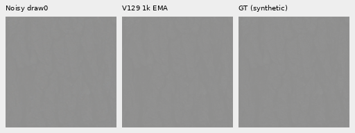
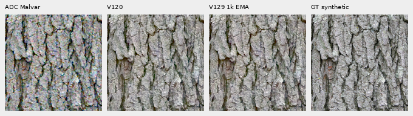
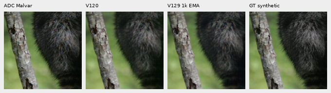
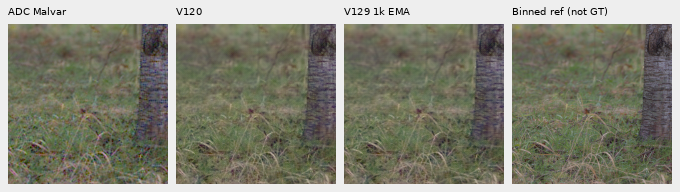
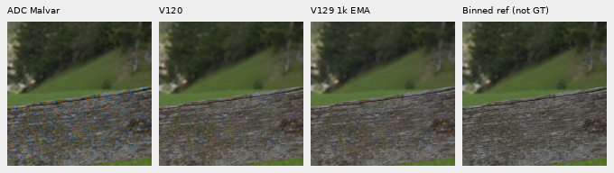

# Faint photographic detail at the ADC floor

**V120 and V129 retain substantial detail in a new faint ADC-only panel;
V129's changes are mixed. V130's FP32-trained endpoint is pending.**
This supplements the [precision-gradient diagnostic](training-precision-gradients.md)
and [matched training trial](training-precision-pilot.md). The current snapshot
contains32 of48 declared new predictions. It supplies no FP32-versus-BF16
trained-quality conclusion.

[Results, input/metric/display audits and checkpoint bindings](results/faint-adc-precision-v1.json) ·
[Primary four-CFA summaries](results/faint-adc-primary-summaries-v1.csv) ·
[Original-source detail strata](results/faint-adc-original-source-strata-v1.csv) ·
[Native image/source/ROI/display metadata](images/faint-adc-precision-v1/manifest.json).

## Fixed test and execution

The four existing bark, raccoon fur, grass and wood contexts receive a new
controlled contrast transform: retain each camera channel's whole256×256
spatial mean and scale deviations by.025. A fixed16-bit ADC, black.03,
shot=read=0 then samples all four CFAs. There is no spatial interpolation,
stochastic noise draw or RAW decode. These are deliberately faint processed
targets, not new real exposures. New observations require16 new V120 baseline
calls; old primary ADC input hashes did not match reconstruction from stored
targets, so those older predictions were not adopted.

Both completed methods made exactly16 IEEE FP32 root/encoder calls, preserving
their loaded weights/backbone and RNG. V129's full-model identity matches its
earlier86-call collection. The four source IDs are absent from all90,782 Commons
train rows,128 native training records and64 paired cases. The mixed manifest's
validation rows and native admission protected-ID lists remain excluded from
those actual training records. Four CFAs from one source are not four independent photos.

Independent preparation auditing verifies786,432 target values and1,048,576
ADC samples using long-double rational calculations. Independent mirrored-FFT
scoring checks32 metric rows/eight groups/200 scalar fields and2,150,400 native
channels in eight primary PNGs. V130 retains its original1,000-update training
budget and then receives these same16 inputs; the separate86-call high-noise/GFX
queue remains unchanged. No automatic retry or inference-budget reset occurs.

## Current results

| Source | V120 / V129 sRGB PSNR | V120 / V129 faint-band gain |
| --- | ---: | ---: |
| Bark |65.42593 /65.23982 |.99055 /.99212 |
| Fur |70.64078 /70.64100 |.95585 /.95619 |
| Grass, approximate native target |66.54368 /66.53548 |.99786 /.97774 |
| Wood, approximate native target |67.31228 /67.25270 |.97300 /.97383 |

These means describe four faint targets at+0EV. Their high PSNR is not comparable
to the full427-photo benchmark. All transformed eligible blocks fall below2%
local band contrast, merging originally strong and weak structures. Projection
near one does not by itself prove accurate detail: errors orthogonal to the
target remain.

These band metrics use linear-sRGB luminance, as in the retained material
reports. The training-gradient diagnostic's Q instead uses camera-RGB band
coefficients; the two diagnostics measure different quantities.

The existing **original-target** contrast bins provide a more specific fine-detail
view. Masks depend only on the reference before the.025 transform, remain
identical across methods/CFAs, and use the established DCT16 annulus1/8–1/3
cycle/pixel, luminance/gamut and RMS rules. This descriptive stratification was
derived after V120/V129 predictions and before V130 predictions. Independent
FFT coefficients and dot/norm reductions verify all360 fields, max5.92e−14 error.

| Original detail region | Blocks | Gain V120 → V129 | Relative band error V120 → V129 |
| --- | ---: | ---: | ---: |
| Fur,0–2% |7 |.85184 →.87003 |.28624 →.28712 |
| Fur,2–5% |5 |.83387 →.85593 |.31109 →.29770 |
| Grass,2–5% |3 |.96548 →.94039 |.24896 →.24865 |
| Wood,2–5% |9 |.88083 →.88079 |.18287 →.18379 |

V129 raises selected faint-fur response, with lower error in the2–5% region;
the lowest-contrast fur error rises slightly. Grass loses response and wood is
essentially unchanged. Actual native viewing finds small differences, without
a clear large recovery. V120 remains the general recommendation. The retained
ADC response argues against a universal faint-detail ceiling, while leaving
the noisy-material and real-mesh weaknesses unresolved.

## Native pixels and display

Normal triplets: ADC-only Malvar preview → V129 → exact processed synthetic GT,
RGGB, central160×160 at48,48,+0EV, common WB/matrix/sRGB, no resizing:

The following **display-only40× contrast** makes small differences visible.
It maps every method to `original camera DC +40×(value−DC)` before the identical
WB/matrix/sRGB transform,+0EV. The original reference defines a common DC;
no prediction or inference parameter is fitted. This approximately restores
the target's original display contrast and also amplifies ADC, demosaicing and
model errors. Scores above use the unamplified faint targets.

Columns: ADC Malvar → V120 → V129 → target. Each cell remains native160 pixels:

All four triplets and four enhanced boards were actually viewed. An independent
saved-PNG audit verifies all1,228,800 enhanced panel channels exactly. Two Commons
targets are exact for their processed synthetic operator; the two native-camera
estimates remain **approximate, not GT**. Bark: Derek Ramsey, CC BY-SA2.5;
raccoon: Korall, CC BY3.0; public RAW references: CC0. Source links, source/ROI,
both checkpoint hashes, ADC conditioning and every display parameter are in
the manifest. The real GFX pairs remain separate qualitative tests.

Queue/status:
`.cache/current-quality-20261023-v1/fp32-faint-adc-quality-v1/run/`.
