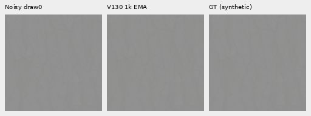
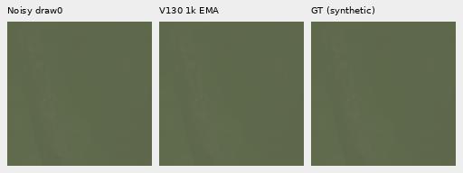
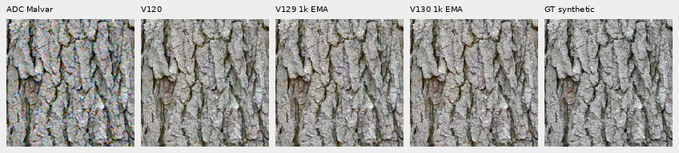
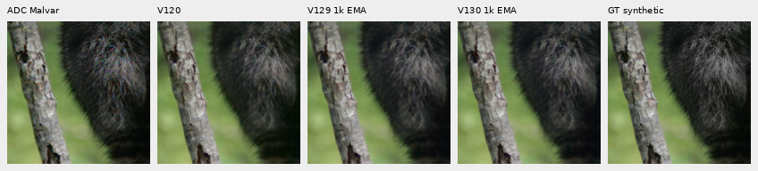
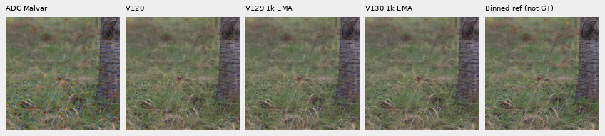
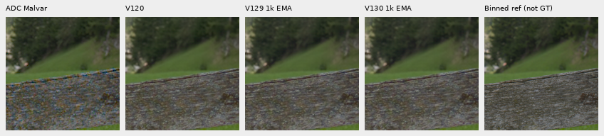

# Faint photographic detail at the ADC floor

**V130's FP32 training slightly improves selected weak fur, grass and wood
bands against V129's BF16 control.** Gain rises and relative band error falls
in each selected weakest original-source stratum. Global faint-target sRGB PSNR
falls0.01720dB, and visible changes are small. All three methods retain
substantial detail; this supports neither a universal faint-detail precision
ceiling nor a large high-noise/real-mesh recovery.
[The matched1,000-update training trial](training-precision-pilot.md) is complete.
V120 remains the general recommendation.

[Completed48-call result and audits](results/faint-adc-precision-v2.json) ·
[Primary four-CFA summaries](results/faint-adc-primary-summaries-v2.csv) ·
[Original-source strata](results/faint-adc-original-source-strata-v2.csv) ·
[Native image/source/ROI/checkpoint/display metadata](images/faint-adc-precision-v2/manifest.json).
The earlier [32-call publication](results/faint-adc-precision-v1.json) and its
images remain unchanged.

## Fixed test and execution

Four existing bark, raccoon fur, grass and wood contexts receive a new
controlled contrast transform: retain each camera channel's whole256×256
spatial mean and scale deviations by0.025. A fixed16-bit ADC, black0.03,
shot=read=0 samples all four CFAs. No spatial interpolation, stochastic noise
draw or RAW decode occurs. These deliberately faint processed targets are not
new real exposures. New observations required16 new V120 baseline calls;
the older primary ADC inputs did not match reconstruction from stored targets,
so their predictions were not adopted.

Exactly16 IEEE FP32 root/encoder calls per method completed,48 total, with
loaded weights, backbone and RNG unchanged. V129/V130 are the matched1k
endpoints; each full-model identity matches its standard86-call collection.
The four source IDs are absent from90,782 Commons train rows,128 native
training records and64 paired cases. Validation rows and protected-ID metadata
in the mixed manifest are excluded from actual training records. Four CFAs
from one source are not four independent photographs.

Independent long-double preparation verifies786,432 target values and1,048,576
ADC samples. Mirrored-FFT scoring checks48 metric rows,12 groups,300 scalar
fields and2,457,600 native channels across eight primary PNGs. The fixed40×
display's1,536,000 panel channels independently match exactly. No old inference
was repeated, and neither training nor standard86-call budgets changed.

## Results and original-source detail

| Source | sRGB PSNR V120 / V129 / V130 | Faint-band gain V120 / V129 / V130 |
| --- | ---: | ---: |
| Bark |65.42593 /65.23982 /65.25060 |0.99055 /0.99212 /0.99301 |
| Fur |70.64078 /70.64100 /70.58828 |0.95585 /0.95619 /0.95856 |
| Grass, approximate native target |66.54368 /66.53548 /66.50143 |0.99786 /0.97774 /0.97966 |
| Wood, approximate native target |67.31228 /67.25270 /67.25987 |0.97300 /0.97383 /0.97505 |
| Mean sRGB PSNR |67.48067 /67.41725 /67.40004 |— |

These high scores describe four deliberately flat faint targets at+0EV and
are not comparable to the full427-photo benchmark. All transformed eligible
blocks fall below2% band contrast, merging originally strong and weak detail.
Projection near one alone does not establish accuracy: orthogonal errors remain.
Band metrics use linear-sRGB luminance; the [gradient probe's Q](training-precision-gradients.md)
uses camera-RGB coefficients and measures a different quantity.

The **original-target** contrast bins provide a more specific fine-detail view.
Masks depend only on the reference before the0.025 transform, remain identical
across methods/CFAs and use the established DCT16 annulus1/8–1/3 cycle/pixel,
luminance/gamut and RMS rules. This descriptive stratification and V120/V129
results were published before V130 predictions. The final reduction adds V130
to those same masks; independently computed FFT coefficients and dot/norm
reductions check180 rows/45 groups/540 fields, max error6.97e−14.

| Original detail region | Blocks | Gain V120 → V129 → V130 | Relative band error V120 → V129 → V130 |
| --- | ---: | ---: | ---: |
| Fur,0–2% |7 |0.85184 →0.87003 →0.87913 |0.28624 →0.28712 →0.28590 |
| Fur,2–5% |5 |0.83387 →0.85593 →0.86250 |0.31109 →0.29770 →0.29647 |
| Grass,2–5% |3 |0.96548 →0.94039 →0.94348 |0.24896 →0.24865 →0.24706 |
| Wood,2–5% |9 |0.88083 →0.88079 →0.88446 |0.18287 →0.18379 →0.18292 |

FP32 recovers part of V129's grass response loss and improves the selected
fur/wood bands slightly. Wood's relative error remains slightly above V120's;
grass gain remains below V120's. These are small measured gains on four sources,
with no claim of statistical independence or broad architectural superiority.
Actual native viewing finds subtle changes without a large recovery.

## Native pixels and display

Normal triplets: ADC-only Malvar preview → V130 → exact processed synthetic GT,
RGGB, central160×160 at48,48,+0EV, common WB/matrix/sRGB, no resizing:

The following **display-only40× contrast** makes small differences visible.
It maps every method to `original camera DC +40×(value−DC)` before the identical
WB/matrix/sRGB transform,+0EV. The original reference supplies a common DC;
no prediction or inference parameter is fitted. This approximately restores
the target's original display contrast and amplifies model, ADC and demosaicing
errors. Scores above use the unamplified faint targets.

Columns: ADC Malvar → V120 → V129 → V130 → target. Cells remain native160 pixels:

All four triplets and four enhanced boards were actually viewed. Commons targets
are exact for their processed synthetic operator; native-camera estimates
remain **approximate, not GT**. Bark: Derek Ramsey, CC BY-SA2.5; raccoon: Korall,
CC BY3.0; public RAW references: CC0. The manifest records source links, ROI,
all checkpoint hashes, ADC conditioning and display parameters. Both real GFX
pairs remain separate qualitative tests, including corrected DSCF3842/DSCF3835.

Queue/status: `.cache/current-quality-20261023-v1/fp32-faint-adc-quality-v1/run/`.
[Publication/input continuity verification](results/v130-faint-adc-publication-verification-v1.json).
