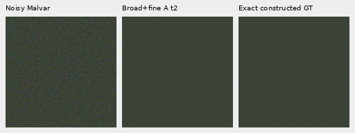
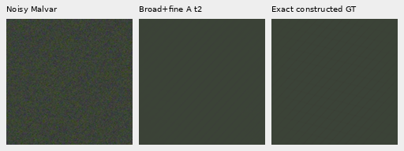
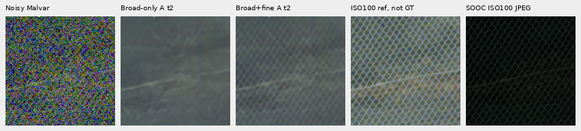

# Additional fine-frequency proposals for guided phase pooling

**Complete: fine cab structure becomes more visible, with false-colour costs.**
Adding a fine proposal pair to [neural-guided pooling](neural-guided-phase-pooling.md)
raises analytic1600/far weak response0.989%→2.037% with unchanged quiet error
and slightly lower increment error. Source1 drives that measured gain. Both
fine cab directions become more visible in both noise profiles/ROIs, but a
purple/green periodic grid prevents a faithful-mesh-recovery claim. Building
corrections and neural-nuisance1600 errors increase. The option is implemented
and off by default; V120 remains the general choice. The separate broad-only
[full comparison](neural-guided-phase-full-panel.md) continues unchanged.

[All44 native figures](images/neural-nuisance-fine-phase129-v1/native-viewer-with-extras.html)
were actually inspected on13 unresized contact sheets.
[Exact publication and197 receipt archives](results/neural-nuisance-fine-phase129-v1/publication.json)
preserve167 executed source files, the first failed unit test, both discovery
diagnostics and all original experiment receipts.
[Independent final source/pixel/summary/link verification](results/fine-phase129-publication-verification-v1.json).

The closed guided pilot's actual cab proposals are mostly0.016–0.03 native
cycles/pixel. The earlier [RAW-only green diagnostic](green-phase-spectrum.md)
found fine diagonal peaks around`(.117,.074)` and`(-.090,.074)` instead.
The current two broad-context maxima do not even propose those families.
This is a discovery limitation in these cases, without proving that finding
the frequencies is sufficient for faithful reconstruction.

An input-only diagnostic keeps the original broad candidate and projects all
its columns before searching an **additional** native radial1/16–0.24 band.
It uses the same green A samples, physical inverse-variance/Hann weights,
20-degree family separation and1.5-native-bin A/B matching. Both upper cab
windows recover both fine families in both folds, under both retained noise
profiles. Left upper seeds are approximately`(-.08984,.07227)` and
`(.11523,.07227)`; right upper seeds approximately`(.11719,.07227)` and
`(-.09180,.07227)`, with0–1-bin interfold distances. Lower windows select
other structures and have less agreement. No parent, GT, reference or neural
arrays enter this diagnostic. The13 original broad geometries reproduce
exactly; no new sensor noise, RAW decoding or model inference occurs.

The initial diagnostic also proposes nearby sidelobes or harmonics of already
represented constructed carriers. The revised rule excludes angular families
whose original coarse carrier is already in the fine band, and integer
harmonic neighborhoods with radius`h*1.5` native bins. This reflects frequency
displacement growing with harmonic order, **not calibrated uncertainty**.
It retains both upper-cab families and yields no matched extra pair in the two
400/far constructed controls. The revision is an adaptive development decision
after that diagnostic, not a blinded or pre-registered validation result.

The [implementation](../src/demosaic/fine_carrier_proposals.py) retains the
original broad pair **and its delivered correction**. It discovers/refines two
extra fine carriers after projecting the complete broad design. Their global
nuisance includes the original broad carriers, plus the declared analytic or
neural background. Each fine direction gets its own A/B matching, per-color
conditional validation and native129 guided phase kernel; RAW and parent use
the identical fixed linear map after scoring. Original raw-H1 controls remain
unchanged. If either fold cannot supply a distinct admissible pair, that tile
keeps the broad-only output. Extra candidates do not confer confidence or
guarantee freedom from duplicate profile energy or false texture.

The added band never replaces the broad search: the27.69-pixel fundamental
remains available below1/16. Exclusions can miss valid collinear structures;
this is a fixed candidate-budget experiment rather than a completeness bound.
Fine conditional tests use the original broad **H1 design**, not a joint
refit of the final nonlinear phase profiles. That limitation and actual
quiet/increment/real-artifact costs must remain visible.

Use `restore_neural_nuisance(..., aggregation_config=PhaseAggregateConfig(
bins=32, window=129, query_stride=32), phase_guide=True,
reselect_frequencies=False, add_fine_carriers=True)` with the existing
Hann512/full-frame geometry and two genuine A-only neural background fields.
`conditional-*` names analytic nuisance and unprefixed modes neural nuisance;
both use the same own-color neural guides and keep separate RGB amplitudes.
The option is off by default. No fine proposal/reference geometry is supplied
by the caller or read from a low-noise image.

The reused adaptive cohort is unchanged:36 finite roles from two RGGB/repeat0
sources × near/far × three priors, plus12 material/protected contexts. All88
neural fields were adopted with zero fresh neural/DINO calls. All48 corrections
closed before new GT/reference quality analysis. Fixed0/2/4 thresholds are
retained; the primary scientific contrast is analytic broad+fine localt2
against the completed guided broad-only analytic arm. Neural nuisance and
original H1 controls remain visible. No generalization or calibrated risk
claim follows from this development cohort.

The primary localt2 analytic comparison uses identical stored inputs, parent,
geometry, guide fields, thresholds and display transforms. Response is projected
amplitude relative to exact GT, not percent accuracy. DN16 errors below are
means across the two sources; no significance/generalization claim follows.

| Cell / analytic variant | Weak response | Strong response | Quiet RMS DN16 | Weak-increment RMS DN16 |
| --- | ---: | ---: | ---: | ---: |
|400/far parent V143 |0.95794% |33.78291% |4.008575 |11.788630 |
|400/far guided broad-only |28.70178% |75.33408% |4.030275 |11.677129 |
|400/far broad+fine |28.70178% |75.33408% |4.030275 |11.677129 |
|1600/far parent V143 |0.98266% |0.84934% |5.550811 |15.538719 |
|1600/far guided broad-only |0.98935% |49.75416% |5.551996 |15.621053 |
|1600/far broad+fine |2.03712% |49.75416% |5.551996 |15.616328 |

The400/far result is retained exactly, rather than a new improvement from the
fine band. Analytic1600/far increment error falls0.03025% versus broad-only,
but remains0.49946% above parent; quiet remains0.02134% above parent. Full
role2 RGB RMS falls28.473860→28.470970 DN16. Source0 stays at weak1.35355%,
increment10.840135 DN16; source1 rises0.62516%→2.72069%, with increment
20.401971→20.392522 DN16. Both source quiet errors are identical. Other five
analytic noise/placement means are unchanged. Most weak detail remains missing.

Neural nuisance has a worse cost:1600/far weak0.98711%→1.84941%, quiet
5.595190→5.604294 DN16, increment16.035578→16.532969 DN16. The latter is
6.39853% above parent, versus3.19756% before.1600/near increment is2.34794%
above parent. Neither the extra candidates nor conditional validation prevents
these errors. Fixed0/2/4 curves and both nuisance arms remain in the viewer.

Noisy Malvar → broad+fine analytic localt2 → exact constructed GT:

These are512-native constructed sources0/1, RGGB, repeat0, two-direction
role2, recipe seed202611160500, ROI`[176,176,160,160]`. Native160 crop pixels
are unresized; display exposure2/contrast1 and saved source WB/matrix apply
identically to all methods/GT. Conditioning is shot/read`0.00032/4.096e-7`,
source exposure1. The unchanged400/far exact-GT controls retain
[source0](images/neural-nuisance-fine-phase129-v1/triplets/iso400-index0008-role2-analytic-triplet.png)
and [source1](images/neural-nuisance-fine-phase129-v1/triplets/iso400-index0024-role2-analytic-triplet.png),
same ROI/display, shot/read`8e-5/2.56e-8`.

Configuration/source SHA256:
`7bbe985c51e8cd20d679e7ea09a037222f209541427ce68520021c9a86aef092`.
Procedural V143 parent checkpoint:
`96d146d017c54196288c585f8b7eddcf030e8a235061049c31e985b9380b7ce4`.
Photographic V120 parent/frozen A-only teacher checkpoint:
`a9d9b6b4f974e24a6b11e5e740aab32314233a7f53c056cf37c7d2aac1c589fb`.
Official DINO backbone:
`691963f0f796aac860d818d59d9d14287a4675612829fbe9467c7f5df8ce5b14`.

Both standing GFX families remain included: DSCF3879/3880 sky, building,
foliage and coarse fence; DSCF3842/3835 fine cab mesh, both noise profiles,
left/right ROIs and both JPEGs. References differ in aperture/exposure/motion;
ISO100/AHD views are qualitative, **not exact GT**, and receive no pixelwise
scoring. All media stay cached/read-only and captures/JPEGs/siblings outside
training. No new source observation, noise realization or learned-weight
update is introduced.

The following direct native board compares noisy Malvar, analytic broad-only,
analytic broad+fine, independent ISO100/AHD reference and ISO100 SOOC JPEG.
The new lattice is easier to see, especially on the right, with conspicuous
purple/green chroma and overly regular structure. It remains much weaker and
less faithful than the independent reference. Those different captures do not
identify an exact per-pixel error.

[Nominal left](images/neural-nuisance-fine-phase129-v1/cab-before-after/mesh-nominal-left-before-after.png),
[fixed nearby-camera profile left](images/neural-nuisance-fine-phase129-v1/cab-before-after/mesh-profile3879-left-before-after.png)
and [right](images/neural-nuisance-fine-phase129-v1/cab-before-after/mesh-profile3879-right-before-after.png)
show the same visibility/artifact tradeoff. Crop coordinates in the retained
scene are left`[206,229,160,160]`, right`[426,189,160,160]`, exposure16/
contrast1. The disclosed nominal shot/read is`0.00128/6.5536e-6`; fixed
nearby-DSCF3879 input-Haar profile is`0.0014635775921166604/1.0715704128646712e-6`.
Neither is a dedicated flat/dark calibration. Both profiles were retained,
with no output-selected noise sweep. Original seven-cell cab boards in the
viewer retain **both** SOOC JPEGs and both restoration arms, with matching
transforms and provenance; direct boards add the broad-only analytic control.

Scene-wide maximum160×160 correction RMS from V120 rises for analytic
nuisance: building130.593→148.908 DN16, foliage8.224→11.757, coarse fence
64.133→71.753, cab nominal15.037→23.978 and nearby profile15.578→18.664.
The exhaustive scans select each method's own maximum after inference without
loading real references. These are **correction magnitudes, not reference
errors**, and the maxima may occur at different coordinates. Retained identical
building ROI`[76,260,160,160]` rises114.308→129.409 DN16. Neural building
55.198→59.693 and cab7.238/8.535→23.597/17.792 likewise rise. Native stress
views retain the residual building colour/dark bands. Sky remains unchanged;
foliage/bark/fur stay soft. A visible grid alone does not establish correct
colour or wire reconstruction.

The new operator tests discover two known fine families independently of
broad carriers on all four CFAs, check actual NaN withholding, direct weighted
fits, original coarse-span removal, identical parent projection, no-match
fallback and actual nonzero fine delivery without changing H1. Eight new tests
and116 existing regression tests pass together:124 tests,27.29s; Ruff passes.
The first targeted suite exposed a
valid32-pixel case with no admissible pair; its failure is preserved and the
broad-only fallback is now tested. No inference run was restarted.

All288 original H1 outputs match the broad-only guided run exactly. Phase
arrays are unchanged in419/432 finite-wire,64/72 material/ADC,15/48 main-GFX
and0/24 cab comparisons across methods/thresholds. The independent output audit
checks3819 fields,228 finite and114 material metric rows, and14,131,200 encoded
channels; maximum discrepancy2.89e-15. The original38-figure preparation,
viewer and11-sheet manifest remain byte-exact; six later figures, a combined
viewer and two additional sheets are separate addenda.

Two-thread correction takes725.28s versus384.33s broad-only. The extra proposal
search/fit/operator work is not optimized and this is not a100MP speed claim.
No learned weights changed. An appropriate next comparison is a frequency-
limited fine-carrier reconstruction with the broad branch held fixed, plus
coloured fine-wire exact-GT controls. The [sinusoidal fine control](fine-sinusoidal-carriers.md)
now completes all48 cases/46 actual native figures: NN1600/far increment
−3.017% versus fine phase with less response, analytic response/error worsens,
cab colour grid persists and building bands increase. High profile harmonics and CFA ambiguity
are possible explanations for the chroma grid; this trial does not isolate
their cause, and shared green geometry does not justify forcing equal RGB
amplitudes.

Frozen plan:
`f449c205912fca318003dd3644dc4e957fd1b6907a6bc414882560515e6fdacc`.
Root: `.cache/experiments/neural-nuisance-fine-phase129-pilot-v1/`.
