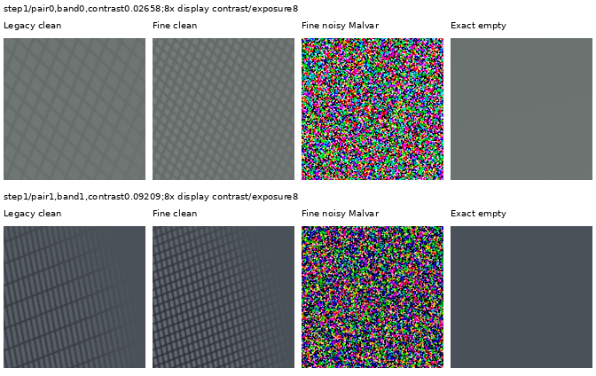
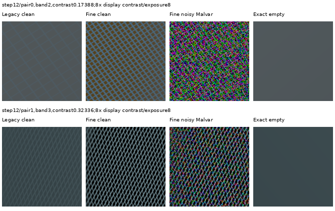
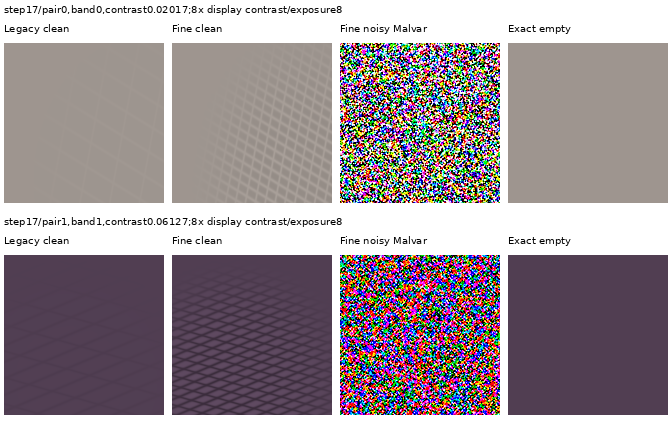
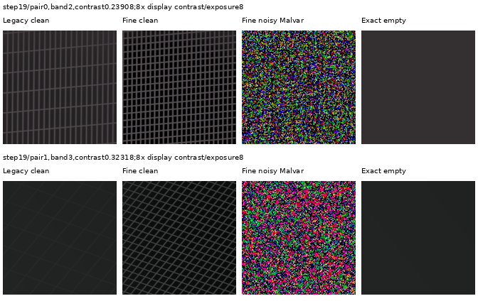
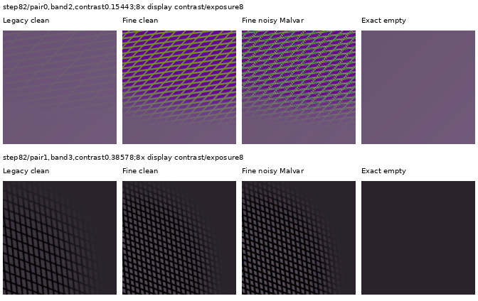
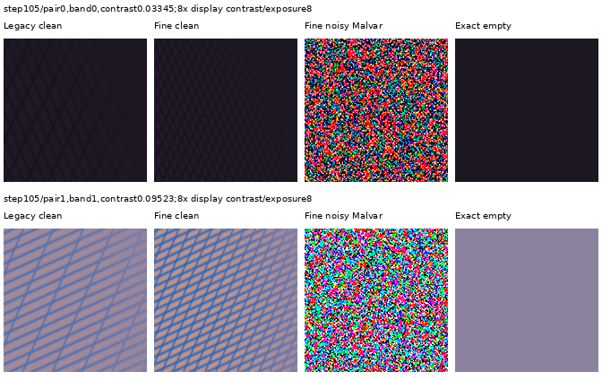

# Fine crossed-wire training data: V168

V168 tests whether better coverage of fine crossed wires improves the bounded
V167 head. Both heads use the same architecture and losses. Full training has
started; held-out quality and native restoration comparisons are pending.
[V167's completed response gain and quiet costs](bounded-spectral-support.md)
remain the current evidence for that architecture.

Of the original 341 mesh batches, 171 change and 170 remain exactly archived.
All 659 other batches also keep their original inputs and parent predictions.
For the changed batches, both nominal wire periods move from 6–32 to 6–10 native
pixels. The 342 pairs span four relative peak-contrast bands: 2–5%, 5–12.5%,
12.5–25% and 25–40%, with 86/86/85/85 pairs. The original quantiles determine
positions inside each band; other recipe fields stay fixed. This jointly changes
frequency and contrast coverage, so the comparison does not isolate either one.
Half the old mesh distribution retains its very weak and coarser examples.

Camera, CFA, geometry, exposure, scene level, tint, wire width, orientation,
phase, mask and background slopes stay fixed. Every changed present image has
an exact empty counterfactual, and all 342 empty clean targets match the old
ones bit-for-bit. Sensor coefficients and seeds match; changed Poisson rates
can change the noisy empty frame too. Both marginals retain the existing
physical shot/read/ADC model. No real capture, JPEG or held-out reference supplies
training pixels. Both GFX scenes and siblings remain protected.

The independent input audit checks all 171 changed batches and reconstructs
342 clean sensor fingerprints. For the 322 changed noisy pairs, median signal
RMS rises from 2.32 to 10.71 DN16; the median full-context signal/input-noise
energy ratio rises from 0.00732 to 0.0380. It is an energy proxy, not matched-filter
detectability or restored RGB covariance. Twenty ADC-only pairs are separate.
The audit independently computes the 171 changed clean-target masks using
streaming NumPy extrema; 829 unchanged targets retain the earlier independent
mask evidence. The training comparison must check both arms' actual masks and
pair units, since the rule is fixed but their values can change with the data.

All 288 relevant CPU checks pass, including 22 new data checks. The renderer
replays legacy recipe pixels exactly, preserves global RNG state, and passes
independent quantile-transport and physical sensor/counterfactual checks. All
90 neural source files match completed V167. The genuine 8+2 GPU smoke passes,
with exact ten-row V167 control replay and 94 finite Adam states. The first
full-training rows reproduce that restored prefix. These are readiness checks,
not a restoration-quality result.

The parent-cache worker's first pass omitted the archived deterministic-algorithm
flags while disabling TF32 and benchmarking. A separate pass checked all 171
new input batches under the archived policy. All first-pass predictions differed,
with maximum absolute difference 0.00464 DN16. Canonical training uses the
corrected outputs. The first pass, source, receipts and arrays remain preserved;
inputs and noise were constructed once. This totals 342 parent roots / 1,368
images and the same backbone counts. It adds about 2.00 GiB of retained corrected
parents to the original 5.34 GiB cache projection. The 829 old input/parent batches
are reused. No original RAW or `/mnt/dataz` reads occur.

Both fresh heads have 124,909 parameters / 47 tensors and support floor 0.25.
They retain V167's common-loss fixed-support backward route and weight 1 / 16
DN16 units, pair-difference weight 1 / 2 DN16 floor / epsilon .003, flat anchor
.25, initial weights, AdamW, LR, clipping and EMA. The legacy-data control must
reproduce all 1,000 V167 bounded-head trace rows, final raw/EMA/Adam state and
1,644 actual predictions. Candidate parent caches are corrected to the old
compute policy before training. Targets and pair metadata never enter inference.

The fixed review retains all 822 cases and four raw/EMA endpoints: 3,288 head
forwards, 1,644 new candidate arrays and 1,644 actual control replays. It includes
the DSCF3879/3880 scene's sky, buildings, foliage and coarse fence, plus both
DSCF3842/3835 cab-mesh windows under both priors with camera JPEGs. ISO100 AHD
and JPEG references differ in aperture, shutter, motion and processing; they
are qualitative references, not exact GT. All 18 held-out Commons IDs remain
excluded. The planned 72 native figures include 24 noisy/restored/GT triplets;
actual viewing and independent pixel verification are required before quality
publication. Eight earlier useful native comparator columns remain.

Head stages total 5,308 roots / 11,368 images: 20 discarded smoke, 2,000 training
and 3,288 review forwards. There is no new neural architecture compatibility
pass; all 90 neural sources are unchanged. Parent/backbone cache work is counted
separately above. This study uses 56/116 GiB local/external reserves, a .5 GiB
projection margin and .25 GiB remaining local artifact bound, with 12 GiB CUDA
and 52/32 GiB launch/runtime RAM checks. Earlier trial receipts stay intact.

[Immutable preparation and source bindings](results/v168-fine-mesh-preparation-v1.json) ·
[Preparation verification](results/v168-fine-mesh-preparation-verification-v1.json) ·
[Original data schedule](results/v168-fine-mesh-data-plan-v1.json).

## Inspected training data

These six original data boards were actually viewed at native resolution and
are adopted by the cache without re-drawing. Columns are legacy clean target,
fine clean target, fine noisy Malvar, and exact empty target. There is no learned
restoration in these figures. Each cell is 160×160 at ROI `[176,176,160,160]`,
common camera display exposure 8 and contrast 8 about the recorded empty-ROI
channel means. Pixels are not resized. Display clipping is not training clipping.
The manifest records source recipes, noise conditioning, camera transforms and
anchors. The eventual performance report will include restored crop triplets.

