# Fine-mesh training data: V168 final quality

V168's finer crossed-wire training distribution raises held-out mesh response **17.48–18.09% over the exact V167 control**, reaching **3.805–3.836% of constructed GT amplitude**. Present-mesh RMS falls **0.560–0.566%**, and all 48 native512 coarse-flat errors improve at both endpoints, with mean reductions **0.221–0.275%**. These are useful data gains with the same architecture, losses, initialization and 1,000-update horizon. The experiment changes frequency and contrast coverage together; it does not isolate either factor.

The quiet-field cost persists: mean quiet RMS rises **1.49–5.44%**, all 32 quiet spatial errors worsen at both endpoints, and native512 total-flat means rise **0.136–0.228%**. Wholly absent mesh error rises **0.585%** and the actual blank regions of present scenes rise **0.688–0.691%**. The candidate does not establish flat safety or solve the real fine cab fence. V161/V164 still provide stronger learned mesh response, V166 remains useful for quiet color, V165 for grain/total-flat error, V158 for quiet accuracy and V157 for coarse capacity. No available model combines these strengths.

## Where the fine-wire gain lands

The fixed period diagnostic groups the 64 held-out recipes by how many nominal carrier periods are at most 10 pixels; geometry can move actual frequencies. The groups contain 26, 29 and 9 recipes, each observed under four related CFA/noise variants. With both nominal periods fine, mean response rises from **1.131/1.139% to 1.792/1.817% of GT** for raw/EMA, about **58.5/59.5%**. Present RMS falls from 10.076/10.087 to 10.006/10.022 DN16; blank RMS rises from 5.794/5.812 to 5.830/5.853 DN16. With no fine carrier, response rises from 1.062/1.072% to 1.296/1.330%; with one, from 5.845/5.854% to 6.679/6.709%. The finest group benefits most proportionally and remains the least recovered relative to its target. These adaptive, related cases do not measure training-seed uncertainty. [All per-recipe values and fixed strata](results/v168-mesh-period-strata-v1.json).

Overall actual mesh response is .038048/.038359, present RMS 8.931209/8.943902 DN16 and blank RMS 5.570457/5.589461. Wholly absent RMS is 5.271166/5.290214. Mean signed absent-template gain is close to zero, which does not cancel the measured blank error or rule out false detail. Relative to V143, mesh response is 72.8–74.2% higher, while wholly absent RMS is 0.635–0.999% worse.

## What the native crops show

All 72 primary figures were actually inspected at original detail across 18 sheets, including both raw/EMA endpoints, 24 noisy/restored/exact-GT triplets, both protected GFX scenes and both fine-mesh noise priors. The fixed crops and display transforms are retained without resizing.

Synthetic seed2302 remains almost flat at exposure8 despite the clear crossed lattice in GT. At contrast40, much of the visible variation is broad colored mottle. Seed2309 preserves its stronger diagonal family; the weak crossing family changes subtly and remains mostly missing. The optional periodic correction shows more lattice but keeps direction and support defects.

The ISO6400 fine cab left crop remains largely erased. The right crop keeps one diagonal family more strongly than the crossing family under both nominal and profile3879 priors; neither endpoint convincingly restores the complete lattice. The main-scene coarse fence, building and foliage look close to control. Ordinary sky looks smooth at exposure4. The ISO100 AHD and camera JPEG references differ in capture aperture, exposure, motion and processing and are qualitative references, not exact GT.

At the fixed contrast40 displays, native512 dark flats and mixed quiet fields retain broad red, blue and green patches plus residual grain. The subtle changes from control do not remove them. At ordinary contrast the mixed step and narrow bar remain well defined, showing why a favorable whole-context RMS is insufficient to judge the quiet neighbors. Natural bird, butterfly and plant microdetail remains heavily smoothed. ADC bark and raccoon crops keep much more texture, with no striking candidate/control difference; constant ADC fields and sloped-plane displays remain smooth.

## Error and mechanism limits

Raw quiet means are **4.350000/7.094512 DN16** for ISO6400/12800; EMA means are **4.203388/6.745842**. They remain **7.81–15.31% above V143**. Quiet spatial means increase **1.68–2.55% over control** at all 32 inputs. Quiet DC bias changes by +4.87/+11.89% raw and −1.09/+5.57% EMA: one lower DC mean does not make the quiet region safer. Full mixed-context RMS improves 0.59–1.39%, while its quiet subregion worsens.

Native512 total-flat RMS is **18.506482/24.020028 raw**, **18.546646/24.086164 EMA**. Coarse32 RMS is **13.335471/17.791280 raw**, **13.367796/17.832479 EMA**. All 48 coarse inputs improve over matched control at both endpoints; full error worsens on 29/48 raw and 40/48 EMA inputs. Coarse error and total error measure different frequency ranges.

Natural-photo cohort full-RMS means worsen versus control in seven of eight raw/EMA comparisons; the organic-dark raw mean improves only .00257%. Retained-dark band error improves .0074–.0086%, with the other three cohorts worse at both endpoints. ADC-photo RMS improves .0336/.0320% over control, but all eight ADC-photo outputs differ from V143 at each endpoint. All 192 constant-field ADC outputs remain exactly the parent. A small ADC-photo gain is not a high-noise detail gain.

All 256 present-mesh mean supports remain near the .25 floor. Coefficient RMS rises to **8.012e−5/8.261e−5**, from **5.850e−5/5.951e−5**; direct spatial correction RMS rises to **.497803/.345442 DN16**, from **.362017/.315988**. This establishes more learned activity and displacement, not an isolated explanation of the gain or a guarantee of correct detail. [Archived support values](results/v168-archived-support-summary-v1.json).

The final training checkpoint is SHA256 `afc71282b8f291dea4e6438b106a6851825b76338d4acfa23b1ca7a0cec89247`. Candidate component hashes are raw `7e2be7ba5edadc2fbf8d97bf9cb275a7cec1714a5ea6ff61a8c2efcb1c118de2` and EMA `d089b40e5502887510308816c648a9fc91d9cb58c687aa57862ed853e1efbc61`. The control's entire 1,000-row trajectory, raw/EMA/Adam state and 1,644 actual endpoint predictions reproduce V167 exactly. Training recovery and review-policy continuation are fully accounted below; no full-training restart or repeated review inference is hidden.

The first publication attempt copied 40 receipts before a missing adopted-launch path stopped it. Those partial copies, source and failure log are preserved. The corrected publisher binds the original v2 launch and checks every source path before copying; the independent verifier's prose count is corrected from 33 to 49 final copies. This publication-only correction adds no model or noise calls. [Exact correction and partial-copy hashes](results/v168-publication-path-correction-v1.json).

[Final evidence and immutable sources](results/v168-fine-mesh-final-v1.json) · [Native pixels, source ROIs, conditioning, exposure and checkpoint hashes](images/v168-fine-mesh-v1/manifest-v1.json).

## Response and actual blank error

RMS values are camera-RGB DN16. Response1 means the exact constructed mesh amplitude. Blank error measures actual target error; added blank RMS measures displacement from V143.

| Method | Present full RMS | Response | Actual blank RMS | Blank spatial RMS | Added blank RMS |
| --- | ---: | ---: | ---: | ---: | ---: |
|V143|9.111243|0.02202090|5.523323|5.343113|0.00000000|
|Legacy ctrl raw|8.981523|0.03238742|5.532231|5.356251|0.87262459|
|Legacy ctrl EMA|8.994781|0.03248398|5.551259|5.366688|0.85880048|
|Fine mesh raw|8.931209|0.03804833|5.570457|5.391310|1.18749282|
|Fine mesh EMA|8.943902|0.03835930|5.589461|5.407807|1.14976941|
|Existing periodic detail|8.586126|0.07089755|5.523328|5.343118|0.00063557|

## Quiet neighbors and coarse fields

| Prior | Method | Whole RMS | Quiet RMS | Quiet spatial RMS |
| --- | --- | ---: | ---: | ---: |
|ISO6400|V143|27.105631|3.898845|3.268502|
|ISO6400|Legacy ctrl raw|27.054526|4.221290|3.348955|
|ISO6400|Legacy ctrl EMA|26.989986|4.141840|3.348572|
|ISO6400|Fine mesh raw|26.892995|4.350000|3.423454|
|ISO6400|Fine mesh EMA|26.831196|4.203388|3.433879|
|ISO12800|V143|36.747466|6.152652|5.341833|
|ISO12800|Legacy ctrl raw|36.139329|6.728466|5.444060|
|ISO12800|Legacy ctrl EMA|36.028569|6.547331|5.447253|
|ISO12800|Fine mesh raw|35.636443|7.094512|5.535426|
|ISO12800|Fine mesh EMA|35.550733|6.745842|5.547922|

Quiet bias is averaged per RGB channel before its Euclidean RMS. The independent pixel audit verifies total squared = spatial squared + DC squared per case; means of RMS values do not share that identity.

| Prior | Method | Quiet DC RMS DN16 |
| --- | --- | ---: |
| iso6400-prior | parent | 2.016074 |
| iso6400-prior | legacy-control-raw-step1000 | 2.434560 |
| iso6400-prior | legacy-control-EMA-step1000 | 2.304264 |
| iso6400-prior | fine-mesh-raw-step1000 | 2.553053 |
| iso6400-prior | fine-mesh-EMA-step1000 | 2.279202 |
| iso12800-prior | parent | 2.849060 |
| iso12800-prior | legacy-control-raw-step1000 | 3.728242 |
| iso12800-prior | legacy-control-EMA-step1000 | 3.426662 |
| iso12800-prior | fine-mesh-raw-step1000 | 4.171370 |
| iso12800-prior | fine-mesh-EMA-step1000 | 3.617679 |

|Flat test|V143|Legacy ctrl raw|Legacy ctrl EMA|Fine mesh raw|Fine mesh EMA|
| --- | ---: | ---: | ---: | ---: | ---: |
|Native512 ISO6400 full RMS|18.546808|18.481399|18.505695|18.506482|18.546646|
|Native512 ISO6400 spatial RMS|18.235130|18.181950|18.211357|18.187010|18.237235|
|Native512 ISO6400 block32 RMS|13.440561|13.372303|13.398120|13.335471|13.367796|
|Native512 ISO12800 full RMS|24.071890|23.981424|24.031410|24.020028|24.086164|
|Native512 ISO12800 spatial RMS|23.596861|23.541824|23.583390|23.579540|23.649192|
|Native512 ISO12800 block32 RMS|17.932544|17.838301|17.872030|17.791280|17.832479|
|Older native256 ISO12800 full RMS|27.233548|27.124481|27.169922|27.185755|27.230825|
|Older native256 ISO12800 spatial RMS|26.017191|25.938711|25.982845|25.951411|26.028441|
|Older native256 ISO12800 block32 RMS|19.539875|19.436470|19.473692|19.381232|19.428919|

## Natural detail and ADC controls

|Photo test|V143|Legacy ctrl raw|Legacy ctrl EMA|Fine mesh raw|Fine mesh EMA|
| --- | ---: | ---: | ---: | ---: | ---: |
|Retained512 faint full RMS|33.963754|33.962135|33.961565|33.967361|33.968609|
|Retained512 faint band error|0.824639|0.824631|0.824609|0.824717|0.824695|
|Retained512 faint band response|0.298560|0.297603|0.297758|0.297802|0.297996|
|Retained512 dark full RMS|29.097715|29.098939|29.094325|29.101435|29.098256|
|Retained512 dark band error|0.661447|0.661319|0.661311|0.661270|0.661254|
|Retained512 dark band response|0.531446|0.530130|0.530287|0.530744|0.530871|
|Organic384 faint full RMS|37.469061|37.480662|37.477363|37.487845|37.487138|
|Organic384 faint band error|0.924117|0.924699|0.924657|0.925100|0.925055|
|Organic384 faint band response|0.150701|0.149338|0.149460|0.148982|0.149124|
|Organic384 dark full RMS|33.685796|33.693790|33.687892|33.692924|33.690339|
|Organic384 dark band error|0.781612|0.781642|0.781640|0.781703|0.781689|
|Organic384 dark band response|0.398945|0.397488|0.397611|0.397680|0.397768|

|ADC test|V143|Legacy ctrl raw|Legacy ctrl EMA|Fine mesh raw|Fine mesh EMA|
| --- | ---: | ---: | ---: | ---: | ---: |
|Photo full RMS|18.149871|18.146890|18.147987|18.140792|18.142182|
|Photo band error|0.101855|0.101834|0.101842|0.101788|0.101800|
|Photo band response|0.968329|0.968332|0.968325|0.968257|0.968246|
|Sloped512 full RMS|3.771369|3.774112|3.774182|3.776748|3.776943|
|Sloped512 spatial RMS|3.397249|3.399834|3.399888|3.402835|3.403006|
|Sloped512 block32 RMS|0.574652|0.573566|0.573573|0.573529|0.573442|
|Sloped512 crop block32 RMS|0.088145|0.088146|0.088145|0.088156|0.088157|
|Sloped512 worst absolute DC|11.176981|11.181840|11.181765|11.180945|11.181031|

## Fixed native comparisons

Every cell is native 160×160; crop pixels are never resized. All RAW methods within each board share source coordinates, camera display transform, exposure and contrast. JPEG cells retain native sRGB8 without exposure/contrast changes. Both final raw/EMA endpoints of both heads are shown, with eight retained V156/V157/V158/V159/V160 ordinary/V160 paired/V161/V162 columns.

The main scene is DSCF3879 ISO6400 versus DSCF3880 ISO100 f/5.6. The fine cab mesh uses DSCF3842 versus DSCF3835 and both camera JPEGs. Aperture, shutter, moving subjects and processing differ: ISO100 views are qualitative references, not exact GT. All30 real score rows stay unscored.

### Mesh and exact absence

mesh-seed2026112302-present-iso6400-prior-RGGB; ROI `[176, 176, 160, 160]`, RAW exposure 8, contrast 1.

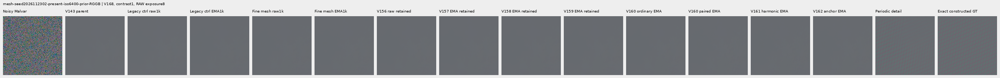

mesh-seed2026112302-present-iso6400-prior-RGGB; ROI `[176, 176, 160, 160]`, RAW exposure 8, contrast 40.

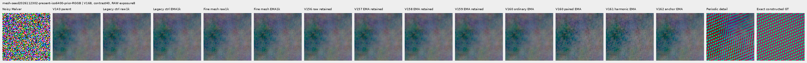

mesh-seed2026112309-present-iso6400-prior-RGGB; ROI `[176, 176, 160, 160]`, RAW exposure 8, contrast 1.

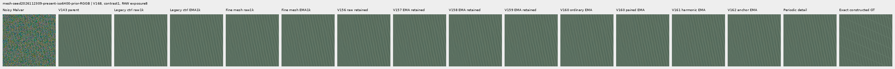

mesh-seed2026112309-present-iso6400-prior-RGGB; ROI `[176, 176, 160, 160]`, RAW exposure 8, contrast 40.

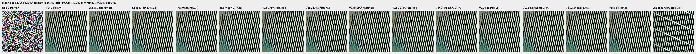

mesh-seed2026112304-absent-iso6400-prior-RGGB; ROI `[165, 0, 160, 160]`, RAW exposure 8, contrast 40.

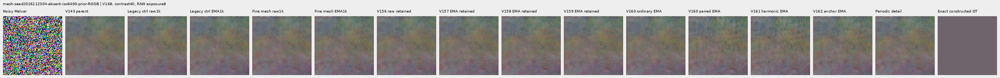

### Quiet neighbors beside edges

mixed-vertical-step-iso6400-prior-RGGB; ROI `[80, 176, 160, 160]`, RAW exposure 8, contrast 40.

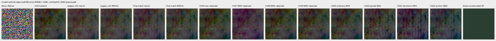

mixed-vertical-step-iso6400-prior-RGGB; ROI `[240, 176, 160, 160]`, RAW exposure 8, contrast 1.

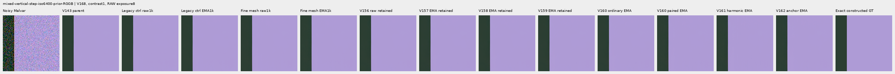

mixed-vertical-step-iso12800-prior-RGGB; ROI `[80, 176, 160, 160]`, RAW exposure 8, contrast 40.

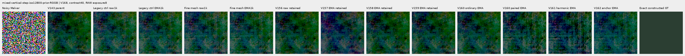

mixed-vertical-step-iso12800-prior-RGGB; ROI `[240, 176, 160, 160]`, RAW exposure 8, contrast 1.

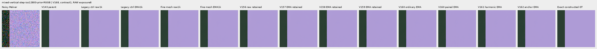

mixed-narrow-bar-iso6400-prior-RGGB; ROI `[80, 176, 160, 160]`, RAW exposure 8, contrast 40.

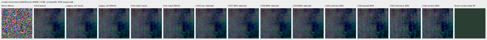

mixed-narrow-bar-iso6400-prior-RGGB; ROI `[240, 176, 160, 160]`, RAW exposure 8, contrast 1.

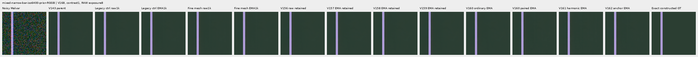

mixed-narrow-bar-iso12800-prior-RGGB; ROI `[80, 176, 160, 160]`, RAW exposure 8, contrast 40.

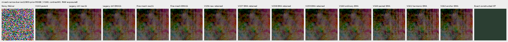

mixed-narrow-bar-iso12800-prior-RGGB; ROI `[240, 176, 160, 160]`, RAW exposure 8, contrast 1.

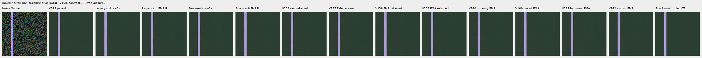

mixed-slanted-step-iso6400-prior-RGGB; ROI `[80, 176, 160, 160]`, RAW exposure 8, contrast 40.

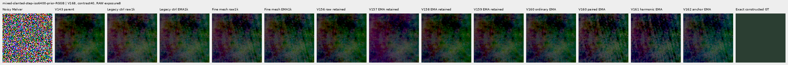

mixed-slanted-step-iso6400-prior-RGGB; ROI `[240, 176, 160, 160]`, RAW exposure 8, contrast 1.

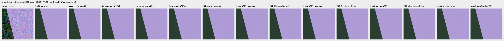

mixed-slanted-step-iso12800-prior-RGGB; ROI `[80, 176, 160, 160]`, RAW exposure 8, contrast 40.

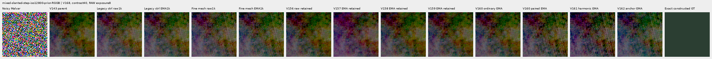

mixed-slanted-step-iso12800-prior-RGGB; ROI `[240, 176, 160, 160]`, RAW exposure 8, contrast 1.

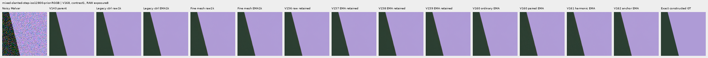

mixed-striped-patch-iso6400-prior-RGGB; ROI `[80, 176, 160, 160]`, RAW exposure 8, contrast 40.

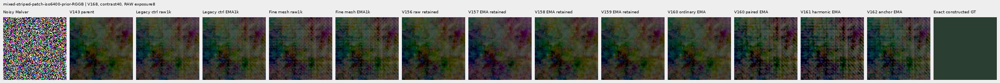

mixed-striped-patch-iso6400-prior-RGGB; ROI `[240, 176, 160, 160]`, RAW exposure 8, contrast 1.

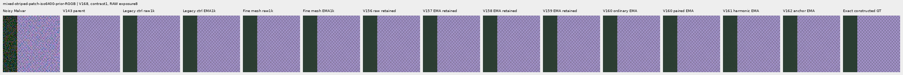

mixed-striped-patch-iso12800-prior-RGGB; ROI `[80, 176, 160, 160]`, RAW exposure 8, contrast 40.

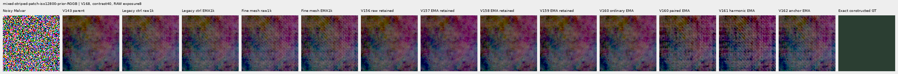

mixed-striped-patch-iso12800-prior-RGGB; ROI `[240, 176, 160, 160]`, RAW exposure 8, contrast 1.

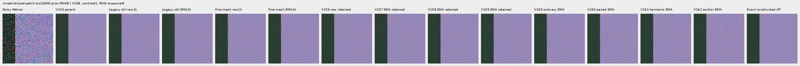

### Standalone flats and slopes

gray-l0.02-adc-only-RGGB; ROI `[48, 48, 160, 160]`, RAW exposure 4, contrast 40.

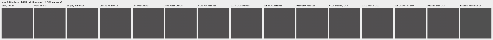

gray-l0.02-iso12800-prior-RGGB; ROI `[48, 48, 160, 160]`, RAW exposure 4, contrast 40.

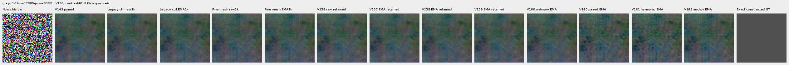

flat512-gray-l0.02-adc-only-RGGB; ROI `[176, 176, 160, 160]`, RAW exposure 4, contrast 40.

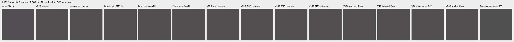

flat512-gray-l0.02-iso6400-prior-RGGB; ROI `[176, 176, 160, 160]`, RAW exposure 4, contrast 40.

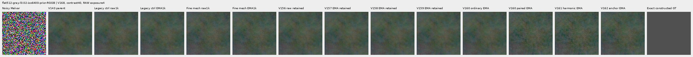

flat512-gray-l0.02-iso12800-prior-RGGB; ROI `[176, 176, 160, 160]`, RAW exposure 4, contrast 40.

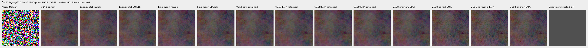

flat512-h210-s0.50-l0.02-iso6400-prior-RGGB; ROI `[176, 176, 160, 160]`, RAW exposure 4, contrast 40.

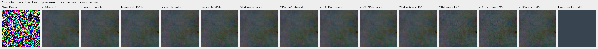

flat512-gray-l0.18-iso12800-prior-RGGB; ROI `[176, 176, 160, 160]`, RAW exposure 1, contrast 8.

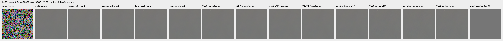

flat512-gray-l0.90-iso12800-prior-RGGB; ROI `[176, 176, 160, 160]`, RAW exposure 1, contrast 4.

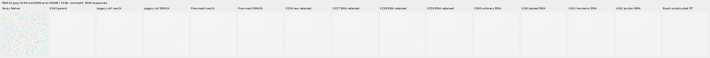

V150-control-ADC-plane0-RGGB; ROI `[176, 176, 160, 160]`, RAW exposure 45, contrast 8.

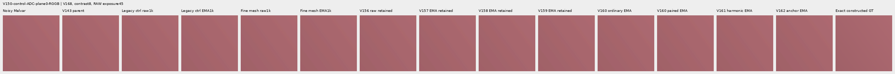

V150-control-ADC-plane1-RGGB; ROI `[176, 176, 160, 160]`, RAW exposure 9, contrast 8.

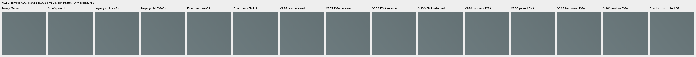

V150-control-ADC-plane2-RGGB; ROI `[176, 176, 160, 160]`, RAW exposure 1, contrast 8.

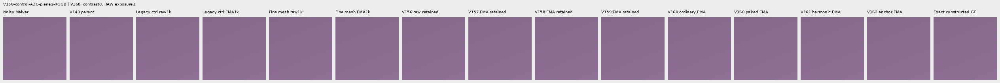

V150-control-ADC-plane3-RGGB; ROI `[176, 176, 160, 160]`, RAW exposure 0.24, contrast 8.

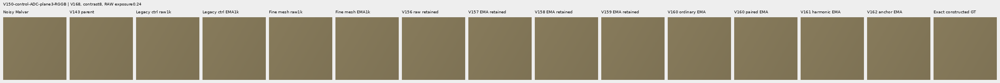

### Natural photographic detail

organic-02a76fd33b5e1414a0504f0b3f0aeb03a569b6f4-photo-faint-RGGB; ROI `[112, 112, 160, 160]`, RAW exposure 14.3883, contrast 8.

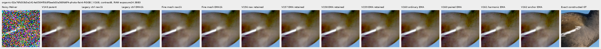

organic-dabacecd4780a1c230f8e9fce6ca1a604bdeab4c-photo-dark-RGGB; ROI `[112, 112, 160, 160]`, RAW exposure 102.758, contrast 1.

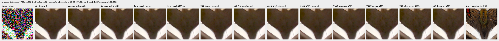

organic-6b3920bceba82d95ecf9351d47f6f94267694bd0-photo-dark-RGGB; ROI `[112, 112, 160, 160]`, RAW exposure 64.0491, contrast 1.

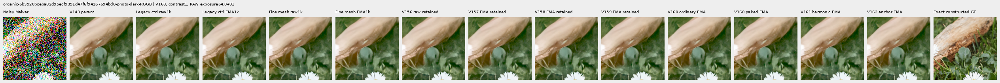

photo-3e638bbb56ed80abc88939468783e3bf9b92ee77-photo-faint-RGGB; ROI `[176, 176, 160, 160]`, RAW exposure 12.1494, contrast 8.

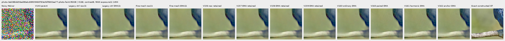

photo-3e638bbb56ed80abc88939468783e3bf9b92ee77-photo-dark-RGGB; ROI `[176, 176, 160, 160]`, RAW exposure 80.9959, contrast 1.

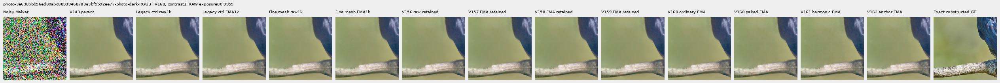

V150-control-bark-contrast0p025-adc-RGGB; ROI `[48, 48, 160, 160]`, RAW exposure 1, contrast 40.

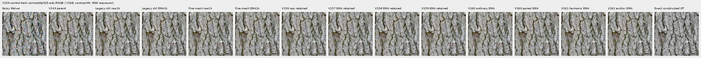

V150-control-raccoon-fur-contrast0p025-adc-RGGB; ROI `[48, 48, 160, 160]`, RAW exposure 1, contrast 40.

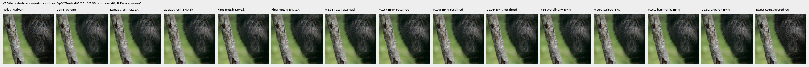

### Protected real GFX scenes

main-overcast-sky; ROI `[176, 176, 160, 160]`, RAW exposure 4, contrast 1.

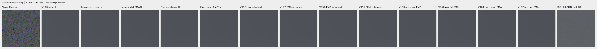

main-building-detail; ROI `[176, 176, 160, 160]`, RAW exposure 4, contrast 1.

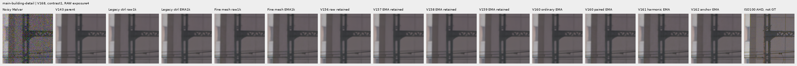

main-foliage; ROI `[176, 176, 160, 160]`, RAW exposure 4, contrast 1.

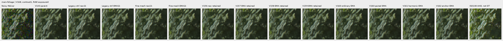

main-chain-link-fence; ROI `[176, 176, 160, 160]`, RAW exposure 4, contrast 1.

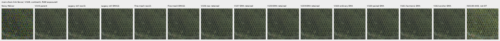

mesh-nominal; ROI `[206, 229, 160, 160]`, RAW exposure 16, contrast 1.

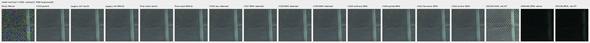

mesh-nominal; ROI `[426, 189, 160, 160]`, RAW exposure 16, contrast 1.

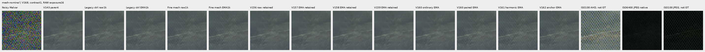

mesh-profile3879; ROI `[206, 229, 160, 160]`, RAW exposure 16, contrast 1.

mesh-profile3879; ROI `[426, 189, 160, 160]`, RAW exposure 16, contrast 1.

### Noisy, restored, exact constructed GT triplets

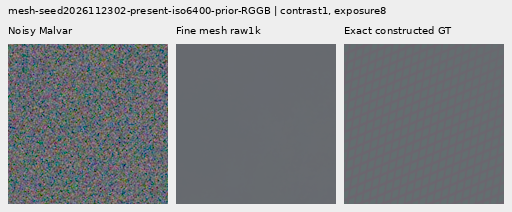

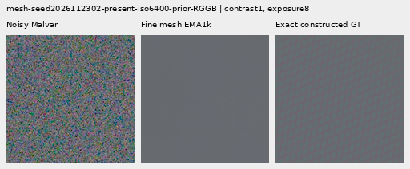

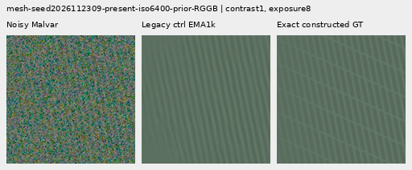

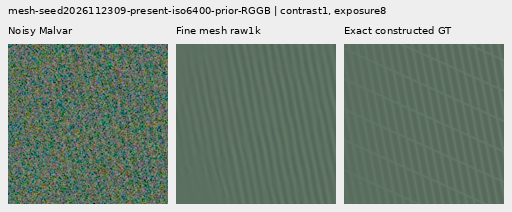

## Data, architecture and validation

Two fresh identical 124,909-parameter / 47-tensor heads use the V167 bounded architecture with support floor .25. All90 neural source files remain byte-identical. Initialization, losses, common fixed-support surrogate backward route, AdamW, LR, clipping, EMA and1000-update horizon match. Only training frequency/contrast coverage changes. Targets, pairs and references never enter inference.

The candidate changes171 of341 mesh batches;170 mesh and659 other batches retain their archived inputs and parent predictions. Both nominal wire periods transport6–32 to6–10 pixels;342 pairs span contrast bands.02–.05,.05–.125,.125–.25,.25–.4,with86/86/85/85 pairs. Geometry, level, tint, slopes, angles, phases, widths, masks, camera, CFA, exposure, noise coefficients and seeds stay fixed. All342 new empty clean targets match their originals exactly. Changed Poisson rates do not imply identical noisy empty samples. This jointly tests frequency and contrast coverage,not either factor separately. Nominal periods are not actual post-geometry peaks.

The independent input audit reconstructs342 clean sensor fingerprints and computes171 new target masks with streaming NumPy extrema. For322 changed noisy pairs,median actual signal RMS rises2.32 to10.71 DN16 and median full-context signal/noise energy ratio .00732 to.0380;20 ADC pairs stay separate. The ratio is not matched-filter detectability or restored RGB covariance. Six original data boards were actually viewed and adopted without re-drawing. [Original data evidence and six native boards](results/v168-fine-mesh-preparation-v1.json).

All288 relevant CPU checks pass,including22 new data checks for exact legacy recipe replay,RNG isolation,independent quantile transport and physical/counterfactual preservation. Genuine8+2 model/EMA/Adam/RNG restoration passes. The first ten complete smoke/train rows match;all1000 V167 bounded-control trace rows and final raw/EMA/Adam state reproduce exactly. All1644 actual control predictions replay bit-exact before storage adoption. Four strict CPU endpoint loads and94 finite final Adam states pass. Every recorded training/review support extremum meets the common .25 floor;this does not independently reconstruct full maps or guarantee delivered detail or flat safety.

Both heads retain common weight1/unit16 DN16,difference weight1/floor2 DN16/epsilon.003,flat anchor.25 and all base losses. Common routing replays FFT/fixed Malvar on691 paired batches per head,including71 zero-weight ADC batches,without another neural root. Actual units and masks can differ with changed target pixels;the audits below check each head separately. All18 held-out Commons IDs,64 held-out mesh recipes and protected captures/JPEGs/siblings remain excluded. No new photographic source or original RAW/dataz reads occur. [Original free-photo pipeline](paired-response.md).

The first parent-cache pass omitted archived deterministic-algorithm flags while disabling TF32 and benchmarking. A second pass evaluated all171 new inputs under the archived policy. Every first-pass parent differed,maximum .00463860 DN16;canonical training uses corrected arrays. Both passes,inputs,old outputs and receipts remain intact,with no source/noise redraw. Total cache work is342 parent roots/1368 images and342 nested DINO calls/1368 images. About2.00GiB of corrected parents are retained beyond the original5.34GiB projection. One read-only preparation verifier also had a corrected8-versus9-field bookkeeping assertion;its original source/log are preserved. These corrections are explicit and do not imply a head-training restart.

A local-disk guard stopped the original training process after915 complete updates. Recovery restored the actual750 model/EMA/Adam/RNG state,adopted750 trace rows and replayed751–915 with every recorded row bit-exact before finishing916–1000. The915 state was not saved,so no direct state comparison to it is claimed.117 own derived mesh fixtures moved byte-exact to fast SSD,with unchanged logical paths and hashes;56/116GiB reserves remain fixed. Recovery checkpoints durably before waiting on further headroom pressure. Final gradient maxima cover the restored smoke first10 and recovered751–1000,not global first1000 maxima;original and resumed source assertions check every completed update gradient for finiteness. [Recovery admission and preserved failure](results/v168-checkpoint-recovery-preparation-v1.json).

The first reviewer retained an inherited120GiB guard despite the declared116GiB policy. It stopped before a new forward after2770 complete actual observations. Three full collections and304 final-EMA rows were hash/fingerprint/journal-checked and adopted;only518 unfinished cases run under the corrected116GiB guard. No completed review inference is repeated. Original failed queue,source,journals and arrays remain preserved. [Review continuation evidence](results/v168-review-policy-continuation-v1.json).

The current comparison fixes architecture,objective,initializer and optimization. Historical comparisons mix interventions;CFA/noise variants and this adaptive cohort are related,not independent blind scene replications or significance evidence. Earlier detail,quiet-color and flat/grain strengths remain available regardless of this data result.

`legacy-control`: 459/900 supervised batches clip; pre-clip norm median 1.017819, maximum 479.207886.

`fine-mesh`: 461/900 supervised batches clip; pre-clip norm median 1.077723, maximum 427.053101.

The100 zero-gradient ADC batches advance Adam/EMA clocks. Gradient norms describe pressure,not an isolated cause of quality.

The independent audit checks 40,210 scalars across4,686 rows and 476 Decimal reductions;maximum difference 4.55e-13. All72 native images/24 triplets were actually viewed in18 original-detail sheets;61,824,000 RGB channels were independently checked.

Actual head work is5638 roots/12688 images:20 discarded smoke,2330 physical training/recovery and3288 review forwards. The logical1000-update trajectories still have2000 unique training head calls;330 recovery calls/1320 images replay completed overlap. Cache parent/backbone work is separate above;DINO calls are nested,not added as top-level roots. All17 recorded original/recovery/review scientific owners are terminal. Training and review each had one resource/policy guard stop,with three dependent controller failures in total;one checkpoint recovery finishes training without a full restart. The parent setup and read-only verifier corrections remain separate. All1644 new review arrays/4.421GiB are external. Reserves are56/116GiB local/external plus.5GiB projection margin and.25GiB remaining local bound. Prior receipts and all original media remain intact.

## Actual training objectives, units and inherited masks

Independent FP32 recombination of the recorded components reproduces all 2,000 actual weighted total losses bit-exactly, including zero ADC totals. This checks weights and conditional routing; it does not recompute training targets or losses from full training predictions, which were not retained. Output-level semantics are covered separately by the current CPU tests and actual restored-prefix checks. The recorded common loss can be positive on ADC pairs even though its total supervision is zero.

| Domain | ADC only | Arm | Batches | Pairs | Common supervised batches | Mean recorded common loss |
| --- | --- | --- | ---: | ---: | ---: | ---: |
| mesh | False | legacy-control | 307 | 614 | 307 | 0.092576 |
| mesh | False | fine-mesh | 307 | 614 | 307 | 0.136743 |
| photo | False | legacy-control | 214 | 428 | 214 | 1.033419 |
| photo | False | fine-mesh | 214 | 428 | 214 | 1.035890 |
| flat | True | legacy-control | 12 | 0 | 0 | 0.000000 |
| flat | True | fine-mesh | 12 | 0 | 0 | 0.000000 |
| mixed | False | legacy-control | 139 | 0 | 0 | 0.000000 |
| mixed | False | fine-mesh | 139 | 0 | 0 | 0.000000 |
| weak | False | legacy-control | 99 | 198 | 99 | 0.150966 |
| weak | False | fine-mesh | 99 | 198 | 99 | 0.151396 |
| flat | False | legacy-control | 141 | 0 | 0 | 0.000000 |
| flat | False | fine-mesh | 141 | 0 | 0 | 0.000000 |
| mesh | True | legacy-control | 34 | 68 | 0 | 0.001152 |
| mesh | True | fine-mesh | 34 | 68 | 0 | 0.003931 |
| photo | True | legacy-control | 29 | 58 | 0 | 0.300806 |
| photo | True | fine-mesh | 29 | 58 | 0 | 0.300806 |
| mixed | True | legacy-control | 17 | 0 | 0 | 0.000000 |
| mixed | True | fine-mesh | 17 | 0 | 0 | 0.000000 |
| weak | True | legacy-control | 8 | 16 | 0 | 0.000616 |
| weak | True | fine-mesh | 8 | 16 | 0 | 0.000614 |

Independent NumPy FP32 reconstruction checks1000 joint records/2000 actual unit fingerprints. Both heads use the same2DN16 floor rule with their respective retained mean shot-increment variances. These are pre-ADC increment proxies,not restored RGB covariance. No full training outputs were retained for a separate target-loss recomputation.

| Arm | Domain | ADC only | Pairs | Median difference unit DN16 | P90 unit | Maximum unit |
| --- | --- | --- | ---: | ---: | ---: | ---: |
| legacy-control | mesh | False | 614 | 8.604690 | 25.789597 | 88.750217 |
| fine-mesh | mesh | False | 614 | 13.955137 | 41.589196 | 101.251194 |
| legacy-control | photo | False | 428 | 61.038446 | 270.123829 | 853.877535 |
| fine-mesh | photo | False | 428 | 61.038446 | 270.123829 | 853.877535 |
| legacy-control | weak | False | 198 | 17.108980 | 58.000702 | 110.375437 |
| fine-mesh | weak | False | 198 | 17.108980 | 58.000702 | 110.375437 |
| legacy-control | mesh | True | 68 | 2.000000 | 2.000000 | 2.000000 |
| fine-mesh | mesh | True | 68 | 2.000000 | 2.000000 | 2.000000 |
| legacy-control | photo | True | 58 | 2.000000 | 2.000000 | 2.000000 |
| fine-mesh | photo | True | 58 | 2.000000 | 2.000000 | 2.000000 |
| legacy-control | weak | True | 16 | 2.000000 | 2.000000 | 2.000000 |
| fine-mesh | weak | True | 16 | 2.000000 | 2.000000 | 2.000000 |

All2000 actual mask fingerprints/counts match their separate oracles:1000 inherited control masks,829 inherited unchanged candidate masks and171 newly independent candidate masks. Streaming NumPy extrema are independent of training max pooling. The detached mask requires truncated17x17 per-channel range at most1DN16. Eligible weak gradients keep actual targets;the16DN16 pseudo-Huber uses a whole-image denominator. Coverage sets term weight,not inference confidence or flat safety.

| Arm | Domain | ADC only | Batches | Mean batch eligible fraction | Pixel-weighted eligible fraction |
| --- | --- | --- | ---: | ---: | ---: |
| legacy-control | mesh | False | 307 | 0.699702 | 0.699702 |
| fine-mesh | mesh | False | 307 | 0.689948 | 0.689948 |
| legacy-control | photo | False | 214 | 0.522321 | 0.522321 |
| fine-mesh | photo | False | 214 | 0.522321 | 0.522321 |
| legacy-control | flat | True | 12 | 0.646564 | 0.646564 |
| fine-mesh | flat | True | 12 | 0.646564 | 0.646564 |
| legacy-control | mixed | False | 139 | 0.907641 | 0.907641 |
| fine-mesh | mixed | False | 139 | 0.907641 | 0.907641 |
| legacy-control | weak | False | 99 | 0.502555 | 0.502555 |
| fine-mesh | weak | False | 99 | 0.502555 | 0.502555 |
| legacy-control | flat | False | 141 | 0.688589 | 0.688589 |
| fine-mesh | flat | False | 141 | 0.688589 | 0.688589 |
| legacy-control | mesh | True | 34 | 0.667894 | 0.667894 |
| fine-mesh | mesh | True | 34 | 0.663079 | 0.663079 |
| legacy-control | photo | True | 29 | 0.507665 | 0.507665 |
| fine-mesh | photo | True | 29 | 0.507665 | 0.507665 |
| legacy-control | mixed | True | 17 | 0.907094 | 0.907094 |
| fine-mesh | mixed | True | 17 | 0.907094 | 0.907094 |
| legacy-control | weak | True | 8 | 0.500000 | 0.500000 |
| fine-mesh | weak | True | 8 | 0.500000 | 0.500000 |

[Original protocol](results/v168-fine-mesh-v1/original-protocol.md) · [Immutable preparation](results/v168-fine-mesh-preparation-v1.json) · [Independent publication verification](results/v168-fine-mesh-publication-verification-v1.json).

## Photographic credits

Derived native targets/crops retain the respective source licenses; transformations include linearization, area binning and exposure/contrast changes. Source IDs and ROIs are in the manifest.

| Source | Author | License |
| --- | --- | --- |
| [File:Emamzadeh Esmaeil roof.jpg](https://commons.wikimedia.org/wiki/File:Emamzadeh_Esmaeil_roof.jpg) | مانفی | [CC BY-SA 4.0](https://creativecommons.org/licenses/by-sa/4.0) |
| [File:HP-85-IMG 0439.jpg](https://commons.wikimedia.org/wiki/File:HP-85-IMG_0439.jpg) | Rama & Musée Bolo | [CC BY-SA 2.0 fr](https://creativecommons.org/licenses/by-sa/2.0/fr/deed.en) |
| [File:Spangled Drongo - AndrewMercer - DSC00966.jpg](https://commons.wikimedia.org/wiki/File:Spangled_Drongo_-_AndrewMercer_-_DSC00966.jpg) | Andrew Mercer (www.baldwhiteguy.co.nz) | [CC BY-SA 4.0](https://creativecommons.org/licenses/by-sa/4.0) |
| [File:Naxos Chora 2025-06-14 0505.jpg](https://commons.wikimedia.org/wiki/File:Naxos_Chora_2025-06-14_0505.jpg) | Tsui | [CC BY-SA 4.0](https://creativecommons.org/licenses/by-sa/4.0) |
| [File:Castelo Novo April 2015-2a.jpg](https://commons.wikimedia.org/wiki/File:Castelo_Novo_April_2015-2a.jpg) | Alvesgaspar | [CC BY-SA 4.0](https://creativecommons.org/licenses/by-sa/4.0) |
| [File:RX50 -5 ¼” dual floppy disk drive 02.jpg](https://commons.wikimedia.org/wiki/File:RX50_-5_%C2%BC%E2%80%9D_dual_floppy_disk_drive_02.jpg) | Mister rf | [CC BY-SA 4.0](https://creativecommons.org/licenses/by-sa/4.0) |
| [File:DSC00752 San Salvator Laur.jpg](https://commons.wikimedia.org/wiki/File:DSC00752_San_Salvator_Laur.jpg) | Rione Colonna | [CC BY 4.0](https://creativecommons.org/licenses/by/4.0) |
| [File:Regierungsgebäude, Vaduz.jpg](https://commons.wikimedia.org/wiki/File:Regierungsgeb%C3%A4ude,_Vaduz.jpg) | AuHaidhausen | [CC BY 4.0](https://creativecommons.org/licenses/by/4.0) |
| [File:Common moorhen (Gallinula chloropus) France.jpg](https://commons.wikimedia.org/wiki/File:Common_moorhen_(Gallinula_chloropus)_France.jpg) | Alexis Lours | [CC BY 4.0](https://creativecommons.org/licenses/by/4.0) |
| [File:Dried platanus leaves on rain puddle, Quinta das Conchas e dos Lilases, Lisbon, Portugal julesvernex2.jpg](https://commons.wikimedia.org/wiki/File:Dried_platanus_leaves_on_rain_puddle,_Quinta_das_Conchas_e_dos_Lilases,_Lisbon,_Portugal_julesvernex2.jpg) | Jules Verne Times Two | [CC BY-SA 4.0](https://creativecommons.org/licenses/by-sa/4.0) |
| [File:Close wing pudding position of Lethe visrava (Moore, 1866) - White-edged Woodbrown WLB IMG 0997.jpg](https://commons.wikimedia.org/wiki/File:Close_wing_pudding_position_of_Lethe_visrava_(Moore,_1866)_-_White-edged_Woodbrown_WLB_IMG_0997.jpg) | Thamblyok | [CC BY-SA 4.0](https://creativecommons.org/licenses/by-sa/4.0) |
| [File:Daisies near Cockspur coral tree (Erythrina crista-galli) roots, Jardim da Praça de Londres, Lisbon, Portugal julesvernex2.jpg](https://commons.wikimedia.org/wiki/File:Daisies_near_Cockspur_coral_tree_(Erythrina_crista-galli)_roots,_Jardim_da_Pra%C3%A7a_de_Londres,_Lisbon,_Portugal_julesvernex2.jpg) | Jules Verne Times Two | [CC BY-SA 4.0](https://creativecommons.org/licenses/by-sa/4.0) |
| [File:Apples on tree 2021 G1.jpg](https://commons.wikimedia.org/wiki/File:Apples_on_tree_2021_G1.jpg) | George Chernilevsky | [CC BY-SA 4.0](https://creativecommons.org/licenses/by-sa/4.0) |
| [File:Close wing Nectering of Pseudozizeeria maha (Kollar, 1844) - Pale Grass Blue WLB.jpg](https://commons.wikimedia.org/wiki/File:Close_wing_Nectering_of_Pseudozizeeria_maha_(Kollar,_1844)_-_Pale_Grass_Blue_WLB.jpg) | Anitava Roy | [CC BY-SA 4.0](https://creativecommons.org/licenses/by-sa/4.0) |
| [File:Grey heron (Ardea cinerea) head.jpg](https://commons.wikimedia.org/wiki/File:Grey_heron_(Ardea_cinerea)_head.jpg) | Alexis Lours | [CC BY 4.0](https://creativecommons.org/licenses/by/4.0) |
| [File:Openwing position of Parasarpa dudu (Westwood, -1850-) - White Commodore.jpg](https://commons.wikimedia.org/wiki/File:Openwing_position_of_Parasarpa_dudu_(Westwood,_-1850-)_-_White_Commodore.jpg) | MaheshBaruahwildlife | [CC BY-SA 4.0](https://creativecommons.org/licenses/by-sa/4.0) |
| [File:Kentucky Coffee-tree Gymnocladus dioicus 3264px.jpg](https://commons.wikimedia.org/wiki/File:Kentucky_Coffee-tree_Gymnocladus_dioicus_3264px.jpg) | Photo (c)2007 Derek Ramsey (Ram-Man) | [CC BY-SA 2.5](https://creativecommons.org/licenses/by-sa/2.5) |
| [File:Racoon clinging to a tree.JPG](https://commons.wikimedia.org/wiki/File:Racoon_clinging_to_a_tree.JPG) | Korall | [CC BY 3.0](https://creativecommons.org/licenses/by/3.0) |

## Fixed component checkpoints

- `legacy-control-raw-step1000`: `3e6e9237a634bedefc20ae3a0cb5dcf36011b6acdec6a43f1415e27ad98266f0`.
- `legacy-control-EMA-step1000`: `37bf49ca1a67671d983978dbca3e2f628684f61c28d82e8303ebe47575e6a4c3`.
- `fine-mesh-raw-step1000`: `7e2be7ba5edadc2fbf8d97bf9cb275a7cec1714a5ea6ff61a8c2efcb1c118de2`.
- `fine-mesh-EMA-step1000`: `d089b40e5502887510308816c648a9fc91d9cb58c687aa57862ed853e1efbc61`.
