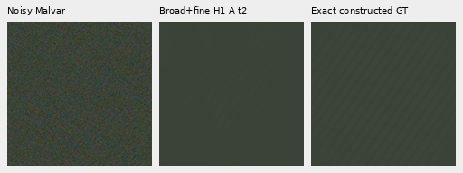
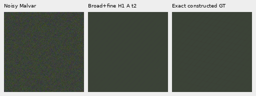
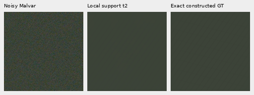
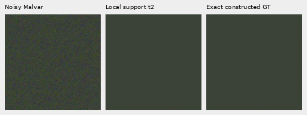
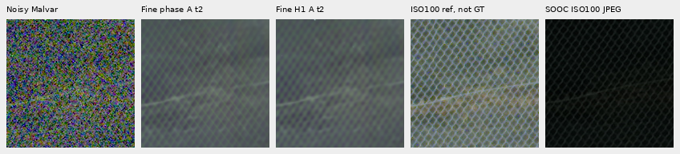
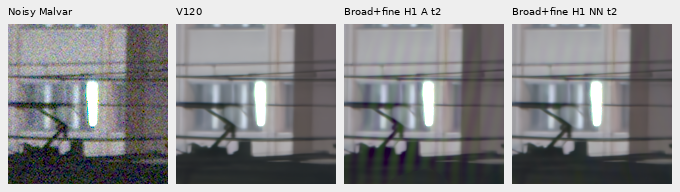

# Sinusoidal fine carriers above fixed guided phase

**Complete: lower higher-noise neural-nuisance errors, with less response;
the real cab colour grid persists.**
The [extra fine-band phase trial](fine-frequency-proposals.md) finds both cab
families and makes a lattice more visible, with false purple/green texture.
This control keeps its broad guided-phase correction and fine proposals,
but reconstructs the fine pair with local sine/cosine coefficients. V120
remains the general baseline. The option supplies a measured error/response
tradeoff: neural1600/far increment error falls 3.017% versus fine phase,
while weak response falls 1.849%→1.247%. Analytic response falls, building
bands increase, and restricting the fine waveform does not remove the grid.

[All 46 native figures](images/neural-nuisance-fine-sinusoidal129-v1/native-viewer-with-NN1600.html)
were actually inspected on 14 unresized contact sheets.
[208 exact receipt archives and 167 executed sources](results/neural-nuisance-fine-sinusoidal129-v1/publication.json)
preserve the complete run, failure/revision evidence and original 44-figure
preparation. Two NN1600 triplets are separate addenda. The
[38 admission/source/queue archives](results/fine-sinusoidal129-setup-v1/publication.json)
retain the original pending-run state without rewriting it.
[Independent final source/pixel/metric/link verification](results/fine-sinusoidal129-publication-verification-v1.json).
[Exact verifier source/log](results/fine-sinusoidal129-publication-verification-artifacts-v1.json)
and [all-field400/6400 preservation check](results/fine-sinusoidal129-preservation-check-v1.json).

The added fine pair uses the same A-only broad-design projection, exclusions,
refinement, A/B geometry matching and fixed physical variance. Its native
129-pixel/stride32 WLS fits all four fine columns jointly with independent RGB
coefficients, after the global joint-fit broad/background nuisance. Full/null
predictions supply per-colour conditional support. Delivery uses each fine
carrier's **full-fit sine/cosine coefficients**, projecting RAW and parent
through exactly the same fixed map after scoring. Broad guided phase and
original raw-H1 controls are retained. A missing admissible pair keeps broad
only. Fine pooling has no phase/range or edge-side kernel.

This changes the fine waveform, fit, delivery and support model together.
Local coefficient interpolation is not a strict spectral cutoff, and this
is not an isolated test of whether high harmonics cause the real chroma grid.
The signed correction, empirical validation and additional proposals supply
no calibrated confidence or protection against false detail.

An initial coloured exact-signal test exposed a separate issue: summing
full-minus-conditional-null fine deliveries loses 27.176% of a faint red
coefficient despite low aggregate RGB error. The full-fit carrier map instead
recovers independently specified RGB amplitudes/phases on all four CFAs with
the fixed correct geometry. This is adaptive implementation evidence, not a
blinded quality result or a bound for unknown real geometry. Initial failed
test log and source snapshot are preserved. The new tests also check actual
withheld NaNs, original broad-span annihilation, identical parent projection,
nonzero fine delivery, unchanged H1 outputs and unchanged broad diagnostics.

Use `restore_neural_nuisance(..., aggregation_config=PhaseAggregateConfig(
bins=32, window=129, query_stride=32), phase_guide=True,
reselect_frequencies=False, add_fine_carriers=True,
fine_reconstruction="sinusoidal")` with the existing Hann512/full-frame
geometry and two genuine A-only neural fields. The default fine reconstruction
remains `"phase"`; sinusoidal fine delivery is explicitly opt-in. The analytic
arm uses analytic nuisance; its broad phase still requires A-only neural
guidance. The neural-nuisance arm remains visible as a separate control.

The adaptive cohort is the same 36 finite roles from two sources,
RGGB/repeat0, three original priors, near/far, plus 12 material/protected
contexts. It adopts all 88 cached fields with zero neural/DINO calls, sensor
noise draws, RAW decodes or learned updates. All 48 corrections closed
before new GT/reference analysis. Primary comparison is analytic localt2
against completed fine phase; broad-only guided phase is retained alongside
all six methods and fixed 0/2/4 curves. No output-selected threshold was used.

Mean projected weak response and RMS DN16 errors across the same two
development sources, local threshold2. Response is amplitude, not accuracy.

|1600/far variant | Weak response | Quiet RMS | Weak-increment RMS | Full role2 RGB RMS |
| --- | ---: | ---: | ---: | ---: |
| Parent V143 |0.98266% |5.550811 |15.538719 |29.283769 |
| Broad-only guided, analytic |0.98935% |5.551996 |15.621053 |28.473860 |
| Fine phase, analytic |2.03712% |5.551996 |15.616328 |28.470970 |
| Fine sinusoidal, analytic |1.49991% |5.551996 |15.618608 |28.472396 |
| Broad-only guided, NN nuisance |0.98711% |5.595190 |16.035578 |28.562127 |
| Fine phase, NN nuisance |1.84941% |5.604294 |16.532969 |28.862956 |
| Fine sinusoidal, NN nuisance |1.24737% |5.595156 |16.034092 |28.561320 |

The primary analytic arm loses 0.53721 percentage points of weak response
versus fine phase, with identical quiet error and increment +0.01460%.
It retains a smaller gain over broad-only, with increment −0.01565%; that
error remains +0.51413% above parent. Strong response stays 49.75416%.
Source0 is unchanged; source1 weak response falls 2.72069%→1.64628%, versus
broad-only 0.62516%. Its increment is 20.397080 DN16, versus fine phase
20.392522 and broad-only 20.401971. The faint direction remains mostly absent.

The NN arm reduces quiet/increment error **0.16304%/3.01747%** versus fine
phase, and reduces full RGB error, with less weak response. Changes again
come from source1; source0 is unchanged. It is slightly better than broad-only
NN on these errors/response, but quiet/increment remain +0.79890%/+3.18799%
above parent. Strong response stays 49.29297%. At1600/near, NN increment
falls 1.99714% versus fine phase, remaining +0.30391% above parent; analytic
increment instead rises 0.00513%, with weak 4.26268%→4.25500%.

Both400 cells and both6400 cells retain their prior localt2 metrics exactly.
In particular analytic400/far weak28.70178%, quiet4.030275 and increment
11.677129 DN16 are preservation controls, not new fine-sinusoidal gains.
The fixed0/2/4 plots retain much larger error costs at threshold0 and the
response loss at4. No new threshold is selected from those curves.

Noisy Malvar → fine-sinusoidal analytic nuisance → exact constructed GT:

The NN-nuisance error/response alternative uses exactly the same noisy/GT
pixels, crop coordinates and transforms:

These are512-native sources0/1, RGGB/repeat0, role2, recipe seed202611160500,
ROI`[176,176,160,160]`, display exposure2/contrast1, source exposure1,
shot/read`0.00032/4.096e-7`, saved source WB/matrix. Native160 crop pixels are
never resized. The400/far preservation triplets retain
[source0](images/neural-nuisance-fine-sinusoidal129-v1/triplets/iso400-index0008-role2-analytic-triplet.png)
and [source1](images/neural-nuisance-fine-sinusoidal129-v1/triplets/iso400-index0024-role2-analytic-triplet.png),
same ROI/display, shot/read`8e-5/2.56e-8`.

Both protected families remain included: DSCF3879/3880 sky, building, foliage,
coarse fence; DSCF3842/3835 fine cab mesh, both noise profiles/ROIs/JPEGs.
ISO100/AHD/JPEG captures differ in exposure/aperture/motion and remain
independent qualitative references, **not exact GT**. They receive no
pixelwise scoring. Cached media only; originals stay read-only, and all
protected captures/JPEGs/siblings stay outside training. The already running
[full broad-only guided study](neural-guided-phase-full-panel.md) keeps its
original frozen code and process ownership.

Direct native fine-phase → fine-sinusoidal comparisons retain
[nominal left](images/neural-nuisance-fine-sinusoidal129-v1/cab-before-after/mesh-nominal-left-before-after.png),
[nominal right](images/neural-nuisance-fine-sinusoidal129-v1/cab-before-after/mesh-nominal-right-before-after.png),
[nearby-profile left](images/neural-nuisance-fine-sinusoidal129-v1/cab-before-after/mesh-profile3879-left-before-after.png)
and [right](images/neural-nuisance-fine-sinusoidal129-v1/cab-before-after/mesh-profile3879-right-before-after.png).
The lattice stays visible with purple/green periodic texture; changes are
subtle and do not establish faithful mesh recovery. Both SOOC JPEGs remain
in each original seven-cell board in the viewer.

DSCF3842/3835 left/right native ROIs`[206,229,160,160]`/`[426,189,160,160]`
use exposure16/contrast1. Retained nominal shot/read is`0.00128/6.5536e-6`;
fixed nearby-DSCF3879 input-Haar profile is
`0.0014635775921166604/1.0715704128646712e-6`. Neither is a dedicated flat/dark
calibration. Independent references/JPEGs use unchanged transforms/coordinates
and are not pixelwise targets.

Exhaustive native160 maximum correction RMS from V120:

| Scene | Analytic fine phase → sinusoidal DN16 | NN fine phase → sinusoidal DN16 |
| --- | ---: | ---: |
| Building |148.908→154.781 |59.693→65.109 |
| Foliage |11.757→8.277 |6.535→4.151 |
| Coarse fence |71.753→64.659 |72.425→64.793 |
| Cab nominal |23.978→22.921 |23.597→22.135 |
| Cab nearby profile |18.664→17.415 |17.792→16.139 |

These are **correction magnitudes, not real-reference errors**, selected from
each method without loading reference arrays; maxima can move. Historical
building ROI`[76,260,160,160]` increases analytic129.409→148.399 DN16. The
new analytic maximum is`[82,219,160,160]`. Both are retained as native stress
views. Actual viewing finds persistent/increased building colour bands,
unchanged sky and soft foliage/bark/fur. Smaller correction in another scene
does not prove its missing detail is more accurate.

The fine H1 map is insufficient to eliminate the real chroma grid. The grid
persists without a free fine phase profile; this does not isolate a unique
cause or rule out a contribution from higher harmonics in phase pooling.
The next useful test targets
per-colour evidence/background leakage at the identified fine frequencies,
with end-to-end coloured fine-wire GT and genuine A-only guide predictions.

All 210 regression tests pass, including the new colour/actual-withholding
checks; Ruff passes. An initial wider test invocation omitted `scripts` from
`PYTHONPATH`, yielding seven import failures alongside 203 passing tests;
the corrected invocation passes all 210 without another numerical change.
Both logs and the earlier conditional-delivery failure are retained.

All288 H1 control outputs match the original guided broad-only run exactly.
All48 input/parent fingerprints,50 tiles/100 broad diagnostic arms and100
fine geometry/matching arms match fine phase exactly. The independent audit
checks3819 fields,228 finite/114 material rows and14,131,200 encoded channels,
maximum discrepancy2.89e-15. Two-thread correction566.97s versus725.28s fine
phase; this mixed model/implementation comparison is not a100MP benchmark.

Frozen plan:
`95ee0352be2f33aeef53dc0e8e4289d8a39d1fc95fe8b10f8ff1adc37dc798f9`.
Configuration/source:
`9231482cbbd51ccf60b3b74861c43ced136bd4618af4d1c9b5a0f56c79bb8eca`.
Procedural V143 parent checkpoint:
`96d146d017c54196288c585f8b7eddcf030e8a235061049c31e985b9380b7ce4`.
Photographic V120 parent/frozen A-only teacher checkpoint:
`a9d9b6b4f974e24a6b11e5e740aab32314233a7f53c056cf37c7d2aac1c589fb`.
Official DINO backbone:
`691963f0f796aac860d818d59d9d14287a4675612829fbe9467c7f5df8ce5b14`.
Root: `.cache/experiments/neural-nuisance-fine-sinusoidal129-pilot-v1/`.
CPU16/17, two threads/low priority, RAM48/32GiB start/runtime and disk96GiB
reserves; two-hour stage deadlines. Exact PID/creation ownership gates the
reviewer and original seven-stage 44-figure evidence queue; all completed
normally, followed by two extra NN1600 triplets. No inference restart.
