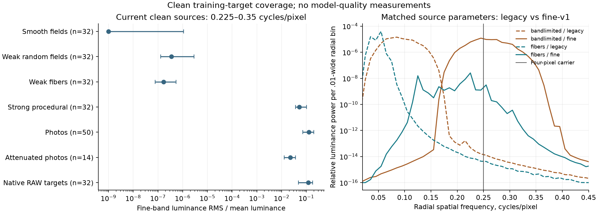
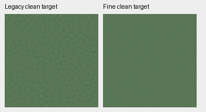
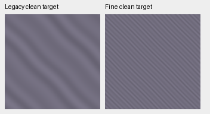

# Fine-frequency coverage in weak training targets

The sampled photographic, contrast-attenuated photographic and native RAW
targets already contain fine-frequency content. The dedicated weak-texture
sources have a narrower gap: almost no energy around four-pixel structures.
An optional `fine-v1` profile now supplies that band while retaining the existing
weak-source quota. Its reader and CPU training checks pass;
**endpoint quality review remains pending**.
V114 is the current working model after the [completed Tiny/Small comparison](v114-v115-quality.md),
which retained the legacy texture profile.
The [V116 follow-up](fine-detail-data-training.md) has completed training and tests the fine
profile and reviewed paired-reference masks against completed Tiny V114.

[Source audit, reader results and artifact bindings](results/fine-weak-frequency-coverage-v1.json).

## What the clean-source audit measures

The CPU audit reads 224 clean native256 targets from deterministic source
indices in V114's completed first 9,775 updates. Sampling balances five
32-patch strata—smooth fields, weak random fields, weak fibers, strong procedural
targets and native RAW targets—plus 64 photographs. Fourteen of those photographs
receive the existing contrast attenuation. These sample counts describe the
audit, not the proportions or population statistics of training.

For unclipped linear-sRGB luminance, the descriptor subtracts the crop mean,
applies a separable Hann window and measures radial FFT power. Power is divided
by 256⁴ and the mean squared window; the square root of band power is divided
by absolute crop-mean luminance. The two declared bands are .20–.30 and
.225–.35 cycles per final pixel. The latter lies above the legacy random-field
generator's nominal upper support and includes the .25 four-pixel carrier.

| Clean target stratum | Patches | Median relative RMS, .225–.35 cycles/pixel |
| --- | ---: | ---: |
| Smooth fields | 32 | 2.05 × 10⁻²¹ |
| Legacy weak random fields | 32 | 3.54 × 10⁻⁷ |
| Legacy weak fibers | 32 | 1.68 × 10⁻⁷ |
| Strong procedural targets | 32 | .05175 |
| Photographs | 50 | .12580 |
| Contrast-attenuated photographs | 14 | .02219 |
| Native RAW targets | 32 | .11866 |



The left panel shows medians and interquartile ranges, with values below 10⁻⁹
clipped to that plotting floor. These intervals describe sampled targets, not
confidence intervals. The right panel shows median radial power within each
matched replacement group; the solid lines use the fine profile.
[Figure data and SVG](images/weak-frequency-coverage/figure.json).

Only SSD caches are read. The audit generates no noisy observations and calls
no model, encoder or optimizer. Native camera RGB is transformed with its
source WB/matrix in NumPy64 for these descriptors. Native references retain
residual capture noise and are not exact GT. Spectral energy alone measures
neither useful photographic detail nor recoverability, SNR or model quality.
The result does not establish a general failure of the current binning policy.

## Optional fine profile within the existing allocation

Legacy random fields span 1/48 to a random upper bound between 1/8 and .22
cycles per final pixel. Legacy fiber fundamentals have periods of 6–32 pixels.
`fine-v1` changes only these frequency bounds:

- Random fields span 1/6 to a random upper bound of .34–.40 cycles per final pixel.
- Fiber fundamentals have periods of 3.5–6 final pixels; the existing 1.37×
  harmonic and bend construction remain in place.

Both profiles produce continuous float32 scene-linear RGB. Paired draws retain
the same kind, local generator seed, level, tint, peak contrast, random-field
exponent or fiber angle/bend/phase, and Python RNG consumption. Measured RMS
need not be identical. Geometry still precedes the final area2 reduction.

For a prospective matched training recipe:

```yaml
synthetic_fraction: 0.20
weak_texture_fraction: 0.15
fine_weak_texture_fraction: 0.075
augmentation_downsample: 2
optical_blur_probability: 0
```

`fine_weak_texture_fraction` is an absolute Commons-domain probability **inside**
the weak quota. This example replaces half of the weak draws. Under the current
25/25/50 native/paired/Commons mix, fine targets occupy 3.75% of all samples,
and total weak targets stay at 7.5%. Photographic, flat, strong-procedural,
native and paired allocations do not change. Source selection precedes
generation; a fine draw loads no photograph or discarded procedural target.

The library default is zero. Validation disables both weak profiles, resume
rejects a changed fine quota, and existing positional `CleanDataset` arguments
retain their meanings. V116 is the first production recipe selecting the
option; its eight-update CUDA check passed and original20k training has started.

## Actual reader compatibility and native views

The real 90,864-source/six-ROI reader checks all 64 audited weak indices twice:
once with the new default and once with a .075 fine quota. All 64 default
targets match the original frozen-reader arrays bit for bit. Only the 38
selected replacements change: 18 random fields and 20 fibers. The other 26
targets remain exact. All post-generator Python RNG states match, preserving
the downstream geometry draws. No photographic IO occurs during these weak
draws; global Python/Torch RNG states remain unchanged.

For these matched replacement subsets, median relative RMS in .225–.35 rises
from 3.28 × 10⁻⁷ to .00970 for random fields and from 1.76 × 10⁻⁷ to .00584 for
fibers. This demonstrates target coverage, with no trained-model conclusion.



[Random-field source, recipe, array and native-pixel bindings](images/weak-frequency-coverage/weak-bandlimited.json).



[Fiber source, recipe, array and native-pixel bindings](images/weak-frequency-coverage/weak-fibers.json).

These are pairs of generated **clean targets**, not noisy/denoised/GT performance
triplets. Both use ROI [48,48,160,160], exposure ×1 and the same linear-sRGB→sRGB
display transform, without resizing or contrast stretching. The examples select
the largest generator level × peak contrast in each replacement kind for
visibility; no model outcome exists. Both native pairs and the chart were viewed.

The 28 targeted tests pass, including frequency support, routing, legacy
compatibility and actual tiny-model interrupted/resumed training with exact
model/EMA/Adam/RNG states. The real-model CPU check below also passes.
A later matched production test must compare recovered fine detail, unrelated
residuals and flat false detail, alongside complete
photo/camera/color and standing GFX review. The [current architecture comparison](small-aligned-training.md)
comes first; the [optional normalized-band loss](contrast-normalized-band-supervision.md)
also remains disabled.

## Actual V112 training-path check

Both legacy and fine recipes pass **eight discarded CPU64/B16/FP32 optimizer
updates** from the exact V112 EMA. These are 16 model forwards, 16 encoder
forwards and 16 updates total, with 256 sample draws across paired, native and Commons
domains. All 91 initial EMA tensors match the parent, all 89 fresh Adam states
reach step8, model/EMA/Adam stay finite, and the official Tiny encoder stays
unchanged and without gradients. No validation or CUDA work occurs.
[Execution, saved arrays and independent NumPy audit](results/fine-weak-real-V112-CPU-v1.json).

The batch16 schedule actually exercises five fine targets: two fiber and three
random fields. Only these five of 48 Commons clean targets change. All nine
weak draws retain their seed, background, tint, peak contrast and downstream
geometry RNG. Both runs read the same 110 cached arrays with verified identical
bytes. The first two root predictions/losses are exact before the replacement
batch; both runs retain identical domains and learning rates.

All camera matrices, WB, CFA and shot/read parameters stay bit exact. Six whole
noisy batches are identical. In the two replacement batches, changed Poisson
rates also change some sibling noise draws through variable RNG consumption;
the receipt records changed slots per field. Clean/sensor targets change only
at the intended five indices. The per-step RNG preserves later unchanged
batches. This check does not claim identical noise for every unchanged target.

The first source copy omitted three trainer-required license files and stopped
with zero model calls or updates. That attempted source/log/receipt remains
preserved; the corrected copy uses fresh output roots. The completed checks
verify the real training path at CPU64, without establishing convergence,
native256/BF16 CUDA readiness or a quality gain. Their checkpoints remain
engineering evidence; original V114/V115 recipes and V112 selection are unchanged.
Both continuations have completed20,000 updates and their
[endpoint review](v114-v115-quality.md) selects V114 as the general baseline.
The fine profile is used by the separate completed V116 training run, whose
full quality evaluation is running.
