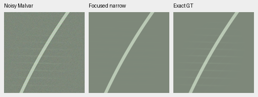
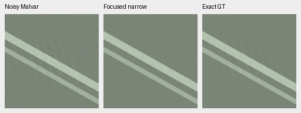

# Fitting narrow wires inside a measured footprint

The uniform periodic fit assumes a wire extends across the crop. On
constructed ISO400 wires with known geometry and finite extent, a uniform
eight-knot profile represents only 17% of the clean weak-wire energy.
The same profile with the exact footprint represents 91%. Estimating
where the wire exists is important even when its angle and changing
spacing are already known. A footprint estimated from the stronger
wire and used to constrain a narrow companion fit raises recovery from
**1.15% to 6.86%** on six constructed same-plane ISO400 cases.
[Executed evidence](results/finite-wire-profiles-v1/publication.json).

## Where the faint signal is lost

The [perspective replay](shared-projective-phase.md) supplied exact
center frequencies and compared estimated and exact quadratic phase.
This follow-up uses the same 24 constructed rail-and-wire pairs, with
independent strong-only and strong-plus-weak RAW. Each noise prior has
six same-plane, four different-plane and two planar pairs. The exact
analytic rail supplies the parent, and the two wire directions vary in
strength, width, angle and signed color.

In the first diagnostic, the two eight-knot representations use exact
phase geometry. The uniform basis repeats throughout the native query.
The localized basis multiplies each phase column by the known continuous
footprint. Least-squares projection of the clean faint component gives
the energy figures above. A second calculation fits noisy RAW and
compares the existing delivery gate, the same gate requiring only
positive contributions on both folds, and the fitted correction before
that gate. Removing the discovery-fit reliability attenuation changes
how the predictive score and correction are formed. The exact-shape
control fits one signed amplitude per color and direction to RAW using
the isolated clean wire shapes. These diagnostics use the clean target
to locate or represent detail.

| Fixed-scale ISO400 same-plane diagnostic | Weak recovery | Increment RMS DN16 | Quiet RMS DN16 |
| --- | ---: | ---: | ---: |
| Uniform, nominal gate | 1.27% | 6.127 | 2.526 |
| Uniform, positive-only gate | 4.53% | 7.776 | 7.528 |
| Uniform, before gate | 6.78% | 6.337 | 15.169 |
| Exact footprint, nominal gate | 1.84% | 6.457 | 0 |
| Exact footprint, positive-only gate | 20.25% | 5.853 | 0 |
| Exact footprint, before gate | 52.29% | 4.728 | 0 |
| Exact footprint, before gate or discovery shrinkage | 75.01% | 4.869 | 0 |
| Exact wire shapes and rail, RAW-fitted amplitude | 84.98% | 1.810 | 0 |

Quiet RMS is zero for supplied footprints by construction. Removing the
gate for the uniform fit raises quiet error by almost sixfold. At ISO6400,
the exact-shape amplitude fit recovers 34.35% with 5.520 DN16 increment
error, while the exact-footprint eight-knot fit before the gate recovers
11.95% with 8.808 DN16 error. Support, prediction and delivery each limit
recovery in these cases.

## Choosing a profile on reserved RAW

The narrow model uses one periodized line profile per direction with
separate signed amplitudes for red, green and blue. It tests three widths
of 0.04, 0.07 and 0.11 cycles and 16 evenly spaced phase shifts. It uses
four native pixel subsamples for each shape. The whole-image carrier
frequencies remain fixed. The constructed panels also repeat the earlier
test that transfers estimated perspective from the stronger direction.

Two crossed fits on the original screening reserve compare all 48 shapes
with the carrier-absent nuisance model, including the other carrier when
available. Shape eligibility requires a held-out predictive margin in
each direction of the split and lower combined held-out error than the
flexible eight-knot fit. The fit then uses the complementary RAW for the
original reliability attenuation, per-color local validation and weighted
refit. The margins are empirical because the reserve chooses among many
shapes. With an active guide and no admitted shape, the correction uses
the original eight-knot basis.

The footprint arms use the [reserved RAW footprint selector](reserved-wire-footprint.md).
Only the first active carrier can supply a footprint, and both directions
must be active. Admitting a footprint requires its existing crossed
wave-versus-absent and local-versus-uniform checks. It tapers only the
companion's basis. One tested policy uses the same reserve margin for
selecting a shape everywhere. Another requires a positive margin inside
an admitted footprint and a margin of one otherwise. Both use the
original per-color delivery gates.
[Profile implementation](../src/demosaic/finite_wire_profiles.py) ·
[Replay driver](../scripts/probe_finite_wire_profiles.py).

## Estimated footprints on constructed wires

The recovered fraction is the signed projection of the independent
two-direction minus strong-only estimate onto the known weak wire.
Increment error measures the RMS error in that estimate. Each arm can
scale down to the original fit's quiet-region RMS. Both use the nominal
delivery gates of 2 at ISO400 and 1 at ISO6400. The ISO400 same-plane
results use the exact center frequencies and the earlier reserve-based
perspective transfer, including its planar fallback.

| Same-plane ISO400 policy | Weak recovery | Increment RMS DN16 |
| --- | ---: | ---: |
| Original eight knots | 1.152% | 6.013 |
| Estimated footprint, eight knots | 1.897% | 5.996 |
| Estimated footprint, narrow companion with margin one | 2.658% | 5.962 |
| Narrow companion with a positive margin inside the footprint | **6.858%** | **5.717** |

The larger gain is concentrated in two cases. Four different-plane
ISO400 pairs gain more from footprint-only eight knots, rising from
0.319% to 2.247%. The conditional narrow companion gives 2.233% there.
On the two planar ISO400 pairs, footprint-only reaches 4.405%, while
substituting the narrow companion loses the weak signal and raises
increment error. A confirmed footprint can constrain a useful fit,
and it can also distort the evidence for the wrong line shape.
On the six same-plane ISO6400 examples, companion recovery falls
from 0.296% to 0.119% while increment RMS stays near 6.16 DN16. Only
the two planar ISO6400 examples show higher recovery, reaching 1.97%.

## Archived ordinary wires

The two archived panels contain 32 geometry and noise-profile
combinations over the V143 EMA parent
`96d146d017c54196288c585f8b7eddcf030e8a235061049c31e985b9380b7ce4`.
With whole-image guides and a reserve margin of one, the uniform
companion-only narrow fit raises the separate ISO400 panel from
**6.44% to 7.87%** at the original quiet limit. Increment RMS falls
from 11.2023 to 11.1970 DN16. On the main ISO400 panel it lowers
recovery from 4.80% to 4.55%, with nearly equal increment error.
Using exact center frequencies on that main panel raises response
from 9.01% to 9.65%, again with nearly equal increment error. At
ISO6400 the margin-one companion-only results stay near baseline.

With the footprint-conditional margin and whole-image guides, the main
ISO400 panel falls to 4.24% and the separate panel stays near baseline at
6.46%, with increment RMS up from 11.202 to 11.211 DN16. At ISO6400,
both whole-image panels match the original scores. Supplying exact
center frequencies on the main ISO400 panel raises recovery from 9.01%
to 12.05% and lowers increment RMS from 11.157 to 11.153 DN16. The
benefit remains sensitive to the guide. The uniform narrow companion
works better on the separate ISO400 panel than either footprint arm.
[Per-panel and per-threshold statistics](results/finite-wire-profiles-v1/summary.json).

## False detail with forced guides

On the retained 48 flat and rail-only controls, the initial positive
profile margin admitted shapes for both forced directions on every flat
case. Applying narrow shapes to both directions increased the maximum
flat correction from **15.35 to 29.21 DN16**. Narrowing only the companion
still increased it to 29.47 DN16. A reserve margin of one rejected all
flat shapes and recovered the exact original flat output on those inputs.

Fresh draws on the same 48 scenes test margin one after that choice.
Flat RMS stays near 0.227 DN16 and the peak stays at 9.47 DN16. Applying
narrow shapes to both directions raises straight-rail RMS from 0.603
to 0.688 DN16 and the peak from 10.76 to 13.82 DN16. As a companion-only
fit, straight-rail RMS is 0.604 DN16 and its peak returns to 10.76 DN16.
Rail geometry and the guide bank are shared across the two noise repeats.

The footprint-conditional policy reproduces the original flats exactly.
On the fresh draws, flat RMS falls from 0.227 to 0.120 DN16 and peak
correction falls from 9.47 to 6.24 DN16. One flat repeat receives an
erroneous footprint, and its delivered correction is weaker than the
original. Straight-rail RMS changes from 0.603 to 0.606 DN16 and complex
rail RMS from 1.477 to 1.478 DN16. The straight and complex peaks stay at
10.76 and 24.90 DN16. These are empirical results for the tested controls.

## Native synthetic crops

Cases 4 and 5 are same-plane ISO400 captures with RGGB and BGGR CFA,
respectively. Each triplet shows noisy Malvar, the narrow companion with
conditional margin inside its fitted footprint, and exact GT. The
analytic rail is the parent and uses no learned checkpoint. The native
160×160 cells use ROI `[48,48,160,160]`, exposure ×4, contrast 1, identity
WB and matrix, clipped sRGB, shot/read `8e-5/2.56e-8`, ADC16 and black 0.03.
The estimated response reaches 28.31% on case 4 and 12.74% on case 5 at
the fixed display operating point. The restored rails stay sharp, while
most of the faint lines visible in the exact reference remain difficult
to see in the restored crop.
[Crop source, coordinates and display manifest](images/finite-wire-profiles-v1/manifest.json).

[Case 4 method comparison](images/finite-wire-profiles-v1/iso400-case4-comparison.png) ·
[Case 5 method comparison](images/finite-wire-profiles-v1/iso400-case5-comparison.png).

## Native GFX100S review

The standing crops use V120 EMA
`a9d9b6b4f974e24a6b11e5e740aab32314233a7f53c056cf37c7d2aac1c589fb`,
same-side validation, delivery gate 2, and both scene and spectral guides.
The DSCF3879 ISO6400 main crops use the nominal shot/read prior
`.00128/6.5536e-6` at exposure ×4. DSCF3880 ISO100 AHD is an independent
qualitative reference. The controls and all rendered methods use the
same coordinates and display transform.

The sky stays pixel-identical to V120. The focused companion fit retains
the original coarse fence and its crossings. Replacing every admitted
direction with a narrow shape reduces that coarse-fence correction from
9.00 to 1.44 DN16 RMS relative to V120. The comparison shows softer
modulation with the narrow shape and no new crossings. The focused
spectral foliage correction increases from 2.21 to 2.40 DN16 RMS with
the narrow companion. Fine leaves remain soft. The building looks as
before with the focused policy.
[Sky](images/finite-wire-profiles-v1/main-overcast-sky.png) ·
[Building](images/finite-wire-profiles-v1/main-building-detail.png) ·
[Foliage](images/finite-wire-profiles-v1/main-foliage.png) ·
[Coarse fence](images/finite-wire-profiles-v1/main-chain-link-fence.png).

Both native DSCF3842 fine cab ROIs match conditioned V120 under both
guides and profiles. The fine lattice visible in DSCF3835 ISO100 AHD and
both camera JPEGs remains unresolved. Exposure is ×16. Those independent
references differ in aperture, exposure time and motion.

| Cab profile | Shot/read | Boards |
| --- | --- | --- |
| Nominal | `.00128/6.5536e-6` | [Left](images/finite-wire-profiles-v1/mesh-nominal-left.png) · [Right](images/finite-wire-profiles-v1/mesh-nominal-right.png) |
| DSCF3879 profile | `.0014635775921166604/1.0715704128646712e-6` | [Left](images/finite-wire-profiles-v1/mesh-profile3879-left.png) · [Right](images/finite-wire-profiles-v1/mesh-profile3879-right.png) |

This is a scoped CPU study with fixed checkpoints. The study has no new
full427 or held-out camera scores. V120 remains the general recommendation.
