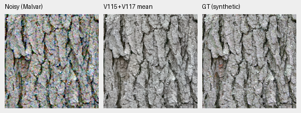
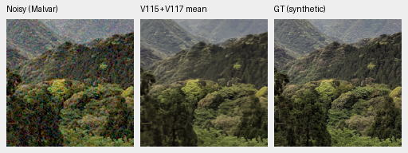
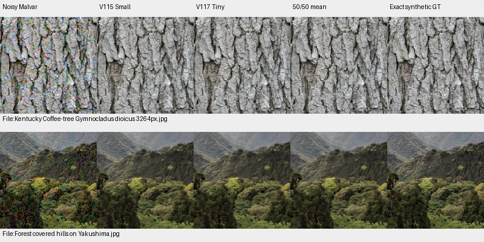
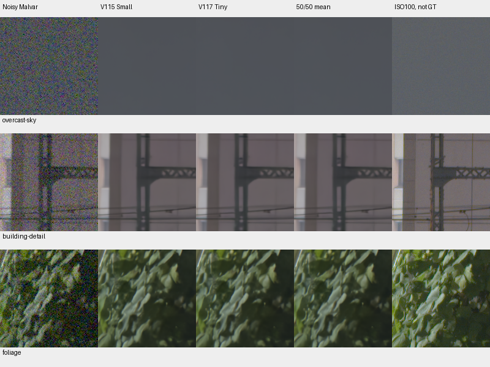
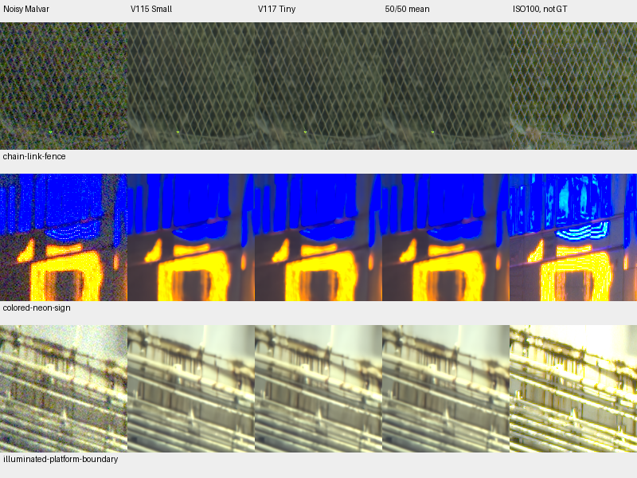

# Fixed Tiny/Small output mean

**A fixed 50/50 mean of V115 Small and V117 Tiny gives an intermediate
photo/camera tradeoff, without resolving their shared fine-detail softness.**
It reaches 37.02408dB on the full photo panel, below V117's 37.04408dB.
Known/unseen measured-CFA means are 54.31387/54.00195dB, below V115's
54.32405/54.00417dB. V114 retains lower ADC color bias. Current useful single
models and the running cleaned-data V119 trial remain documented.

[Complete scores and retained evidence](results/fixed-tiny-small-mean-v1.json) ·
[Native assets and metadata](images/fixed-tiny-small-mean-v1/manifest.json) ·
[Current choices](current-model.md).

## Operator and complete results

The coefficient was fixed before measuring this operator. Average the two
matched single-view FP32 predictions in **linear camera RGB before clipping**:
`(V115 + V117) * float32(0.5)`. There is no coefficient search or target fitting.
The result is an output ensemble, not another trained checkpoint or model
version. All original component outputs and machine receipts remain intact.

| Method | Full427 photo sRGB PSNR | Known CFA PSNR | Unseen CFA PSNR |
| --- | ---: | ---: | ---: |
| V114 Tiny | 36.97973 | 54.28627 | 54.00290 |
| V115 Small | 36.97700 | **54.32405** | **54.00417** |
| V117 Tiny | **37.04408** | 54.27303 | 53.97339 |
| Fixed V115/V117 mean | 37.02408 | 54.31387 | 54.00195 |

The mean gains .04435dB over V114, with 422/427 photo-source means increasing,
and .04708dB over V115, with 425 increasing. It loses .02000dB to V117, with
only 33 increasing; the fixed-source 95% interval is [−.02210,−.01807]dB.
Camera changes versus V115 are −.01018/−.00222dB. Crops average within capture,
captures within scene and scenes equally. These resamples describe the fixed
sources/scenes and do not measure training-seed or general-camera uncertainty.

| Color fixture bias, DN16 | V114 | V115 | V117 | Fixed mean |
| --- | ---: | ---: | ---: | ---: |
| ADC mean max-channel bias | **7.081** | 7.796 | 8.187 | 7.431 |
| ADC worst bias | **51.731** | 65.638 | 63.890 | 62.752 |
| ISO12800 mean bias | **17.083** | 18.210 | 17.431 | 17.537 |
| ISO12800 worst bias | 85.400 | 106.790 | 85.289 | **83.295** |

Flat-field centered RGB RMS falls to 2.359DN16 at ADC and 28.259DN16 at high
noise. Lower spatial variation and lower worst high-noise bias coexist with
mixed mean bias. The fixed mean does not dominate the useful single models.

At level .18 / contrast .02 / ISO12800, projected carrier gains are
.00176/.14503/.71789 for four/eight/sixteen-pixel periods, averaged across four
fixed draws and four CFAs. Four-pixel structure remains nearly absent. Averaging
cannot restore a component that both predictions have removed; these carrier
scores do not establish recovery of weak natural detail.

## Native photo comparisons

Unchanged 160px cells, ROI `[48,48,160,160]` in the retained 256px contexts.
Both use RGGB, shot .00256, read variance .0000262144, display exposure ×1,
WB `[2,1,1.5]` and the same recorded matrix. Left to right: noisy Malvar,
fixed mean, exact synthetic GT. No pixels are resized.

The direct comparison adds both components, with identical noisy/GT pixels
and display transforms. Major bark fissures and canopy forms remain; fine bark
grain and leaves stay soft. Native viewing finds no clear recovery of those
missing structures from averaging.

Sources: [Derek Ramsey](https://commons.wikimedia.org/wiki/File:Kentucky_Coffee-tree_Gymnocladus_dioicus_3264px.jpg),
[CC BY-SA2.5](https://creativecommons.org/licenses/by-sa/2.5/), and
[Grendelkhan](https://commons.wikimedia.org/wiki/File:Forest_covered_hills_on_Yakushima.jpg),
[CC BY-SA4.0](https://creativecommons.org/licenses/by-sa/4.0/); modified by binning,
cropping, synthetic noise, restoration, averaging and display.

## Standing GFX scene

These native sensor-pixel regions average the retained FP32 crops extracted
from each completed 102MP blended output. They do not require another RAW decode
or neural pass. Columns: noisy, V115, V117, fixed mean and the separate ISO100
reference. All share the original coordinates, WB/matrix and +2EV display.

All six regions were viewed. Sky stays smooth and fence/building geometry
coherent. Fine foliage remains painterly, blue neon markings flatten and
platform detail stays soft. The mean shows no clear qualitative gain over its
components. DSCF3879 ISO6400/f1.7 and DSCF3880 ISO100/f5.6 differ in aperture,
time and moving subjects; the latter is approximate, **not GT**. No pixelwise
score uses it. Full mean-frame RGB16 export and end-to-end timing were not
measured. [Standing GFX guide](gfx-qualitative.md).

## Reuse and verification

The [CPU evaluator](../scripts/evaluate_fixed_prediction_mean.py) completes all
five numerical stages: 14,190 observations / 4,450 saved batch means. Actual
input fingerprints and target/WB/matrix values match across components.
Predictions and targets are retained in a new archive. NumPy64 metrics use
the same source/scene aggregation as the completed component audits. Selected
native NPY readback is exactly equal to the declared FP32 component arithmetic.
Every batch passes an independent unclipped-MSE decomposition; maximum
discrepancy is zero. FP32 mean rounding differs from the exact Float64 mean by
at most 1.19e−7 in these arrays. Torch is never imported: zero neural/encoder
calls, noise draws, RAW decodes and optimizer updates.

The initial attempt failed before computing a mean because the frozen safety
module requires archive output under its own workspace. Its sources, plan,
log and zero-mean failure receipt are preserved. The corrected attempt writes
under `work/artifacts`; actual frozen-path/import checks pass. The same issue
was corrected in the waiting native-camera queue by placing its archive inside
the existing frozen workspace, with no controller restart or executed-source
changes. [Layout evidence](results/native-camera-development-output-layout-v1.json).

V115 checkpoint SHA256:
`fee5d05c599cb32f5a1e587c31979f040a06152c8e14676481eee83a4ce04d84`.
V117 checkpoint SHA256:
`f69452432a852ac4c5ffdcbf7d6fe6837a3ab46adbc8a7fdae073111220b8ab0`.
Operator-definition SHA256:
`71a2994d5302103fe6b4998ba5d31c319bb9711b46ed226cd887fc96b5880002`.
Archive fields named `sha256`/`checkpoint_sha256` identify this explicit operator
definition; they do not name an additional trained weight file. The component
hashes, physical inputs, ROIs and display records are bound beside the images.
