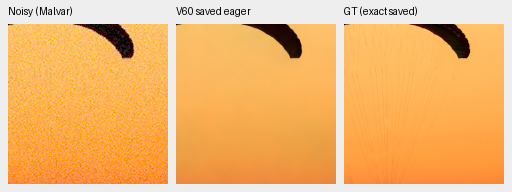
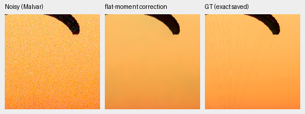
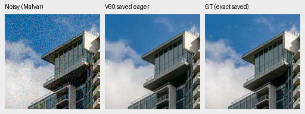
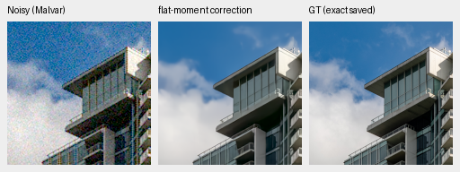
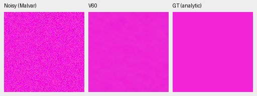
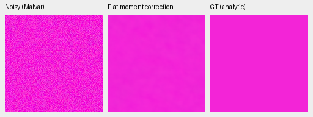
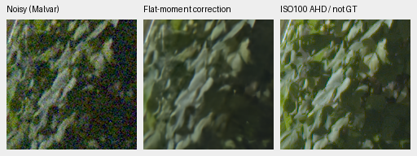
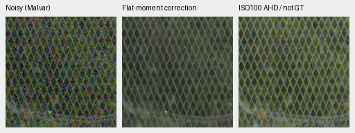

# Flatness-gated CFA mean correction: mixed results

**Keep this fixed correction out of production.** It reduces bright uniform-color
bias, but five of eighteen aggregate flat-field groups regress in camera-RGB
RMSE. High-noise spatial variation usually increases. Reviewed photographs show
no useful detail gain. A predeclared broader CPU screen is still running; its
results and native crops have not been reviewed.
[Execution hashes, complete group summaries, independent checks and 26 actual native views](results/flat-moment-CPU-v1.json).

This is a separate hypothesis from the rejected
[constant-response subtraction](constant-response-CPU-pilot.md). Use the unchanged
V60 prediction once, then add its local observed-minus-predicted CFA mean only
where input variance is consistent with a flat scene. The fixed window is 33×33
packed cells, with actual in-bounds sample counts and both green phases pooled.
All three colors must pass; any ADC-white clipping disables the window. Expand
the additive correction to the native grid. No target, low-ISO reference, fitted
coefficient, second model forward or production inference option is used.

For iid unclipped Poisson+Gaussian samples with variance `v=a*mu+b`, the variance
of `D=S²-a*sample_mean-b` is `2*v²/(N-1)+a²*b/N`. The gate uses a plug-in estimate
and a fixed three-standard-deviation ramp. Quantization and black-floor clipping
are not modeled by that identity. It does not prove gate coverage or unbiased
restoration. Independent NumPy window/interpolation oracles
match exactly on all four CFAs; clean constants, clipped whites and strong
sinusoidal texture pass their limiting-case checks. Sixteen Monte Carlo groups
of 4,096 draws give empirical/exact variance ratios .937–1.054.

The six saved CPU observations pass the small no-RMSE-regression pilot, with
photographs essentially unchanged. The complete 1176-observation hue grid exposes
the tradeoff. These are mean per-case camera-RGB RMSEs:

| Fixed condition / saturation / peak | Original | Corrected |
| --- | ---: | ---: |
| ADC-only / .5 / .9 | .010558 | .000305 |
| ISO12800 / .5 / .9 | .016413 | .007045 |
| ISO12800 / .98 / .9 | .005654 | .003066 |
| ISO12800 / .5 / .18 | .000519 | .000550 |
| ISO12800 / gray / .02 | .000219 | .000239 |

For noisy saturation .5/peak .9, mean centered RGB RMS worsens .002953→.004488 even
as mean bias falls. Bright noisy gray is unchanged because white-clipping gates
are zero. Lower mean error alone is insufficient. The full grid reuses original
CUDA-neural-FP16/physical-FP32 predictions; only the correction runs on CPU.
All 14,112 metric fields independently agree within 2.23e−16. No new neural forwards
or noise draws are needed for this grid or the six-case pilot.

Checkpoint SHA256:
`1e9812afcfaa5322593c9d2c2314fa0d8ae5458c4e116be0f516c992c880b47e`.
Operator SHA256:
`ede405608a182716c68a02523d8b80d5686ba875b7314b048ea5e65421bfce0f`.
The two photographs below use CPU-FP32 saved predictions, shot=.00256/read
variance=.0000262144, ROI `[48,48,160,160]`, display ×1/0EV and identical WB/matrix.
Each panel is native 160×160, never resized; PNGs are 8-bit previews. All 13 method
pairs have identical noisy/reference pixels and matching display metadata.

Fabric, original then corrected; noisy Malvar → method → exact simulated GT:

Building/sky, original then corrected:

Sources: [Roy Egloff](https://commons.wikimedia.org/wiki/File:CH.VD.Villeneuve_2007-08-25_Vertigo-Swiss-Riviera_2392_3x2-R_4K.jpg)
and [Dietmar Rabich](https://commons.wikimedia.org/wiki/File:Vancouver_(BC,_Canada),_Coal_Harbour_Seaside_Park,_Blick_in_den_Himmel_--_2022_--_2158.jpg),
[CC BY-SA4.0](https://creativecommons.org/licenses/by-sa/4.0/); binning, crop,
simulated noise, restoration and correction modifications. Missing fabric cords
and soft building edges remain.

Noisy magenta, original then corrected, same ROI/display/noise as above:

Four standing GFX contexts use four actual CPU-FP32/B1/native 512 forwards shared
by both methods, with unchanged model/DINO/RNG state. Inputs are retained RAW
arrays; no RAF decode or cold-drive access. At native 160 ROI, maximum camera-RGB
changes are .000304 sky, .000155 building, and exactly zero foliage/fence.
Sky/building look nearly unchanged and detail remains soft. These context
outputs are separate from earlier full-frame CUDA output and speed measurements.

Corrected foliage and fence: noisy Malvar → method → independent ISO100 AHD
reference, **not GT**. DSCF3879 ISO6400/f1.7 versus DSCF3880 ISO100/f5.6; aperture,
time and subjects differ. Display ×4/+2EV, shot=.001463577592/read
variance=.000001071570413. Foliage sensor ROI `[8890,5570,160,160]`; fence
`[2240,6000,160,160]` with reference x2241. Full source hashes, ROI/context,
WB/matrix and exposure metadata are in the receipt. No real-photo pixel score.

The running screen covers eight fixed protocol photos and all sixteen
procedural sources, seven conditions and four CFAs. Its CPU noise draws differ
from historical CUDA draws. Passing that development screen would only permit
further review. There is no threshold/window search, new training budget,
full427 replacement, SOTA claim or change to the original 20k training queues.
