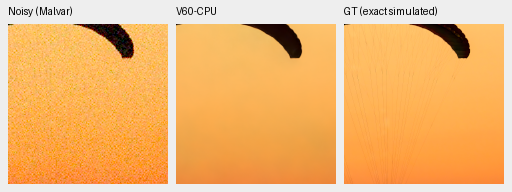
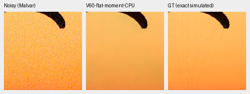
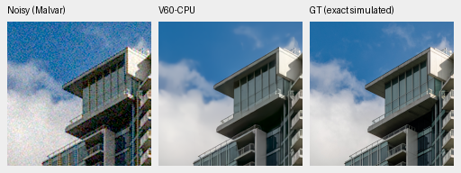
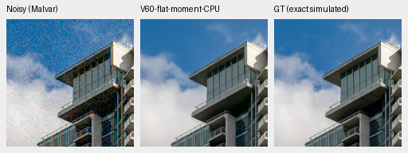
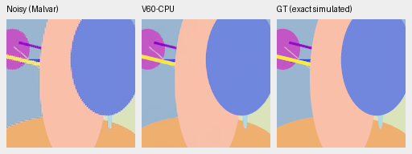
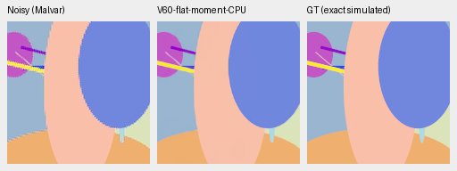

# Fixed flatness-gated correction: completed development screen

**Reject this fixed postprocess.** Its photo gain is negligible, procedural SSIM
falls slightly, and fine detail does not visibly improve. The SSIM decrease
triggers the rejection rule written before scoring. No window/threshold search,
production integration, new training or full427 extension follows.
[Complete execution, source/checkpoint hashes, independent aggregation and eight actual native views](results/flat-moment-CPU-screen-v1.json).
[Earlier pilot, full hue grid and standing GFX comparisons](flat-moment-CPU-pilot.md).

Eight fixed protocol photographs and all sixteen procedural sources have seven
noise/exposure conditions and four CFAs: 672 observations and 1,344 method-case
rows. Each unchanged V60 prediction is shared by the baseline and correction.
The 364 genuine CPU-FP32/B2 forwards retain the original suite's batch companions:
700 image evaluations include 28 unselected companion evaluations. Two CPU
threads, contiguous tensors, no CUDA. Actual model/DINO state and Torch RNG stay
unchanged. The producer completed and exited.

Means balance sources, averaging each source's 28 observations first. Intervals
use 1,000 paired source bootstrap draws/seed42. They describe this development
screen, not training-seed, model-selection or blind-test uncertainty.

| Set / metric | Original | Corrected | Difference [95% source interval] |
| --- | ---: | ---: | --- |
| Eight photos, sRGB PSNR | 35.533550 | 35.533605 | +.000054 dB [.000008,.000133] |
| Eight photos, sRGB SSIM | .966256301 | .966256578 | +.000000278 [−.000000024,.000000865] |
| Sixteen procedural, sRGB PSNR | 34.328158 | 34.328636 | +.000478 dB [.000018,.001283] |
| Sixteen procedural, sRGB SSIM | .971273777 | .971270854 | −.000002923 [−.000008312,−.000000069] |

The procedural SSIM change is small in absolute terms. The fixed rule rejects if
either set's sRGB PSNR or SSIM interval has an upper bound below zero, any photo's
mean PSNR loses over .1 dB, or native views show artifacts. The SSIM clause fails;
no photograph crosses the .1 dB threshold. The earlier full hue grid also found
five RMSE-group regressions and increased high-noise spatial variation despite
better bright-color means. There is no useful photographic detail gain here.

Independent Python `math.fsum` aggregation verifies all 1,344 unique case keys,
six comparisons, per-source deltas, bootstrap intervals and the rejection result.
All four native method pairs have identical noisy/GT pixels and matching source,
ROI, checkpoint, conditioning, WB/matrix and display metadata. Per-case model
metrics were not independently recomputed because predictions were not retained.
The CPU keyed noise differs from historical CUDA draws; these means cannot
replace the existing full427 CUDA scores.

Checkpoint SHA256:
`1e9812afcfaa5322593c9d2c2314fa0d8ae5458c4e116be0f516c992c880b47e`.
Fixed operator SHA256:
`ede405608a182716c68a02523d8b80d5686ba875b7314b048ea5e65421bfce0f`.
The frozen renderer includes the compared operator hash on both methods; the
published receipt explicitly marks it as applied only to corrected predictions.

Native 160×160 panels, ROI `[48,48,160,160]`, display ×1/0EV, no resizing:
noisy WB-aware Malvar → method → exact simulated GT. Both photographs use RGGB,
shot=.00256/read variance=.0000262144, WB `[2,1,1.5]` and the unchanged protocol
matrix. PNGs are 8-bit sRGB previews; metrics use unquantized outputs. Complete
source/ROI/noise/display metadata accompany the images in the receipt.

Fabric, original then corrected:

Building/sky, original then corrected:

Sources: [Roy Egloff](https://commons.wikimedia.org/wiki/File:CH.VD.Villeneuve_2007-08-25_Vertigo-Swiss-Riviera_2392_3x2-R_4K.jpg)
and [Dietmar Rabich](https://commons.wikimedia.org/wiki/File:Vancouver_(BC,_Canada),_Coal_Harbour_Seaside_Park,_Blick_in_den_Himmel_--_2022_--_2158.jpg),
[CC BY-SA4.0](https://creativecommons.org/licenses/by-sa/4.0/); binning, crop,
simulated noise, restoration and correction modifications. The fabric cords
remain missing; clouds and facade detail remain soft. No visible gain is claimed.

Procedural source 13, generator seed 1000013, ADC-only shot=read=0, RGGB;
same ROI/display/WB/matrix. Broad shape boundaries look unchanged and no new
rectangular correction boundary is visible. Original then corrected:

The original V63/V64 20k training/review queues and background Commons download
continue separately. No improved trained model, full-frame timing gain, decisive
real-photo superiority or SOTA result is established by this rejected correction.
