# Flat spatial-error trial: completed quality

V181 provides a quieter local-evidence option with a measurable detail cost.
Adding clean-flat spatial-error supervision to the unchanged V180 architecture
reduces quiet spatial RMS **1.106% / 0.431% raw and 1.152% / 0.474% EMA** at
ISO6400/12800. All 32 quiet inputs improve spatially at each endpoint. Quiet
total RMS falls **0.900% / 0.306% raw and 0.960% / 0.348% EMA**; 31/32 raw and
32/32 EMA inputs improve. This recovers much of V180's quiet-field cost while
retaining more mean mesh response than global V178. It is useful progress on
the tradeoff, with V180 retained for its stronger detail response and V172 for
its balanced comparison. V120 Small remains the broad photo/camera recommendation.

The cost is substantial: mean mesh response falls **8.372% raw / 8.750% EMA
versus V180**, reaching **4.14334% / 4.15043% of exact constructed GT amplitude**.
Response decreases on 235/256 raw and 234/256 EMA inputs. Present-mesh full RMS
rises 0.337% / 0.348%, even though blank RMS falls 0.201% / 0.219%. Absent full
RMS falls 0.126% / 0.137%. Present blank spatial RMS falls 0.258% / 0.284%, but
blank DC RMS rises 0.598% / 0.689%; absent DC RMS rises 0.911% / 1.073%. The
new spatial term excludes per-channel means, and quieter spatial error does
not guarantee improved color bias. Near-zero signed absent-template gain does
not establish absence of false texture.

EMA still exceeds global V178 EMA mesh response **5.783%** and V172 EMA
**7.048%**, but only 90/256 inputs increase against each. Relative to V172,
quiet total RMS changes **−0.214% / +0.109%**, and quiet spatial RMS changes
**−0.058% / +0.283%**. Only 9/16 and 5/16 improve in quiet total RMS, and 10/16
and 3/16 improve spatially. Relative to global V178 EMA, quiet spatial RMS
changes −0.110% / +0.308%. V181 therefore does not dominate these earlier
options. V173 retains stronger quiet-spatial reduction, V171 stronger standalone
flat reduction, V175 raw its modest quiet-total gain, and V161 stronger learned
mesh response with larger quiet costs.

Standalone512 full-flat RMS falls **0.089% / 0.134% raw and 0.078% / 0.110%
EMA** versus V180. Spatial RMS falls 0.184–0.193%, with 44/48 raw and 44/48 EMA
inputs improving. Coarse32 RMS changes +0.0001% / +0.0400% raw and −0.0005% /
+0.0436% EMA. The small spatial benefit leaves the broad field error unresolved.
Versus V172 EMA, full-flat RMS changes +0.008% / −0.094%, again a mixed result.

Natural photographic fine-band response decreases at both endpoints on all
128 noisy inputs versus V180. EMA falls **0.912%, 0.717%, 1.140% and 0.734%**
across retained faint/dark and organic faint/dark means. Relative band error
changes +0.0124%, +0.0083%, +0.0347% and −0.0033%. Lower spatial error on clean
flat neighborhoods can still suppress detail through shared parameters; the
target-only mask is no guarantee against that tradeoff. No broad photo-quality
or noisy-sky safety claim follows.

All **60 actual native figures in 15 original-detail sheets** were inspected,
including 12 unresized noisy/restored/exact constructed-GT triplets. Mesh2302
remains nearly uniform at normal contrast. At contrast40, V181 has less fine
periodic modulation than V180 under the broad colored field; a complete lattice
does not emerge. Mesh2309 keeps mostly one strong orientation and loses the weak
crossing. Both fine green cab windows remain soft and incomplete under nominal
and profile3879 conditioning. The differences are subtle and do not clearly
recover new crossings from the independent reference. Main coarse fence strands
survive; building edges, foliage, bird feathers, butterfly wing texture and bark
remain soft. These views agree with a quieter but less responsive candidate.

The main sky looks smooth at ordinary exposure4. Noisy gray/color flats and quiet
regions beside steps, bars and stripe patches retain broad green/purple mottle
at contrast40. V181 reduces some fine structured/mottled error versus V180,
without removing the broad casts. Normal-contrast fields are nearly smooth and
step/bar/stripe boundaries survive. ADC bark/fur and all four ADC planes retain
the exact frozen output. ADC identities do not establish noisy-sky safety.

Both protected GFX scenes remain in the report: DSCF3879 ISO6400 / independent
DSCF3880 ISO100 f/5.6 for sky, building, foliage and coarse chain link; DSCF3842
ISO6400 / independent DSCF3835 ISO100 f/5.6 and both camera JPEGs for fine cab
mesh. **ISO100/AHD and JPEG references are qualitative, not exact GT**; aperture,
exposure time, processing and moving subjects differ. No real-reference pixelwise
scores are used. These captures, JPEGs and siblings remain excluded from training.
Only cached arrays and cached parent predictions are used; originals and
unavailable `/mnt/dataz` remain untouched.

Mesh triplets use native ROI `[176,176,160,160]` in the same 512px RGGB contexts,
exposure8/contrast1, shot .00128/read variance 6.5536e−6. Quiet triplets use
ROI `[80,176,160,160]`, exposure8/contrast40 about camera RGB
`[.001500000013,.006000000052,.002666666871]`, with shot/read variance
.00128/6.5536e−6 or .00256/2.62144e−5. Fine cab views retain cached context
`[600,6260,768,768]`, ROIs `[206,229,160,160]` / `[426,189,160,160]`, exposure16.
Every view retains the prior source/ROI/noise/display transform; crop pixels are
never resized. Training checkpoint SHA256 is
`681fe36fc73a9b4a75cb682980a653ad3412ff0df295b8307caee9ce299b6a96`.
Both strict endpoint exports bind that checkpoint, source/class/config, raw/EMA
state and module hash. Six earlier V178/V180 viewer states retain separate metadata.

The intended change versus V180 is one added loss: weight .25 times domain
weight, using actual target errors in 4DN16 units and truncated17px per-channel
spatial variance inside the existing clean-range mask. All 98 neural files,
seven original terms, target mask, data and training recipe remain unchanged.
One continuation adds 900 updates/3,600 noisy images across the same 1,000 cached
rows with 100 ADC skips, from the original V172 raw/Adam/EMA history and a zero
local-evidence adapter. Network clocks finish at1,800, adapter at900. Genuine
row8 restoration resumes at row9 without prefix replay. Independent audit
passes all900 eight-term FP32 totals, full trace and five raw/EMA/Adam/frozen/RNG
checkpoints. Peak CUDA allocation is about6.31GiB. The two admission updates are
separate probes, not trial initializers.

The fixed review completes all822 inputs at both endpoints:1,644 wrapper/frozen,
1,500 network/projection and7,500 sampler calls,1,644 exact frozen replays and
144 ADC identities. Independent quality audit verifies6,576 input fingerprints,
72 native RGB plus72 residual arrays,53,772,288 addition channels,582 native
metric scalars,278 Decimal means and750 exact input-only raw/EMA evidence pairs.
This checks local geometry and finite powers without independently recomputing
the spectrum or calibrating confidence. No new parent/DINO, sensor/source draw
or RAW decode occurs.

All17 methods/13,974 rows, both V175 endpoints, all four V178 endpoints and both
V180 endpoints remain available. Two same-endpoint primary loss contrasts and
26 contextual contrasts retain1,050 table cells,2,313 Decimal means and11,226
paired checks. Earlier completed outputs are reused; this is not bit-exact paired
retraining, and sampler atomic backward remains warn-only nondeterministic. The
reused development suite has no blind or seed-uncertainty estimate. The completed
trial establishes a useful quiet/detail option, while missing real fine crossings
and broad mottling keep the joint goal open.

[Exact evidence](results/v181-flat-spatial-evidence-final-v1.json) · [Native-pixel viewer](images/v181-flat-spatial-evidence-v1/native-viewer.html).

# Flat spatial loss and retained local/global/control comparison tables

RMS values are camera-RGB DN16. Signed gain 1 is exact constructed amplitude. Real ISO100 references are unscored. This reused development suite is not blind validation.

## New loss and retained local/global/control at the same budget

### Mesh response and blank error

| Metric | V178-control-raw | V178-control-EMA | V178-evidence-raw | V178-evidence-EMA | V180-local-phase-raw | V180-local-phase-EMA | V181-flat-spatial-raw | V181-flat-spatial-EMA |
| --- | ---: | ---: | ---: | ---: | ---: | ---: | ---: | ---: |
| Present full RMS | 8.954916 | 8.957374 | 8.950154 | 8.953061 | 8.876450 | 8.877083 | 8.906324 | 8.907939 |
| Present signed template gain | 0.03888490 | 0.03887981 | 0.03924275 | 0.03923549 | 0.04521940 | 0.04548425 | 0.04143345 | 0.04150431 |
| Present blank RMS | 5.610388 | 5.613564 | 5.610671 | 5.614318 | 5.616159 | 5.620176 | 5.604892 | 5.607879 |
| Present blank spatial RMS | 5.428461 | 5.428190 | 5.429207 | 5.429165 | 5.435846 | 5.437361 | 5.421840 | 5.421916 |
| Present blank DC RMS | 1.302865 | 1.315066 | 1.301321 | 1.314366 | 1.297771 | 1.306773 | 1.305530 | 1.315772 |
| Absent full RMS | 5.308835 | 5.311586 | 5.308666 | 5.311814 | 5.310667 | 5.314059 | 5.303987 | 5.306787 |
| Absent signed template gain | 0.00001722 | 0.00001355 | 0.00001755 | 0.00001511 | 0.00008047 | 0.00009106 | -0.00002453 | -0.00002356 |
| Absent blank RMS | 5.308835 | 5.311586 | 5.308666 | 5.311814 | 5.310667 | 5.314059 | 5.303987 | 5.306787 |
| Absent blank spatial RMS | 5.166172 | 5.165967 | 5.166425 | 5.166424 | 5.169570 | 5.170659 | 5.160459 | 5.160529 |
| Absent blank DC RMS | 1.128316 | 1.139692 | 1.126611 | 1.138905 | 1.121278 | 1.130202 | 1.131491 | 1.142331 |

### Quiet fields beside detail

| Metric | V178-control-raw | V178-control-EMA | V178-evidence-raw | V178-evidence-EMA | V180-local-phase-raw | V180-local-phase-EMA | V181-flat-spatial-raw | V181-flat-spatial-EMA |
| --- | ---: | ---: | ---: | ---: | ---: | ---: | ---: | ---: |
| iso6400-prior whole RMS | 26.807064 | 26.802756 | 26.805698 | 26.801574 | 26.783953 | 26.770305 | 26.746588 | 26.742613 |
| iso6400-prior quiet RMS | 4.036107 | 4.031506 | 4.034977 | 4.029954 | 4.067919 | 4.063950 | 4.031306 | 4.024922 |
| iso6400-prior quiet spatial RMS | 3.442433 | 3.441227 | 3.443856 | 3.443032 | 3.478830 | 3.479326 | 3.440358 | 3.439251 |
| iso6400-prior quiet DC RMS | 1.992752 | 1.988387 | 1.988485 | 1.983280 | 1.994619 | 1.988680 | 1.989691 | 1.982039 |
| iso12800-prior whole RMS | 35.438505 | 35.433998 | 35.432874 | 35.427920 | 35.277377 | 35.253643 | 35.325202 | 35.317787 |
| iso12800-prior quiet RMS | 6.297270 | 6.292864 | 6.297440 | 6.292439 | 6.328901 | 6.324568 | 6.309551 | 6.302588 |
| iso12800-prior quiet spatial RMS | 5.556405 | 5.555426 | 5.557017 | 5.556344 | 5.599142 | 5.600006 | 5.575015 | 5.573477 |
| iso12800-prior quiet DC RMS | 2.777805 | 2.774289 | 2.778281 | 2.773895 | 2.772617 | 2.766157 | 2.773563 | 2.768331 |

### Standalone 512-pixel flats

| Metric | V178-control-raw | V178-control-EMA | V178-evidence-raw | V178-evidence-EMA | V180-local-phase-raw | V180-local-phase-EMA | V181-flat-spatial-raw | V181-flat-spatial-EMA |
| --- | ---: | ---: | ---: | ---: | ---: | ---: | ---: | ---: |
| iso6400-prior full RMS | 18.631764 | 18.629767 | 18.632121 | 18.629596 | 18.624531 | 18.624026 | 18.607935 | 18.609537 |
| iso6400-prior spatial RMS | 18.303915 | 18.303283 | 18.302926 | 18.302710 | 18.306471 | 18.306564 | 18.272367 | 18.271228 |
| iso6400-prior coarse32 RMS | 13.431766 | 13.432282 | 13.432070 | 13.432578 | 13.433240 | 13.433568 | 13.433259 | 13.433500 |
| iso12800-prior full RMS | 24.202722 | 24.199457 | 24.205429 | 24.202115 | 24.206583 | 24.202340 | 24.174201 | 24.175828 |
| iso12800-prior spatial RMS | 23.741963 | 23.740972 | 23.740806 | 23.740427 | 23.749890 | 23.750376 | 23.706304 | 23.704605 |
| iso12800-prior coarse32 RMS | 17.915130 | 17.915920 | 17.915587 | 17.916187 | 17.915837 | 17.914310 | 17.922998 | 17.922111 |

### Natural photographic detail

| Metric | V178-control-raw | V178-control-EMA | V178-evidence-raw | V178-evidence-EMA | V180-local-phase-raw | V180-local-phase-EMA | V181-flat-spatial-raw | V181-flat-spatial-EMA |
| --- | ---: | ---: | ---: | ---: | ---: | ---: | ---: | ---: |
| retained512/photo-faint full RMS | 33.964565 | 33.965091 | 33.964381 | 33.964993 | 33.965056 | 33.965822 | 33.967023 | 33.967698 |
| retained512/photo-faint band response | 0.298162 | 0.298158 | 0.298217 | 0.298218 | 0.298853 | 0.298969 | 0.296127 | 0.296243 |
| retained512/photo-faint band error | 0.824616 | 0.824613 | 0.824628 | 0.824625 | 0.824678 | 0.824669 | 0.824773 | 0.824771 |
| retained512/photo-dark full RMS | 29.094201 | 29.094373 | 29.094067 | 29.094435 | 29.097274 | 29.097995 | 29.095585 | 29.096066 |
| retained512/photo-dark band response | 0.530784 | 0.530763 | 0.530842 | 0.530826 | 0.531147 | 0.531274 | 0.527270 | 0.527464 |
| retained512/photo-dark band error | 0.661241 | 0.661240 | 0.661242 | 0.661241 | 0.661293 | 0.661292 | 0.661350 | 0.661347 |
| organic384/photo-faint full RMS | 37.480380 | 37.481906 | 37.480903 | 37.482130 | 37.481665 | 37.482521 | 37.494874 | 37.496490 |
| organic384/photo-faint band response | 0.149424 | 0.149428 | 0.149414 | 0.149424 | 0.149544 | 0.149626 | 0.147867 | 0.147920 |
| organic384/photo-faint band error | 0.924915 | 0.924907 | 0.924921 | 0.924914 | 0.924930 | 0.924906 | 0.925232 | 0.925227 |
| organic384/photo-dark full RMS | 33.685298 | 33.685606 | 33.685377 | 33.685832 | 33.687261 | 33.687290 | 33.691034 | 33.691601 |
| organic384/photo-dark band response | 0.397869 | 0.397863 | 0.397874 | 0.397876 | 0.397806 | 0.397910 | 0.394844 | 0.394988 |
| organic384/photo-dark band error | 0.781673 | 0.781672 | 0.781676 | 0.781676 | 0.781730 | 0.781733 | 0.781703 | 0.781707 |

### ADC controls

| Metric | V178-control-raw | V178-control-EMA | V178-evidence-raw | V178-evidence-EMA | V180-local-phase-raw | V180-local-phase-EMA | V181-flat-spatial-raw | V181-flat-spatial-EMA |
| --- | ---: | ---: | ---: | ---: | ---: | ---: | ---: | ---: |
| Photo full RMS | 18.142182 | 18.142182 | 18.142182 | 18.142182 | 18.142182 | 18.142182 | 18.142182 | 18.142182 |
| Photo band error | 0.101800 | 0.101800 | 0.101800 | 0.101800 | 0.101800 | 0.101800 | 0.101800 | 0.101800 |
| fresh-flat512 full RMS | 3.322910 | 3.322910 | 3.322910 | 3.322910 | 3.322910 | 3.322910 | 3.322910 | 3.322910 |
| fresh-flat512 coarse32 RMS | 0.538587 | 0.538587 | 0.538587 | 0.538587 | 0.538587 | 0.538587 | 0.538587 | 0.538587 |
| adc-sloped512 full RMS | 3.776943 | 3.776943 | 3.776943 | 3.776943 | 3.776943 | 3.776943 | 3.776943 | 3.776943 |
| adc-sloped512 coarse32 RMS | 0.573442 | 0.573442 | 0.573442 | 0.573442 | 0.573442 | 0.573442 | 0.573442 | 0.573442 |

## Earlier strengths and both endpoints

### Mesh response and blank error

| Metric | parent | V161-EMA | V169-EMA | V171-EMA | V172-EMA | V173-EMA | V174-EMA | V175-raw | V175-EMA | V178-control-raw | V178-control-EMA | V178-evidence-raw | V178-evidence-EMA | V180-local-phase-raw | V180-local-phase-EMA | V181-flat-spatial-raw | V181-flat-spatial-EMA |
| --- | ---: | ---: | ---: | ---: | ---: | ---: | ---: | ---: | ---: | ---: | ---: | ---: | ---: | ---: | ---: | ---: | ---: |
| Present full RMS | 9.111243 | 8.979201 | 8.956287 | 8.909846 | 8.955686 | 8.948849 | 8.955665 | 8.956087 | 8.949633 | 8.954916 | 8.957374 | 8.950154 | 8.953061 | 8.876450 | 8.877083 | 8.906324 | 8.907939 |
| Present signed template gain | 0.02202090 | 0.05239854 | 0.03836594 | 0.03884819 | 0.03877185 | 0.03723868 | 0.03867667 | 0.03879218 | 0.03878479 | 0.03888490 | 0.03887981 | 0.03924275 | 0.03923549 | 0.04521940 | 0.04548425 | 0.04143345 | 0.04150431 |
| Present blank RMS | 5.523323 | 5.816396 | 5.609300 | 5.544439 | 5.610812 | 5.590872 | 5.609727 | 5.610388 | 5.601944 | 5.610388 | 5.613564 | 5.610671 | 5.614318 | 5.616159 | 5.620176 | 5.604892 | 5.607879 |
| Present blank spatial RMS | 5.343113 | 5.645413 | 5.431940 | 5.361961 | 5.429880 | 5.410955 | 5.428378 | 5.421000 | 5.420632 | 5.428461 | 5.428190 | 5.429207 | 5.429165 | 5.435846 | 5.437361 | 5.421840 | 5.421916 |
| Present blank DC RMS | 1.289621 | 1.287310 | 1.289568 | 1.300170 | 1.299983 | 1.294365 | 1.300955 | 1.326118 | 1.300870 | 1.302865 | 1.315066 | 1.301321 | 1.314366 | 1.297771 | 1.306773 | 1.305530 | 1.315772 |
| Absent full RMS | 5.237910 | 5.501669 | 5.305929 | 5.248144 | 5.309113 | 5.291708 | 5.308678 | 5.311212 | 5.302362 | 5.308835 | 5.311586 | 5.308666 | 5.311814 | 5.310667 | 5.314059 | 5.303987 | 5.306787 |
| Absent signed template gain | 0.00003236 | 0.00039787 | -0.00000719 | 0.00001071 | 0.00000519 | -0.00003993 | -0.00000498 | -0.00000001 | 0.00000192 | 0.00001722 | 0.00001355 | 0.00001755 | 0.00001511 | 0.00008047 | 0.00009106 | -0.00002453 | -0.00002356 |
| Absent blank RMS | 5.237910 | 5.501669 | 5.305929 | 5.248144 | 5.309113 | 5.291708 | 5.308678 | 5.311212 | 5.302362 | 5.308835 | 5.311586 | 5.308666 | 5.311814 | 5.310667 | 5.314059 | 5.303987 | 5.306787 |
| Absent blank spatial RMS | 5.099652 | 5.367749 | 5.169538 | 5.102240 | 5.167332 | 5.151649 | 5.166379 | 5.161086 | 5.160891 | 5.166172 | 5.165967 | 5.166425 | 5.166424 | 5.169570 | 5.170659 | 5.160459 | 5.160529 |
| Absent blank DC RMS | 1.098115 | 1.111598 | 1.098120 | 1.135453 | 1.122982 | 1.113479 | 1.125281 | 1.155025 | 1.121672 | 1.128316 | 1.139692 | 1.126611 | 1.138905 | 1.121278 | 1.130202 | 1.131491 | 1.142331 |

### Quiet fields beside detail

| Metric | parent | V161-EMA | V169-EMA | V171-EMA | V172-EMA | V173-EMA | V174-EMA | V175-raw | V175-EMA | V178-control-raw | V178-control-EMA | V178-evidence-raw | V178-evidence-EMA | V180-local-phase-raw | V180-local-phase-EMA | V181-flat-spatial-raw | V181-flat-spatial-EMA |
| --- | ---: | ---: | ---: | ---: | ---: | ---: | ---: | ---: | ---: | ---: | ---: | ---: | ---: | ---: | ---: | ---: | ---: |
| iso6400-prior whole RMS | 27.105631 | 26.972453 | 26.806949 | 27.302897 | 26.801695 | 26.860185 | 26.797020 | 26.795723 | 26.796191 | 26.807064 | 26.802756 | 26.805698 | 26.801574 | 26.783953 | 26.770305 | 26.746588 | 26.742613 |
| iso6400-prior quiet RMS | 3.898845 | 4.615625 | 4.046127 | 5.289473 | 4.033561 | 4.012548 | 4.026601 | 4.028107 | 4.033524 | 4.036107 | 4.031506 | 4.034977 | 4.029954 | 4.067919 | 4.063950 | 4.031306 | 4.024922 |
| iso6400-prior quiet spatial RMS | 3.268502 | 3.772120 | 3.439626 | 3.429768 | 3.441249 | 3.417869 | 3.438372 | 3.436096 | 3.435861 | 3.442433 | 3.441227 | 3.443856 | 3.443032 | 3.478830 | 3.479326 | 3.440358 | 3.439251 |
| iso6400-prior quiet DC RMS | 2.016074 | 2.478187 | 2.018205 | 3.855646 | 1.991393 | 1.991098 | 1.982841 | 1.992262 | 2.001566 | 1.992752 | 1.988387 | 1.988485 | 1.983280 | 1.994619 | 1.988680 | 1.989691 | 1.982039 |
| iso12800-prior whole RMS | 36.747466 | 35.371842 | 35.462223 | 36.176612 | 35.435967 | 35.609092 | 35.430797 | 35.338865 | 35.348725 | 35.438505 | 35.433998 | 35.432874 | 35.427920 | 35.277377 | 35.253643 | 35.325202 | 35.317787 |
| iso12800-prior quiet RMS | 6.152652 | 7.060811 | 6.344343 | 7.979617 | 6.295703 | 6.278894 | 6.288010 | 6.278763 | 6.309106 | 6.297270 | 6.292864 | 6.297440 | 6.292439 | 6.328901 | 6.324568 | 6.309551 | 6.302588 |
| iso12800-prior quiet spatial RMS | 5.341833 | 5.949189 | 5.559786 | 5.525857 | 5.557772 | 5.540053 | 5.555586 | 5.554541 | 5.553504 | 5.556405 | 5.555426 | 5.557017 | 5.556344 | 5.599142 | 5.600006 | 5.575015 | 5.573477 |
| iso12800-prior quiet DC RMS | 2.849060 | 3.597003 | 2.853327 | 5.513166 | 2.780697 | 2.778718 | 2.770721 | 2.739782 | 2.800261 | 2.777805 | 2.774289 | 2.778281 | 2.773895 | 2.772617 | 2.766157 | 2.773563 | 2.768331 |

### Standalone 512-pixel flats

| Metric | parent | V161-EMA | V169-EMA | V171-EMA | V172-EMA | V173-EMA | V174-EMA | V175-raw | V175-EMA | V178-control-raw | V178-control-EMA | V178-evidence-raw | V178-evidence-EMA | V180-local-phase-raw | V180-local-phase-EMA | V181-flat-spatial-raw | V181-flat-spatial-EMA |
| --- | ---: | ---: | ---: | ---: | ---: | ---: | ---: | ---: | ---: | ---: | ---: | ---: | ---: | ---: | ---: | ---: | ---: |
| iso6400-prior full RMS | 18.546808 | 19.024279 | 18.618871 | 18.394478 | 18.607969 | 18.561545 | 18.609537 | 18.624985 | 18.626425 | 18.631764 | 18.629767 | 18.632121 | 18.629596 | 18.624531 | 18.624026 | 18.607935 | 18.609537 |
| iso6400-prior spatial RMS | 18.235130 | 18.723699 | 18.308796 | 18.067235 | 18.308685 | 18.249657 | 18.312272 | 18.300711 | 18.296671 | 18.303915 | 18.303283 | 18.302926 | 18.302710 | 18.306471 | 18.306564 | 18.272367 | 18.271228 |
| iso6400-prior coarse32 RMS | 13.440561 | 13.375119 | 13.438463 | 13.205937 | 13.435593 | 13.434259 | 13.438287 | 13.433167 | 13.431800 | 13.431766 | 13.432282 | 13.432070 | 13.432578 | 13.433240 | 13.433568 | 13.433259 | 13.433500 |
| iso12800-prior full RMS | 24.071890 | 24.866512 | 24.219097 | 23.850667 | 24.198471 | 24.125142 | 24.180955 | 24.197306 | 24.177811 | 24.202722 | 24.199457 | 24.205429 | 24.202115 | 24.206583 | 24.202340 | 24.174201 | 24.175828 |
| iso12800-prior spatial RMS | 23.596861 | 24.441501 | 23.747288 | 23.431650 | 23.747758 | 23.675332 | 23.745663 | 23.744923 | 23.737404 | 23.741963 | 23.740972 | 23.740806 | 23.740427 | 23.749890 | 23.750376 | 23.706304 | 23.704605 |
| iso12800-prior coarse32 RMS | 17.932544 | 17.847243 | 17.930574 | 17.619500 | 17.921661 | 17.925292 | 17.922356 | 17.923633 | 17.920121 | 17.915130 | 17.915920 | 17.915587 | 17.916187 | 17.915837 | 17.914310 | 17.922998 | 17.922111 |

### Natural photographic detail

| Metric | parent | V161-EMA | V169-EMA | V171-EMA | V172-EMA | V173-EMA | V174-EMA | V175-raw | V175-EMA | V178-control-raw | V178-control-EMA | V178-evidence-raw | V178-evidence-EMA | V180-local-phase-raw | V180-local-phase-EMA | V181-flat-spatial-raw | V181-flat-spatial-EMA |
| --- | ---: | ---: | ---: | ---: | ---: | ---: | ---: | ---: | ---: | ---: | ---: | ---: | ---: | ---: | ---: | ---: | ---: |
| retained512/photo-faint full RMS | 33.963754 | 33.989892 | 33.966492 | 33.965750 | 33.965651 | 33.972592 | 33.965226 | 33.966362 | 33.964199 | 33.964565 | 33.965091 | 33.964381 | 33.964993 | 33.965056 | 33.965822 | 33.967023 | 33.967698 |
| retained512/photo-faint band response | 0.298560 | 0.300629 | 0.298025 | 0.298141 | 0.298194 | 0.290365 | 0.298145 | 0.297719 | 0.297729 | 0.298162 | 0.298158 | 0.298217 | 0.298218 | 0.298853 | 0.298969 | 0.296127 | 0.296243 |
| retained512/photo-faint band error | 0.824639 | 0.824519 | 0.824693 | 0.824595 | 0.824629 | 0.824737 | 0.824629 | 0.824593 | 0.824596 | 0.824616 | 0.824613 | 0.824628 | 0.824625 | 0.824678 | 0.824669 | 0.824773 | 0.824771 |
| retained512/photo-dark full RMS | 29.097715 | 29.108120 | 29.094009 | 29.115518 | 29.095378 | 29.108366 | 29.095377 | 29.092722 | 29.092537 | 29.094201 | 29.094373 | 29.094067 | 29.094435 | 29.097274 | 29.097995 | 29.095585 | 29.096066 |
| retained512/photo-dark band response | 0.531446 | 0.531944 | 0.530900 | 0.531020 | 0.530919 | 0.516410 | 0.530799 | 0.529616 | 0.529657 | 0.530784 | 0.530763 | 0.530842 | 0.530826 | 0.531147 | 0.531274 | 0.527270 | 0.527464 |
| retained512/photo-dark band error | 0.661447 | 0.661212 | 0.661251 | 0.661223 | 0.661241 | 0.661891 | 0.661235 | 0.661219 | 0.661222 | 0.661241 | 0.661240 | 0.661242 | 0.661241 | 0.661293 | 0.661292 | 0.661350 | 0.661347 |
| organic384/photo-faint full RMS | 37.469061 | 37.468656 | 37.483612 | 37.498859 | 37.482240 | 37.489719 | 37.483229 | 37.485465 | 37.482585 | 37.480380 | 37.481906 | 37.480903 | 37.482130 | 37.481665 | 37.482521 | 37.494874 | 37.496490 |
| organic384/photo-faint band response | 0.150701 | 0.151718 | 0.149160 | 0.149403 | 0.149407 | 0.145102 | 0.149378 | 0.149340 | 0.149335 | 0.149424 | 0.149428 | 0.149414 | 0.149424 | 0.149544 | 0.149626 | 0.147867 | 0.147920 |
| organic384/photo-faint band error | 0.924117 | 0.924824 | 0.925058 | 0.924904 | 0.924935 | 0.925212 | 0.924941 | 0.924914 | 0.924916 | 0.924915 | 0.924907 | 0.924921 | 0.924914 | 0.924930 | 0.924906 | 0.925232 | 0.925227 |
| organic384/photo-dark full RMS | 33.685796 | 33.688406 | 33.685928 | 33.717351 | 33.687728 | 33.688935 | 33.687788 | 33.684152 | 33.682841 | 33.685298 | 33.685606 | 33.685377 | 33.685832 | 33.687261 | 33.687290 | 33.691034 | 33.691601 |
| organic384/photo-dark band response | 0.398945 | 0.398821 | 0.397799 | 0.398053 | 0.397914 | 0.386519 | 0.397835 | 0.397145 | 0.397168 | 0.397869 | 0.397863 | 0.397874 | 0.397876 | 0.397806 | 0.397910 | 0.394844 | 0.394988 |
| organic384/photo-dark band error | 0.781612 | 0.781774 | 0.781691 | 0.781667 | 0.781679 | 0.781560 | 0.781680 | 0.781671 | 0.781673 | 0.781673 | 0.781672 | 0.781676 | 0.781676 | 0.781730 | 0.781733 | 0.781703 | 0.781707 |

### ADC controls

| Metric | parent | V161-EMA | V169-EMA | V171-EMA | V172-EMA | V173-EMA | V174-EMA | V175-raw | V175-EMA | V178-control-raw | V178-control-EMA | V178-evidence-raw | V178-evidence-EMA | V180-local-phase-raw | V180-local-phase-EMA | V181-flat-spatial-raw | V181-flat-spatial-EMA |
| --- | ---: | ---: | ---: | ---: | ---: | ---: | ---: | ---: | ---: | ---: | ---: | ---: | ---: | ---: | ---: | ---: | ---: |
| Photo full RMS | 18.149871 | 18.146394 | 18.142182 | 18.142182 | 18.142182 | 18.142182 | 18.142182 | 18.142182 | 18.142182 | 18.142182 | 18.142182 | 18.142182 | 18.142182 | 18.142182 | 18.142182 | 18.142182 | 18.142182 |
| Photo band error | 0.101855 | 0.101811 | 0.101800 | 0.101800 | 0.101800 | 0.101800 | 0.101800 | 0.101800 | 0.101800 | 0.101800 | 0.101800 | 0.101800 | 0.101800 | 0.101800 | 0.101800 | 0.101800 | 0.101800 |
| fresh-flat512 full RMS | 3.322910 | 3.322910 | 3.322910 | 3.322910 | 3.322910 | 3.322910 | 3.322910 | 3.322910 | 3.322910 | 3.322910 | 3.322910 | 3.322910 | 3.322910 | 3.322910 | 3.322910 | 3.322910 | 3.322910 |
| fresh-flat512 coarse32 RMS | 0.538587 | 0.538587 | 0.538587 | 0.538587 | 0.538587 | 0.538587 | 0.538587 | 0.538587 | 0.538587 | 0.538587 | 0.538587 | 0.538587 | 0.538587 | 0.538587 | 0.538587 | 0.538587 | 0.538587 |
| adc-sloped512 full RMS | 3.771369 | 3.769995 | 3.776943 | 3.776943 | 3.776943 | 3.776943 | 3.776943 | 3.776943 | 3.776943 | 3.776943 | 3.776943 | 3.776943 | 3.776943 | 3.776943 | 3.776943 | 3.776943 | 3.776943 |
| adc-sloped512 coarse32 RMS | 0.574652 | 0.575804 | 0.573442 | 0.573442 | 0.573442 | 0.573442 | 0.573442 | 0.573442 | 0.573442 | 0.573442 | 0.573442 | 0.573442 | 0.573442 | 0.573442 | 0.573442 | 0.573442 | 0.573442 |

RMS is camera-RGB DN16; template gain1 means exact constructed amplitude. The added spatial loss is the intended change versus V180; completed V178/V180 outputs are reused. V175 has a larger fresh-noise budget. Reused inputs do not establish blind generalization, seed uncertainty or noisy-sky safety. ISO100/AHD/JPEG references are qualitative, not GT.

## Native comparisons

All cells retain160×160 source pixels without resizing. The manifest records source/ROI, checkpoint/state, physical noise, exposure, contrast, anchor and qualified references for every view. Both protected GFX families/JPEGs/siblings remain excluded from training.

### Comparison boards

mesh-seed2026112302-present-iso6400-prior-RGGB; ROI `[176, 176, 160, 160]`, exposure8, contrast1.

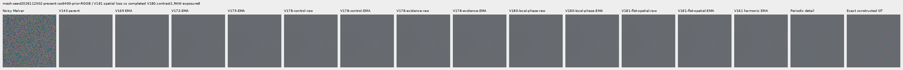

mesh-seed2026112302-present-iso6400-prior-RGGB; ROI `[176, 176, 160, 160]`, exposure8, contrast40.

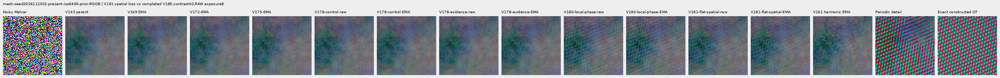

mesh-seed2026112309-present-iso6400-prior-RGGB; ROI `[176, 176, 160, 160]`, exposure8, contrast1.

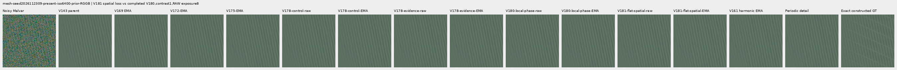

mesh-seed2026112309-present-iso6400-prior-RGGB; ROI `[176, 176, 160, 160]`, exposure8, contrast40.

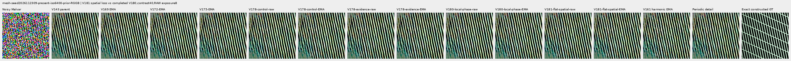

mesh-seed2026112304-absent-iso6400-prior-RGGB; ROI `[165, 0, 160, 160]`, exposure8, contrast40.

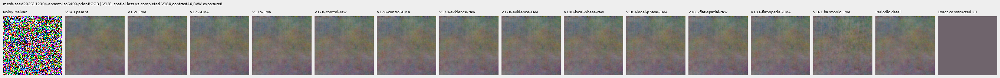

main-overcast-sky; ROI `[176, 176, 160, 160]`, exposure4, contrast1.

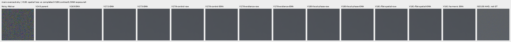

main-building-detail; ROI `[176, 176, 160, 160]`, exposure4, contrast1.

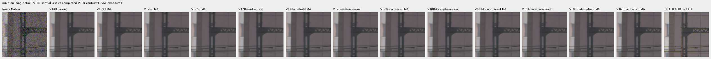

main-foliage; ROI `[176, 176, 160, 160]`, exposure4, contrast1.

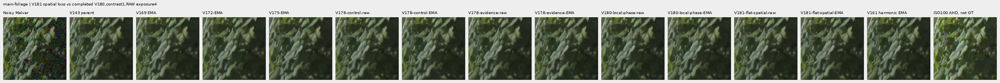

main-chain-link-fence; ROI `[176, 176, 160, 160]`, exposure4, contrast1.

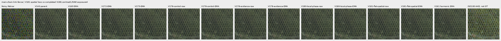

mesh-nominal; ROI `[206, 229, 160, 160]`, exposure16, contrast1.

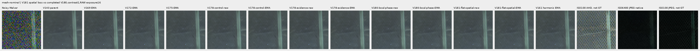

mesh-nominal; ROI `[426, 189, 160, 160]`, exposure16, contrast1.

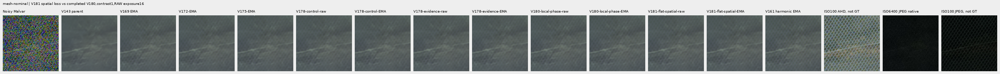

mesh-profile3879; ROI `[206, 229, 160, 160]`, exposure16, contrast1.

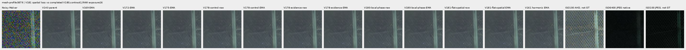

mesh-profile3879; ROI `[426, 189, 160, 160]`, exposure16, contrast1.

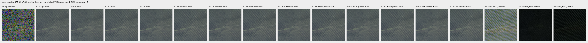

organic-02a76fd33b5e1414a0504f0b3f0aeb03a569b6f4-photo-faint-RGGB; ROI `[112, 112, 160, 160]`, exposure14.3883, contrast8.

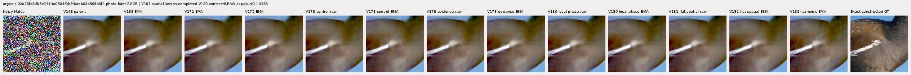

organic-dabacecd4780a1c230f8e9fce6ca1a604bdeab4c-photo-dark-RGGB; ROI `[112, 112, 160, 160]`, exposure102.758, contrast1.

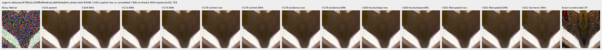

organic-6b3920bceba82d95ecf9351d47f6f94267694bd0-photo-dark-RGGB; ROI `[112, 112, 160, 160]`, exposure64.0491, contrast1.

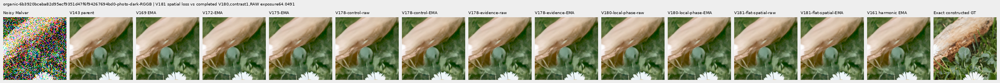

gray-l0.02-adc-only-RGGB; ROI `[48, 48, 160, 160]`, exposure4, contrast40.

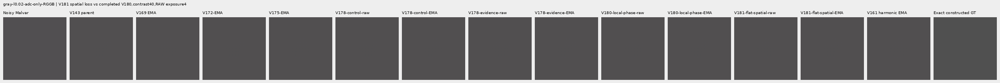

gray-l0.02-iso12800-prior-RGGB; ROI `[48, 48, 160, 160]`, exposure4, contrast40.

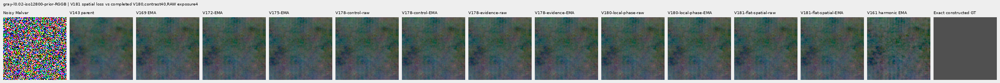

flat512-gray-l0.02-adc-only-RGGB; ROI `[176, 176, 160, 160]`, exposure4, contrast40.

flat512-gray-l0.02-iso6400-prior-RGGB; ROI `[176, 176, 160, 160]`, exposure4, contrast40.

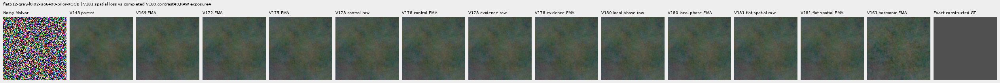

flat512-gray-l0.02-iso12800-prior-RGGB; ROI `[176, 176, 160, 160]`, exposure4, contrast40.

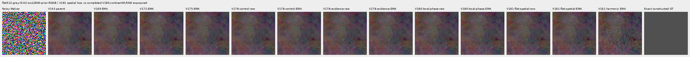

flat512-h210-s0.50-l0.02-iso6400-prior-RGGB; ROI `[176, 176, 160, 160]`, exposure4, contrast40.

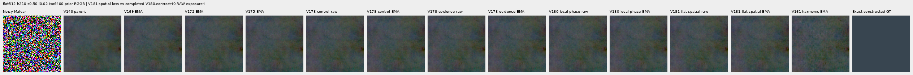

flat512-gray-l0.18-iso12800-prior-RGGB; ROI `[176, 176, 160, 160]`, exposure1, contrast8.

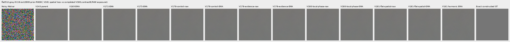

flat512-gray-l0.90-iso12800-prior-RGGB; ROI `[176, 176, 160, 160]`, exposure1, contrast4.

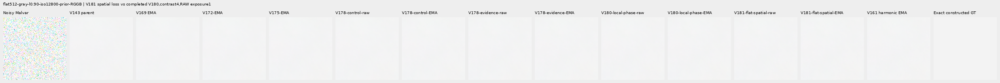

photo-3e638bbb56ed80abc88939468783e3bf9b92ee77-photo-faint-RGGB; ROI `[176, 176, 160, 160]`, exposure12.1494, contrast8.

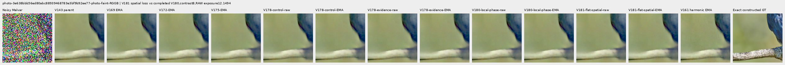

photo-3e638bbb56ed80abc88939468783e3bf9b92ee77-photo-dark-RGGB; ROI `[176, 176, 160, 160]`, exposure80.9959, contrast1.

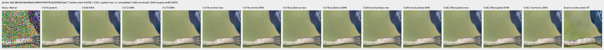

mixed-vertical-step-iso6400-prior-RGGB; ROI `[80, 176, 160, 160]`, exposure8, contrast40.

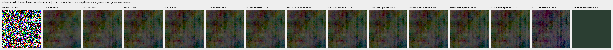

mixed-vertical-step-iso6400-prior-RGGB; ROI `[240, 176, 160, 160]`, exposure8, contrast1.

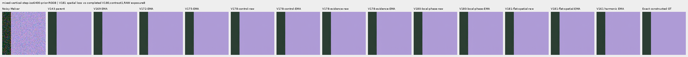

mixed-vertical-step-iso12800-prior-RGGB; ROI `[80, 176, 160, 160]`, exposure8, contrast40.

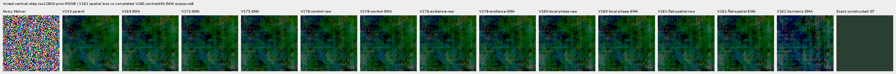

mixed-vertical-step-iso12800-prior-RGGB; ROI `[240, 176, 160, 160]`, exposure8, contrast1.

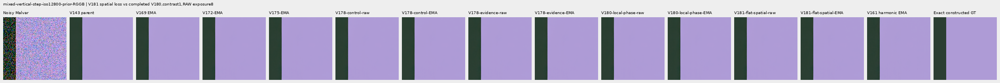

mixed-narrow-bar-iso6400-prior-RGGB; ROI `[80, 176, 160, 160]`, exposure8, contrast40.

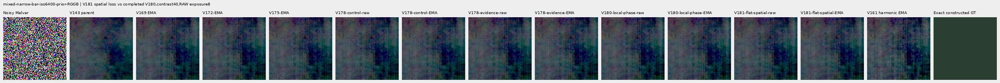

mixed-narrow-bar-iso6400-prior-RGGB; ROI `[240, 176, 160, 160]`, exposure8, contrast1.

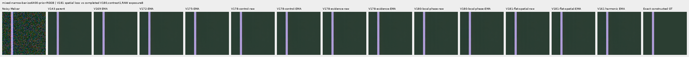

mixed-narrow-bar-iso12800-prior-RGGB; ROI `[80, 176, 160, 160]`, exposure8, contrast40.

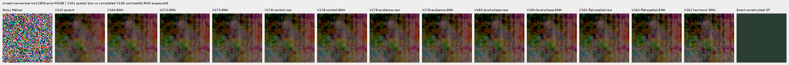

mixed-narrow-bar-iso12800-prior-RGGB; ROI `[240, 176, 160, 160]`, exposure8, contrast1.

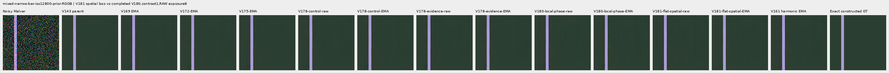

mixed-slanted-step-iso6400-prior-RGGB; ROI `[80, 176, 160, 160]`, exposure8, contrast40.

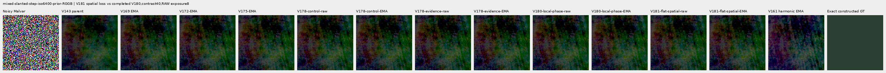

mixed-slanted-step-iso6400-prior-RGGB; ROI `[240, 176, 160, 160]`, exposure8, contrast1.

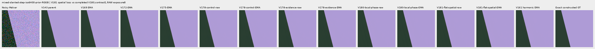

mixed-slanted-step-iso12800-prior-RGGB; ROI `[80, 176, 160, 160]`, exposure8, contrast40.

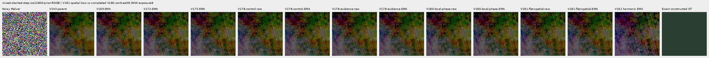

mixed-slanted-step-iso12800-prior-RGGB; ROI `[240, 176, 160, 160]`, exposure8, contrast1.

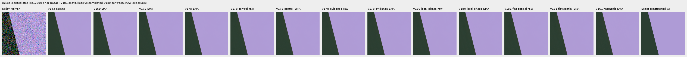

mixed-striped-patch-iso6400-prior-RGGB; ROI `[80, 176, 160, 160]`, exposure8, contrast40.

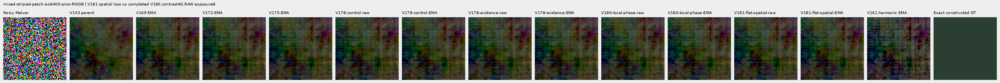

mixed-striped-patch-iso6400-prior-RGGB; ROI `[240, 176, 160, 160]`, exposure8, contrast1.

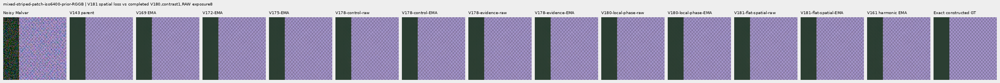

mixed-striped-patch-iso12800-prior-RGGB; ROI `[80, 176, 160, 160]`, exposure8, contrast40.

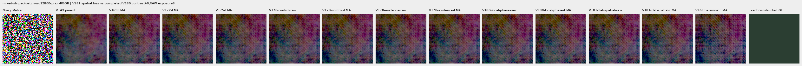

mixed-striped-patch-iso12800-prior-RGGB; ROI `[240, 176, 160, 160]`, exposure8, contrast1.

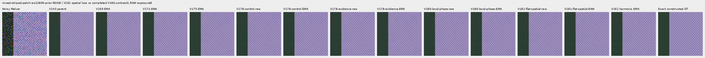

V150-control-bark-contrast0p025-adc-RGGB; ROI `[48, 48, 160, 160]`, exposure1, contrast40.

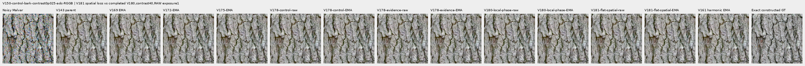

V150-control-raccoon-fur-contrast0p025-adc-RGGB; ROI `[48, 48, 160, 160]`, exposure1, contrast40.

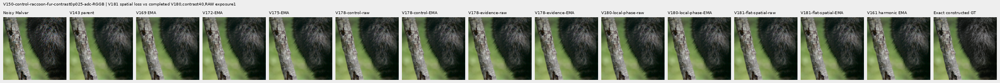

V150-control-ADC-plane0-RGGB; ROI `[176, 176, 160, 160]`, exposure45, contrast8.

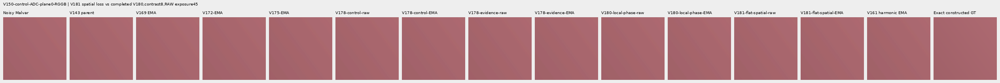

V150-control-ADC-plane1-RGGB; ROI `[176, 176, 160, 160]`, exposure9, contrast8.

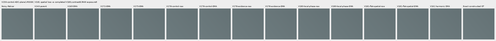

V150-control-ADC-plane2-RGGB; ROI `[176, 176, 160, 160]`, exposure1, contrast8.

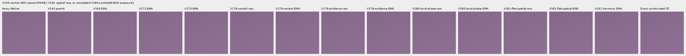

V150-control-ADC-plane3-RGGB; ROI `[176, 176, 160, 160]`, exposure0.24, contrast8.

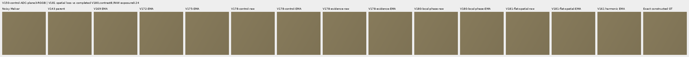

### Noisy, restored and exact constructed GT

mesh-seed2026112302-present-iso6400-prior-RGGB; ROI `[176, 176, 160, 160]`, exposure8, contrast1.

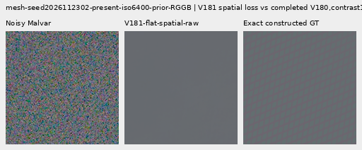

mesh-seed2026112302-present-iso6400-prior-RGGB; ROI `[176, 176, 160, 160]`, exposure8, contrast1.

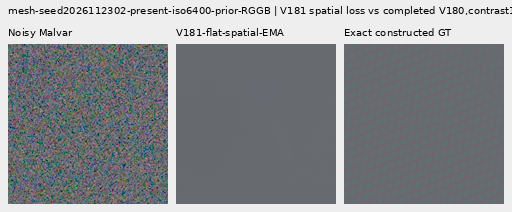

mesh-seed2026112309-present-iso6400-prior-RGGB; ROI `[176, 176, 160, 160]`, exposure8, contrast1.

mesh-seed2026112309-present-iso6400-prior-RGGB; ROI `[176, 176, 160, 160]`, exposure8, contrast1.

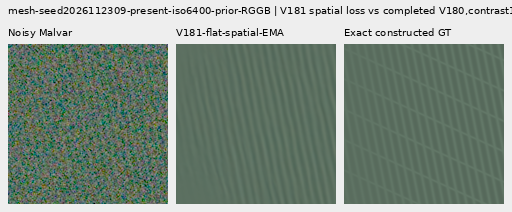

flat512-gray-l0.02-iso6400-prior-RGGB; ROI `[176, 176, 160, 160]`, exposure4, contrast40.

flat512-gray-l0.02-iso6400-prior-RGGB; ROI `[176, 176, 160, 160]`, exposure4, contrast40.

flat512-gray-l0.02-iso12800-prior-RGGB; ROI `[176, 176, 160, 160]`, exposure4, contrast40.

flat512-gray-l0.02-iso12800-prior-RGGB; ROI `[176, 176, 160, 160]`, exposure4, contrast40.

mixed-vertical-step-iso6400-prior-RGGB; ROI `[80, 176, 160, 160]`, exposure8, contrast40.

mixed-vertical-step-iso6400-prior-RGGB; ROI `[80, 176, 160, 160]`, exposure8, contrast40.

mixed-vertical-step-iso12800-prior-RGGB; ROI `[80, 176, 160, 160]`, exposure8, contrast40.

mixed-vertical-step-iso12800-prior-RGGB; ROI `[80, 176, 160, 160]`, exposure8, contrast40.

[Publication verification](results/v181-flat-spatial-evidence-publication-verification-v1.json).
