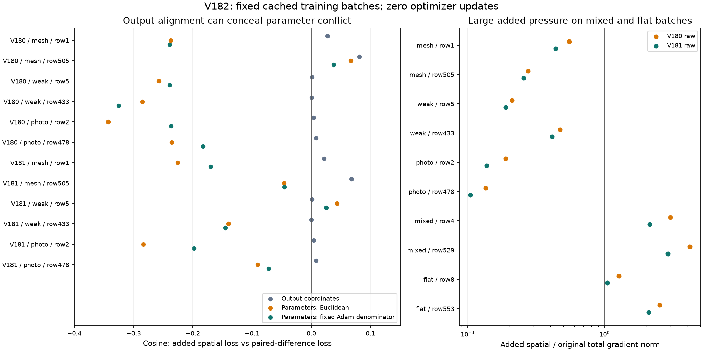

# Why flat supervision can suppress paired detail

**V182 finds a local conflict through shared neural parameters.** The added
spatial loss and paired-detail loss have positive output-gradient cosines on
all 12 paired training cases. Their parameter-gradient cosines are negative
on 10/12, in both Euclidean coordinates and a fixed saved-Adam denominator
metric. In that fixed metric, a negative spatial-gradient direction decreases
the measured target-pair response on **all 12 cases**, including at the completed
V181 state. The shared matching network alone has the same 12/12 response sign;
the evidence adapter alone has 10/12. This supports investigating coherent
pair-response supervision while retaining the flat penalties.

These are local training derivatives, **not a new trained model or a measured
quality gain**. [V181's actual comparison](flat-spatial-evidence-comparison.md)
remains authoritative: quieter fields cost mesh and photographic response;
real fine cab crossings and broad colored mottle remain unresolved. The local
architecture remains useful, with both quieter V181 and stronger-response V180
recipes retained alongside earlier strengths. V120 Small remains the general
recommendation.

[Standalone SVG](images/v182-loss-gradient-geometry-v1/training-gradient-geometry.svg) ·
[Complete inputs, checkpoint bindings, gradients and independent evidence](results/v182-flat-spatial-loss-geometry-v1.json).
Both panels were actually inspected at original detail. The fixed Adam metric
applies to **both parameter plots**; the right panel uses a logarithmic ratio axis.

## Fixed training-only measurements

Two completed raw checkpoints, V180 and V181, each see the same ten cached
four-image batches. Selection is fixed before any forward: the first and middle
noisy batch in each of mesh, weak texture, photo, mixed structure and flat
domains. Actual row numbers are 1/505, 5/433, 2/478, 4/529 and 8/553 respectively.
These use the existing cached sources, counterfactuals, physical noise, parent
predictions and pair units. No protected GFX input enters this diagnostic.

Five scalar functionals are differentiated: the original weighted seven-term
total, the weighted V181 spatial addition, weighted paired-difference and common
losses, and mean normalized target-pair response. Response is the projection of
the restored pair difference onto its actual clean difference, divided by that
pair's own target energy, then averaged over pairs. It is a **full-target response,
not a frequency-band score**. The six unique paired targets have DC energy
fractions below 7e−11, so constant RGB differences account for negligible target
energy here. This still does not identify a particular missing fine orientation.

For scalar gradients g and h, ordinary parameter products are gᵀh. The second
metric is gᵀDh, with positive diagonal
`D = 1 / (sqrt(saved_v / (1 − beta2^step)) + epsilon)` in FP64. Saved network
clocks are 1,800 and adapter clocks 900. This fixes the denominator at the saved
state; it omits first moments, the next second-moment update, clipping, decay,
finite steps and cross-batch interactions. It is **not an actual AdamW update**.
No gradient projection or optimizer change is justified by a cosine alone.

## Every paired case

Cosines compare the added spatial loss with paired-difference loss. The last
column is the response derivative under `−D g_spatial`; negative decreases this
training-pair response. Its scale is specific to this diagnostic direction.

| Raw state / domain / row | Output cosine | Parameter cosine | Fixed-Adam cosine | Fixed-Adam spatial response slope |
| --- | ---: | ---: | ---: | ---: |
| V180 / mesh / 1 | 0.027364 | -0.237047 | -0.238977 | -4.960308 |
| V180 / mesh / 505 | 0.081031 | 0.066640 | 0.037414 | -53.903255 |
| V180 / weak / 5 | 0.001449 | -0.257464 | -0.238790 | -6.152639 |
| V180 / weak / 433 | 0.000419 | -0.284942 | -0.325373 | -5.243847 |
| V180 / photo / 2 | 0.004254 | -0.342578 | -0.236721 | -0.270581 |
| V180 / photo / 478 | 0.007797 | -0.235587 | -0.182662 | -0.128690 |
| V181 / mesh / 1 | 0.021898 | -0.225561 | -0.170192 | -1.172843 |
| V181 / mesh / 505 | 0.068028 | -0.045913 | -0.045406 | -14.944992 |
| V181 / weak / 5 | 0.001052 | 0.043489 | 0.024866 | -0.172142 |
| V181 / weak / 433 | 0.000174 | -0.139682 | -0.145034 | -2.682198 |
| V181 / photo / 2 | 0.003901 | -0.283479 | -0.197988 | -0.170750 |
| V181 / photo / 478 | 0.008259 | -0.090906 | -0.071734 | -0.052261 |

The added spatial term has 0.104–0.549 times the original-total gradient norm
on these paired examples in the fixed metric. Ratios rise to 2.131–4.189 on
mixed batches and 1.046–2.528 on standalone flats. These are four selected quiet
batches at two states, not population estimates. Their effect on a different
detail batch was not measured. Both true weak target differences and the
existing clean mask remain intact; direct output alignment does not prevent
shared-parameter suppression.

## Execution and independent checks

The original owner completes exactly **20 wrapper/frozen/network/projection
forwards, 100 sampler calls and 76 parameter backward evaluations**, with zero
optimizer updates. All model/frozen states and CPU/CUDA RNG remain unchanged.
Peak CUDA allocation is about 6.63 GiB. The existing sampler's atomic backward
remains warn-only nondeterministic. No source/noise draws, parent/DINO inference,
RAW decode or original/dataz access occurs; all 98 neural files stay unchanged.

All 5,700 layer/output Gram computations are compared independently in NumPy
and Torch FP64. Full parameter vectors and the positive denominator diagonal
are retained for the first mesh batch at both checkpoints; other vectors have
fingerprints and in-process comparisons. All twenty RGB batches are retained.
The independent CPU audit verifies 53,477,376 RGB values, all input bindings,
20 eight-term FP32 totals, 20 clean masks/spatial losses, 24 paired losses,
12 pair-response functionals, all 140 aggregate/output geometry matrices,
two strict raw checkpoints and 284 saved Adam denominators. The two full
retained archives reproduce 284 layer fingerprints and 568 Gram matrices.
Maximum independent loss errors are below 3.8e−8; response error is below 5.6e−17.
Twenty-two gradient/response CPU checks and four independent-auditor checks pass.
The earlier eighteen-check pure-math prefix is also preserved.

The first audit stopped after its first batch because a local pair-unit array
shadowed the complete unit-row list. Its exact frozen source, seal and log stay
preserved. The corrected v2 changes that variable name and version bindings;
math, tolerances, diagnostic inputs and worker outputs are unchanged. No neural
work is repeated. The first actually viewed plot placed its legend over the
last row; a separately preserved v2 adds axis space using identical measurements.

Both protected GFX families/JPEGs/siblings remain outside training. Their actual
sky/building/foliage/coarse-fence and fine-cab ROI/profile/JPEG comparisons remain
in the completed [V181 native viewer](images/v181-flat-spatial-evidence-v1/native-viewer.html).
Independent ISO100/AHD/JPEG references remain qualitative, not exact GT. Existing
native noisy/restored/exact constructed-GT triplets, with source/ROI, checkpoint,
physical noise and display transforms, remain in the [quality report](flat-spatial-evidence-comparison.md).
This gradient diagnostic does not replace them or assert new real-photo recovery.

[Gradient/response helpers](../scripts/loss_gradient_geometry.py) ·
[Bound worker](../scripts/probe_flat_spatial_loss_geometry.py) ·
[Independent auditor](../scripts/audit_flat_spatial_loss_geometry.py) ·
[Plot source](../scripts/plot_flat_spatial_loss_geometry.py).
