# Clean-target flat anchor: V162 final quality

V162's clean-target anchor reduces fine colored grain relative to the stronger V161 context model, with a measurable detail cost. **Quiet spatial RMS falls 4.73–7.73% on all 32 inputs at both endpoints. Total quiet RMS falls 1.68–5.29%**, improving 26/32 inputs at both raw/EMA endpoints. Six inputs worsen; the maximum increase is 0.907 DN16 raw / 0.763 EMA. The change is an extra training loss at weight 0.25 versus 0, with identical architecture, initialization, cached data and all base losses.

The mesh cost is explicit: response falls **20.28% raw / 21.53% EMA versus V161**, reaching **3.846% / 4.112% of exact constructed GT amplitude**. That remains 74.67% / 86.73% above V143, but is slightly below V160 paired response. Actual present-case blank RMS improves **2.28% / 3.30% versus V161**, yet remains 1.08% / 1.84% above V143. Present full RMS is mixed versus V161: raw +0.085%, EMA −0.276%. Lower total error therefore does not mean better weak-signal response.

Native512 standalone-flat RMS falls **1.28–2.55% versus V161**, improving 46/48 raw and 48/48 EMA inputs. Coarse block32 means improve another 0.04–0.11%, with individual regressions. Against V143, coarse RMS is **0.53–0.67% lower on all 48 inputs at both endpoints**, while total flat RMS is still 0.21–0.67% higher. V160 ordinary retains better total-flat accuracy and V157 retains stronger coarse correction. This is a useful grain/coarse compromise rather than a uniformly cleaner model.

Color bias remains a problem. At ISO12800, mean quiet DC RMS rises from 3.736→3.916 DN16 raw and 3.597→3.773 EMA versus V161, despite lower spatial error. ISO6400 mean DC improves slightly raw and worsens slightly EMA. Total quiet RMS remains **11.54–12.21% above V143**, with 30/32 raw and 31/32 EMA inputs worse; all 32 quiet spatial errors are also above V143. The independent original-pixel decomposition below separates these costs. Stronger absolute RGB supervision reduces fine grain but does not remove the learned color-bias tradeoff.

All 72 native figures were actually inspected in 18 original-detail sheets. Boosted flat and quiet crops show less fine colored/gridded grain than V161, while broad mottle and casts persist. Main sky remains smooth at the fixed +2EV display without an obvious new coherent pattern; that view does not establish flat-field safety. Both cab priors/windows remain soft, with slightly weaker existing strand/lattice contrast than V161, most apparent in the right window. No convincing new complete crossings appear. Building and foliage remain softened. Independent ISO100 captures and JPEGs are qualitative references, not exact GT.

All eight natural-photo band-response means fall versus V161, by 0.29–1.04%, and remain below V143. Full photo RMS is small and mixed: five of eight cohort means improve versus V161, three worsen. Bird feathers, butterfly scales and grass/wood microtexture do not show convincing recovery. ADC-photo RMS improves about 0.15–0.16% versus V143, still far less than V150's retained 3.06% gain. ADC sloped-plane coarse means improve while full RMS worsens slightly. All 192 constant ADC outputs retain their parents exactly.

The mask audit verifies all 1,000 actual GPU mask fingerprints/counts against independent clean-target NumPy extrema. Supervised mean eligible fractions are about 70% mesh, 50% weak detail, 52% photos, 69% standalone flats and 91% mixed regions. Eligible nonconstant targets retain their original weak gradients. Coverage demonstrates where the loss applied, not inference accuracy or a flat-safety guarantee. Clipping rises from 134→197 of 900 supervised batches; these norms do not isolate why individual quality metrics change.

Retain the anchor as an optional grain-reduction recipe on the context architecture, with its weaker response and persistent bias clearly documented. Keep V161's stronger learned response, V160 paired response, V158 quiet accuracy, V160 ordinary total-flat accuracy and V157 coarse capacity visible. V120 Small remains the broad general recommendation. This related, adaptively reused cohort does not establish blind generalization. Recovering dark fine detail without false structure remains an active objective.

[Final evidence and immutable sources](results/v162-flat-target-anchor-final-v1.json) · [Native pixels, source ROIs, conditioning, exposure and checkpoint hashes](images/v162-flat-target-anchor-v1/manifest-v1.json).

## Response and actual blank error

RMS values are camera-RGB DN16. Response1 means the exact constructed mesh amplitude. Blank error measures actual target error; added blank RMS measures displacement from V143.

| Method | Present full RMS | Response | Actual blank RMS | Blank spatial RMS | Added blank RMS |
| --- | ---: | ---: | ---: | ---: | ---: |
|V143|9.111243|0.02202090|5.523323|5.343113|0.00000000|
|Harm ctrl raw|8.942284|0.04825149|5.713081|5.545150|1.55501600|
|Harm ctrl EMA|8.979201|0.05239854|5.816396|5.645413|1.83264649|
|Flat anchor raw|8.949879|0.03846471|5.583074|5.403889|1.09371049|
|Flat anchor EMA|8.954442|0.04111957|5.624725|5.445889|1.21505232|
|Existing periodic detail|8.586126|0.07089755|5.523328|5.343118|0.00063557|

## Quiet neighbors and coarse fields

| Prior | Method | Whole RMS | Quiet RMS | Quiet spatial RMS |
| --- | --- | ---: | ---: | ---: |
|ISO6400|V143|27.105631|3.898845|3.268502|
|ISO6400|Harm ctrl raw|27.015906|4.594075|3.658947|
|ISO6400|Harm ctrl EMA|26.972453|4.615625|3.772120|
|ISO6400|Flat anchor raw|27.007081|4.357444|3.429304|
|ISO6400|Flat anchor EMA|26.991217|4.371246|3.480570|
|ISO12800|V143|36.747466|6.152652|5.341833|
|ISO12800|Harm ctrl raw|35.543905|7.022340|5.811414|
|ISO12800|Harm ctrl EMA|35.371842|7.060811|5.949189|
|ISO12800|Flat anchor raw|35.875252|6.904136|5.536684|
|ISO12800|Flat anchor EMA|35.774065|6.862538|5.586692|

Quiet bias is averaged per RGB channel before its Euclidean RMS. The independent pixel audit verifies total squared = spatial squared + DC squared per case; means of RMS values do not share that identity.

| Prior | Method | Quiet DC RMS DN16 |
| --- | --- | ---: |
| iso6400-prior | parent | 2.016074 |
| iso6400-prior | harmonic-control-raw-step1000 | 2.591170 |
| iso6400-prior | harmonic-control-EMA-step1000 | 2.478187 |
| iso6400-prior | flat-anchor-raw-step1000 | 2.535833 |
| iso6400-prior | flat-anchor-EMA-step1000 | 2.487000 |
| iso12800-prior | parent | 2.849060 |
| iso12800-prior | harmonic-control-raw-step1000 | 3.735989 |
| iso12800-prior | harmonic-control-EMA-step1000 | 3.597003 |
| iso12800-prior | flat-anchor-raw-step1000 | 3.915659 |
| iso12800-prior | flat-anchor-EMA-step1000 | 3.772640 |

|Flat test|V143|Harm ctrl raw|Harm ctrl EMA|Flat anchor raw|Flat anchor EMA|
| --- | ---: | ---: | ---: | ---: | ---: |
|Native512 ISO6400 full RMS|18.546808|18.826539|19.024279|18.585475|18.629697|
|Native512 ISO6400 spatial RMS|18.235130|18.527491|18.723699|18.240981|18.329562|
|Native512 ISO6400 block32 RMS|13.440561|13.363268|13.375119|13.353534|13.369736|
|Native512 ISO12800 full RMS|24.071890|24.578261|24.866512|24.122393|24.232774|
|Native512 ISO12800 spatial RMS|23.596861|24.129865|24.441501|23.661838|23.794943|
|Native512 ISO12800 block32 RMS|17.932544|17.832772|17.847243|17.812308|17.832816|
|Older native256 ISO12800 full RMS|27.233548|27.736351|28.043239|27.279997|27.400426|
|Older native256 ISO12800 spatial RMS|26.017191|26.549347|26.872305|26.061415|26.210132|
|Older native256 ISO12800 block32 RMS|19.539875|19.442077|19.456009|19.411683|19.435240|

## Natural detail and ADC controls

|Photo test|V143|Harm ctrl raw|Harm ctrl EMA|Flat anchor raw|Flat anchor EMA|
| --- | ---: | ---: | ---: | ---: | ---: |
|Retained512 faint full RMS|33.963754|33.977553|33.989892|33.967916|33.967087|
|Retained512 faint band error|0.824639|0.824651|0.824519|0.824655|0.824456|
|Retained512 faint band response|0.298560|0.299368|0.300629|0.297322|0.298299|
|Retained512 dark full RMS|29.097715|29.102824|29.108120|29.099585|29.095951|
|Retained512 dark band error|0.661447|0.661248|0.661212|0.661306|0.661247|
|Retained512 dark band response|0.531446|0.531132|0.531944|0.529251|0.529948|
|Organic384 faint full RMS|37.469061|37.470642|37.468656|37.478905|37.469023|
|Organic384 faint band error|0.924117|0.925087|0.924824|0.924858|0.924545|
|Organic384 faint band response|0.150701|0.150442|0.151718|0.149180|0.150133|
|Organic384 dark full RMS|33.685796|33.689916|33.688406|33.693059|33.686492|
|Organic384 dark band error|0.781612|0.781780|0.781774|0.781647|0.781619|
|Organic384 dark band response|0.398945|0.397925|0.398821|0.396776|0.397497|

|ADC test|V143|Harm ctrl raw|Harm ctrl EMA|Flat anchor raw|Flat anchor EMA|
| --- | ---: | ---: | ---: | ---: | ---: |
|Photo full RMS|18.149871|18.147494|18.146394|18.120138|18.123230|
|Photo band error|0.101855|0.101827|0.101811|0.101620|0.101654|
|Photo band response|0.968329|0.968346|0.968357|0.968423|0.968416|
|Sloped512 full RMS|3.771369|3.770226|3.769995|3.774910|3.774662|
|Sloped512 spatial RMS|3.397249|3.395901|3.395581|3.400832|3.400446|
|Sloped512 block32 RMS|0.574652|0.575722|0.575804|0.573505|0.573225|
|Sloped512 crop block32 RMS|0.088145|0.088150|0.088146|0.088148|0.088148|
|Sloped512 worst absolute DC|11.176981|11.173789|11.173521|11.176790|11.176686|

## Fixed native comparisons

Every cell is native 160×160; crop pixels are never resized. All RAW methods within each board share source coordinates, camera display transform, exposure and contrast. JPEG cells retain native sRGB8 without exposure/contrast changes. Both final raw/EMA endpoints of both heads are shown, with six retained V156/V157/V158/V159/V160 ordinary/V160 paired columns.

The main scene is DSCF3879 ISO6400 versus DSCF3880 ISO100 f/5.6. The fine cab mesh uses DSCF3842 versus DSCF3835 and both camera JPEGs. Aperture, shutter, moving subjects and processing differ: ISO100 views are qualitative references, not exact GT. All30 real score rows stay unscored.

### Mesh and exact absence

mesh-seed2026112302-present-iso6400-prior-RGGB; ROI `[176, 176, 160, 160]`, RAW exposure 8, contrast 1.

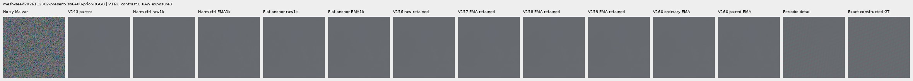

mesh-seed2026112302-present-iso6400-prior-RGGB; ROI `[176, 176, 160, 160]`, RAW exposure 8, contrast 40.

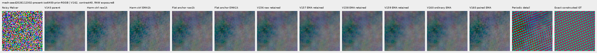

mesh-seed2026112309-present-iso6400-prior-RGGB; ROI `[176, 176, 160, 160]`, RAW exposure 8, contrast 1.

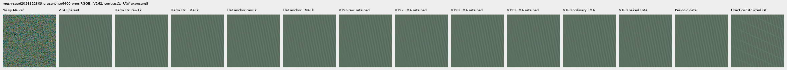

mesh-seed2026112309-present-iso6400-prior-RGGB; ROI `[176, 176, 160, 160]`, RAW exposure 8, contrast 40.

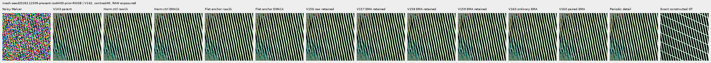

mesh-seed2026112304-absent-iso6400-prior-RGGB; ROI `[165, 0, 160, 160]`, RAW exposure 8, contrast 40.

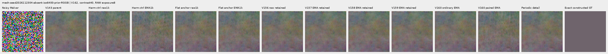

### Quiet neighbors beside edges

mixed-vertical-step-iso6400-prior-RGGB; ROI `[80, 176, 160, 160]`, RAW exposure 8, contrast 40.

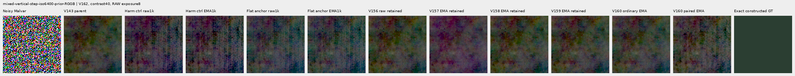

mixed-vertical-step-iso6400-prior-RGGB; ROI `[240, 176, 160, 160]`, RAW exposure 8, contrast 1.

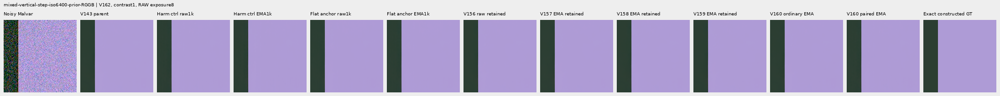

mixed-vertical-step-iso12800-prior-RGGB; ROI `[80, 176, 160, 160]`, RAW exposure 8, contrast 40.

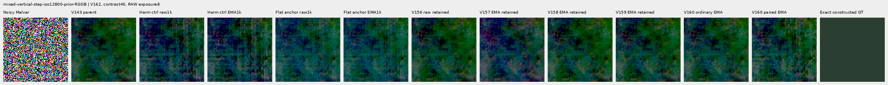

mixed-vertical-step-iso12800-prior-RGGB; ROI `[240, 176, 160, 160]`, RAW exposure 8, contrast 1.

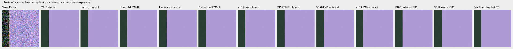

mixed-narrow-bar-iso6400-prior-RGGB; ROI `[80, 176, 160, 160]`, RAW exposure 8, contrast 40.

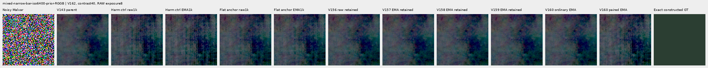

mixed-narrow-bar-iso6400-prior-RGGB; ROI `[240, 176, 160, 160]`, RAW exposure 8, contrast 1.

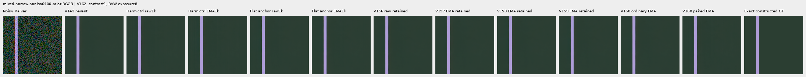

mixed-narrow-bar-iso12800-prior-RGGB; ROI `[80, 176, 160, 160]`, RAW exposure 8, contrast 40.

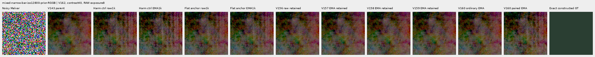

mixed-narrow-bar-iso12800-prior-RGGB; ROI `[240, 176, 160, 160]`, RAW exposure 8, contrast 1.

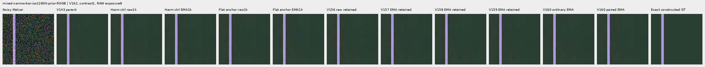

mixed-slanted-step-iso6400-prior-RGGB; ROI `[80, 176, 160, 160]`, RAW exposure 8, contrast 40.

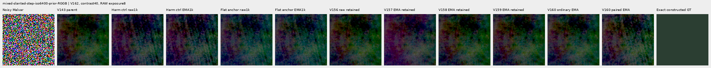

mixed-slanted-step-iso6400-prior-RGGB; ROI `[240, 176, 160, 160]`, RAW exposure 8, contrast 1.

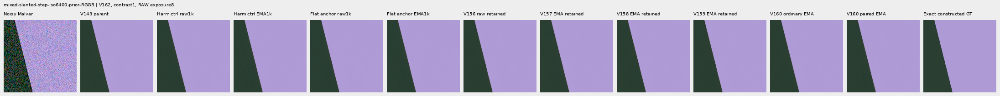

mixed-slanted-step-iso12800-prior-RGGB; ROI `[80, 176, 160, 160]`, RAW exposure 8, contrast 40.

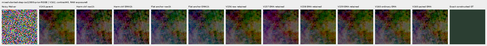

mixed-slanted-step-iso12800-prior-RGGB; ROI `[240, 176, 160, 160]`, RAW exposure 8, contrast 1.

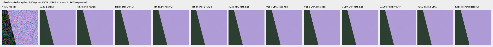

mixed-striped-patch-iso6400-prior-RGGB; ROI `[80, 176, 160, 160]`, RAW exposure 8, contrast 40.

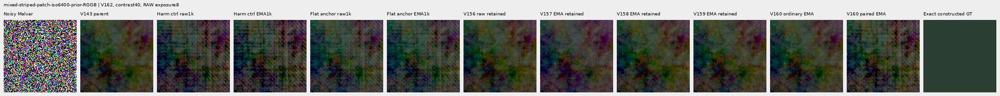

mixed-striped-patch-iso6400-prior-RGGB; ROI `[240, 176, 160, 160]`, RAW exposure 8, contrast 1.

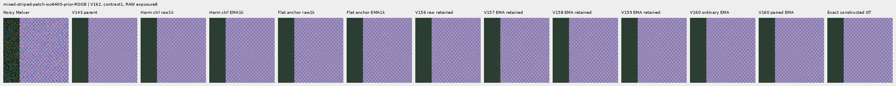

mixed-striped-patch-iso12800-prior-RGGB; ROI `[80, 176, 160, 160]`, RAW exposure 8, contrast 40.

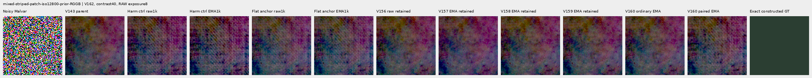

mixed-striped-patch-iso12800-prior-RGGB; ROI `[240, 176, 160, 160]`, RAW exposure 8, contrast 1.

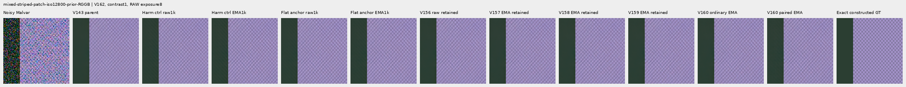

### Standalone flats and slopes

gray-l0.02-adc-only-RGGB; ROI `[48, 48, 160, 160]`, RAW exposure 4, contrast 40.

gray-l0.02-iso12800-prior-RGGB; ROI `[48, 48, 160, 160]`, RAW exposure 4, contrast 40.

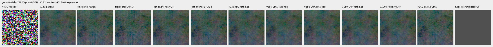

flat512-gray-l0.02-adc-only-RGGB; ROI `[176, 176, 160, 160]`, RAW exposure 4, contrast 40.

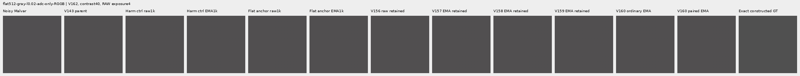

flat512-gray-l0.02-iso6400-prior-RGGB; ROI `[176, 176, 160, 160]`, RAW exposure 4, contrast 40.

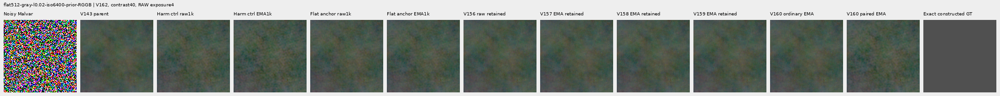

flat512-gray-l0.02-iso12800-prior-RGGB; ROI `[176, 176, 160, 160]`, RAW exposure 4, contrast 40.

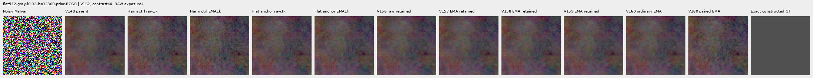

flat512-h210-s0.50-l0.02-iso6400-prior-RGGB; ROI `[176, 176, 160, 160]`, RAW exposure 4, contrast 40.

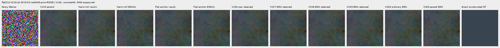

flat512-gray-l0.18-iso12800-prior-RGGB; ROI `[176, 176, 160, 160]`, RAW exposure 1, contrast 8.

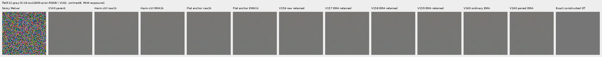

flat512-gray-l0.90-iso12800-prior-RGGB; ROI `[176, 176, 160, 160]`, RAW exposure 1, contrast 4.

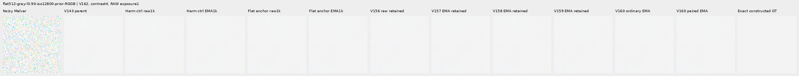

V150-control-ADC-plane0-RGGB; ROI `[176, 176, 160, 160]`, RAW exposure 45, contrast 8.

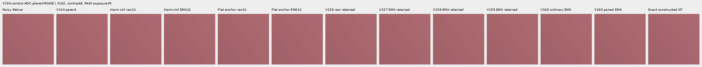

V150-control-ADC-plane1-RGGB; ROI `[176, 176, 160, 160]`, RAW exposure 9, contrast 8.

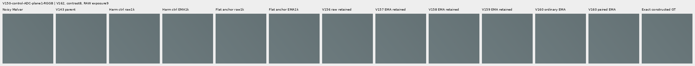

V150-control-ADC-plane2-RGGB; ROI `[176, 176, 160, 160]`, RAW exposure 1, contrast 8.

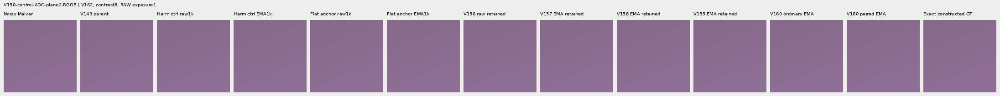

V150-control-ADC-plane3-RGGB; ROI `[176, 176, 160, 160]`, RAW exposure 0.24, contrast 8.

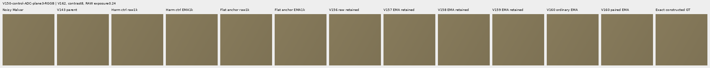

### Natural photographic detail

organic-02a76fd33b5e1414a0504f0b3f0aeb03a569b6f4-photo-faint-RGGB; ROI `[112, 112, 160, 160]`, RAW exposure 14.3883, contrast 8.

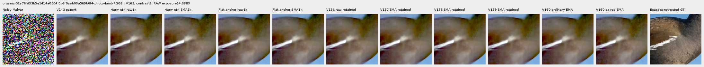

organic-dabacecd4780a1c230f8e9fce6ca1a604bdeab4c-photo-dark-RGGB; ROI `[112, 112, 160, 160]`, RAW exposure 102.758, contrast 1.

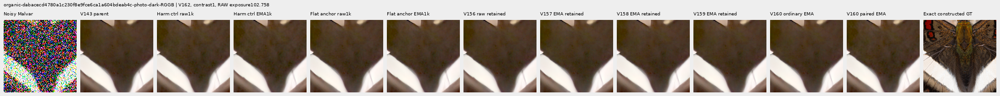

organic-6b3920bceba82d95ecf9351d47f6f94267694bd0-photo-dark-RGGB; ROI `[112, 112, 160, 160]`, RAW exposure 64.0491, contrast 1.

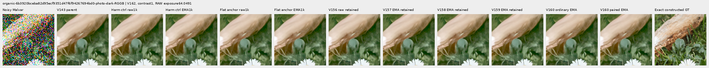

photo-3e638bbb56ed80abc88939468783e3bf9b92ee77-photo-faint-RGGB; ROI `[176, 176, 160, 160]`, RAW exposure 12.1494, contrast 8.

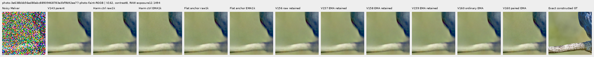

photo-3e638bbb56ed80abc88939468783e3bf9b92ee77-photo-dark-RGGB; ROI `[176, 176, 160, 160]`, RAW exposure 80.9959, contrast 1.

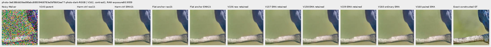

V150-control-bark-contrast0p025-adc-RGGB; ROI `[48, 48, 160, 160]`, RAW exposure 1, contrast 40.

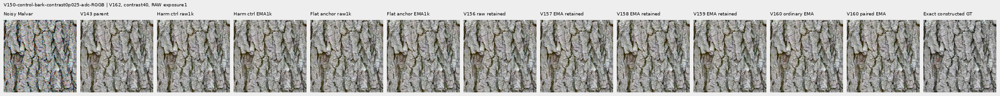

V150-control-raccoon-fur-contrast0p025-adc-RGGB; ROI `[48, 48, 160, 160]`, RAW exposure 1, contrast 40.

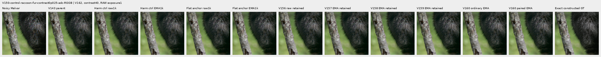

### Protected real GFX scenes

main-overcast-sky; ROI `[176, 176, 160, 160]`, RAW exposure 4, contrast 1.

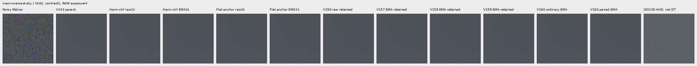

main-building-detail; ROI `[176, 176, 160, 160]`, RAW exposure 4, contrast 1.

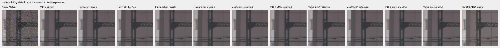

main-foliage; ROI `[176, 176, 160, 160]`, RAW exposure 4, contrast 1.

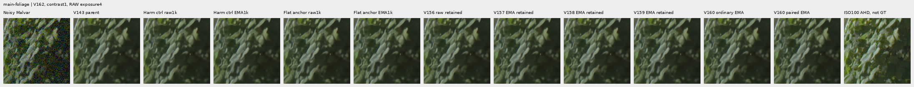

main-chain-link-fence; ROI `[176, 176, 160, 160]`, RAW exposure 4, contrast 1.

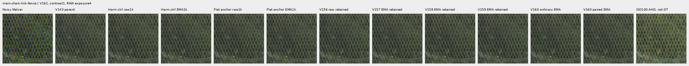

mesh-nominal; ROI `[206, 229, 160, 160]`, RAW exposure 16, contrast 1.

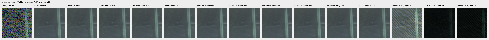

mesh-nominal; ROI `[426, 189, 160, 160]`, RAW exposure 16, contrast 1.

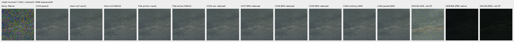

mesh-profile3879; ROI `[206, 229, 160, 160]`, RAW exposure 16, contrast 1.

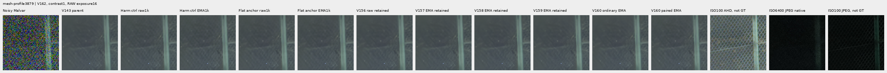

mesh-profile3879; ROI `[426, 189, 160, 160]`, RAW exposure 16, contrast 1.

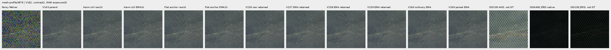

### Noisy, restored, exact constructed GT triplets

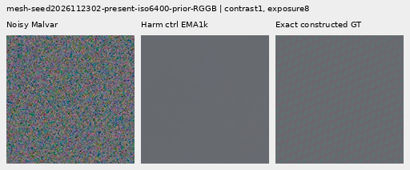

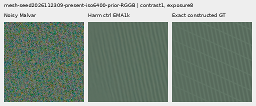

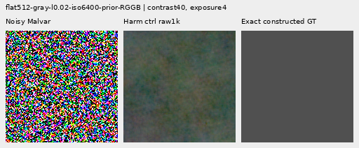

## Training, architecture and validation

Two fresh identical 124,397-parameter / 46-tensor harmonic-context heads use the same V160 cache and exact V161 initialization/base objectives. Only flat-target anchor weight 0 versus 0.25 changes. A detached per-channel 17×17 clean-target range at most 1 DN16 defines eligibility, with truncated neighborhoods at borders. The loss uses stable pseudo-Huber output-minus-target RGB error in fixed 16 DN16 units. Its whole-image denominator weights sparse masks proportionally; inherited domain weights apply. Selected weak gradients retain actual target values. This is training supervision, not an inference gate or calibrated uncertainty. Targets/masks/pair fields never enter the model forward.

The control exactly reproduces every V161 harmonic trace row and final raw/EMA/Adam state; all 1,644 actual control predictions replay byte-exact before archive storage is reused. The candidate retains 1,644 new external arrays. All 88 neural source files remain unchanged. Historical comparator columns mix data/loss/architecture changes; only the current matched contrast isolates the new anchor weight.

The reused V160 cache contains 4,000 frames: 1,382 present/background pairs and 1,236 ordinary frames from 2,618 scene/patch instances. Its 486 photo pairs visit 268 free-photo IDs; 234 reduce contrast and 245 use reviewed ROIs. Geometry precedes area 2 after bin 4; optical blur is zero. All 18 held-out IDs and protected captures/JPEGs/siblings remain excluded. V162 creates no new sources/noise or parent/DINO predictions. [V160 construction evidence](paired-response.md) preserves its original accounting failure and explicit 23-batch adoption.

156 CPU checks pass, including 17 new independent mask/loss/adjoint, border, coverage, sub-DN detail, shared pair error and batch-independence tests. Genuine 8+2 model/EMA/Adam/RNG restoration passes; first 10 complete smoke/train rows match exactly. CUDA parity covers 28 archived contexts / 56 calls and all CFAs/native 256/384/512/768. Ten additional leaf-output backwards check actual masks/losses/gradients against independent NumPy arithmetic; these are not neural forwards. Four strict endpoint loads and 92 finite Adam states at 1,000 pass. All 1,000 control trace rows match V161.

`harmonic-control`: 134/900 supervised batches clip; pre-clip norm median 0.269817, maximum 73.602211.

`flat-anchor`: 197/900 supervised batches clip; pre-clip norm median 0.422909, maximum 113.627274.

The 100 zero-gradient ADC batches advance Adam/EMA clocks. Gradient norms describe optimization pressure; they do not isolate the cause of a quality change.

The independent audit checks 40,210 scalars across 4,686 rows and 476 Decimal reductions; maximum scalar difference is 1.59e-12. All 72 native images / 24 triplets were actually viewed in 18 original-detail sheets; 54,451,200 RGB channels were independently checked.

Actual scientific work is 5,364 head calls: 56 parity, 20 discarded smoke, 2,000 training and 3,288 main review. These evaluate 11,424 head images. Ten numerical leaf-output backwards and separate CPU tests are outside neural counts. All 1,644 new candidate arrays / 4.421 GiB stay external; 1,644 control outputs replay exactly before archive adoption. All ten original scientific controllers/workers plus the independent mask auditor are terminal, with no scientific failure or restart. The auxiliary readiness-verifier stale-path failure/source and corrected revision2 remain preserved. New local/external reserves are 60/152 GiB plus 0.5 GiB projected margin; old evidence is retained. Originals and `/mnt/dataz` are unused.

## Actual training-mask coverage

An independent streaming NumPy audit recomputes all 1,000 actual GPU mask fingerprints/counts from original clean RGB. Mean batch fraction reflects the loss denominator; pixel-weighted fraction accounts for mixed native context sizes. ADC masks are recorded but their total supervised loss remains zero. Eligibility describes a training weight, not a flat-safety or quality result.

| Domain | ADC only | Batches | Mean batch eligible fraction | Pixel-weighted eligible fraction |
| --- | --- | ---: | ---: | ---: |
| mesh | False | 307 | 0.699702 | 0.699702 |
| mesh | True | 34 | 0.667894 | 0.667894 |
| weak | False | 99 | 0.502555 | 0.502555 |
| weak | True | 8 | 0.500000 | 0.500000 |
| photo | False | 214 | 0.522321 | 0.522321 |
| photo | True | 29 | 0.507665 | 0.507665 |
| flat | False | 141 | 0.688589 | 0.688589 |
| flat | True | 12 | 0.646564 | 0.646564 |
| mixed | False | 139 | 0.907641 | 0.907641 |
| mixed | True | 17 | 0.907094 | 0.907094 |

[Original protocol](results/v162-flat-target-anchor-v1/original-protocol.md) · [Immutable preparation](results/v162-flat-target-anchor-preparation-v1.json) · [Preserved auxiliary failure](results/v162-readiness-verifier-failure-v1.json) · [Independent publication verification](results/v162-flat-target-anchor-publication-verification-v1.json).

## Photographic credits

Derived native targets/crops retain the respective source licenses; transformations include linearization, area binning and exposure/contrast changes. Source IDs and ROIs are in the manifest.

| Source | Author | License |
| --- | --- | --- |
| [File:Emamzadeh Esmaeil roof.jpg](https://commons.wikimedia.org/wiki/File:Emamzadeh_Esmaeil_roof.jpg) | مانفی | [CC BY-SA 4.0](https://creativecommons.org/licenses/by-sa/4.0) |
| [File:HP-85-IMG 0439.jpg](https://commons.wikimedia.org/wiki/File:HP-85-IMG_0439.jpg) | Rama & Musée Bolo | [CC BY-SA 2.0 fr](https://creativecommons.org/licenses/by-sa/2.0/fr/deed.en) |
| [File:Spangled Drongo - AndrewMercer - DSC00966.jpg](https://commons.wikimedia.org/wiki/File:Spangled_Drongo_-_AndrewMercer_-_DSC00966.jpg) | Andrew Mercer (www.baldwhiteguy.co.nz) | [CC BY-SA 4.0](https://creativecommons.org/licenses/by-sa/4.0) |
| [File:Naxos Chora 2025-06-14 0505.jpg](https://commons.wikimedia.org/wiki/File:Naxos_Chora_2025-06-14_0505.jpg) | Tsui | [CC BY-SA 4.0](https://creativecommons.org/licenses/by-sa/4.0) |
| [File:Castelo Novo April 2015-2a.jpg](https://commons.wikimedia.org/wiki/File:Castelo_Novo_April_2015-2a.jpg) | Alvesgaspar | [CC BY-SA 4.0](https://creativecommons.org/licenses/by-sa/4.0) |
| [File:RX50 -5 ¼” dual floppy disk drive 02.jpg](https://commons.wikimedia.org/wiki/File:RX50_-5_%C2%BC%E2%80%9D_dual_floppy_disk_drive_02.jpg) | Mister rf | [CC BY-SA 4.0](https://creativecommons.org/licenses/by-sa/4.0) |
| [File:DSC00752 San Salvator Laur.jpg](https://commons.wikimedia.org/wiki/File:DSC00752_San_Salvator_Laur.jpg) | Rione Colonna | [CC BY 4.0](https://creativecommons.org/licenses/by/4.0) |
| [File:Regierungsgebäude, Vaduz.jpg](https://commons.wikimedia.org/wiki/File:Regierungsgeb%C3%A4ude,_Vaduz.jpg) | AuHaidhausen | [CC BY 4.0](https://creativecommons.org/licenses/by/4.0) |
| [File:Common moorhen (Gallinula chloropus) France.jpg](https://commons.wikimedia.org/wiki/File:Common_moorhen_(Gallinula_chloropus)_France.jpg) | Alexis Lours | [CC BY 4.0](https://creativecommons.org/licenses/by/4.0) |
| [File:Dried platanus leaves on rain puddle, Quinta das Conchas e dos Lilases, Lisbon, Portugal julesvernex2.jpg](https://commons.wikimedia.org/wiki/File:Dried_platanus_leaves_on_rain_puddle,_Quinta_das_Conchas_e_dos_Lilases,_Lisbon,_Portugal_julesvernex2.jpg) | Jules Verne Times Two | [CC BY-SA 4.0](https://creativecommons.org/licenses/by-sa/4.0) |
| [File:Close wing pudding position of Lethe visrava (Moore, 1866) - White-edged Woodbrown WLB IMG 0997.jpg](https://commons.wikimedia.org/wiki/File:Close_wing_pudding_position_of_Lethe_visrava_(Moore,_1866)_-_White-edged_Woodbrown_WLB_IMG_0997.jpg) | Thamblyok | [CC BY-SA 4.0](https://creativecommons.org/licenses/by-sa/4.0) |
| [File:Daisies near Cockspur coral tree (Erythrina crista-galli) roots, Jardim da Praça de Londres, Lisbon, Portugal julesvernex2.jpg](https://commons.wikimedia.org/wiki/File:Daisies_near_Cockspur_coral_tree_(Erythrina_crista-galli)_roots,_Jardim_da_Pra%C3%A7a_de_Londres,_Lisbon,_Portugal_julesvernex2.jpg) | Jules Verne Times Two | [CC BY-SA 4.0](https://creativecommons.org/licenses/by-sa/4.0) |
| [File:Apples on tree 2021 G1.jpg](https://commons.wikimedia.org/wiki/File:Apples_on_tree_2021_G1.jpg) | George Chernilevsky | [CC BY-SA 4.0](https://creativecommons.org/licenses/by-sa/4.0) |
| [File:Close wing Nectering of Pseudozizeeria maha (Kollar, 1844) - Pale Grass Blue WLB.jpg](https://commons.wikimedia.org/wiki/File:Close_wing_Nectering_of_Pseudozizeeria_maha_(Kollar,_1844)_-_Pale_Grass_Blue_WLB.jpg) | Anitava Roy | [CC BY-SA 4.0](https://creativecommons.org/licenses/by-sa/4.0) |
| [File:Grey heron (Ardea cinerea) head.jpg](https://commons.wikimedia.org/wiki/File:Grey_heron_(Ardea_cinerea)_head.jpg) | Alexis Lours | [CC BY 4.0](https://creativecommons.org/licenses/by/4.0) |
| [File:Openwing position of Parasarpa dudu (Westwood, -1850-) - White Commodore.jpg](https://commons.wikimedia.org/wiki/File:Openwing_position_of_Parasarpa_dudu_(Westwood,_-1850-)_-_White_Commodore.jpg) | MaheshBaruahwildlife | [CC BY-SA 4.0](https://creativecommons.org/licenses/by-sa/4.0) |
| [File:Kentucky Coffee-tree Gymnocladus dioicus 3264px.jpg](https://commons.wikimedia.org/wiki/File:Kentucky_Coffee-tree_Gymnocladus_dioicus_3264px.jpg) | Photo (c)2007 Derek Ramsey (Ram-Man) | [CC BY-SA 2.5](https://creativecommons.org/licenses/by-sa/2.5) |
| [File:Racoon clinging to a tree.JPG](https://commons.wikimedia.org/wiki/File:Racoon_clinging_to_a_tree.JPG) | Korall | [CC BY 3.0](https://creativecommons.org/licenses/by/3.0) |

## Fixed component checkpoints

- `harmonic-control-raw-step1000`: `eeeea374b37dfd9c068228fda20892552daf9b13e482d075a98ce126eb013d6d`.
- `harmonic-control-EMA-step1000`: `eec2f79a124681b92059fbf736895a73eab6eeedaf091005f6b8e1451c068d36`.
- `flat-anchor-raw-step1000`: `d6d658efd4dfc6ecbf52496b22c51bb5651ad87eb94abc0a0bff832dc3f41b1b`.
- `flat-anchor-EMA-step1000`: `ea80f26ab8893cfe0a461dd9532b6bc8efc2f2a9ac9006df8da1da67eed0ea9d`.
