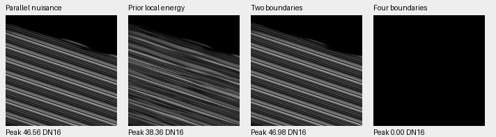
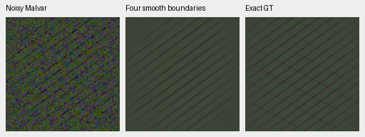
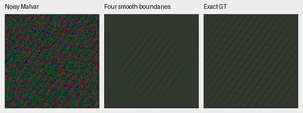

# Curved boundaries for held-out RAW wire validation

[Local phase bounds](local-phase-bounds.md) kept individual
corrections smaller, while the gate still passed a misleading
periodic guide in all 24 complex rail controls. This comparison
changes the query's predictive background. The guides, reserved
Bayer sites, phase fit, correction scale, wave gate and parent
are shared with the parallel-step refit.

## Discovery and validation

Each fold starts from its own supported parallel steps. The new
model permits an independent offset, relative angle and quadratic
bend per boundary while retaining one common axis. It uses a
smooth transition with a native-pixel scale. The optimizer first
fits at scale 1.25 pixels and then at 0.42 pixels. It solves the
linear affine and step amplitudes for each candidate shape.

The fit uses only discovery green samples. It retains the
original hard steps when the smooth model saves too little
squared error, and greedily proposes extra boundaries against
the existing nuisance span. Each change must save more than
`3 × log(discovery green count)` approximate sensor-noise units.
The two arms allow at most two or four boundaries. The shape
search and this complexity cost are fixed across all cases.

The chosen shape supplies nuisance columns for each color's
phase refit and its conditional null. The reserved samples test
the full and null predictions from the other fold. The camera
side-specific gate uses the same original single-edge mask as
the parallel control. Neither the parent nor the target determines
the boundary shapes or the evidence gate.

## False responses on complex rails

The exact-parent controls replay the earlier 36 flats, straight
steps and rails and the 32 more difficult controls. Their
sensor observations, misleading guides, Bayer layouts and
correction settings are fixed. The guide points along the rail's
normal and its perpendicular, even though these scenes have
no periodic wires. Error is the added correction in a native
160×160 crop.

Values below give aggregate RMS and the largest absolute error,
in DN16, at the nominal gate. The names indicate maximum
boundary count. The local energy cap is the retained output
bound from the earlier study.

| Exact structure | Parallel wave refit | Prior local energy | Two smooth boundaries | Four smooth boundaries |
| --- | ---: | ---: | ---: | ---: |
| Retained flat | 0.077 / 6.19 | 0.064 / 2.94 | 0.077 / 6.19 | 0.077 / 6.19 |
| Retained step | 0.460 / 13.39 | 0.387 / 9.23 | 0.897 / 14.64 | 0.897 / 14.64 |
| Retained straight rail | 0.789 / 13.58 | 0.681 / 9.05 | 1.110 / 15.03 | 1.110 / 15.03 |
| Sloped flat | 0.144 / 4.59 | 0.128 / 3.38 | 0.144 / 4.59 | 0.144 / 4.59 |
| Wedge | 3.768 / 29.69 | 3.282 / 21.03 | 0.568 / 5.79 | 0.568 / 5.79 |
| Bent rail | 4.089 / 32.60 | 3.589 / 26.22 | 0.235 / 4.04 | 0.315 / 4.79 |
| Two rails | 7.000 / 46.56 | 6.131 / 38.36 | 7.038 / 46.98 | 1.552 / 14.33 |
| All 24 complex rails | 5.161 / 46.56 | 4.518 / 38.36 | 4.079 / 46.98 | 0.971 / 14.33 |

The four-boundary fit reduces complex rail peak error from 46.56
to 14.33 DN16 and changes 17/24 crops versus 24/24 for parallel
steps. Increasing the threshold by one gives 11/24 changes,
0.578 DN16 RMS and an 8.94 DN16 peak. The two-boundary version
works well on wedges and single bent rails. Four boundaries
matter in the two-rail case. Both flexible fits have higher
error on the original straight steps and rails at the nominal
gate, with five step and seven rail activations at the stricter
gate.

The grayscale residual comparison shows maximum RGB correction
per pixel on the double-rail scene with the largest original
parallel peak. All four panels use the same 0–64 DN16 display.

## Wire response at the paired quiet ceiling

The original parallel refit's quiet RMS supplies the ceiling for
each geometry set, guide and noise level. Weak response is the
projected fraction of the exact faint-wire increment. Increment
RMS measures the error of that paired difference. The two source
sets each contain eight geometries per noise level.

| Guides and panel | Parallel steps | Two boundaries | Four boundaries | Increment RMS, parallel to four (DN16) |
| --- | ---: | ---: | ---: | ---: |
| ISO400 full-frame, sources 88–95 | 4.801% | 4.791% | 4.738% | 11.18019 to 11.18021 |
| ISO400 exact center, sources 88–95 | 9.005% | 8.979% | 8.821% | 11.15730 to 11.15773 |
| ISO400 full-frame, disjoint sources 80–87 | 6.436% | 6.436% | 6.436% | 11.20227 to 11.20227 |
| ISO6400 full-frame, sources 88–95 | 0.661% | 0.661% | 0.661% | 25.43795 to 25.43795 |
| ISO6400 full-frame, disjoint sources 80–87 | 2.464% | 2.464% | 2.464% | 22.94546 to 22.94546 |

Both flexible methods reproduce all 16 disjoint source predictions
bit for bit at the nominal gate. On the primary panel, 30 of 32
guide/noise/source combinations also reproduce the parallel
output exactly. The full-frame ISO400 arm loses 0.063 percentage
points under the four-boundary model.

A separate sensitivity diagnostic adds two finite wire directions
on 16 of the bent and double-rail backgrounds. The faint carrier
is 12° from the rail normal and one quarter the stronger carrier's
amplitude. It uses independently corrupted strong-only and
two-family observations, exact nominal guide frequencies and the
same clean rail-only delivery parent. This tests whether real weak
evidence survives the nuisance fit near the rail, with no learned
parent involved.

| Sensitivity panel | Parallel weak response | Four-boundary weak response | Quiet RMS, parallel to four (DN16) | Increment RMS, parallel to four (DN16) |
| --- | ---: | ---: | ---: | ---: |
| ISO400 | 0.387% | 0.016% | 1.942 to 2.140 | 7.076 to 7.140 |
| ISO6400 | 0.037% | 0.131% | 1.041 to 0.351 | 7.039 to 6.950 |

The lower false response on rail-only scenes does not establish
recovery of nearby faint wires. On this diagnostic the nominal gate
recovers very little of the added direction under any background.
[Full measurements and declared sensitivity recipe](results/flexible-query-edges-v1/summary.json).

## Native exact-target crops

The noisy Malvar, four-boundary and exact GT triplets use the
full-frame guide at threshold 2 and correction scale 0.82212.
Both are native 160×160 ROI `[176,176,160,160]` with ISO400
shot/read `8e-5 / 2.56e-8`, 16-bit ADC, exposure ×2 and
contrast ×5. V143 EMA SHA256 is
`96d146d017c54196288c585f8b7eddcf030e8a235061049c31e985b9380b7ce4`.
The strong diagonals remain prominent and most faint crossings
are missing.

[Source 88 full comparison](images/flexible-query-edges-v1/iso400-source88-RGGB-comparison.png) ·
[Source 89 full comparison](images/flexible-query-edges-v1/iso400-source89-BGGR-comparison.png).

## Native GFX100S review

With full-frame guide ranking, the sky, building and foliage
remain exact V120. Both flexible backgrounds retain the visible
coarse fence crossings and change that crop by 9.00 DN16 RMS
from V120 versus 8.99 for the parallel steps. With the fixed
spectral building guide, the four-boundary correction is
2.94 DN16 RMS from the parent versus 3.92 for the parallel fit.
There is no convincing new building or fine foliage detail.
Both flexible fits return all four cab crops to V120, with incomplete
fine crossings under both noise profiles.

The native 160×160 cells use the fixed coordinates and V120
EMA SHA256
`a9d9b6b4f974e24a6b11e5e740aab32314233a7f53c056cf37c7d2aac1c589fb`.
Nominal shot/read are `0.00128 / 6.5536e-6`; main display
exposure is ×4 and cab ×16. The transferred cab profile is
`0.0014635775921166604 / 1.0715704128646712e-6` at the same
cab exposure. DSCF3880 and DSCF3835 ISO100 AHD and the two
cab camera JPEGs are independent qualitative references.

| RAW and profile | Native comparisons |
| --- | --- |
| DSCF3879 nominal | [Sky](images/flexible-query-edges-v1/main-overcast-sky.png) · [Building](images/flexible-query-edges-v1/main-building-detail.png) · [Foliage](images/flexible-query-edges-v1/main-foliage.png) · [Coarse fence](images/flexible-query-edges-v1/main-chain-link-fence.png) |
| DSCF3842 nominal | [Left](images/flexible-query-edges-v1/mesh-nominal-left.png) · [Right](images/flexible-query-edges-v1/mesh-nominal-right.png) |
| DSCF3842 transferred | [Left](images/flexible-query-edges-v1/mesh-profile3879-left.png) · [Right](images/flexible-query-edges-v1/mesh-profile3879-right.png) |

Each replay ran on CPU. Collection took 129.44 seconds for the
primary exact-target set, 59.97 for the disjoint set, 11.17 for
the cameras and 161.14 across the two rail-control panels. The
review verified 600 retained arrays exactly and inspected ten
native comparison boards, two standalone triplets and one
double-rail residual board. This component study uses archived
neural predictions. It adds no training, full427 or known/unseen
camera panel scores.

[Native provenance](images/flexible-query-edges-v1/manifest.json) ·
[Measurements](results/flexible-query-edges-v1/summary.json) ·
[Publication hashes](results/flexible-query-edges-v1/publication.json) ·
[Frozen scripts and receipts](results/flexible-query-edges-v1/evidence.tar.gz).
