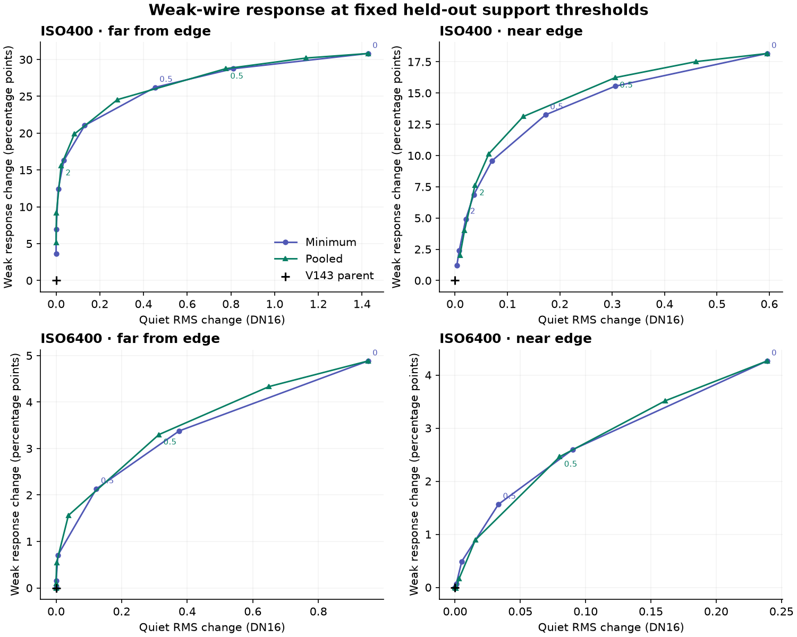
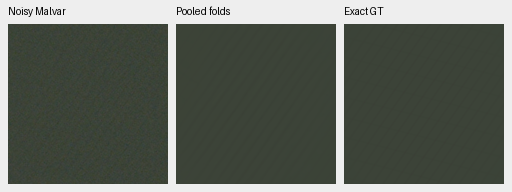
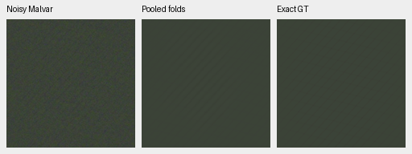

# Pooling held-out RAW support across folds

At ISO400 far from the edge, pooling raises held-out weak-wire response from
**14.19% to 16.89%** at the tightest quiet-error budget. Mean quiet RMS is
essentially the same, and weak-increment RMS falls from **10.0391 to
10.0222 DN16**. All eight geometries improve weak response. At ISO6400,
weak recovery remains small and the far-wire increment error rises at this
budget. Both GFX families were viewed. The sky stays unchanged and the cab
crossings remain incomplete.
[Full evidence](results/fold-support-pooling-v1/publication.json) ·
[Frozen setup and preflight](results/fold-support-pooling-setup-v1/publication.json).

The [phase-agreement follow-up](phase-profile-agreement.md) reduces the
small building correction with lower weak-wire recovery at nearly the
same quiet-region error.

The current gate uses the lower of two local predictive scores. The pooled
gate averages them where both are positive and gives zero correction when
either is zero or negative. This tests whether both RAW folds can support the
same wire even when one offers much stronger evidence. At threshold zero
both gates deliver identical output. They share the eight-knot phase fits,
discovery-only shrinkage, noise estimates, directional guides, CFA treatment,
parent projection, and overlap weighting.

## Comparison at a quiet-region budget

Eight fixed thresholds from 0 to 4 are evaluated on 384 retained query views.
The 128 cases span eight geometries, two edge distances, four Bayer layouts,
and ISO400 and ISO6400 profiles. For each geometry, the remaining seven
serve as calibration. Each arm chooses a threshold and one uniform scale
on its delivered correction. It maximizes weak response with the parent
quiet RMS plus 0.02, 0.1, or 0.3 DN16 as the cap. The cap uses the square root
of the equal-geometry, equal-CFA mean squared error. Each held-out geometry
then uses the chosen settings, with its actual quiet cost, weak increment
error, and absent-wire projection reported together. A separate descriptive
calculation uses exact targets to see what each sweep could deliver under
the same budget on each geometry.

The first four case groups reproduced all 36 retained minimum-fold predictions
at thresholds 0, 2, and 4. Twelve direct pixel calculations confirmed the
quiet-budget arithmetic. Perturbing one test geometry's target-derived
moments left its threshold and scale choices unchanged in both arms.
[Preflight receipt](results/fold-support-pooling-setup-v1/preflight.json).

## Held-out results

Each number is the mean of eight held-out geometry results. RMS inside a
geometry pools its four Bayer layouts in squared-error units. The observed
quiet cost is the excess over the V143 parent. The calibration budget was
0.02 DN16 in the table. Held-out geometries can exceed that allowance.

| Noise and edge | Fold score | Weak response | Strong response | Excess quiet RMS DN16 | Weak-increment RMS DN16 |
| --- | --- | ---: | ---: | ---: | ---: |
| ISO400 far | Minimum | 14.195% | 57.419% | 0.02370 | 10.03912 |
| ISO400 far | Pooled | 16.894% | 58.699% | 0.02306 | 10.02219 |
| ISO400 near | Minimum | 8.901% | 29.461% | 0.02768 | 13.02778 |
| ISO400 near | Pooled | 9.467% | 29.667% | 0.02651 | 13.02159 |
| ISO6400 far | Minimum | 1.944% | 10.103% | 0.02172 | 22.44641 |
| ISO6400 far | Pooled | 2.221% | 16.209% | 0.02109 | 22.46424 |
| ISO6400 near | Minimum | 3.827% | 7.448% | 0.02448 | 30.82920 |
| ISO6400 near | Pooled | 3.881% | 7.362% | 0.02349 | 30.82628 |

The ISO400 far weak-response improvement spans 0.14 to 6.64 percentage
points. The paired geometry bootstrap interval for the mean is
[1.47, 4.08] percentage points. The magnitude of the CFA-averaged
absent-wire projection is similar, 0.1487% versus 0.1495%. At the 0.1 DN16
budget, pooling still improves mean ISO400 weak response both near and far,
with similar or lower achieved quiet error. The 0.3 DN16 far result carries
more quiet error with pooling. The target-assisted sweep with the same
per-geometry quiet cap shows an ISO400 far gain of 0.85 percentage points
at 0.02 DN16 and essentially no gain at 0.3 DN16. These comparisons use
the same eight retained geometries. The ISO6400 gains remain small and
vary with the selected quiet budget.
[All paired deltas and target-assisted sweeps](results/fold-support-pooling-v1/summary.json).

The figure shows changes from V143 for each fixed score threshold before
calibration. Axis ranges vary by panel. At threshold 2, ISO400 far weak
response rises from 14.15% to 17.38% with a small quiet increase of 0.014 DN16.

## Native comparisons

Both triplets show noisy Malvar, V143 with pooled support at threshold 2,
and exact constructed GT. They use ISO400 far queries from sources 0 and 1,
RGGB draw 1, two-direction role, original ROI `[176,176,160,160]`, exposure 2,
and the same WB and display transform. The ADC16 black fraction is 0.03.
ISO400 uses shot/read `8e-5/2.56e-8` and ISO6400 uses
`0.00128/6.5536e-6`. The synthetic parent is V143 EMA
`96d146d017c54196288c585f8b7eddcf030e8a235061049c31e985b9380b7ce4`.

The real parent is V120 EMA
`a9d9b6b4f974e24a6b11e5e740aab32314233a7f53c056cf37c7d2aac1c589fb`.
The DSCF3879/3880 comparisons use the existing native crops at exposure 4.
At threshold 2, the sky matches the minimum-fold output and V120 exactly.
The building correction changes by 0.42 DN16 RMS relative to the minimum
gate and shows no conspicuous new bands. The coarse fence retains its
crossings, and foliage remains soft. The DSCF3842/3835 cab crops use
exposure 16 with both recorded noise profiles. The left shows somewhat
stronger diagonal modulation. Both sides still lack convincing new
crossings. The independently demosaiced ISO100 and camera JPEGs are
qualitative references with differing exposure, aperture, and motion.
[Sky](images/fold-support-pooling-v1/main-overcast-sky.png) ·
[Building](images/fold-support-pooling-v1/main-building-detail.png) ·
[Foliage](images/fold-support-pooling-v1/main-foliage.png) ·
[Coarse fence](images/fold-support-pooling-v1/main-chain-link-fence.png) ·
[Cab left](images/fold-support-pooling-v1/mesh-nominal-left.png) ·
[Cab right](images/fold-support-pooling-v1/mesh-nominal-right.png) ·
[Transferred profile left](images/fold-support-pooling-v1/mesh-profile3879-left.png) ·
[Transferred profile right](images/fold-support-pooling-v1/mesh-profile3879-right.png).

Collection took 616.17 seconds on the shared two-thread CPU allocation.
The report contains 1,920 fixed-threshold rows. It also verifies 1,176
matched-control predictions across synthetic and camera inputs. The direct-pixel audit covers
1,152 reductions on 192 held-out rows, 64 unchanged real-camera display
cells, and both synthetic triplet subsets. All ten boards were opened.
V120 remains the general inference recommendation.
[Native provenance and viewing](images/fold-support-pooling-v1/manifest.json) ·
[Independent audit](results/fold-support-pooling-v1/independent-audit.json).
