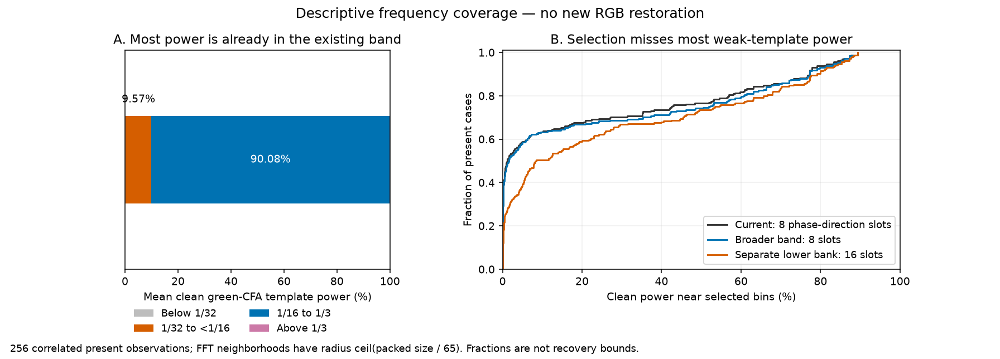
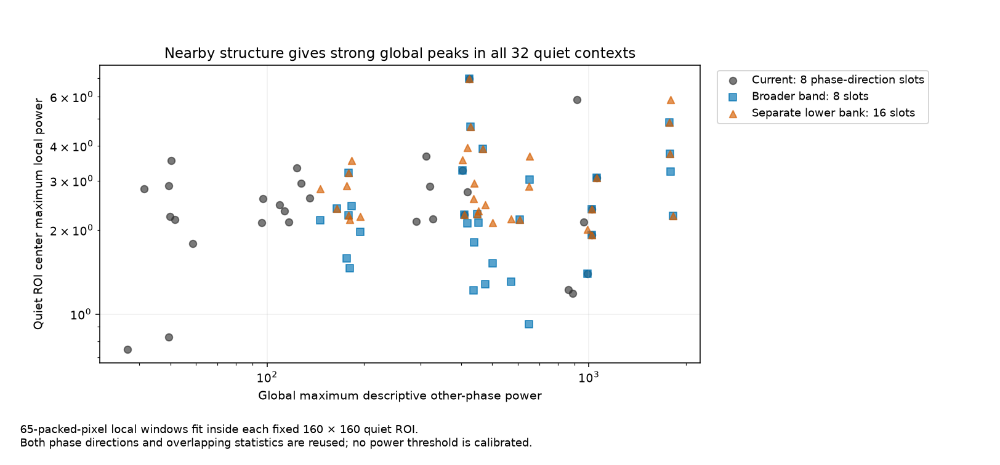

# Frequency selection misses weak crossed-wire measurements

V186 finds that broadening the current frequency band alone is unlikely to remove the main limitation. About **90.08% of clean green-CFA template power is already in the existing band**, but bins selected from noisy input lie near only **21.25% on average and 1.18% at the median**. This is a read-only diagnostic, not an improved denoiser or a recoverability bound. [V185](spatial-context-wave-comparison.md) remains the latest trained result, with its native fine-fence, sky, foliage and quiet-field comparisons unchanged.

The left panel averages principal packed-CFA spectral power. The right retains all 256 present observations. Noise and Bayer variants reuse 64 procedural scenes; they are not independent scene replications. The square Fourier neighborhoods have radius ceil(256/65)=4 bins, chosen from the existing local-window width. Windowed measurements and nonlinear contextual mixing can produce frequencies outside these neighborhoods, so the fractions are descriptive proximity measures, not a ceiling on model response.

## Matched and enlarged selections

| Input-only selection | Phase-direction slots | Mean template power near bins | Median |
| --- | ---: | ---: | ---: |
| Existing 1/16–1/3 band | 8 | 21.253% | 1.178% |
| Broadened 1/32–1/3 band | 8 | 22.413% | 1.581% |
| Existing bank plus separate 1/32–<1/16 bank | 16 | 27.072% | 8.336% |

With a narrower ±1-bin neighborhood, mean proximity is 17.34%, 18.35% and 19.94%, respectively. Broadening at the same slot count gives only a small gain. Adding a separate lower-frequency bank helps more, but doubles the slots and increases chance alignment in absent inputs: mean hypothetical-template proximity rises from 1.70% to 5.84% for the wider neighborhood. Those absent templates are diagnostic construction data, not actual absent-scene signal.

Fifty of the 128 nominal line-family fundamentals have periods longer than 16 native pixels. Their first harmonics fall below the old cutoff, but narrow wires carry substantial power in higher harmonics: the omitted 1/32–<1/16 octave contains only 9.57% of mean clean CFA-template power. About 0.28% lies below 1/32; principal CFA aliases remain unresolved. The recipe count alone therefore overstates what a simple lower cutoff could fix.

Both existing and counterfactual selections use four peaks per green direction, selecting from that direction's green samples only and measuring the other green at those fixed bins. The added bank uses four extra peaks per direction. The FP64 reference reproduces all actual V185 high-band selections in all 550 contexts. No target, pair difference or model response enters a new selection. The complete input journal closes before clean arrays and saved V185 response rows are interpreted.

## Quiet-region warning

Every quiet context contains real nearby structure. Global descriptive power can therefore be large while the fixed quiet ROI is uniform. The median maximum other-phase power is **212.95 globally versus 2.36 at the quiet ROI center** for the current selection. Broader-band selection gives **452.11 versus 2.25**; the separate lower bank gives **452.11 versus 2.70**. A 65-packed-pixel window fits inside each 160×160 quiet ROI. No fixed threshold from these selected, overlapping and correlated statistics establishes confidence or safe restoration.

For constructed present/absent mesh inputs, the current selection has maximum other-phase power at least 4 in 98/256 present and 29/256 absent cases. A separate lower bank changes those counts to 122/256 and 56/256. At 16 the counts are 36/0 and 38/0. These inherited descriptive bins are not deployment cutoffs; considering more candidates changes their distributions. All 32 quiet contexts exceed 16 globally even under the existing selection.

Eight real ROI measurements are included below for input interpretation only. The two cab noise profiles reuse the same capture, and these ROIs are not independent scene replications. No ISO100/AHD/JPEG reference is read or scored.

| Cached input / ROI | Current global maximum other-phase power | Local ROI-center maximum |
| --- | ---: | ---: |
| main-overcast-sky / main-overcast-sky | 2.235 | 4.899 |
| main-building-detail / main-building-detail | 4703.686 | 188.293 |
| main-foliage / main-foliage | 263.565 | 319.870 |
| main-chain-link-fence / main-chain-link-fence | 3784.682 | 1021.841 |
| mesh-nominal / fine-green-mesh-left | 120.230 | 30.560 |
| mesh-nominal / fine-green-mesh-right | 120.230 | 86.330 |
| mesh-profile3879 / fine-green-mesh-left | 163.899 | 44.026 |
| mesh-profile3879 / fine-green-mesh-right | 163.899 | 120.718 |

## Implication for the next model

The evidence supports testing selection that pools the two green phases and nearby frequency bins to gather weaker structure before choosing a sparse wave basis. That is a hypothesis, not a measured improvement. Pooling changes selection bias; an other-phase statistic would no longer be an independent selection holdout. Spatial support, all quiet/absent/flat controls and both protected GFX scenes remain necessary. This diagnostic does not prove that loss weighting is harmless or that missing detail is recoverable from every input.

## Reproducibility and preserved failures

The scope is 550 cached contexts: 256 present and 256 matched absent mesh observations, 32 mixed quiet contexts and six protected real contexts. The 512 constructed template measurements use exact present-minus-empty clean camera-RGB samples mosaiced at their original CFA positions. This target information enters only after input-only selection. Existing V185 raw/EMA response scalars are reused, with no restored RGB produced.

Twenty-six focused CPU checks cover selection, four CFA layouts, conjugate suppression, tie behavior, scaling, target/other-phase isolation, numerical group labels, orthonormal QR covariance and explicit linear rows. The independent audit verifies 1,650 input fingerprints and 4,400 actual selected-frequency records. On the fixed first 12 cases it checks 288 independently ranked bins, 192 explicit complex DFT/variance rows and 132 template-fraction scalars. All 3,200 local control powers are checked by explicit patch QR; 130 means are checked with Decimal arithmetic. Maximum errors are 4.40e-16 for complex DFT coefficients, 2.21e-20 for variance, 2.78e-17 for template fractions and 2.11e-12 for local powers.

The original run completed and closed all 550 selections and all 512 template rows, then stopped on the cab metadata's two-ROI form. The control successor retained those byte-exact prefixes without replay and journals each control result; its 40 regions produce 160 region-method records. Original unpersisted control calculations could not be resumed. The first audit also caught a summary-format bug: a numeric grouping key had been replaced by its own statistics object. Corrected reduction preserves group labels; every original row and the primary presence-only summary remain unchanged. Both failed sources/logs and all successor bindings are preserved. Canonical code handles both forms and the corrected reduction.

All 100 neural source files remain unchanged. There are zero model/checkpoint loads, neural/parent/DINO/RAW-decoder calls, new RGB restorations, source/noise renders or real reference reads. Originals and unavailable `/mnt/dataz` were not accessed. Both GFX capture families, JPEGs and siblings remain held out from training. This repeatedly used development suite establishes no blind generalization or calibrated noisy-sky safety.

[Exact evidence, sources and viewing notes](results/v186-frequency-coverage-v1.json). [Latest trained native-pixel viewer](images/v185-spatial-context-v1/native-viewer.html).
