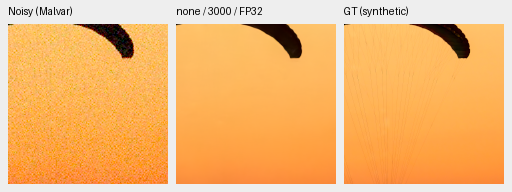
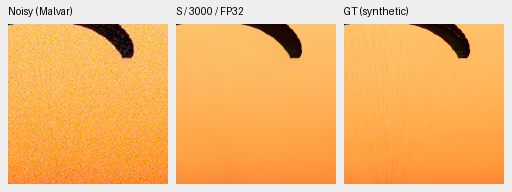
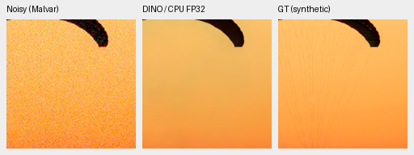
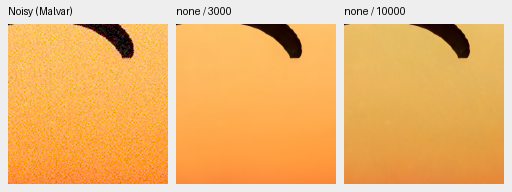
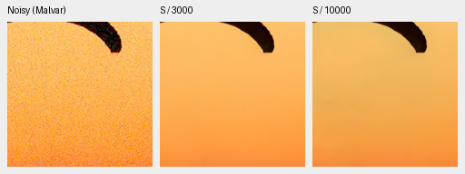
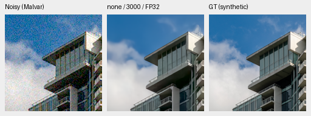
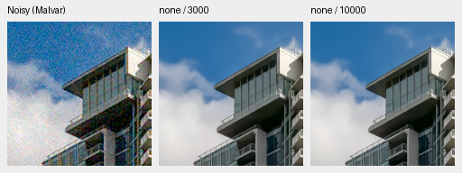
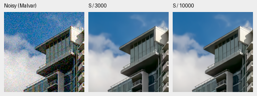

# A matched CPU replay exposes a fabric color regression

On the fixed fabric example, both fresh models shift away from the exact
target's color between 3,000 and 10,000 updates. The building example does not
show a comparable shift. This is a demonstrated failure on one observation,
not a claim of broader regression or an identified training cause.
[All float predictions, source/ROI/checkpoint records and native PNGs](results/fresh-none-S-3k10k-color-means-cpu.json).

A later [input-CFA gain probe](saved-input-cfa-gain-cpu.md) on the same saved
predictions substantially reduces the shifted fabric's color error, while its
fine cords remain missing. It uses no target in the gain fit and changes no
production default. The two-source result does not establish broad correction.

The replay uses the same two serialized CPU observations as the
[earlier no-context/S review](fresh-none-S10k-cpu-review.md). It computes all
four arm/checkpoint combinations on both inputs in CPU FP32, without new noise,
source decoding or output adjustment. All four 10,000-step restored display
panels reproduce the previous pixels byte exactly. The eight unquantized
256px predictions are now retained for analysis.

## Exact-GT crops

Every primary row is **noisy → denoised → exact simulated GT**, with native
160×160 panels. No resizing, sharpening, per-method exposure or color fitting
is applied. These targets are exact for the simulated degradation; they are
not clean camera-RAW measurements.

Fabric, no-context 3k:

Same observation, no-context 10k, reused unchanged:

Fabric, DINO-S 3k:

Same observation, DINO-S 10k, reused unchanged:

The 10k outputs are darker/more yellow than their 3k counterparts and target.
Fine cords remain missing at both steps. The direct rows below copy the exact
saved pixels and read **noisy → 3k → 10k**; neither learned panel is GT.

Building, no-context 3k:

Same observation, no-context 10k:

The building outputs remain close and retain small channel-mean errors. The
two DINO-S building GT triplets are also in the receipt. These direct rows show
both methods on the building observation:

## Unquantized color residuals

For the displayed fabric ROI, mean prediction-minus-GT errors in **unclipped
linear camera RGB**, normalized to sensor white 1, are:

| Model | Step | Mean R error | Mean G error | Mean B error | Channel-mean component of camera MSE |
| --- | ---: | ---: | ---: | ---: | ---: |
| No context | 3,000 | −.000893 | −.000910 | +.001100 | 2.24% |
| No context | 10,000 | −.089247 | −.022618 | −.006891 | 94.47% |
| DINO-S | 3,000 | −.004639 | −.000892 | +.002013 | 17.77% |
| DINO-S | 10,000 | −.041003 | −.010098 | −.001222 | 82.83% |

The fraction is the arithmetic decomposition of this particular residual:
mean squared channel-mean error divided by total camera-RGB MSE. It is not an
estimate of statistical estimator bias, a corrected output or the fraction of
a full-suite score. Remaining spatial errors can include varying color errors
as well as lost detail. This diagnostic uses unclipped camera values, whereas
the standard camera PSNR clips both arrays to sensor range.

At the red CFA sites in this ROI, the realized noisy-minus-target mean is
−.0000379. Prediction-minus-target red-phase means are −.0897643 for no-context 10k
and −.0413133 for S 10k. These refer to the red sampled sites, rather than all RGB
pixels in the table. They show a much larger model error on this case than the
realized input mean error, without an independence-based noise confidence claim.
No calibration or target-dependent correction is applied.

The building's channel-mean errors stay below .0016 in absolute normalized
camera units, and their mean components account for less than 1% of camera MSE.
The effect is scene-dependent in these two examples. This does not establish
the cause of the separate [eight-image BF16 training-monitor decline](fresh-dino-capacity-10k.md).

## Fixed protocol and provenance

Both sources use the original 8×-binned uint16 linear-sRGB caches, native 256px
tiles, RGGB, shot `.00256`, read variance `.0000262144`, 16-bit ADC/black `.03`,
WB [2,1,1.5], the original evaluation matrix and display exposure ×1. The matrix,
actual serialized observations/targets, source/cache hashes and noise
fingerprints are recorded in the receipt. Noise is the previous keyed CPU
realization, not the CUDA realization from the training monitor/full suite.

| Source | 256px tile in the binned source | Displayed 160px ROI in that source |
| --- | --- | --- |
| Fabric, `0014aa4e…` | [189,3,256,256] | [237,51,160,160] |
| Building, `002fc6ee…` | [195,89,256,256] | [243,137,160,160] |

The displayed ROI within each evaluation tile is [48,48,160,160]. Statistics are
also retained for the whole 256px tile and border-trimmed 240px interior. CFA
phase order is TL(R), TR(G1), BL(G2), BR(B). Every model uses EMA inference,
original seed 48/planned 10,000 schedules and the same original source bundle
`2f1a2251d8141d335e99266343b46b61b8da3cb13012fc63d79ea5c3968ad01c`.
Both step boundaries belong to the same original training trajectory per arm.

| Checkpoint | SHA256 |
| --- | --- |
| No-context3k | `6f9948c361cda74a294ad0cc9db4718dfb3fe0a9cc5a4c1cc867e986e0a7eedf` |
| No-context10k | `0df4ff404c38b8f4b42f6451486e91c97631544b1c817c126f371195942f3af4` |
| S3k | `b6adac140926920d7faad223acf545f32904c41d6883ab982a1ac9d5bdce3312` |
| S10k | `ae74bc17012c85d5253f24da4dbaaec4486ed430aa143d852442754288d56bad` |

Sources: [Roy Egloff](https://commons.wikimedia.org/wiki/File:CH.VD.Villeneuve_2007-08-25_Vertigo-Swiss-Riviera_2392_3x2-R_4K.jpg)
and [Dietmar Rabich](https://commons.wikimedia.org/wiki/File:Vancouver_(BC,_Canada),_Coal_Harbour_Seaside_Park,_Blick_in_den_Himmel_--_2022_--_2158.jpg),
[CC BY-SA 4.0](https://creativecommons.org/licenses/by-sa/4.0/), modified by
binning, crop, camera/noise simulation, restoration and rendering. Derived
photographs retain that license. Complete author/license/source fields remain
in the receipt.

## Checks and limits

All eight new PNGs were visually inspected. Eight new float predictions pass
hash/shape/dtype/finite checks. Every new primary panel and all four reused 10k
triplets rerender byte-exactly; direct rows copy parent pixels exactly. An
independent NumPy64 rebuild of the saved spatial statistics differs by at most
1.11e-16. Execution/audit drivers and source files are archived; Ruff passes.
No CUDA context was initialized.

There are only two sources, one high-noise condition and one training seed.
These CPU results do not reproduce the BF16 monitor or replace the original
full427/paired/analytic/102MP GFX review now running. No model, training policy,
inference correction or README reference changes. Prioritize color fidelity in
that complete review before choosing another experiment.
