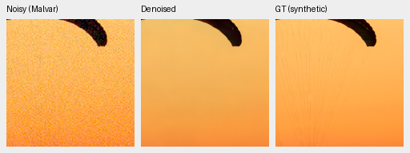
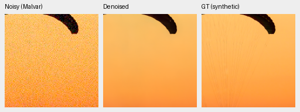
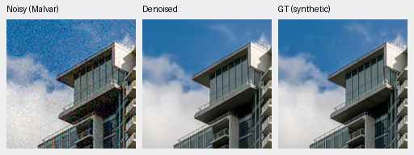
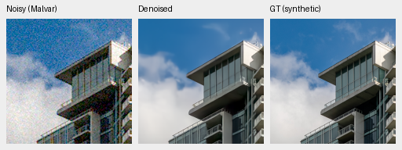
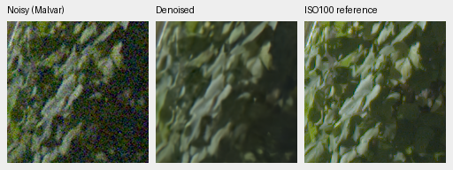
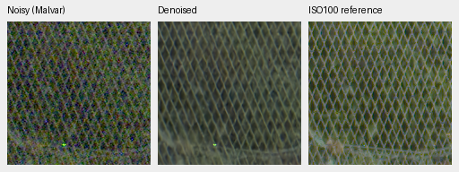
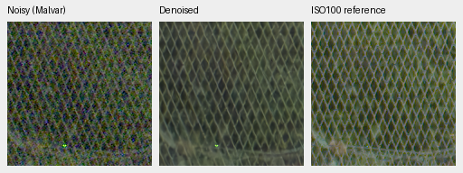
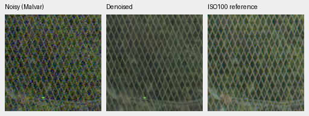

# Fresh DINO comparison: completed 10,000-update review

Current architecture and recommendations: [current model guide](current-model.md).
The versioned study below retains its measured results and original protocol.

All three completed their original schedules and gained about 0.75 dB on 427
synthetic-noise photos over their own step3000 checkpoints. No-context has the
highest photo and unseen-camera primary means; DINO-S has a tiny, uncertain
known-camera advantage, and DINO-B leads the procedural mean. There is no
consistent DINO benefit. **V43 step2000 was the README reference when this experiment closed**:
the new mean gains coexist with a visible fabric color regression and missing
fine texture. No model is promoted by this review.

[Complete results, hashes and59 native crop receipts](results/fresh-dino-capacity-10k-review.json).
[Matched initialization/protocol](fresh-dino-capacity.md),
[step3000 review](fresh-dino-capacity-3k-review.md),
[independent training-boundary checks](results/fresh-dino-capacity-10k-boundary.json).

## Matched training and evaluation

Seed48, batch16, native256px patches, LR1e-4 with100 warmup updates and the
original10000-update schedule (finalLR1e-5). Whole model/EMA/AdamW/Python/Torch/
CUDA RNG continued from step3000; no new initializer or changed corpus.
All403 logged `(step, domain, input/target SHA)` observations match across the
three arms. Unlogged batches are not separately hashed. All stored model/EMA
tensors and logged losses/gradient norms are finite; AdamW counters equal10000.
The frozen source bundle is
`2f1a2251d8141d335e99266343b46b61b8da3cb13012fc63d79ea5c3968ad01c`.

Commons40170/native128/paired32,25/25/50 domain mix,4×→geometry/PSF→area2 targets,
original8× validation, Gaussian RGB initialization and explicitFP32 middle-skip
policy are shared. S/B use genuine frozen DINOv3 features; their projection
width/capacity also differs. One seed under the original nondeterministic CUDA
policy cannot establish convergence or isolate foundation-feature quality.

| Model | Whole-state step10000 checkpoint SHA256 |
| --- | --- |
| No context | `0df4ff404c38b8f4b42f6451486e91c97631544b1c817c126f371195942f3af4` |
| Frozen DINOv3-S | `ae74bc17012c85d5253f24da4dbaaec4486ed430aa143d852442754288d56bad` |
| Frozen DINOv3-B | `dcf3e96591d7ede1890482f874b0233a1ba9516bb9e31a042e5efa82e242ced1` |

| Panel | Model | Measured-CFA PSNR | AHD RGB PSNR | AHD SSIM |
| --- | --- | ---: | ---: | ---: |
| Known | No context | 54.19996 | 40.00884 | 0.931271 |
| Known | Frozen DINOv3-S | 54.21198 | 40.06452 | 0.931928 |
| Known | Frozen DINOv3-B | 54.19850 | 39.97406 | 0.930968 |
| Known | RawNIND global CFA-LS | 54.06860 | 39.67805 | 0.928811 |
| Known | RawNIND channel CFA-LS | 54.08474 | 39.71710 | 0.928831 |
| Unseen | No context | 53.83974 | 38.55027 | 0.921084 |
| Unseen | Frozen DINOv3-S | 53.78590 | 38.47549 | 0.921142 |
| Unseen | Frozen DINOv3-B | 53.77763 | 38.53874 | 0.920906 |
| Unseen | RawNIND global CFA-LS | 53.56220 | 38.14484 | 0.918380 |
| Unseen | RawNIND channel CFA-LS | 53.76822 | 38.56191 | 0.922127 |

Known4:8 pairs/72 crops. Unseen5:10 pairs/90 crops from cameras held out of
training. Registered low-noise measured CFA is primary; independent LibRaw AHD
RGB is auxiliary, **not exact RGB GT**. Both RawNIND variants use publisher
global-ADC normalization and gains fitted from the observed noisy CFA only.
Protected-final16-scene scoring remains closed.

| Model | 427-photo PSNR | SSIM | 16-procedural PSNR | SSIM |
| --- | ---: | ---: | ---: | ---: |
| No context | 35.55039 | 0.961097 | 34.01121 | 0.970106 |
| Frozen DINOv3-S | 35.40609 | 0.960561 | 33.90517 | 0.970858 |
| Frozen DINOv3-B | 35.48886 | 0.960941 | 34.10212 | 0.970409 |
| RawNIND global CFA-LS | 26.69578 | 0.790028 | 24.97426 | 0.720411 |
| RawNIND channel CFA-LS | 26.68357 | 0.789899 | 24.98568 | 0.720500 |

| Difference, dB [95% source interval] | Known primary | Unseen primary | Photo sRGB | Procedural sRGB |
| --- | --- | --- | --- | --- |
| Frozen DINOv3-S − No context | +0.01202 [-0.06941, +0.06324] | -0.05384 [-0.12219, +0.00460] | -0.14430 [-0.18422, -0.10952] | -0.10604 [-0.36581, +0.10490] |
| Frozen DINOv3-B − No context | -0.00146 [-0.01773, +0.01065] | -0.06211 [-0.13245, -0.01356] | -0.06153 [-0.10828, -0.01815] | +0.09090 [-0.09004, +0.27649] |
| Frozen DINOv3-B − Frozen DINOv3-S | -0.01348 [-0.07470, +0.07617] | -0.00826 [-0.04251, +0.04898] | +0.08277 [+0.05728, +0.10851] | +0.19694 [+0.02160, +0.39398] |

Source-balanced metrics cover7 conditions ×4 CFAs ×443 sources ×8 methods =
99,232 cases. Intervals use1000 paired source/scene bootstrap resamples,
seed42; these quantify evaluation-source variation, **not training-seed
uncertainty**. The independent arithmetic audit rebuilt all100,528 paired/photo
case rows and336 comparison intervals; maximum absolute discrepancy1.42e-14.
All62,830 classical/RawNIND metric rows and nullable support replay exactly from
step3000. Analytic1792 cases are separate.

| Difference versus channel-calibrated RawNIND, dB [95% source interval] | Known primary | Unseen primary | Photo sRGB | Procedural sRGB |
| --- | --- | --- | --- | --- |
| No context − RawNIND channel CFA-LS | +0.11522 [-0.29034, +0.45295] | +0.07152 [-0.20827, +0.35073] | +8.86682 [+8.69106, +9.05297] | +9.02553 [+7.72745, +10.05229] |
| Frozen DINOv3-S − RawNIND channel CFA-LS | +0.12724 [-0.25200, +0.38742] | +0.01768 [-0.23468, +0.26619] | +8.72252 [+8.54301, +8.91222] | +8.91950 [+7.61800, +9.99427] |
| Frozen DINOv3-B − RawNIND channel CFA-LS | +0.11376 [-0.29391, +0.46360] | +0.00942 [-0.26434, +0.30218] | +8.80529 [+8.62368, +8.99055] | +9.11644 [+7.83224, +10.08894] |

The large synthetic-domain gap to RawNIND does not establish the requested
broad real-photo qualitative margin. On unseen real CFA the channel-calibrated
reference is close, and its auxiliary AHD SSIM is slightly higher.

| Own step10000 minus step3000, observed dB | Known primary | Unseen primary | Photo sRGB | Procedural sRGB |
| --- | ---: | ---: | ---: | ---: |
| No context | -0.03044 | +0.15398 | +0.74857 | +0.75139 |
| Frozen DINOv3-S | +0.05409 | +0.20434 | +0.75473 | +0.73362 |
| Frozen DINOv3-B | +0.04742 | +0.22382 | +0.74691 | +0.66188 |

These are within-run observed changes, without training-repeat uncertainty.
The tiny8-photo training monitor fell while full427 rose; its prefix is not a
reliable broad checkpoint selector. The retained V43 reference has a different
warm-start history (photo34.89934/.957126, known54.23332, unseen53.80606), so its
comparison is contextual rather than a matched fresh-training ablation.

## Native exact-GT examples and color failure

Noisy Malvar → denoised → exact synthetic clean target. Every panel is native
160×160, with one image pixel per PNG pixel and no resizing. All methods share
ROI[48,48,160,160], RGGB/ISO12800 prior, `shot=.00256`, `read=.0000262144`,
16-bit ADC/black.03, WB[2,1,1.5], fixed camera matrix and display×1.
Source/ROI/cache/checkpoint hashes and full conditioning are recorded for each
crop in the receipt. Eight-bit PNGs are previews; scores use unquantized outputs.

The fabric becomes darker/yellower in no-context, less shifted in S and closer
in B; fine cords are missing in all3. Building edges are cleaner and sharper
than RawNIND, but soft sky/texture remains. The independent
[matched CPU3k→10k diagnostic](fresh-color-mean-diagnostic.md) reproduces the
fabric failure: spatial-mean camera-RGB error accounts for94.47%/82.83% of the
no-context/S crop MSE at10k, versus2.24%/17.77% at3k. This is a deterministic
single-observation decomposition, not statistical estimator-bias attribution.
No fitted color correction was applied. The full GPU crops below also show
the shift; the failure is not confined to the CPU diagnostic.

Sources: [Roy Egloff](https://commons.wikimedia.org/wiki/File:CH.VD.Villeneuve_2007-08-25_Vertigo-Swiss-Riviera_2392_3x2-R_4K.jpg)
and [Dietmar Rabich](https://commons.wikimedia.org/wiki/File:Vancouver_(BC,_Canada),_Coal_Harbour_Seaside_Park,_Blick_in_den_Himmel_--_2022_--_2158.jpg),
[CC BY-SA4.0](https://creativecommons.org/licenses/by-sa/4.0/). Modified by binning,
crop, simulated noise, restoration and rendering; previews retain that license.
Paired-scene credits: Benoit Brummer and Christophe De Vleeschouwer,
[RawNIND](https://doi.org/10.14428/DVN/DEQCIM), per-scene credits in receipts.
GFX captures are by the project owner.

### Fabric: exact simulated GT

No context

Frozen DINOv3-S

Frozen DINOv3-B

RawNIND channel CFA-LS

### Building and sky: exact simulated GT

No context

Frozen DINOv3-S

Frozen DINOv3-B

RawNIND channel CFA-LS

## Weak texture and flat fields

Matched384 CPU-seeded carriers plus64 flat observations, evaluated in CUDAFP16
for the three networks and Malvar:1792 cases. Each reported group has16 cases
(four CFAs ×four draws); identical ADC-only draws do not add independence.

At level.01/contrast.1/period8 under ISO12800 noise, in-phase gain is
.00675/.01097/.01314 for no-context/S/B versus1.02913 for Malvar: the dark
carrier is nearly erased. At level.18/contrast.02/period16, gain is
.38052/.29795/.19360 versus.99177. Malvar preserves the signal while retaining
far more noise (noncarrierRMS.02713 versus.00126/.00120/.00107).
The restoration tradeoff still removes real weak structure.

Neutral level.18 flat-field linearRMSE is.001077/.001056/.001071, versus
.027119 for Malvar. Relative bandRMS is.002291/.002246/.002130, versus.059389.
Displayed flats look clean with mild residual variation; these frequency
measurements are not a complete hallucination detector and do not validate
saturated colors. All nine analytic native triplets are linked below.

## Standing real GFX scene

DSCF3879 ISO6400 f/1.7 → restored → independently demosaiced DSCF3880 ISO100
f/5.6. Native sensor crops from the complete102MP outputs. Shared+2EV/WB/matrix;
input-only `shot=.0014635775921166604`, `read=.0000010715704128646712`.
Foliage[8890,5570], fence[2240,6000] (reference x2241), sky[5800,1400],
building[5790,2690] (reference x5791), each160px. The cached pair and its
siblings remain outside training. Aperture,3m38s time difference and moving
subjects differ: **ISO100 is a qualitative reference, not GT**. No warping,
reference gain fitting or pixelwise GFX reference score.

All learned models remove strong noise and give more continuous fence lines
than the RawNIND examples. Fine foliage, fence and building truss/bracket detail
remain softened. RawNIND foliage is more blotchy and fence crossings less
separated. No clear overall winner among the three learned models. The sharper
f/5.6 reference prevents attributing every detail difference to restoration.
Sky/building and global-calibrated RawNIND triplets are in the gallery.

### GFX foliage: separate ISO100 reference

No context

Frozen DINOv3-S

Frozen DINOv3-B

RawNIND channel CFA-LS

### GFX chain-link-fence: separate ISO100 reference

No context

Frozen DINOv3-S

Frozen DINOv3-B

RawNIND channel CFA-LS

| Full102MP observation | Restoration seconds | Peak allocated CUDA GB |
| --- | ---: | ---: |
| No context | 28.97 | 2.402 |
| Frozen DINOv3-S | 34.51 | 2.449 |
| Frozen DINOv3-B | 37.61 | 2.449 |
| RawNIND global CFA-LS | 17.72 | 2.102 |
| RawNIND channel CFA-LS | 17.66 | 2.102 |

Each is a single shared-machine observation:520 tiles, tile512/overlap64/batch4,
channels-last; learned convolutionsFP16 with physical/refinementFP32, RawNIND
IEEEFP32. Times exclude loading, decoding, display rendering and TIFF encoding.
They are not a repeated speed comparison or a10-second result. Ten full
8746×11662×3 RGB16 TIFFs verify fullSHA/size/dtype/16-bit tags, sampled>256 codes,
and sRGB ICC tags. They remain under
`/mnt/external/demosaic/evaluation/gfx-3879-3880-fresh-dino-capacity-10k-full/`.
All59 native PNGs were visually inspected; full-frame integrity checks do not
constitute visual inspection of every TIFF pixel.

## Complete native gallery

Identical noisy/reference panel bytes and coordinates/transforms verify across
methods; all59 PNG hashes verify and the repository copies are byte-identical.

| Panel / source | Native triplets |
| --- | --- |
| known / 2pilesofplates | [No context](images/fresh-dino-10k-none-known-2pilesofplates.png), [Frozen DINOv3-S](images/fresh-dino-10k-S-known-2pilesofplates.png), [Frozen DINOv3-B](images/fresh-dino-10k-B-known-2pilesofplates.png), [RawNIND global CFA-LS](images/fresh-dino-10k-raw-global-known-2pilesofplates.png), [RawNIND channel CFA-LS](images/fresh-dino-10k-raw-channel-known-2pilesofplates.png) |
| known / 7D-1 | [No context](images/fresh-dino-10k-none-known-7D-1.png), [Frozen DINOv3-S](images/fresh-dino-10k-S-known-7D-1.png), [Frozen DINOv3-B](images/fresh-dino-10k-B-known-7D-1.png), [RawNIND global CFA-LS](images/fresh-dino-10k-raw-global-known-7D-1.png), [RawNIND channel CFA-LS](images/fresh-dino-10k-raw-channel-known-7D-1.png) |
| unseen / LucieB_3apples | [No context](images/fresh-dino-10k-none-unseen-LucieB_3apples.png), [Frozen DINOv3-S](images/fresh-dino-10k-S-unseen-LucieB_3apples.png), [Frozen DINOv3-B](images/fresh-dino-10k-B-unseen-LucieB_3apples.png), [RawNIND global CFA-LS](images/fresh-dino-10k-raw-global-unseen-LucieB_3apples.png), [RawNIND channel CFA-LS](images/fresh-dino-10k-raw-channel-unseen-LucieB_3apples.png) |
| unseen / LucieB_Coulicoco | [No context](images/fresh-dino-10k-none-unseen-LucieB_Coulicoco.png), [Frozen DINOv3-S](images/fresh-dino-10k-S-unseen-LucieB_Coulicoco.png), [Frozen DINOv3-B](images/fresh-dino-10k-B-unseen-LucieB_Coulicoco.png), [RawNIND global CFA-LS](images/fresh-dino-10k-raw-global-unseen-LucieB_Coulicoco.png), [RawNIND channel CFA-LS](images/fresh-dino-10k-raw-channel-unseen-LucieB_Coulicoco.png) |
| full427 / 0014aa4e075b1827f91ef8a0 | [No context](images/fresh-dino-10k-none-full427-0014aa4e.png), [Frozen DINOv3-S](images/fresh-dino-10k-S-full427-0014aa4e.png), [Frozen DINOv3-B](images/fresh-dino-10k-B-full427-0014aa4e.png), [RawNIND global CFA-LS](images/fresh-dino-10k-raw-global-full427-0014aa4e.png), [RawNIND channel CFA-LS](images/fresh-dino-10k-raw-channel-full427-0014aa4e.png) |
| full427 / 002fc6eeadf637e81d5a327f | [No context](images/fresh-dino-10k-none-full427-002fc6ee.png), [Frozen DINOv3-S](images/fresh-dino-10k-S-full427-002fc6ee.png), [Frozen DINOv3-B](images/fresh-dino-10k-B-full427-002fc6ee.png), [RawNIND global CFA-LS](images/fresh-dino-10k-raw-global-full427-002fc6ee.png), [RawNIND channel CFA-LS](images/fresh-dino-10k-raw-channel-full427-002fc6ee.png) |
| analytic / carrier-l0.01-c0.1-p8-dr | [No context](images/fresh-dino-10k-none-analytic-carrier-l0.01-c0.1-p8-draw0.png), [Frozen DINOv3-S](images/fresh-dino-10k-S-analytic-carrier-l0.01-c0.1-p8-draw0.png), [Frozen DINOv3-B](images/fresh-dino-10k-B-analytic-carrier-l0.01-c0.1-p8-draw0.png) |
| analytic / carrier-l0.18-c0.02-p16- | [No context](images/fresh-dino-10k-none-analytic-carrier-l0.18-c0.02-p16-draw0.png), [Frozen DINOv3-S](images/fresh-dino-10k-S-analytic-carrier-l0.18-c0.02-p16-draw0.png), [Frozen DINOv3-B](images/fresh-dino-10k-B-analytic-carrier-l0.18-c0.02-p16-draw0.png) |
| analytic / flat-l0.18-draw0 | [No context](images/fresh-dino-10k-none-analytic-flat-l0.18-draw0.png), [Frozen DINOv3-S](images/fresh-dino-10k-S-analytic-flat-l0.18-draw0.png), [Frozen DINOv3-B](images/fresh-dino-10k-B-analytic-flat-l0.18-draw0.png) |
| gfx-full / overcast-sky | [No context](images/fresh-dino-10k-none-gfx-full-overcast-sky.png), [Frozen DINOv3-S](images/fresh-dino-10k-S-gfx-full-overcast-sky.png), [Frozen DINOv3-B](images/fresh-dino-10k-B-gfx-full-overcast-sky.png), [RawNIND global CFA-LS](images/fresh-dino-10k-raw-global-gfx-full-overcast-sky.png), [RawNIND channel CFA-LS](images/fresh-dino-10k-raw-channel-gfx-full-overcast-sky.png) |
| gfx-full / building-detail | [No context](images/fresh-dino-10k-none-gfx-full-building-detail.png), [Frozen DINOv3-S](images/fresh-dino-10k-S-gfx-full-building-detail.png), [Frozen DINOv3-B](images/fresh-dino-10k-B-gfx-full-building-detail.png), [RawNIND global CFA-LS](images/fresh-dino-10k-raw-global-gfx-full-building-detail.png), [RawNIND channel CFA-LS](images/fresh-dino-10k-raw-channel-gfx-full-building-detail.png) |
| gfx-full / foliage | [No context](images/fresh-dino-10k-none-gfx-full-foliage.png), [Frozen DINOv3-S](images/fresh-dino-10k-S-gfx-full-foliage.png), [Frozen DINOv3-B](images/fresh-dino-10k-B-gfx-full-foliage.png), [RawNIND global CFA-LS](images/fresh-dino-10k-raw-global-gfx-full-foliage.png), [RawNIND channel CFA-LS](images/fresh-dino-10k-raw-channel-gfx-full-foliage.png) |
| gfx-full / chain-link-fence | [No context](images/fresh-dino-10k-none-gfx-full-chain-link-fence.png), [Frozen DINOv3-S](images/fresh-dino-10k-S-gfx-full-chain-link-fence.png), [Frozen DINOv3-B](images/fresh-dino-10k-B-gfx-full-chain-link-fence.png), [RawNIND global CFA-LS](images/fresh-dino-10k-raw-global-gfx-full-chain-link-fence.png), [RawNIND channel CFA-LS](images/fresh-dino-10k-raw-channel-gfx-full-chain-link-fence.png) |
