# Fresh no-context / DINO-S / DINO-B: first1000 review

No promotion at this gate. The no-context arm leads both DINO branches on
unseen-camera measured CFA and photographic PSNR. ViT-B recovers some of the
photo deficit versus ViT-S, but does not surpass no context. Continue all three
to3000 with the original optimizer, RNG and planned10000 schedule before
drawing a convergence conclusion. V43 step2000 remains the experimental
reference and the README selection.

[Complete results, provenance and50 verified native triplets](results/fresh-dino-capacity-1k-review.json).
[Matched setup and preflights](fresh-dino-capacity.md). All three begin from the
same verified Gaussian RGB weights and zero measurement/gates, with no inherited
JDD/DINO restoration history. All66 shared CNN tensors and initial outputs match
under the actual FP32/BF16/FP16 policies. Explicit FP32 middle skips avoid the
previously diagnosed zero-context precision confound. Default legacy policies
remain unchanged; all three new models use the matched policy.

Seed48, batch16, LR1e-4/planned10000, fresh AdamW/EMA and exactly1000 updates per
arm. All41 logged input/target batches match across all three. Commons40170/
native128/paired32,25/25/50 mix,4×→geometry/PSF→2× targets and original8× validation
are fixed. S/B foundation weights stay frozen; their adapter input widths and
trainable parameter counts differ. This compares complete context branches,
not feature quality independently of adapter capacity. It is one early seed/gate,
not evidence of convergence or a universal foundation-model effect.

| Panel | Model | Measured-CFA PSNR | AHD RGB PSNR | AHD SSIM |
| --- | --- | ---: | ---: | ---: |
| Known4 | V45 no context | 54.17774 | 39.81197 | 0.929875 |
| Known4 | V44 frozen ViT-S | 54.12663 | 39.75493 | 0.928851 |
| Known4 | V51 frozen ViT-B | 54.15941 | 39.86447 | 0.930075 |
| Known4 | RawNIND global CFA-LS | 54.06860 | 39.67805 | 0.928811 |
| Known4 | RawNIND channel CFA-LS | 54.08474 | 39.71710 | 0.928831 |
| Unseen5 | V45 no context | 53.65522 | 38.02854 | 0.914100 |
| Unseen5 | V44 frozen ViT-S | 53.39479 | 37.81912 | 0.914504 |
| Unseen5 | V51 frozen ViT-B | 53.38600 | 37.97445 | 0.914981 |
| Unseen5 | RawNIND global CFA-LS | 53.56220 | 38.14484 | 0.918380 |
| Unseen5 | RawNIND channel CFA-LS | 53.76822 | 38.56191 | 0.922127 |

Known4 has8 pairs/72 crops; unseen5 has10 pairs/90 crops. Registered low-noise
measured CFA is primary. Independent LibRaw AHD RGB is auxiliary, **not exact
RGB GT**. Both RawNIND variants use publisher global-ADC normalization and gain
calibration from the observed CFA only. Protected-final scoring stays closed.

| Model | 427-photo PSNR | SSIM | 16-procedural PSNR | SSIM |
| --- | ---: | ---: | ---: | ---: |
| V45 no context | 34.59792 | 0.953346 | 32.98414 | 0.960873 |
| V44 frozen ViT-S | 34.47325 | 0.952648 | 33.05082 | 0.957839 |
| V51 frozen ViT-B | 34.55073 | 0.953021 | 33.03041 | 0.959794 |
| RawNIND global CFA-LS | 26.69578 | 0.790028 | 24.97426 | 0.720411 |
| RawNIND channel CFA-LS | 26.68357 | 0.789899 | 24.98568 | 0.720500 |

| Difference, dB[95% source interval] | Known primary | Unseen primary | Photo sRGB | Procedural sRGB |
| --- | --- | --- | --- | --- |
| V44 frozen ViT-S − V45 no context | -0.05111 [-0.11976, +0.01755] | -0.26043 [-0.31445, -0.21821] | -0.12467 [-0.14500, -0.10512] | +0.06669 [-0.23430, +0.34914] |
| V51 frozen ViT-B − V45 no context | -0.01833 [-0.08223, +0.03473] | -0.26923 [-0.41333, -0.14213] | -0.04720 [-0.06663, -0.02897] | +0.04628 [-0.16808, +0.31100] |
| V51 frozen ViT-B − V44 frozen ViT-S | +0.03278 [-0.00797, +0.08518] | -0.00880 [-0.11901, +0.09695] | +0.07748 [+0.05599, +0.09649] | -0.02041 [-0.15032, +0.12458] |

Source-bootstrap intervals measure evaluation-source variation, not training-seed
uncertainty. Source-balanced results use443 synthetic-evaluation sources, seven
conditions/four CFAs and99,232 cases: three new networks, two calibrated RawNIND
variants and three classical baselines. Everything is recomputed in the same
frozen source/version and protocol, without cached-neural reuse.

| Difference versus channel-calibrated RawNIND | Known primary | Unseen primary | Photo sRGB | Procedural sRGB |
| --- | --- | --- | --- | --- |
| V45 no context − RawNIND channel CFA-LS | +0.09300 [-0.29072, +0.47672] | -0.11300 [-0.44777, +0.19505] | +7.91435 [+7.75974, +8.06172] | +7.99846 [+7.47122, +8.45570] |
| V44 frozen ViT-S − RawNIND channel CFA-LS | +0.04189 [-0.38565, +0.45022] | -0.37342 [-0.68963, -0.04391] | +7.78968 [+7.63709, +7.93630] | +8.06515 [+7.64558, +8.47336] |
| V51 frozen ViT-B − RawNIND channel CFA-LS | +0.07467 [-0.36210, +0.51145] | -0.38222 [-0.71248, -0.04653] | +7.86715 [+7.71669, +8.01571] | +8.04474 [+7.65665, +8.44226] |

These early fresh models have a different training history from the V43 step2000
photographic experimental reference (known54.23332/unseen53.80606 primary,
photo34.89934/.957126, procedural33.28537/.966604). Its
[review](native-corpus-2k-review.md) remains context, not a matched continuation.
No early mean or initialization check establishes the requested large qualitative
margin over RawNIND or SOTA. All exact source/checkpoint/reference-weight/data
hashes and file paths remain in the receipt.

## Native crops

Noisy Malvar → restored → exact synthetic GT for protocol photos. Native160×160
per panel; no resizing. Shared ROI[48,48,160,160], RGGB/ISO12800 prior
`shot=.00256`, `read=.0000262144`, display×1, WB[2,1,1.5] and fixed protocol matrix.
Noisy/reference panel pixels and ROI/noise/display metadata verify identical
across all methods. PNGs are8-bit previews; metrics use unquantized outputs.

Photographic sources: [Roy Egloff](https://commons.wikimedia.org/wiki/File:CH.VD.Villeneuve_2007-08-25_Vertigo-Swiss-Riviera_2392_3x2-R_4K.jpg)
and [Dietmar Rabich](https://commons.wikimedia.org/wiki/File:Vancouver_(BC,_Canada),_Coal_Harbour_Seaside_Park,_Blick_in_den_Himmel_--_2022_--_2158.jpg),
[CC BY-SA4.0](https://creativecommons.org/licenses/by-sa/4.0/). Modified by binning,
crop, simulated noise, restoration and rendering; previews retain that license.
Paired images: Benoit Brummer and Christophe De Vleeschouwer,
[RawNIND](https://doi.org/10.14428/DVN/DEQCIM), per-scene credits in receipts.
GFX images by the project owner.

Full102MP GFX DSCF3879 ISO6400 → restored → separate DSCF3880 ISO100 f/5.6.
Native160px foliage[8890,5570], fence[2240,6000] (reference x2241); sky/building
also published. Shared+2EV/WB/matrix and input-only `shot=.0014635775921166604`,
`read=.0000010715704128646712`. Time/aperture/motion differ: the last panel is
a qualitative reference, **not GT**. No warping, reference gain fitting or
pixelwise GFX reference score.

### Exact synthetic GT: 0014aa4e

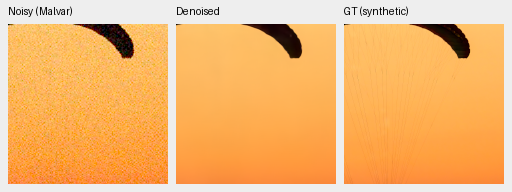

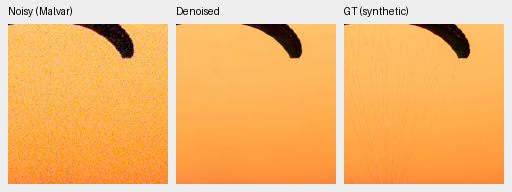

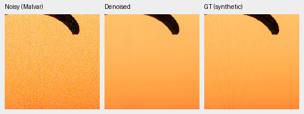

### Exact synthetic GT: 002fc6ee

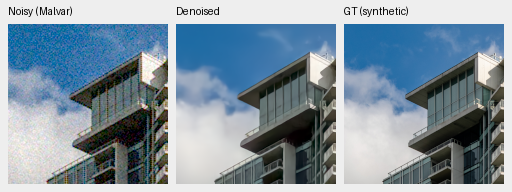

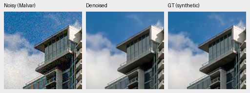

### Separate ISO100 reference: foliage

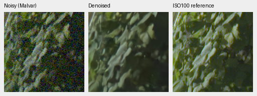

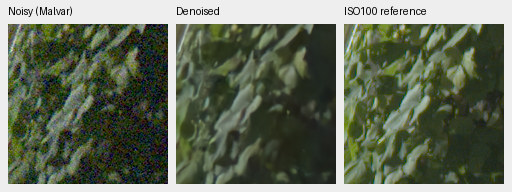

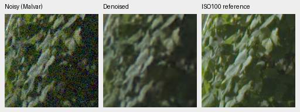

### Separate ISO100 reference: chain-link-fence

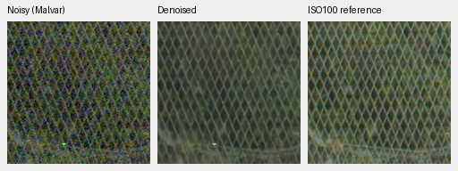

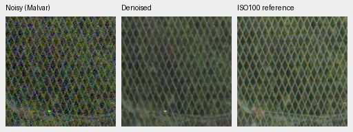

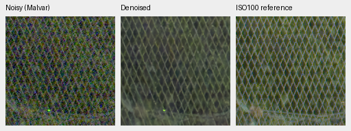

At native scale, all three fresh networks suppress most noise and recover the
fence lattice more cleanly than channel-calibrated RawNIND, whose selected
fence retains stronger colored grid artifacts. The fresh outputs are still
soft: fabric strands largely disappear, small leaf texture is smeared, and the
building edges and window details fall short of exact GT. None has a clear
visual win across the displayed regions. The separate ISO100 frame is sharper
and differs in exposure/aperture; it cannot establish pixelwise error or prove
that these differences are all restoration errors.

Immutable first1000 checkpoint copies and hashes are recorded in the receipt;
evaluation reports retain their original run paths. Later continuation may
advance each run’s `last.pt`, so use those immutable copies for reproduction.

All50 native PNGs verify SHA/dimensions/metadata and common noisy/reference
panel bytes. All ten complete8746×11662×3 RGB16 TIFFs verify fullSHA/size/dtype/
dimensions/16-bit tags and>256 sampled codes; sRGB outputs carry ICC profiles.
Successive full GFX observations: 0:control-anchored-native-fresh-b16-v45:step-1000: 30.18s; 1:dino-anchored-native-fresh-b16-v44:step-1000: 33.20s; 2:dino-base-anchored-native-fresh-b16-v51:step-1000: 35.64s; RawNIND:CFA-LS: 17.54s; RawNIND:CFA-channel: 17.52s. Tiles512/overlap64/batch4,
excluding load/decode/render/encoding. The shared-machine observations are not
a repeated speed comparison or a10-second result. Complete files remain under
`/mnt/external/demosaic/evaluation/gfx-3879-3880-fresh-dino-capacity-1k-full/`.
