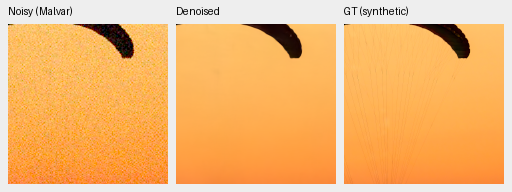
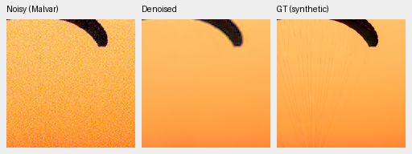
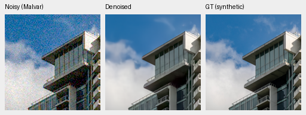
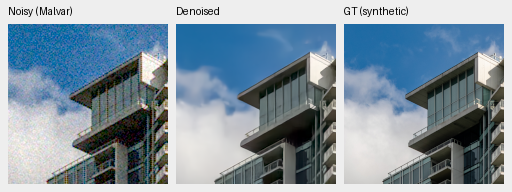
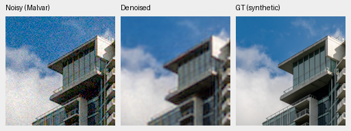
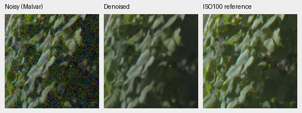
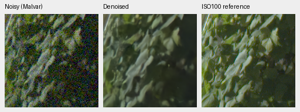
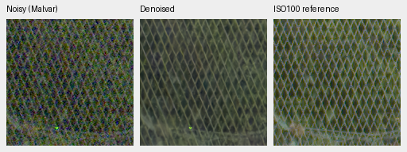
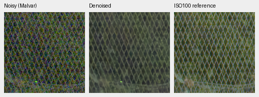
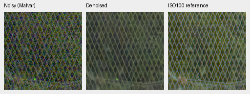

# Fresh no-context / DINO-S / DINO-B: step3000 review

No promotion. No-context remains strongest on photographic PSNR and known/
unseen measured-CFA means within this matched triple. ViT-B improves photo
and procedural PSNR over ViT-S, but does not beat no-context photo/primary.
The retained V43 step2000 reference remains stronger on photo and unseen
primary. These runs stop at this review gate with immutable whole-state
checkpoints and their original10000 schedule preserved; convergence and a
universal DINO effect are not established.

[Complete results, provenance and50 verified native triplets](results/fresh-dino-capacity-3k-review.json).
[Matched setup and preflights](fresh-dino-capacity.md). All three begin from the
same verified Gaussian RGB weights and zero measurement/gates, with no inherited
JDD/DINO restoration history. At initialization, all66 common CNN tensors and all three outputs matched
under the actual FP32/BF16/FP16 policies. Explicit FP32 middle skips avoid the
previously diagnosed zero-context precision confound. Default legacy policies
remain unchanged; all three new models use the matched policy.

Seed48, batch16, LR1e-4/planned10000, the original AdamW/EMA and exactly3000 total updates per
arm. All122 logged input/target batches match across all three. Commons40170/
native128/paired32,25/25/50 mix,4×→geometry/PSF→2× targets and original8× validation
are fixed. S/B foundation weights stay frozen; their adapter input widths and
trainable parameter counts differ. This compares complete context branches,
not feature quality independently of adapter capacity. It is one seed/gate,
not evidence of convergence or a universal foundation-model effect.

| Panel | Model | Measured-CFA PSNR | AHD RGB PSNR | AHD SSIM |
| --- | --- | ---: | ---: | ---: |
| Known4 | V45 no context | 54.23040 | 39.88386 | 0.930279 |
| Known4 | V44 frozen ViT-S | 54.15788 | 39.77738 | 0.929824 |
| Known4 | V51 frozen ViT-B | 54.15108 | 39.80945 | 0.929561 |
| Known4 | RawNIND global CFA-LS | 54.06860 | 39.67805 | 0.928811 |
| Known4 | RawNIND channel CFA-LS | 54.08474 | 39.71710 | 0.928831 |
| Unseen5 | V45 no context | 53.68576 | 38.11241 | 0.915925 |
| Unseen5 | V44 frozen ViT-S | 53.58156 | 37.90213 | 0.913439 |
| Unseen5 | V51 frozen ViT-B | 53.55382 | 37.97789 | 0.913607 |
| Unseen5 | RawNIND global CFA-LS | 53.56220 | 38.14484 | 0.918380 |
| Unseen5 | RawNIND channel CFA-LS | 53.76822 | 38.56191 | 0.922127 |

Known4 has8 pairs/72 crops; unseen5 has10 pairs/90 crops. Registered low-noise
measured CFA is primary. Independent LibRaw AHD RGB is auxiliary, **not exact
RGB GT**. Both RawNIND variants use publisher global-ADC normalization and gain
calibration from the observed CFA only. Protected-final scoring stays closed.

| Model | 427-photo PSNR | SSIM | 16-procedural PSNR | SSIM |
| --- | ---: | ---: | ---: | ---: |
| V45 no context | 34.80182 | 0.955911 | 33.25982 | 0.961393 |
| V44 frozen ViT-S | 34.65136 | 0.955345 | 33.17156 | 0.961475 |
| V51 frozen ViT-B | 34.74195 | 0.955414 | 33.44023 | 0.961398 |
| RawNIND global CFA-LS | 26.69578 | 0.790028 | 24.97426 | 0.720411 |
| RawNIND channel CFA-LS | 26.68357 | 0.789899 | 24.98568 | 0.720500 |

| Difference, dB[95% source interval] | Known primary | Unseen primary | Photo sRGB | Procedural sRGB |
| --- | --- | --- | --- | --- |
| V44 frozen ViT-S − V45 no context | -0.07251 [-0.11100, -0.02560] | -0.10420 [-0.17536, -0.04414] | -0.15046 [-0.21868, -0.09619] | -0.08826 [-0.33129, +0.08311] |
| V51 frozen ViT-B − V45 no context | -0.07932 [-0.15182, -0.02207] | -0.13195 [-0.19471, -0.07286] | -0.05987 [-0.12060, -0.01504] | +0.18041 [-0.09970, +0.41487] |
| V51 frozen ViT-B − V44 frozen ViT-S | -0.00681 [-0.05845, +0.04483] | -0.02774 [-0.07689, +0.02150] | +0.09059 [+0.05741, +0.12328] | +0.26867 [+0.12316, +0.43031] |

Source-bootstrap intervals measure evaluation-source variation, not training-seed
uncertainty. Source-balanced results use443 synthetic-evaluation sources, seven
conditions/four CFAs and99,232 cases: three new networks, two calibrated RawNIND
variants and three classical baselines. Everything is recomputed in the same
frozen source/version and protocol, without cached-neural reuse.

| Difference versus channel-calibrated RawNIND | Known primary | Unseen primary | Photo sRGB | Procedural sRGB |
| --- | --- | --- | --- | --- |
| V45 no context − RawNIND channel CFA-LS | +0.14566 [-0.26463, +0.55595] | -0.08246 [-0.38587, +0.18971] | +8.11825 [+7.96734, +8.27053] | +8.27414 [+7.81821, +8.73225] |
| V44 frozen ViT-S − RawNIND channel CFA-LS | +0.07314 [-0.32482, +0.47111] | -0.18666 [-0.52180, +0.11997] | +7.96779 [+7.80312, +8.13100] | +8.18588 [+7.69925, +8.66363] |
| V51 frozen ViT-B − RawNIND channel CFA-LS | +0.06634 [-0.32140, +0.41938] | -0.21440 [-0.57296, +0.07537] | +8.05838 [+7.88414, +8.22667] | +8.45455 [+8.01268, +8.87744] |

These early fresh models have a different training history from the V43 step2000
photographic experimental reference (known54.23332/unseen53.80606 primary,
photo34.89934/.957126, procedural33.28537/.966604). Its
[review](native-corpus-2k-review.md) remains context, not a matched continuation.
No early mean or initialization check establishes the requested large qualitative
margin over RawNIND or SOTA. All exact source/checkpoint/reference-weight/data
hashes and file paths remain in the receipt.

## Native crops

Noisy Malvar → restored → exact synthetic GT for protocol photos. Native160×160
per panel; no resizing. Shared ROI[48,48,160,160], RGGB/ISO12800 prior
`shot=.00256`, `read=.0000262144`, display×1, WB[2,1,1.5] and fixed protocol matrix.
Noisy/reference panel pixels and ROI/noise/display metadata verify identical
across all methods. PNGs are8-bit previews; metrics use unquantized outputs.

Photographic sources: [Roy Egloff](https://commons.wikimedia.org/wiki/File:CH.VD.Villeneuve_2007-08-25_Vertigo-Swiss-Riviera_2392_3x2-R_4K.jpg)
and [Dietmar Rabich](https://commons.wikimedia.org/wiki/File:Vancouver_(BC,_Canada),_Coal_Harbour_Seaside_Park,_Blick_in_den_Himmel_--_2022_--_2158.jpg),
[CC BY-SA4.0](https://creativecommons.org/licenses/by-sa/4.0/). Modified by binning,
crop, simulated noise, restoration and rendering; previews retain that license.
Paired images: Benoit Brummer and Christophe De Vleeschouwer,
[RawNIND](https://doi.org/10.14428/DVN/DEQCIM), per-scene credits in receipts.
GFX images by the project owner.

Full102MP GFX DSCF3879 ISO6400 → restored → separate DSCF3880 ISO100 f/5.6.
Native160px foliage[8890,5570], fence[2240,6000] (reference x2241); sky/building
also published. Shared+2EV/WB/matrix and input-only `shot=.0014635775921166604`,
`read=.0000010715704128646712`. Time/aperture/motion differ: the last panel is
a qualitative reference, **not GT**. No warping, reference gain fitting or
pixelwise GFX reference score.

### Exact synthetic GT: 0014aa4e

### Exact synthetic GT: 002fc6ee

### Separate ISO100 reference: foliage

### Separate ISO100 reference: chain-link-fence

The fence lattice is cleaner than channel-calibrated RawNIND's selected
colored grid artifacts, but all three networks still smooth leaf texture and
largely erase the fabric strands. Fine building/window details remain below
exact synthetic GT. B shows no consistent native visual win over no-context
across these examples. The ISO100 f/5.6 frame is independently sharper and
contains time/aperture/motion differences; it remains a qualitative reference.
No broad real-image quality margin follows from the synthetic PSNR gap.

All three improve photographic means from their first1000 gate: no-context
+.20390dB, S+.17811dB, B+.19122dB. Unseen primary gains are+.03054/+.18677/+.16782.
These are descriptive same-source/protocol changes, not training-seed intervals.
All62,020 classical/RawNIND metric cases replay exactly across the two gates.
All122 logged training batches match across the three arms; unlogged steps
were not independently hashed. Immutable3000 checkpoint paths are in the
receipt, with first1000 copies preserved separately.

The next data-only experiment retains the stronger V43 parent and compares the
old paired dataset with the newly reviewed extension under the same model,
optimizer setup, seed/schedule and nonpaired observations. It does not assume
that a larger context branch or more data automatically improves quality.

All50 native PNGs verify SHA/dimensions/metadata and common noisy/reference
panel bytes. All ten complete8746×11662×3 RGB16 TIFFs verify fullSHA/size/dtype/
dimensions/16-bit tags and>256 sampled codes; sRGB outputs carry ICC profiles.
Successive full GFX observations: 0:control-anchored-native-fresh-b16-v45:step-3000: 30.41s; 1:dino-anchored-native-fresh-b16-v44:step-3000: 34.01s; 2:dino-base-anchored-native-fresh-b16-v51:step-3000: 36.83s; RawNIND:CFA-LS: 17.32s; RawNIND:CFA-channel: 17.19s. Tiles512/overlap64/batch4,
excluding load/decode/render/encoding. The shared-machine observations are not
a repeated speed comparison or a10-second result. Complete files remain under
`/mnt/external/demosaic/evaluation/gfx-3879-3880-fresh-dino-capacity-3k-full/`.
