# V175 fresh-noise continuation: completed quality

Extending V172 from 900 to **9,000 total optimizer updates**, with 8,073 fresh
sensor batches and newly computed frozen-parent outputs, leaves fine-detail
recovery almost unchanged. **V175 raw offers a small quiet-region error gain**;
the EMA endpoint has different color-bias costs. Neither visibly recovers the
missing fine green cab-fence crossings. V120 remains the general recommendation
and V172 remains the balanced matching baseline for further detail work.

Against V172 EMA, constructed mesh response rises **0.05245% for raw and
0.03338% for EMA**, reaching **3.87922%/3.87848% of exact GT amplitude**, from
3.87718%. Only 138/256 and 131/256 present cases increase, respectively.
These are small descriptive mean changes on the fixed cohort. V161 retains
the stronger learned-detail option and its larger quiet/flat costs; its column
remains beside all newer methods in the tables and native boards.

Raw quiet total RMS falls **0.135% at ISO6400 and 0.269% at ISO12800**: 21/32
inputs improve and 11 worsen. Quiet spatial RMS falls **0.150%/0.058%**, with
29/32 improving, including all 16 ISO6400 inputs. Quiet DC error changes
**+0.044%/−1.471%**. EMA spatial RMS also falls **0.157%/0.077%**, but its total
quiet RMS is almost unchanged at ISO6400 (−0.0009%) and **rises 0.213% at
ISO12800**; DC error rises **0.511%/0.704%**. Keep the raw endpoint's modest
quiet gain available alongside the earlier quiet, detail and flat strengths.

Mesh-containing blank RMS changes **−0.0076% raw/−0.1580% EMA**. In entirely
absent mesh cases it changes **+0.0395%/−0.1272%**. Near-zero signed absent
template means do not establish an absence of invented texture. Photographic
band response falls **0.045–0.245% raw** and **0.048–0.238% EMA** across the four
faint/dark cohort means; band error changes slightly in the favorable direction.
The endpoints therefore do not combine higher natural texture response and
cleaner quiet fields across all conditions.

Native512 standalone-flat full RMS changes **+0.091%/−0.0048% raw** and
**+0.099%/−0.085% EMA** for ISO6400/12800. EMA coarse32 RMS falls only
**0.028%/0.0086%**, with 31/48 individual inputs improving. Raw coarse32 changes
**−0.018%/+0.011%**. These mixed and small changes leave V171's stronger
standalone-flat option useful, with its separate quiet-field costs.

All **60 figures in 15 original-detail sheets** were actually inspected,
including 12 noisy/restored/exact constructed-GT triplets. The ordinary first
mesh crop remains nearly uniform; the second retains one strong orientation
while crossing strands stay weak. Both fine cab ROIs and both conditioning
priors retain soft, incomplete mesh. The main coarse fence is reconstructed,
but foliage and building detail keep similar softness. Normal-display sky looks
smooth in this crop; amplified constructed quiet/flat crops still show colored
grain, broad mottle and casts. The subtle numerical gains do not visibly remove
those failures. ADC bark/fur and plane controls appear unchanged, consistent
with the separate exact checks.

Both protected GFX families, their JPEGs and siblings remain excluded from
training. ISO100 AHD and camera JPEG comparisons differ in aperture, shutter,
motion, exposure and processing; they are qualitative references, not exact GT.
The measured gains/costs are retained without a significance or promotion
cutoff. Reused scenes and coupled cases do not measure blind generalization or
training-seed uncertainty. Longer fresh-noise training alone supplies little
new fine-detail recovery here; the separate V178 phase-evidence trial tests an
additional input path with a matched continuation budget.

## Four-pass training losses

A posthoc reduction of the already audited first four continuation passes
finds **small changes in recorded detail losses**. The table compares means
over the same clean scene rows in passes 1 and 4; these are the changing raw
model's losses before each update, not evaluations of a fixed checkpoint.
Fresh noise, model state and learning rate change together. Three noisy photo
rows retain their original observations. No inference or noise is repeated.

| Domain | Updates/pass | Pair-difference mean, pass 1 → 4 | Flat-anchor change | Total loss change | Pre-clip norm >1, pass 1 → 4 |
|---|---:|---:|---:|---:|---:|
| Mesh | 307 | 0.189039 → 0.188861 (−0.094%) | +0.071% | −0.204% | 59.61% → 46.91% |
| Weak texture | 99 | 0.247964 → 0.248109 (+0.059%) | −0.237% | −0.039% | 52.53% → 45.45% |
| Photo | 214 | 0.314902 → 0.315394 (+0.156%) | +4.797% | +0.156% | 9.81% → 9.81% |
| Flat | 141 | No pairs | −0.558% | −0.387% | 1.42% → 0.71% |
| Mixed edge/quiet | 139 | No pairs | −0.976% | −0.589% | 0% → 0% |

The flat-anchor term integrates a clean-target mask and pseudo-Huber error in
fixed 16-DN16 units. Its mean includes all image elements, so it is neither
flat-region RMS nor a sky score. Its rise on photo batches contrasts with the
fall on standalone flats; one aggregate training total cannot establish both
detail preservation and flat behavior. Reported gradient norms also differ
substantially across domains. Scalar term shares do not establish gradient or
Adam-update contributions, and batch losses mix multiple image contrasts.

The reduction checks all 3,600 FP32 totals exactly and 350 means with independent
Decimal arithmetic. It retains every pass/domain/term summary and paired-row
change counts; repeated scenes and coupled members are correlated, with no
significance or generalization claim. This is descriptive training evidence,
not a new quality result or a reason to select a checkpoint early. At that interim
point the fixed recipe was still running. The final raw/EMA detail, blank,
quiet, flat and real fence/sky outcomes are now reported above and below.
[All reductions and exact source](results/v175-four-pass-training-loss-v1.json) ·
[Reducer](../scripts/summarize_fresh_noise_prefix.py).

[Final evidence and exact sources](results/v175-fresh-noise-matching-final-v1.json) · [Native pixels, source ROIs, checkpoint, noise and display metadata](images/v175-fresh-noise-matching-v1/manifest-v1.json).

## Mesh response and actual blank error

| Metric | V143 parent | V161 EMA | V169 EMA | V171 EMA | V172 EMA | V173 EMA | V174 EMA | V175 raw | V175 EMA |
| --- | ---: | ---: | ---: | ---: | ---: | ---: | ---: | ---: | ---: |
| Present full RMS | 9.111243 | 8.979201 | 8.956287 | 8.909846 | 8.955686 | 8.948849 | 8.955665 | 8.956087 | 8.949633 |
| Present signed template gain | 0.02202090 | 0.05239854 | 0.03836594 | 0.03884819 | 0.03877185 | 0.03723868 | 0.03867667 | 0.03879218 | 0.03878479 |
| Present actual blank RMS | 5.523323 | 5.816396 | 5.609300 | 5.544439 | 5.610812 | 5.590872 | 5.609727 | 5.610388 | 5.601944 |
| Present blank spatial RMS | 5.343113 | 5.645413 | 5.431940 | 5.361961 | 5.429880 | 5.410955 | 5.428378 | 5.421000 | 5.420632 |
| Present blank DC RMS | 1.289621 | 1.287310 | 1.289568 | 1.300170 | 1.299983 | 1.294365 | 1.300955 | 1.326118 | 1.300870 |
| Absent full RMS | 5.237910 | 5.501669 | 5.305929 | 5.248144 | 5.309113 | 5.291708 | 5.308678 | 5.311212 | 5.302362 |
| Absent signed template gain | 0.00003236 | 0.00039787 | -0.00000719 | 0.00001071 | 0.00000519 | -0.00003993 | -0.00000498 | -0.00000001 | 0.00000192 |
| Absent actual blank RMS | 5.237910 | 5.501669 | 5.305929 | 5.248144 | 5.309113 | 5.291708 | 5.308678 | 5.311212 | 5.302362 |
| Absent blank spatial RMS | 5.099652 | 5.367749 | 5.169538 | 5.102240 | 5.167332 | 5.151649 | 5.166379 | 5.161086 | 5.160891 |
| Absent blank DC RMS | 1.098115 | 1.111598 | 1.098120 | 1.135453 | 1.122982 | 1.113479 | 1.125281 | 1.155025 | 1.121672 |

## Quiet fields beside detail

| Metric | V143 parent | V161 EMA | V169 EMA | V171 EMA | V172 EMA | V173 EMA | V174 EMA | V175 raw | V175 EMA |
| --- | ---: | ---: | ---: | ---: | ---: | ---: | ---: | ---: | ---: |
| iso6400-prior whole RMS | 27.105631 | 26.972453 | 26.806949 | 27.302897 | 26.801695 | 26.860185 | 26.797020 | 26.795723 | 26.796191 |
| iso6400-prior quiet RMS | 3.898845 | 4.615625 | 4.046127 | 5.289473 | 4.033561 | 4.012548 | 4.026601 | 4.028107 | 4.033524 |
| iso6400-prior quiet spatial RMS | 3.268502 | 3.772120 | 3.439626 | 3.429768 | 3.441249 | 3.417869 | 3.438372 | 3.436096 | 3.435861 |
| iso6400-prior quiet DC RMS | 2.016074 | 2.478187 | 2.018205 | 3.855646 | 1.991393 | 1.991098 | 1.982841 | 1.992262 | 2.001566 |
| iso12800-prior whole RMS | 36.747466 | 35.371842 | 35.462223 | 36.176612 | 35.435967 | 35.609092 | 35.430797 | 35.338865 | 35.348725 |
| iso12800-prior quiet RMS | 6.152652 | 7.060811 | 6.344343 | 7.979617 | 6.295703 | 6.278894 | 6.288010 | 6.278763 | 6.309106 |
| iso12800-prior quiet spatial RMS | 5.341833 | 5.949189 | 5.559786 | 5.525857 | 5.557772 | 5.540053 | 5.555586 | 5.554541 | 5.553504 |
| iso12800-prior quiet DC RMS | 2.849060 | 3.597003 | 2.853327 | 5.513166 | 2.780697 | 2.778718 | 2.770721 | 2.739782 | 2.800261 |

## Native 512-pixel standalone flats

| Metric | V143 parent | V161 EMA | V169 EMA | V171 EMA | V172 EMA | V173 EMA | V174 EMA | V175 raw | V175 EMA |
| --- | ---: | ---: | ---: | ---: | ---: | ---: | ---: | ---: | ---: |
| iso6400-prior full RMS | 18.546808 | 19.024279 | 18.618871 | 18.394478 | 18.607969 | 18.561545 | 18.609537 | 18.624985 | 18.626425 |
| iso6400-prior spatial RMS | 18.235130 | 18.723699 | 18.308796 | 18.067235 | 18.308685 | 18.249657 | 18.312272 | 18.300711 | 18.296671 |
| iso6400-prior coarse32 RMS | 13.440561 | 13.375119 | 13.438463 | 13.205937 | 13.435593 | 13.434259 | 13.438287 | 13.433167 | 13.431800 |
| iso12800-prior full RMS | 24.071890 | 24.866512 | 24.219097 | 23.850667 | 24.198471 | 24.125142 | 24.180955 | 24.197306 | 24.177811 |
| iso12800-prior spatial RMS | 23.596861 | 24.441501 | 23.747288 | 23.431650 | 23.747758 | 23.675332 | 23.745663 | 23.744923 | 23.737404 |
| iso12800-prior coarse32 RMS | 17.932544 | 17.847243 | 17.930574 | 17.619500 | 17.921661 | 17.925292 | 17.922356 | 17.923633 | 17.920121 |

## Natural photographic detail

| Metric | V143 parent | V161 EMA | V169 EMA | V171 EMA | V172 EMA | V173 EMA | V174 EMA | V175 raw | V175 EMA |
| --- | ---: | ---: | ---: | ---: | ---: | ---: | ---: | ---: | ---: |
| retained512/photo-faint full RMS | 33.963754 | 33.989892 | 33.966492 | 33.965750 | 33.965651 | 33.972592 | 33.965226 | 33.966362 | 33.964199 |
| retained512/photo-faint band response | 0.298560 | 0.300629 | 0.298025 | 0.298141 | 0.298194 | 0.290365 | 0.298145 | 0.297719 | 0.297729 |
| retained512/photo-faint band error | 0.824639 | 0.824519 | 0.824693 | 0.824595 | 0.824629 | 0.824737 | 0.824629 | 0.824593 | 0.824596 |
| retained512/photo-dark full RMS | 29.097715 | 29.108120 | 29.094009 | 29.115518 | 29.095378 | 29.108366 | 29.095377 | 29.092722 | 29.092537 |
| retained512/photo-dark band response | 0.531446 | 0.531944 | 0.530900 | 0.531020 | 0.530919 | 0.516410 | 0.530799 | 0.529616 | 0.529657 |
| retained512/photo-dark band error | 0.661447 | 0.661212 | 0.661251 | 0.661223 | 0.661241 | 0.661891 | 0.661235 | 0.661219 | 0.661222 |
| organic384/photo-faint full RMS | 37.469061 | 37.468656 | 37.483612 | 37.498859 | 37.482240 | 37.489719 | 37.483229 | 37.485465 | 37.482585 |
| organic384/photo-faint band response | 0.150701 | 0.151718 | 0.149160 | 0.149403 | 0.149407 | 0.145102 | 0.149378 | 0.149340 | 0.149335 |
| organic384/photo-faint band error | 0.924117 | 0.924824 | 0.925058 | 0.924904 | 0.924935 | 0.925212 | 0.924941 | 0.924914 | 0.924916 |
| organic384/photo-dark full RMS | 33.685796 | 33.688406 | 33.685928 | 33.717351 | 33.687728 | 33.688935 | 33.687788 | 33.684152 | 33.682841 |
| organic384/photo-dark band response | 0.398945 | 0.398821 | 0.397799 | 0.398053 | 0.397914 | 0.386519 | 0.397835 | 0.397145 | 0.397168 |
| organic384/photo-dark band error | 0.781612 | 0.781774 | 0.781691 | 0.781667 | 0.781679 | 0.781560 | 0.781680 | 0.781671 | 0.781673 |

## ADC-only controls

| Metric | V143 parent | V161 EMA | V169 EMA | V171 EMA | V172 EMA | V173 EMA | V174 EMA | V175 raw | V175 EMA |
| --- | ---: | ---: | ---: | ---: | ---: | ---: | ---: | ---: | ---: |
| Photo full RMS | 18.149871 | 18.146394 | 18.142182 | 18.142182 | 18.142182 | 18.142182 | 18.142182 | 18.142182 | 18.142182 |
| Photo band error | 0.101855 | 0.101811 | 0.101800 | 0.101800 | 0.101800 | 0.101800 | 0.101800 | 0.101800 | 0.101800 |
| fresh-flat512 full RMS | 3.322910 | 3.322910 | 3.322910 | 3.322910 | 3.322910 | 3.322910 | 3.322910 | 3.322910 | 3.322910 |
| fresh-flat512 coarse32 RMS | 0.538587 | 0.538587 | 0.538587 | 0.538587 | 0.538587 | 0.538587 | 0.538587 | 0.538587 | 0.538587 |
| adc-sloped512 full RMS | 3.771369 | 3.769995 | 3.776943 | 3.776943 | 3.776943 | 3.776943 | 3.776943 | 3.776943 | 3.776943 |
| adc-sloped512 coarse32 RMS | 0.574652 | 0.575804 | 0.573442 | 0.573442 | 0.573442 | 0.573442 | 0.573442 | 0.573442 | 0.573442 |

RMS values are camera-RGB DN16. Template gain 1 means exact constructed amplitude; an absent signed mean near zero does not certify absence of false structure. Coarse32 is spatially centered block-mean error. Paired increase/decrease counts are retained. The reused cohort does not establish blind performance or training-seed uncertainty.

## Continued training and fresh physical observations

The actual V172 step-1000 raw model, Adam and EMA states initialize this continuation at 900 optimizer updates. All 96 neural source files, the 2,088,906-parameter/141-tensor matching network, local physical features/output units, frozen V169 EMA and V143/DINO parent remain unchanged. The original seven-term criterion and its bytes are unchanged; only the training recipe changes. No V174 spread initialization or released V170 weights are applied.

Nine additional passes over the retained 1,000 scene/calibration/target rows complete 8,100 new optimizer updates, 900 ADC skips and 32,400 images. Including V172, the model has 9,000 updates/36,000 images on 1,000 unique scene batches. Learning rate reheats to 0.0001 with a 100-row warmup and cosine decay to 0.00001; AdamW, clipping and EMA rules remain. Budget, noise realizations and LR change together, so their individual effects are not isolated. [Original protocol](results/v175-fresh-noise-matching-v1/original-protocol-v1.md).

All 1,000 old input bindings are checked. Independent NumPy Bayer sampling and original clean-sensor hashes admit 897 noisy rows per pass for re-noising. Three clipped photo rows, 65/358/543, cannot recover their original unclipped sensor signal from their stored RGB target, so their exact noisy observations/parents are retained. The result is 8,073 fresh sensor batches, 27 cached noisy batches and 900 ADC skips. No source, camera or geometry is rendered again; no original/dataz files are read.

Fresh noise uses a stateless local CPU generator per continuation row. Counterfactual members share common Poisson counts and read noise; ordinary members use independent sensor samples. Variance conditioning is computed from the new noisy intensity. Targets, masks and pair units remain training-only. Each fresh batch recomputes its own exact frozen V143/DINO parent; no parent from a different noise draw is substituted. The 27 cached batches retain their matching original parents, and ADC rows skip noise/parent/matching/optimizer work.

The first CPU preflight rejects the all-targets-as-clean assumption before any training-data draw. A later CPU binding-shape rejection and a v1 worker import failure are also preserved. The v1 worker stopped before its training claim or CUDA runtime because its snapshot omitted the physical sensor helper. The corrected v2 workspace includes the dependency and passes actual frozen-worker imports, metric construction, strict matching/full-parent/DINO CPU loads and all 54 focused tests, including 18 new cases. The graph/native backward admission inherits unchanged evidence rather than repeating forwards. [Preparation and preserved rejections](results/v175-fresh-noise-matching-preparation-v2.json) · [Frozen-worker readiness](results/v175-frozen-worker-readiness-v1.json).

Two cached-parent CUDA replays at different native sizes reproduce their existing fingerprints exactly before training. A real total-row-1008 checkpoint restores model, Adam, EMA and CPU/CUDA RNG exactly, then continues at 1009 without replay. Global RNG remains unchanged because new noise uses local generators. Atomic sampler input gradients retain warn-only nondeterminism; state restoration does not imply a bit-exact training trajectory.

The final audit checks all 9,000 source/target/unit mappings, 32,346 durable parent/matching events, 8,100 independently summed NumPy FP32 objective totals, 8,100 inherited clean-mask fingerprints and 40,365 actual parent-argument fingerprints. All 141 final Adam states are at actual step 9,000, including 900 inherited updates. Both strict endpoint states are finite and all 47 frozen state tensors retain the initial values.

The first eight continuation rows retain seven actual fresh noisy batches and their parent arrays; the ADC row uses its old cached data. Independent saved-array checks cover their physical variance, fingerprints and exact common-noise pixels. Later fresh arrays were streamed and fingerprinted, not retained as a complete posthoc byte archive. Seeds, source hashes, observed arguments/output fingerprints and unchanged-source checks cover the other rows; there is no full-array audit of all 8,073 new realizations. No noise or neural forward is repeated by the audits.

## Fixed quality, comparisons and execution scope

Both final endpoints complete all 822 fixed cached inputs: 1,644 compositions, 1,500 actual matching calls and 7,500 nested samplers. All 1,644 V169 fingerprints replay exactly and all 144 ADC outputs retain V169. All 6,576 actual quality-input fingerprints and durable event/row bindings pass. Zero local supplied variance retains the frozen output; this is not a guarantee for noisy flat fields.

Independent in-process residual addition covers 1,186,725,888 channels. New full RGB arrays cover 36 selected native cases: 72 RGB plus 72 residuals, 430,196,736 bytes. Independent posthoc metrics/addition check 582 scalars and 53,772,288 channels on those arrays. Other outputs were scored/fingerprinted and independently norm/decomposition/addition checked in process but were not retained as full arrays.

The nine-method tables include the earlier V161 EMA detail prototype, V169 EMA, V171 EMA, V172 EMA, V173 EMA, V174 EMA, V143 parent and both new endpoints. All 822 old V161 EMA arrays exist on exactly the same noisy inputs/parents/ROIs and identical metric-source bytes. A new array-only reduction rehashes and recomputes them; all 8,038 comparable old scalars match exactly, with no model calls. [V161 baseline reduction](results/v175-fresh-noise-matching-v1/baseline-V161-current-metrics-v1.json).

V172 comparisons use its existing audited label-only view rather than the original scores' historical V171 method names. Reversing the labels and native dictionary keys reproduces the complete original record exactly; no prediction, weight or scientific value changes. The continuation plan's original path is preserved and the postprocessing input receipt binds the canonical comparison view. Other earlier numeric comparisons reuse previously audited scores on identical cached inputs.

Decimal arithmetic checks 1201 grouped means. Six existing primary EMA quality forwards additionally retain 30 FP32 pre-tanh offset fields, 102,780,672 bytes. Independent NumPy FP64 reduction binds them to actual inputs/outputs and reconstructs sample positions. These are not retained bit-exact CUDA coordinates, causal distant-information measurements or whole-model receptive fields.

This continuation and quality use 9,600 new CUDA matching calls, zero CPU matching calls and 9,744 nested V169 calls. There are 8,075 actual full V143/DINO roots: 8,073 fresh training batches plus two cached-parent replays, 32,300 parent images. Sensor construction uses 19,179 Poisson and 8,073 Gaussian API calls, with no new source/geometry/camera renders or original/dataz reads. The prior six-input shortcut diagnostic belongs to the preceding V174 work, not these counters. Unit-test draws are separate from scientific training-data counters.

Both corrected CUDA phase owners, the preserved pre-CUDA failed owner and the old-array reducer owner are terminal. No successful scientific prefix repeats. Training/quality CUDA peaks are 6.589985/2.786150 GiB. No new full-frame/100MP or ten-second claim is made. Existing MIT and embedded Caffe sampler notices remain in provenance.

Disk reserves remain 48/111 GiB local/external plus 0.5 GiB margin; runtime/launch RAM remain 32/52 GiB and CUDA quota 24 GiB. Postprocessing raises the remaining local publication forecast from the original 0.2 to 0.4 GiB to include the larger journal/result copies and comparisons. Original guards, receipt bytes and frozen source remain unchanged. [Postprocessing input/source preparation](results/v175-postprocess-preparation-v1.json).

## Fixed native comparisons

All 60 figures were actually viewed in 15 original-detail sheets: 48 boards and 12 noisy/restored/exact constructed GT triplets. Every cell is 160×160 native pixels without resizing. Sources/ROIs, checkpoint hashes, physical noise, exposure, camera transform, contrast and anchors are in the manifest. Mesh uses RGGB512, ROI [176,176,160,160], shot0.00128/read variance6.5536e-6, exposure8 and separate contrast1/40 views. Quiet uses ROI [80,176,160,160], exposure8/contrast40; flats use ROI [176,176,160,160], exposure4/contrast40. ISO12800 uses shot0.00256/read variance2.62144e-5. [Photographic credits](fine-mesh-training.md#photographic-credits).

Main DSCF3879 ISO6400/DSCF3880 ISO100 covers sky, building, foliage and coarse fence at exposure4. Extra DSCF3842/3835 covers both priors and fine cab windows [206,229,160,160]/[426,189,160,160] in 768-pixel contexts at exposure16, with both camera JPEGs. ISO100/AHD/JPEG references differ in aperture, depth of field, shutter, motion and processing. They are qualitative references, not exact GT or pixelwise scoring targets. Both protected families/JPEGs/siblings stay excluded from training and originals stay read-only and unused. [Main scene](../configs/gfx-qualitative-20231231.json) · [Fine cab mesh](../configs/gfx-green-mesh-20231231.json).

The [native-pixel viewer](images/v175-fresh-noise-matching-v1/native-viewer.html) defaults to V174 EMA versus V175 EMA; select V172 EMA for the continuation baseline or V161 harmonic EMA for the earlier detail option. Click the flip tile or press F. [Browser pixel verification](results/v175-native-viewer-verification-v1.json).

### All native comparison boards

mesh-seed2026112302-present-iso6400-prior-RGGB; ROI `[176, 176, 160, 160]`, exposure 8, contrast 1.

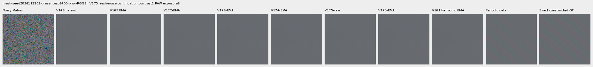

mesh-seed2026112302-present-iso6400-prior-RGGB; ROI `[176, 176, 160, 160]`, exposure 8, contrast 40.

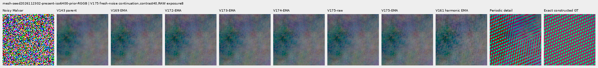

mesh-seed2026112309-present-iso6400-prior-RGGB; ROI `[176, 176, 160, 160]`, exposure 8, contrast 1.

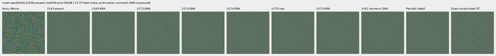

mesh-seed2026112309-present-iso6400-prior-RGGB; ROI `[176, 176, 160, 160]`, exposure 8, contrast 40.

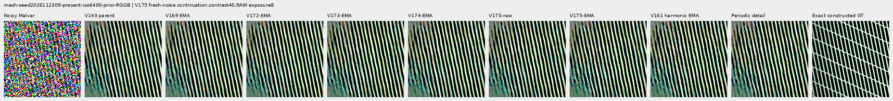

mesh-seed2026112304-absent-iso6400-prior-RGGB; ROI `[165, 0, 160, 160]`, exposure 8, contrast 40.

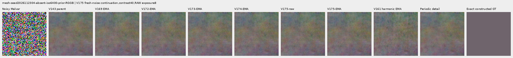

main-overcast-sky; ROI `[176, 176, 160, 160]`, exposure 4, contrast 1.

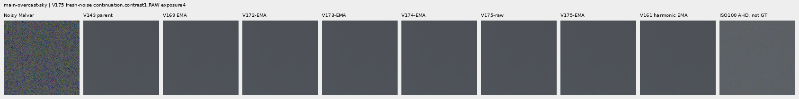

main-building-detail; ROI `[176, 176, 160, 160]`, exposure 4, contrast 1.

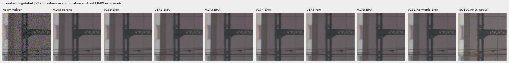

main-foliage; ROI `[176, 176, 160, 160]`, exposure 4, contrast 1.

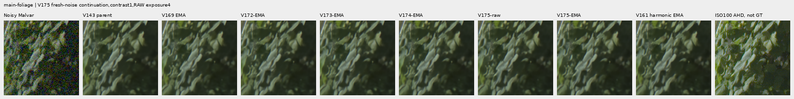

main-chain-link-fence; ROI `[176, 176, 160, 160]`, exposure 4, contrast 1.

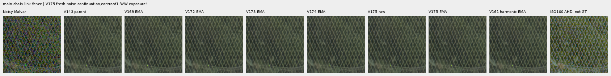

mesh-nominal; ROI `[206, 229, 160, 160]`, exposure 16, contrast 1.

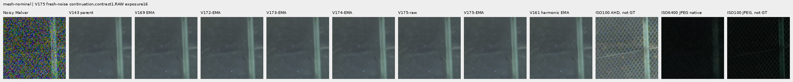

mesh-nominal; ROI `[426, 189, 160, 160]`, exposure 16, contrast 1.

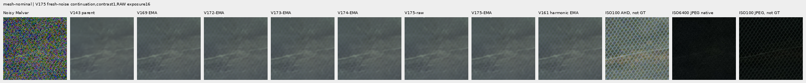

mesh-profile3879; ROI `[206, 229, 160, 160]`, exposure 16, contrast 1.

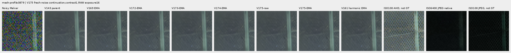

mesh-profile3879; ROI `[426, 189, 160, 160]`, exposure 16, contrast 1.

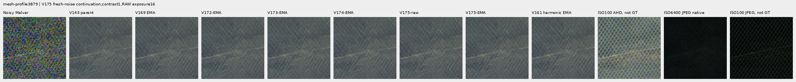

organic-02a76fd33b5e1414a0504f0b3f0aeb03a569b6f4-photo-faint-RGGB; ROI `[112, 112, 160, 160]`, exposure 14.3883, contrast 8.

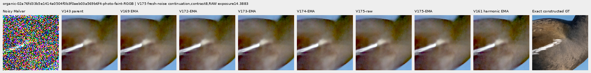

organic-dabacecd4780a1c230f8e9fce6ca1a604bdeab4c-photo-dark-RGGB; ROI `[112, 112, 160, 160]`, exposure 102.758, contrast 1.

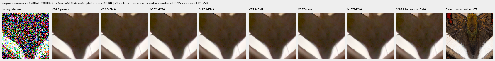

organic-6b3920bceba82d95ecf9351d47f6f94267694bd0-photo-dark-RGGB; ROI `[112, 112, 160, 160]`, exposure 64.0491, contrast 1.

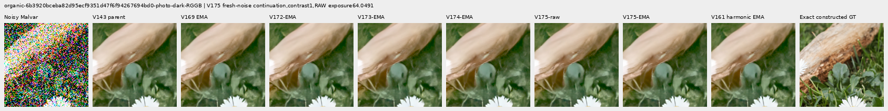

gray-l0.02-adc-only-RGGB; ROI `[48, 48, 160, 160]`, exposure 4, contrast 40.

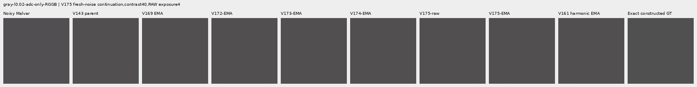

gray-l0.02-iso12800-prior-RGGB; ROI `[48, 48, 160, 160]`, exposure 4, contrast 40.

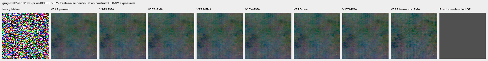

flat512-gray-l0.02-adc-only-RGGB; ROI `[176, 176, 160, 160]`, exposure 4, contrast 40.

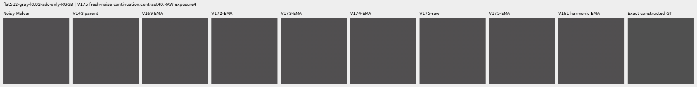

flat512-gray-l0.02-iso6400-prior-RGGB; ROI `[176, 176, 160, 160]`, exposure 4, contrast 40.

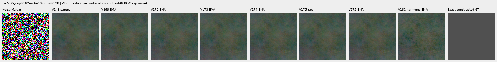

flat512-gray-l0.02-iso12800-prior-RGGB; ROI `[176, 176, 160, 160]`, exposure 4, contrast 40.

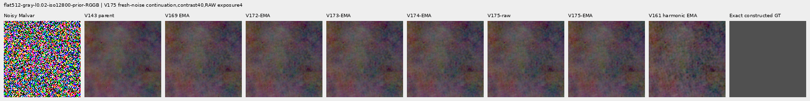

flat512-h210-s0.50-l0.02-iso6400-prior-RGGB; ROI `[176, 176, 160, 160]`, exposure 4, contrast 40.

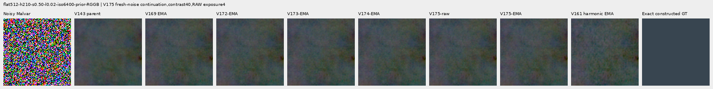

flat512-gray-l0.18-iso12800-prior-RGGB; ROI `[176, 176, 160, 160]`, exposure 1, contrast 8.

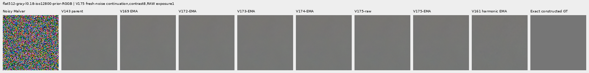

flat512-gray-l0.90-iso12800-prior-RGGB; ROI `[176, 176, 160, 160]`, exposure 1, contrast 4.

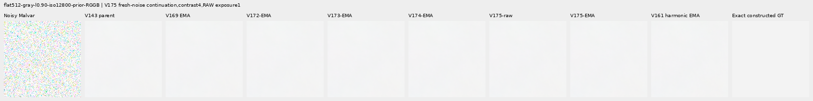

photo-3e638bbb56ed80abc88939468783e3bf9b92ee77-photo-faint-RGGB; ROI `[176, 176, 160, 160]`, exposure 12.1494, contrast 8.

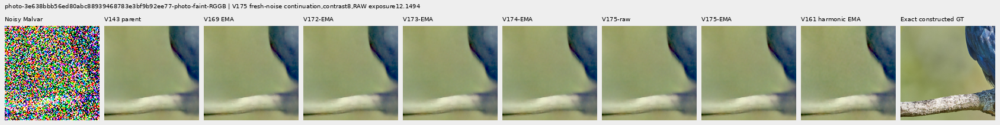

photo-3e638bbb56ed80abc88939468783e3bf9b92ee77-photo-dark-RGGB; ROI `[176, 176, 160, 160]`, exposure 80.9959, contrast 1.

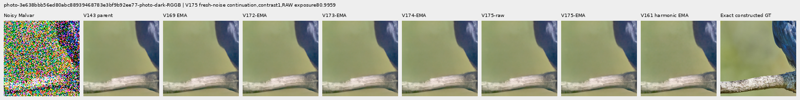

mixed-vertical-step-iso6400-prior-RGGB; ROI `[80, 176, 160, 160]`, exposure 8, contrast 40.

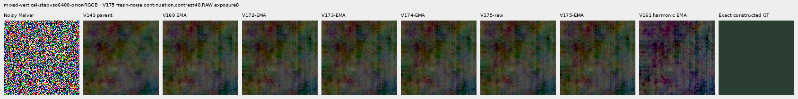

mixed-vertical-step-iso6400-prior-RGGB; ROI `[240, 176, 160, 160]`, exposure 8, contrast 1.

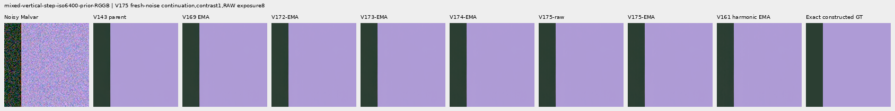

mixed-vertical-step-iso12800-prior-RGGB; ROI `[80, 176, 160, 160]`, exposure 8, contrast 40.

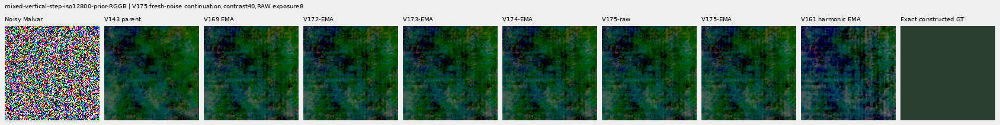

mixed-vertical-step-iso12800-prior-RGGB; ROI `[240, 176, 160, 160]`, exposure 8, contrast 1.

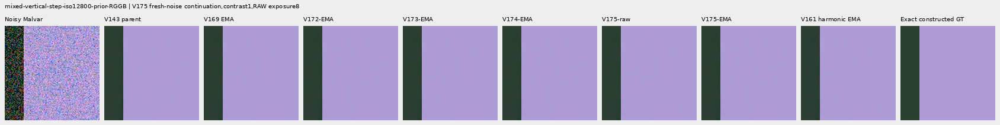

mixed-narrow-bar-iso6400-prior-RGGB; ROI `[80, 176, 160, 160]`, exposure 8, contrast 40.

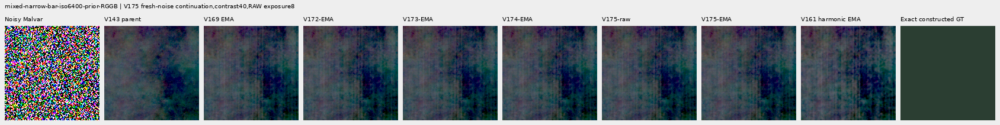

mixed-narrow-bar-iso6400-prior-RGGB; ROI `[240, 176, 160, 160]`, exposure 8, contrast 1.

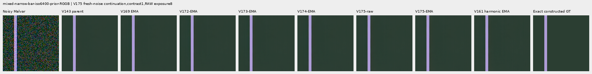

mixed-narrow-bar-iso12800-prior-RGGB; ROI `[80, 176, 160, 160]`, exposure 8, contrast 40.

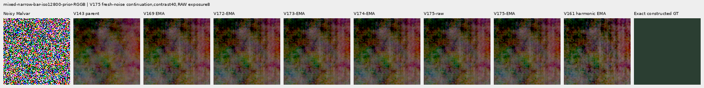

mixed-narrow-bar-iso12800-prior-RGGB; ROI `[240, 176, 160, 160]`, exposure 8, contrast 1.

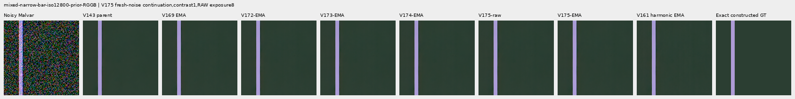

mixed-slanted-step-iso6400-prior-RGGB; ROI `[80, 176, 160, 160]`, exposure 8, contrast 40.

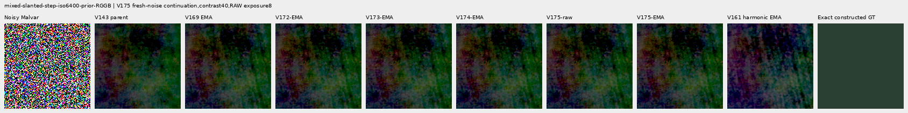

mixed-slanted-step-iso6400-prior-RGGB; ROI `[240, 176, 160, 160]`, exposure 8, contrast 1.

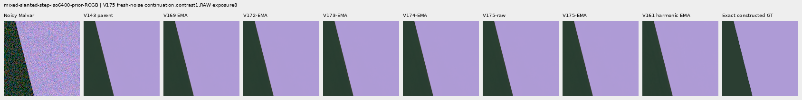

mixed-slanted-step-iso12800-prior-RGGB; ROI `[80, 176, 160, 160]`, exposure 8, contrast 40.

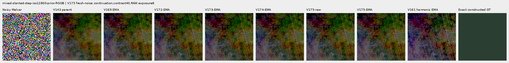

mixed-slanted-step-iso12800-prior-RGGB; ROI `[240, 176, 160, 160]`, exposure 8, contrast 1.

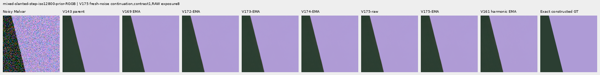

mixed-striped-patch-iso6400-prior-RGGB; ROI `[80, 176, 160, 160]`, exposure 8, contrast 40.

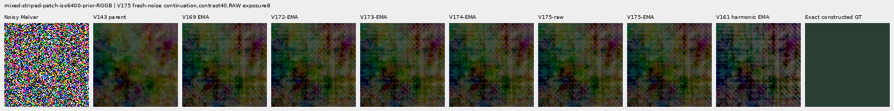

mixed-striped-patch-iso6400-prior-RGGB; ROI `[240, 176, 160, 160]`, exposure 8, contrast 1.

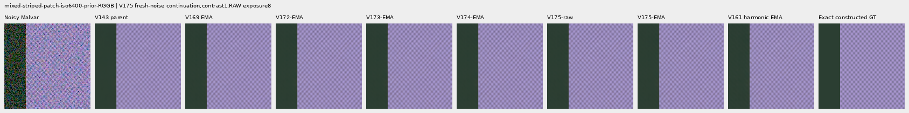

mixed-striped-patch-iso12800-prior-RGGB; ROI `[80, 176, 160, 160]`, exposure 8, contrast 40.

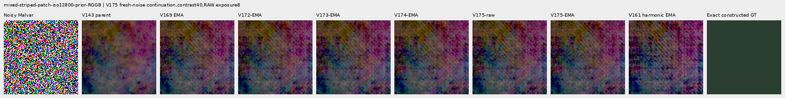

mixed-striped-patch-iso12800-prior-RGGB; ROI `[240, 176, 160, 160]`, exposure 8, contrast 1.

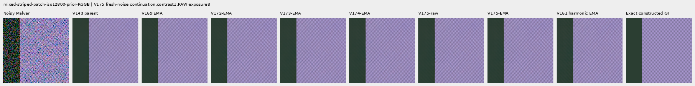

V150-control-bark-contrast0p025-adc-RGGB; ROI `[48, 48, 160, 160]`, exposure 1, contrast 40.

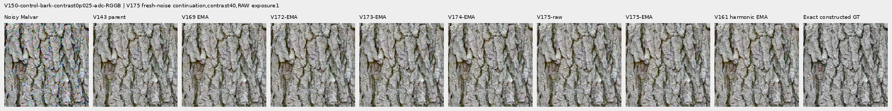

V150-control-raccoon-fur-contrast0p025-adc-RGGB; ROI `[48, 48, 160, 160]`, exposure 1, contrast 40.

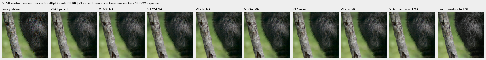

V150-control-ADC-plane0-RGGB; ROI `[176, 176, 160, 160]`, exposure 45, contrast 8.

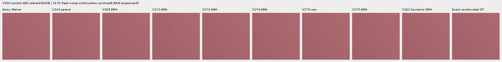

V150-control-ADC-plane1-RGGB; ROI `[176, 176, 160, 160]`, exposure 9, contrast 8.

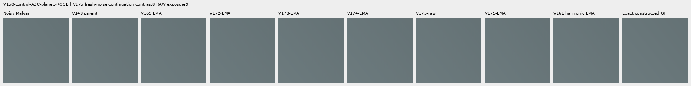

V150-control-ADC-plane2-RGGB; ROI `[176, 176, 160, 160]`, exposure 1, contrast 8.

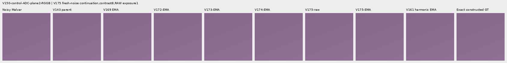

V150-control-ADC-plane3-RGGB; ROI `[176, 176, 160, 160]`, exposure 0.24, contrast 8.

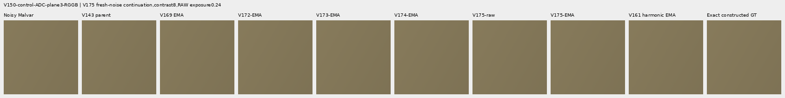

### Noisy, restored and exact constructed GT triplets

mesh-seed2026112302-present-iso6400-prior-RGGB; ROI `[176, 176, 160, 160]`, exposure 8, contrast 1.

mesh-seed2026112302-present-iso6400-prior-RGGB; ROI `[176, 176, 160, 160]`, exposure 8, contrast 1.

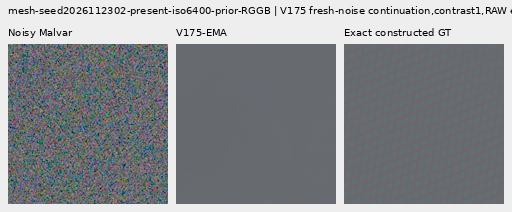

mesh-seed2026112309-present-iso6400-prior-RGGB; ROI `[176, 176, 160, 160]`, exposure 8, contrast 1.

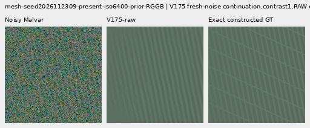

mesh-seed2026112309-present-iso6400-prior-RGGB; ROI `[176, 176, 160, 160]`, exposure 8, contrast 1.

flat512-gray-l0.02-iso6400-prior-RGGB; ROI `[176, 176, 160, 160]`, exposure 4, contrast 40.

flat512-gray-l0.02-iso6400-prior-RGGB; ROI `[176, 176, 160, 160]`, exposure 4, contrast 40.

flat512-gray-l0.02-iso12800-prior-RGGB; ROI `[176, 176, 160, 160]`, exposure 4, contrast 40.

flat512-gray-l0.02-iso12800-prior-RGGB; ROI `[176, 176, 160, 160]`, exposure 4, contrast 40.

mixed-vertical-step-iso6400-prior-RGGB; ROI `[80, 176, 160, 160]`, exposure 8, contrast 40.

mixed-vertical-step-iso6400-prior-RGGB; ROI `[80, 176, 160, 160]`, exposure 8, contrast 40.

mixed-vertical-step-iso12800-prior-RGGB; ROI `[80, 176, 160, 160]`, exposure 8, contrast 40.

mixed-vertical-step-iso12800-prior-RGGB; ROI `[80, 176, 160, 160]`, exposure 8, contrast 40.

[Independent publication verification](results/v175-fresh-noise-matching-publication-verification-v1.json).
