# Fresh no-context versus DINO-S at 10,000 updates

Both original schedules are complete. The two models remain visually close on
the fixed GFX crops, and both still lose fine fabric cords in the exact-GT
example. These fixed examples do not establish a broad DINO benefit or justify
replacing V43 in the README. [All ten new native PNGs, hashes and provenance](results/fresh-none-S10k-cpu-review.json).

This initial **CPU FP32 qualitative check** ran while DINO-B continued training.
It restores four cached 512×512 GFX contexts and two previously serialized
256×256 synthetic observations. It does not produce a full-frame output,
full-suite score or speed result. The [original matched trial](fresh-dino-capacity-10k.md)
has now completed all three original schedules; its complete numerical/native/
analytic/full-frame review remains pending.

A later [matched 3k→10k replay with retained float predictions](fresh-color-mean-diagnostic.md)
confirms a large fabric color/brightness regression in both arms. The building
case has no comparable mean shift. This is a case-level finding rather than a
broad quality claim; the full review remains necessary.

## Matched training and inputs

Both models use seed 48, batch 16, original 10,000-update cosine schedule, genuine
Gaussian CNN initialization, fixed Commons 40,170/native 128/original paired 32,
4×→geometry/PSF→area2 training, and the same physical/noise policies. Their
original training source bundle is
`2f1a2251d8141d335e99266343b46b61b8da3cb13012fc63d79ea5c3968ad01c`.
All **403 logged step/domain/observation hashes match exactly**. The common
effective model configuration and listed training fields were checked before
inference. Both AdamW states reached 10,000 with final LR 1e-5; the
[S boundary receipt](results/fresh-dino-capacity-S10k-boundary.json) also records
finite logged losses/gradient norms/model tensors and a nonzero context gate.

The models differ in frozen DINO features and trainable projection capacity.
One training seed and the existing nondeterministic CUDA execution policy do
not isolate semantic-feature quality or estimate training-repeat uncertainty.
The check uses EMA weights:

| Arm | Whole-checkpoint SHA256 |
| --- | --- |
| No context | `0df4ff404c38b8f4b42f6451486e91c97631544b1c817c126f371195942f3af4` |
| DINO-S | `ae74bc17012c85d5253f24da4dbaaec4486ed430aa143d852442754288d56bad` |

DINO-S uses genuine `facebook/dinov3-vits16-pretrain-lvd1689m`, pinned revision
`114c1379950215c8b35dfcd4e90a5c251dde0d32`. Both models enable the explicit
FP32 middle skip. The immutable evaluation snapshots are recorded in the
receipt; the active controller's expected final model paths were not created
early.

## Standing GFX scene

The source remains cached DSCF3879 (ISO6400, f/1.7, 1/240s) versus DSCF3880
(ISO100, f/5.6, 3s), with the original source hashes and predeclared regions in
the [standing selection](../configs/gfx-qualitative-20231231.json) and
[preceding CPU report](gfx-none10k-cpu-context-review.md). This execution reads
their saved linear observations rather than decoding either RAW again.
The scene and siblings stay out of training; originals remain read-only.

The ISO100 capture is independently AHD demosaiced and calibrated against its
own CFA measurements. It is **not exact GT**: aperture, motion and a 3m38s time
gap limit the comparison. No warping or pixelwise ISO100 quality score is used.
All methods share the same noisy-camera WB/matrix, shot
`.0014635775921166604`, read variance `1.0715704128646712e-6`, and display
exposure ×4 (+2EV). Every panel is an unresized native 160×160 crop.

Primary rows read **noisy → DINO-S 10k → ISO100 reference (not GT)**:

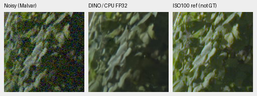

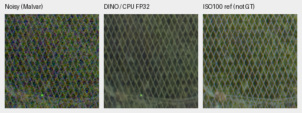

Both models preserve broad leaf shapes but soften fine texture. Both retain
continuous mesh lines. Small local fence differences do not establish an
overall winner. These direct rows read **noisy → no-context 10k → DINO-S 10k**;
neither learned panel is GT. Display pixels are copied exactly from the primary
outputs, without new rendering or adjustment:

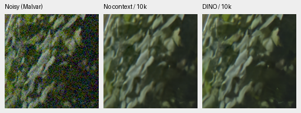

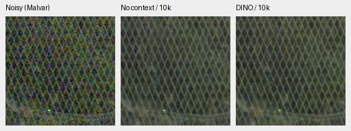

The sky outputs look close and remove most visible grain. Fine building
bracket/truss detail remains softened:

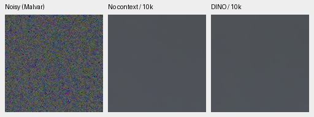

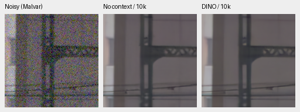

The [sky](images/fresh-none-S10k-cpu-overcast-sky-S.png) and
[building](images/fresh-none-S10k-cpu-building-detail-S.png) primary triplets
and all coordinates are also retained in the receipt.

## Two exact-GT examples

These are the same two fixed 8×-binned Commons sources and CPU-generated noisy
observations as the [preceding review](cross-camera-none10k-cpu-review.md).
The target is exact for this simulated degradation, rather than a real RAW
reference. No new noise draw or source decoding occurs. Both models use RGGB,
shot `.00256`, read variance `.0000262144`, 16-bit ADC with black `.03`,
WB [2,1,1.5], the common evaluation matrix and display exposure ×1.
The receipt records source/cache/serialized-observation hashes, the 256px source
tile, 160px ROI and full display transforms. These two cases are illustrative;
they are not the full 427 evaluation or a model-selection mean.

Fabric, noisy → DINO-S 10k → exact simulated GT:


The same observation with no-context 10k, reused unchanged:


Both miss the fine cords and differ from the target's fabric color.

Building, noisy → DINO-S 10k → exact simulated GT:

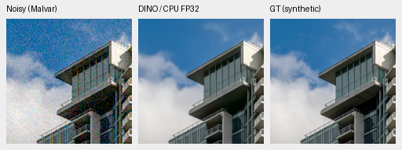

The same observation with no-context 10k, reused unchanged:


Both produce clean architectural edges while losing cloud detail. The common
inputs and display avoid attributing a noise-draw or exposure difference to
the models, but these examples still cannot establish broad quality.

Sources: [Roy Egloff](https://commons.wikimedia.org/wiki/File:CH.VD.Villeneuve_2007-08-25_Vertigo-Swiss-Riviera_2392_3x2-R_4K.jpg)
and [Dietmar Rabich](https://commons.wikimedia.org/wiki/File:Vancouver_(BC,_Canada),_Coal_Harbour_Seaside_Park,_Blick_in_den_Himmel_--_2022_--_2158.jpg),
[CC BY-SA 4.0](https://creativecommons.org/licenses/by-sa/4.0/), modified by
binning, cropping, camera/noise simulation and restoration. Derived photographs
retain that license. GFX photographs belong to the project owner and are used
with permission.

## Three additional camera contexts

A separate cached replay checks the same completed models on the fixed
Leica Q2, Sony a7R II and GFX 50R selections. They remain visually close;
these crops do not establish a new DINO-S advantage.
[All 18 additional native PNGs, six float arrays and provenance](results/fresh-none-S10k-cross-camera-cpu.json).
The two exact-GT S triplets above are reused unchanged, with the same
checkpoint hash and CPU FP32 execution.

No RAW file is read in this replay. The earlier comparison retained unquantized
bilinear camera RGB, whose observed CFA sites preserve the noisy measurements
exactly. Sampling those sites recovers the packed observations. Recomputing
both the complete bilinear and Malvar float arrays is bit-exact against their
earlier saved outputs for all three cameras. Only three new S context forwards
run; the no-context and two RawNIND outputs are reused.

| Camera / ISO / CFA | Context xywh | Shot / read variance | Display |
| --- | --- | --- | --- |
| Q2 / 100 / GBRG | [250,4054,512,512] | 4.372832896e-5 / 1.604877784e-7 | ×2 (+1 EV) |
| a7R II / 400 / RGGB | [3984,2978,512,512] | 8.198338439e-5 / 1.206198755e-7 | ×1 |
| GFX 50R / 100 / RGGB | [1656,1552,512,512] | 1.941424139e-5 / 1.641306284e-7 | ×2 (+1 EV) |

Each context has predeclared ROIs [64,64,160,160] and [256,256,160,160]. All
methods share the original noise estimates, WB, matrix and display exposure;
the receipt records full values. Noise estimates use input-only Haar/flat-patch
fitting, rather than dedicated sensor calibration. These are development
examples without a strict unseen-domain claim. This replay admits no photos to
training and accesses no original source directory. Photographs by the project
owner, used with permission.

The direct rows read **noisy → no-context 10k → DINO-S 10k**. Every displayed
panel is a native 160×160 crop; neither learned output is GT.

Q2 shadow texture remains soft and the learned outputs remain close:

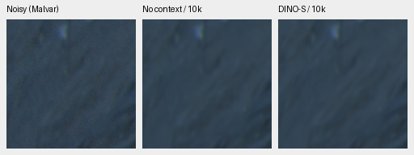

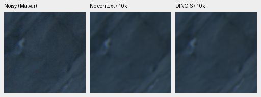

Sony window/fuselage detail is already soft in the noisy capture and remains
soft after restoration, with no clear new winner:

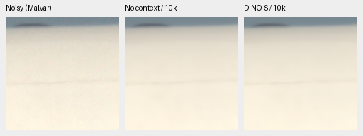

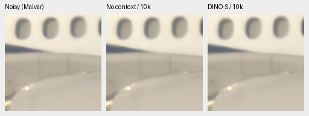

Both learned methods retain sharper concrete seams and more surface variation
than RawNIND on the GFX 50R example. Without a clean reference, not all variation
can be identified as true detail. A new S benefit is not established:

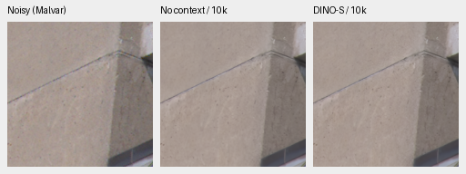

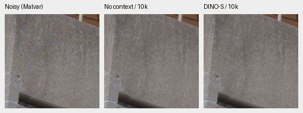

These comparator rows read **noisy → DINO-S 10k → RawNIND channel calibration**.
RawNIND is explicitly **not GT**, and receives no pixelwise quality score. All
twelve S/RawNIND global-or-channel primary triplets are in the receipt.

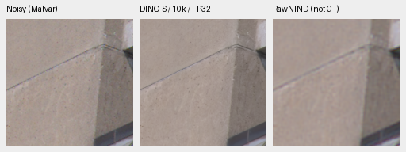

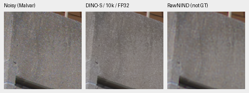

All 18 new PNGs were visually inspected and pass hash/RGB/native-geometry checks.
The six new float arrays pass hash/dtype/shape/finite checks. Every primary
panel rerenders byte-exactly from saved floats. Shared noisy/RawNIND panels and
direct pixels match their parents exactly. The execution, audit and publication
drivers are archived; Ruff passes for their final executed versions. No CUDA
context, new full-frame output or speed result is produced. Production code
and the running workflow's frozen package/evaluation files remain unchanged.

## Initial GFX and exact-GT execution checks

All ten new PNGs and the two reused no-context exact-GT triplets were visually
inspected. Ten PNGs pass hash, RGB/geometry and native-panel checks; all four
saved float32 GFX predictions pass hash/shape/dtype/finite checks. Rerendering
those predictions reproduces their displayed pixels byte exactly. Every shared
noisy/reference panel and all direct-comparison pixels match their parents
exactly. Synthetic noisy/GT panels also rerender exactly from the saved
observations. The two new synthetic restored float arrays were not separately
saved in that initial execution. The later
[color-residual replay](fresh-color-mean-diagnostic.md) now saves their float
predictions and reproduces all four original 10k restoration panels exactly.

The replay archives its production source and checkpoint snapshot; the artifact
audit/publication driver is archived alongside them. No CUDA context was
initialized. Production code and the live workflow's frozen training/evaluation
files are unchanged. Actual CPU inference, artifact checks and Ruff pass.

After sourcing `scripts/env.sh`, replay using the receipt's immutable S snapshot:

```bash
CUDA_VISIBLE_DEVICES='' OMP_NUM_THREADS=4 HF_HUB_OFFLINE=1 \
  uv run --no-sync python scripts/replay_fresh_dino_10k_cpu.py \
  /mnt/external/demosaic/evaluation/fresh-none-S10k-cached-cpu-v1/weights/weights-ae74bc17012c85d5253f24da4dbaaec4486ed430aa143d852442754288d56bad.pt \
  --output /mnt/external/demosaic/evaluation/fresh-none-S10k-cpu-replay
```

The cached baseline report and serialized observations are required. Complete
the original B schedule and full matched review before choosing a new model.
