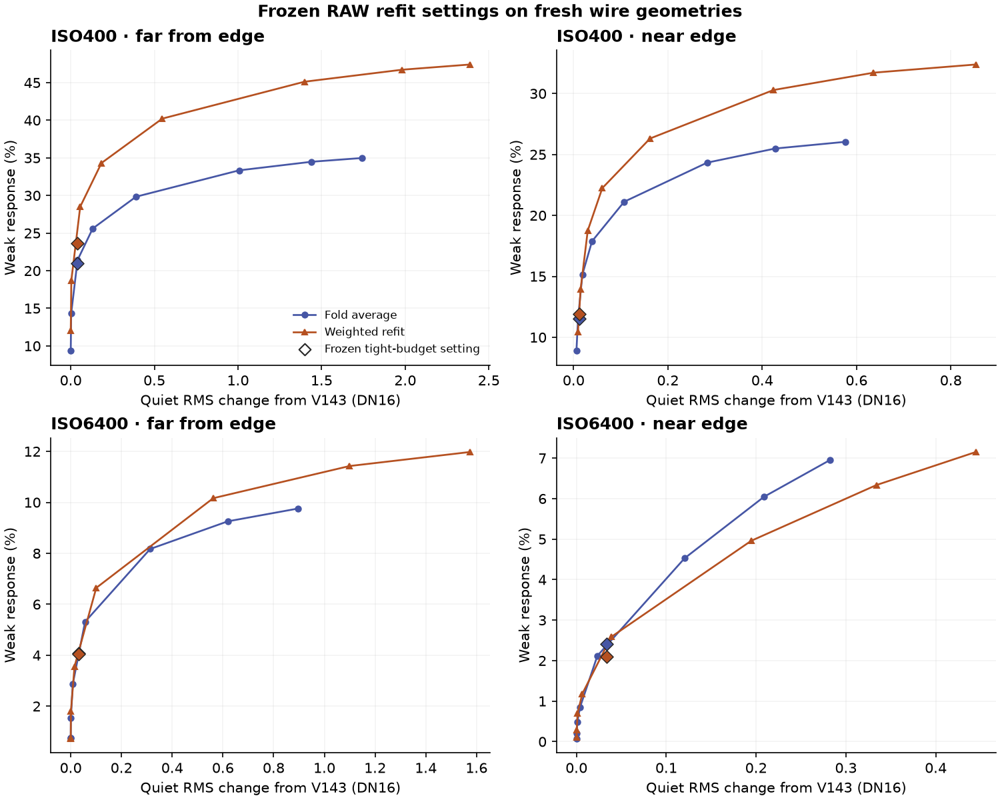
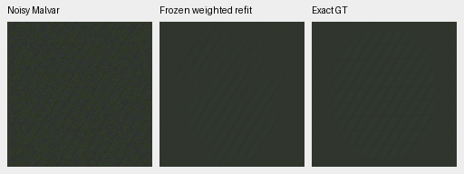
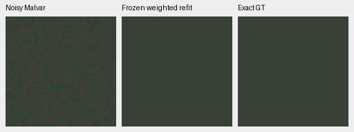

# Weighted RAW refitting on fresh wire geometries

At ISO400 far from a strong edge, frozen settings raise weak-wire
response from **20.94% to 23.66%** with effectively equal measured
quiet RMS. All eight fresh geometries improve both response and
increment error. Both fits exceed the development quiet budget on
average. The tighter settings show little benefit at ISO6400 far
and lose weak response near the edge.
[Audited results and native evidence](results/fresh-phase-refit-v1/publication.json).

## Frozen development settings

The [previous refit comparison](phase-refit-delivery.md) found a
lower-noise gain on retained development geometries. This follow-up
freezes one threshold and correction scale for each method, noise
level, and edge placement at two quiet budgets, 0.02 and 0.10 DN16.
All settings use the eight earlier geometries and their four CFA
layouts. At each budget the development procedure chooses the
largest weak response allowed by the mean squared-error moments.
The settings are fixed before generating the fresh observations.

The fresh sources are procedural recipes 40–47. They differ in
orientation, period, phase, edge, width, brightness and camera
transform. Two geometries use each of RGGB, BGGR, GRBG and GBRG.
Every geometry has a near and far placement under each noise
prior. Each condition has independent background, strong-wire
only, and two-wire sensor draws. Those 96 observations use generator
repeat 7311 with distinct source, placement, role, profile and CFA
keys. Native 512 geometry is rendered at 2× sampling with area
reduction and zero optical blur.
[Scene generator](../src/demosaic/experiments/data/edge_response.py) ·
[Frozen comparison runner](../scripts/probe_fresh_phase_refit.py).

Sixteen disjoint noisy donor regions use repeat 7312, stronger wires
and changed phase. They supply frequency proposals from the same
full-frame nuisance search and half-frequency validation used in
development. Guides whose errors exceed one native 256-pixel
Fourier bin stay in the scored panel. All three query roles share
the same guide and each role fits its own amplitudes and phase.
Both methods score the same query folds. The weighted refit
changes how the admitted correction is estimated from measured
sites with positive pooled support.

All 16 donors recover both true frequencies within 0.091 of a
native 256-pixel Fourier bin. The result tests delivery with an
accurate guide. The [guide-error follow-up](phase-guide-recenter.md)
tests offsets and recovery on these same observations.

The common synthetic parent is V143 EMA, SHA256
`96d146d017c54196288c585f8b7eddcf030e8a235061049c31e985b9380b7ce4`.
The parent uses native 512 context with CPU float32, batch 3.
Both procedures act in the central native 256 query and retain
the parent outside it. The earlier panel's parent used CUDA.
The two fresh arms use identical parent pixels. Replaying one
development batch gives a CPU/CUDA difference of 0.00024 DN16
RMS in the query, with maximum absolute difference 0.00195 DN16.
[Matched parent device check](results/fresh-phase-refit-v1/parent-device-check.json).

## Fresh response at frozen settings

The table compares the 0.02 DN16 development settings on the fresh
data. Values are the mean of eight sources. Each pair is fold
average / weighted refit. Weak response measures projection onto
the exact weak increment. The quiet delta is the achieved increase
over the common V143 parent.

| Fresh stratum | Weak response | Quiet delta, DN16 | Weak-increment RMS, DN16 |
| --- | ---: | ---: | ---: |
| ISO400 far | 20.944% / 23.663% | 0.03893 / 0.03881 | 11.65644 / 11.64021 |
| ISO400 near | 11.544% / 11.910% | 0.01192 / 0.01193 | 15.72547 / 15.72172 |
| ISO6400 far | 4.080% / 4.052% | 0.03037 / 0.03213 | 26.59388 / 26.59476 |
| ISO6400 near | 2.412% / 2.091% | 0.03389 / 0.03390 | 36.81854 / 36.81831 |

At ISO400 far from the edge, the frozen tight-budget weighted fit
improves weak response and increment RMS on every geometry. The
descriptive 95% paired source-bootstrap interval for the response
gain is 2.18–3.16 percentage points. Measured quiet RMS is 2.585 for
both methods to three decimals. Four of eight fold-average outputs
and five of eight weighted outputs exceed the development quiet
budget.
The absolute projected weak response in the weak-absent role is
0.2836% for the fold average and 0.2837% for the weighted fit.

At the unscaled threshold 2, the weighted fit raises response from
21.42% to 28.51% and lowers weak-increment RMS from 11.65468 to
11.62540 DN16. In this comparison actual quiet RMS rises from
2.58722 to 2.60298 DN16.

Scaling each fit uniformly to the intended **measured** quiet increase
of 0.02 DN16 gives the same mean quiet RMS of 2.56645. Weak response
rises from 15.20% to 17.15% and increment RMS falls from 11.68288 to
11.66976 DN16. Both gains hold on all eight far-edge sources. This
post-hoc diagnostic chooses the scale using the fresh quiet targets.
The frozen settings above are the transfer test.
[Exact measured-quiet diagnostic](results/fresh-phase-refit-v1/absolute-quiet-diagnostic.json).

The tighter ISO400 near-edge comparison has almost identical actual
quiet RMS. Only three of eight geometries improve response, and six
improve increment error. At the looser ISO6400 far setting, mean
weak response rises from 4.91% to 6.64% at nearly identical quiet
RMS, while increment RMS rises from 26.59025 to 26.65693 DN16.
Both methods exceed the 0.10 DN16 development quiet budget on
the ISO400 far and ISO6400 near strata.
[Paired source summaries and guide results](results/fresh-phase-refit-v1/summary.json).

On the ISO400 background-only views, the 7×7 high-pass RMS of the
quiet mean RGB and residual chroma are unchanged to five decimals
far from the edge. Near the edge, quiet fine mean-RGB RMS stays near
1.9873 DN16, while quiet fine chroma RMS rises from 1.62267 to
1.62473 DN16. Both use the original frozen tight-budget scales.
[Background-only fine-error diagnostic](results/fresh-phase-refit-v1/quiet-texture.json).

## Native crop protocol

Triplets show noisy Malvar, the weighted refit at the frozen
0.02-DN16 development setting, and exact constructed GT. Cells
are 160×160 original pixels from parent ROI `[176,176,160,160]`.
Source 40 uses RGGB and source 41 uses BGGR. Both examples are
far from the edge, with the two-wire role, repeat 7311, ADC16
black fraction 0.03, exposure 2, and matching WB, camera matrix
and clipped-sRGB display across methods. Shot/read conditioning
is `8e-5/2.56e-8` at ISO400 and `0.00128/6.5536e-6` at ISO6400.
The full boards also show the fold-averaged fit at its frozen
setting and the weighted fit at threshold 2.

At native exposure, the weighted RGGB example shows stronger
diagonals, with more distinct crossings in the exact target. The
BGGR example has subtler differences. Both ISO6400 outputs look
nearly flat. All four comparison boards were opened.
[ISO400 RGGB](images/fresh-phase-refit-v1/iso400-source40-far-RGGB-comparison.png) ·
[ISO400 BGGR](images/fresh-phase-refit-v1/iso400-source41-far-BGGR-comparison.png) ·
[ISO6400 RGGB](images/fresh-phase-refit-v1/iso6400-source40-far-RGGB-comparison.png) ·
[ISO6400 BGGR](images/fresh-phase-refit-v1/iso6400-source41-far-BGGR-comparison.png).

The standing camera comparison adopts the already reviewed
fixed-threshold-2 predictions of this same operator. It covers
DSCF3879/3880 sky, building, foliage and coarse fence and
DSCF3842/3835 both fine cab crops and both noise profiles with
the two camera JPEGs. For these crops the parent is V120 EMA
`a9d9b6b4f974e24a6b11e5e740aab32314233a7f53c056cf37c7d2aac1c589fb`.
Exposure is 4 for the main crops and 16 on the cab. The ISO100
AHD and JPEG views are separate qualitative references with
different aperture, exposure and subject motion.
The sky matches V120 and the coarse fence keeps its crossed
diamonds. The fine cab crossings remain unresolved.
[Sky](images/phase-refit-delivery-v1/main-overcast-sky.png) ·
[Building](images/phase-refit-delivery-v1/main-building-detail.png) ·
[Foliage](images/phase-refit-delivery-v1/main-foliage.png) ·
[Coarse fence](images/phase-refit-delivery-v1/main-chain-link-fence.png) ·
[Cab left](images/phase-refit-delivery-v1/mesh-nominal-left.png) ·
[Cab right](images/phase-refit-delivery-v1/mesh-nominal-right.png) ·
[Transferred profile left](images/phase-refit-delivery-v1/mesh-profile3879-left.png) ·
[Transferred profile right](images/phase-refit-delivery-v1/mesh-profile3879-right.png).

The fresh collection takes 1,366.24 seconds, including 1,265.19
seconds in 32 parent forwards and their 32 DINO calls. Each
forward uses three observations. The independent audit verifies
16 frozen calibrations, 96 distinct query noise keys and RAW
arrays, 16 donor keys, 768 delivered-image reductions, four exact
triplet subsets and eight adopted camera boards. The original
verifier rounded the scaled correction through float32. The
corrected replay computes the blend in float64 and matches the
original report within `1.30e-13`. Both audit attempts are retained.
[Independent audit](results/fresh-phase-refit-v1/independent-audit.json) ·
[Native crop and camera provenance](images/fresh-phase-refit-v1/manifest.json).
