# Full-corpus control: 10,000-step weak-detail review

**Broader coverage is real; weak-detail fidelity regresses at this midpoint.**
The control has visited 53,506 distinct photographic sources in 10,000 updates,
already more than the previous V131/V132 20k continuations. Its four-source
faint-detail mean falls 0.61431 dB against a freshly evaluated, matched CPU V120.
Both protected fence families show no convincing new fine crossings. V120
remains the recommendation. This is a retained **10k/20k midpoint**, not a
completed training horizon, independent generalization study or full427 score.

Numerical analysis and actual viewing of all32 native boards are complete.
The original20k/100k schedules continue; this result does not reset either arm.
The [training report](full-corpus-scaling.md) describes their common source order
and distinct cosine horizons. [Checkpoint-write recovery](full-corpus-checkpoint-cpu-recovery.md)
preserves the later complete13k state and records the lost segment separately.

[Exact receipts and frozen executed sources](results/full-corpus-control10k-review-v1/publication.json) ·
[Independent audit](results/full-corpus-control10k-review-v1/independent-audit.json) ·
[Archive/source verification](results/full-corpus-control10k-review-v1/verification-addendum.json) ·
[Actual native viewing](results/full-corpus-control10k-review-v1/actual-native-viewing.json) ·
[All54 original PNGs and provenance](images/full-corpus-control10k-review-v1/manifest.json).

## Checkpoint, execution and actual coverage

Experiment `full-corpus-scaling-v3/control20k`, step10,000, **EMA**:
`41d45a9c2f5b3ec33922940280e5780fdea1a0065c1f1f522f8f54f935dc330b`.
Matched parent V120 EMA:
`a9d9b6b4f974e24a6b11e5e740aab32314233a7f53c056cf37c7d2aac1c589fb`.
Both retain the same frozen official DINOv3 ConvNeXt-Small, hash
`691963f0f796aac860d818d59d9d14287a4675612829fbe9467c7f5df8ce5b14`.
The retained checkpoint has91 raw/91 EMA tensors and89 finite Adam states at10k,
with Python/CPU/CUDA RNG and the original20k horizon. Training uses B16/BF16,
`throughput-v1`, seed70, LR1e-5→1e-6 and100-step warmup.

The [actual prefix audit](results/full-corpus-control10k-review-v1/training-prefix.json)
checks all10,000 steps/160,000 consecutive target slots and40 conditioning chunks:

| Actual prefix through10k | Count |
| --- | ---: |
| Commons / native-RAW / paired-RAW batches | 5,038 / 2,451 / 2,511 |
| Photographic Commons draws | 56,363 |
| Distinct photo IDs | 53,506 |
| Ordinary draws / distinct ordinary IDs | 53,493 / 53,493 |
| Reviewed draws / reviewed IDs | 2,870 / 33 |
| Reviewed fraction of photo draws | 5.092% |
| Smooth-field / procedural / weak-texture target slots | 8,093 / 4,022 / 12,130 |
| Distinct source/cache-crop boxes, before geometry | 53,526 |

Native/paired per-example IDs were not logged; their batch counts and actual
conditioning are recorded, but catalogue sizes106/32 are not actual visit counts.
The first full ordinary epoch of90,778 sources is planned at step17,039.
Previous V131/V132 continuations visited42,086/90,781 photos in20k updates;
parent/backbone lifetime exposure is unknown. Cohort, reviewed quota and
execution also differ, so this comparison does not isolate corpus size causally.
Both private GFX families, JPEGs and siblings remain excluded from training.

The reported loop averages sum to **6,278.845 seconds through10k**, excluding
initialization and the last validation/save of each contributing prefix. This
is a partial loop measurement, not completed-run duration. The failed original
phase's8,412.536-second wall time includes its checkpoint stall. Final horizon
durations remain pending. Review inference separately took **590.453 seconds**
for110 observations/220 CPU restoration calls,110 actual DINO executions and110
verified frozen-feature replays, excluding model load. No new GPU inference,
RAW decode, noise draw or optimizer update was needed for this quality review.

Both models use CPU IEEE FP32, contiguous B1, two threads, identical retained
five-argument inputs and noise conditions. Their full weights and CPU RNG are
unchanged by inference. Targets enter scoring/display only. Reused observations
contain one actual noise draw each; legacy metadata saying `draws:8` does not
mean eight draws were evaluated here.

## Scores and weak spatial error

All means below use four materials/all four CFAs, fixed160-pixel ROI. Ordinary
has16 inputs, shadows64, and faint ADC-only16. Shadow predictions and targets
both receive their recorded exposure compensation before scoring. These reused
review cases are separate from the full427/known/unseen primary panels.

| Mean sRGB PSNR, dB | Matched V120 | Corpus10k | Difference |
| --- | ---: | ---: | ---: |
| Ordinary ISO12800-prior | 32.304263 | 32.305445 | +0.001181 |
| Shadows, gains1/8 and1/32, two ISO priors | 25.901971 | 25.905589 | +0.003617 |
| 2.5%-contrast, ADC-only | 67.480669 | 66.866355 | **−0.614314** |

The shadow mean is driven by the wood source; the other three sources regress.
All four faint sources regress: bark−0.55891, fur−0.66436, grass−0.58995 and
wood−0.64404 dB. Arithmetic MSE decomposition attributes **98.89% of the added
camera-RGB MSE to spatial error**. In linear/clipped sRGB, channel-mean bias
actually decreases while centered spatial MSE increases.
[Exact decomposition](results/full-corpus-control10k-review-v1/faint-decomposition.json).

For the faint-target lowest-contrast bin, DCT16 annulus1/8–1/3 cycles/pixel:

| Source | Blocks per CFA | Signed gain, V120→10k | Band-error RMS DN16, V120→10k |
| --- | ---: | ---: | ---: |
| Bark | 100 | 0.99055→0.99740 | 10.9719→11.6289 |
| Fur | 99 | 0.95585→0.94826 | 5.0662→6.0112 |
| Grass | 100 | 0.99786→0.97896 | 6.7759→7.2410 |
| Wood | 100 | 0.97300→0.96302 | 3.2179→3.7678 |

Values average the four CFA results. Bark's gain moves closer to one while its
error worsens; gain alone is not fidelity. Separate original-source strata
retain their original masks rather than calling every contrast-reduced block
originally weak. Their lowest populated bins contain only4/7/3/9 blocks per
CFA for bark/fur/grass/wood; relative band error worsens in all four. Full120
stratum rows and masks remain in the [report receipt](results/full-corpus-control10k-review-v1/report.json).

Two preselected ADC-only flat colors across all four CFAs show a useful but
mixed tradeoff. Maximum absolute channel-mean error improves15.0789→7.8681 DN16,
while maximum centered RGB RMS worsens4.6402→8.6865 DN16. These eight inputs
are a spot check, not the complete588-case color panel. At the native8-bit
viewing transform the flat boards look uniform; these small errors require the
unquantized tensors to measure.

## Native comparisons

Every panel below is a native160×160 crop, with identical coordinates/display
across methods and no pixel resizing. Full source/license/ROI/noise/checkpoint
metadata accompanies each image in the manifest. Bark is Derek Ramsey's
Kentucky Coffee-tree photograph (CC BY-SA2.5); fur is Korall's *Racoon clinging
to a tree* (CC BY3.0). Exact synthetic GT means the
retained constructed target, not a pristine real-scene measurement.

Noisy Malvar / Corpus10k EMA / exact constructed GT; ROI[48,48,160,160], exposure1,
RGGB, shot0.00256/read0.0000262144,16-bit ADC, black0.03:

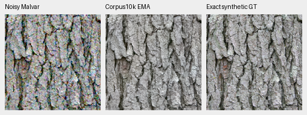

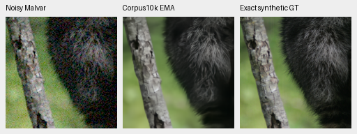

Ordinary detail remains close to V120, with fine strands and bark structures
lost. Deep-shadow boards are still blurred/clumpy; the small score gain is not
convincing new detail. For the faint ADC case, the shared contrast20 display is
`sRGB(clip(.18 +20*(linearRGB − shared target ROI channel mean),0,1))`.
It changes display only; the maximum clipped channel fraction is0.05469%.
Noisy / V120 / Corpus10k / GT or correctly labeled binned reference:

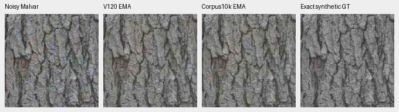

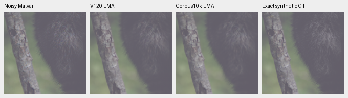

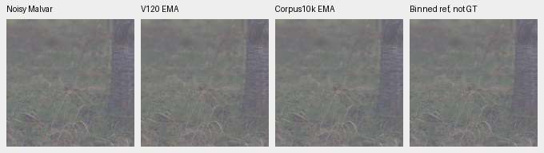

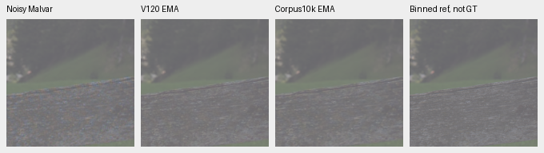

The standing DSCF3879 ISO6400 / DSCF3880 ISO100 scene uses exposure4 and the
established shot0.00128/read0.0000065536 prior. The independently demosaiced
ISO100 capture differs in aperture/motion and is **not exact GT**. All four
main regions were actually viewed: sky remains smooth, building/foliage remain
soft, and coarse fence geometry is similar to V120.

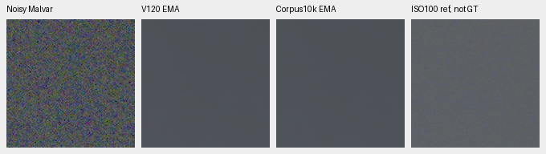

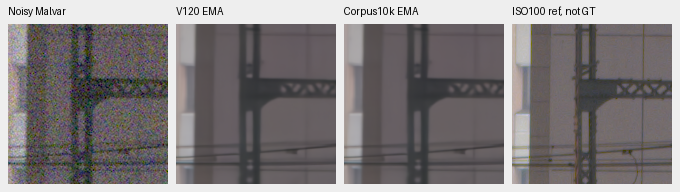

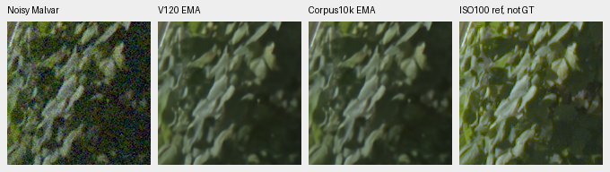

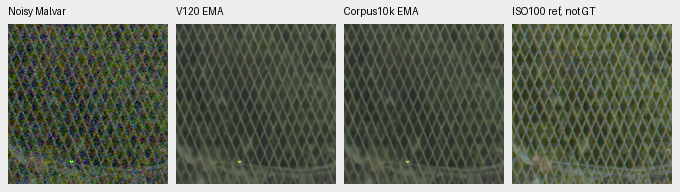

The separate DSCF3842 ISO6400 / DSCF3835 ISO100 cab mesh uses exposure16, both
fixed left/right ROIs, both established conditioning profiles and both SOOC
JPEGs. The nominal profile largely erases the grid; the nearby-capture profile
shows soft, incomplete lattice, without convincing new crossings. References
are qualitative, not pixelwise scoring targets. All four boards were viewed.

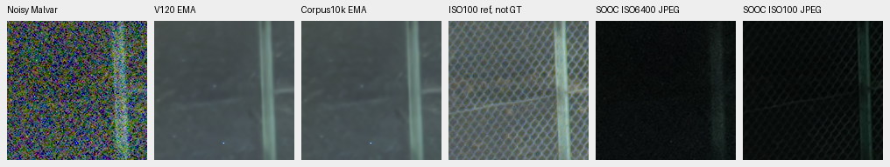

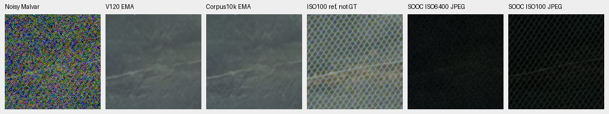

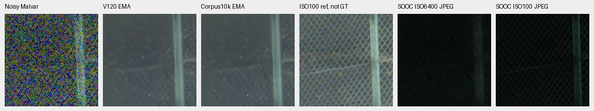

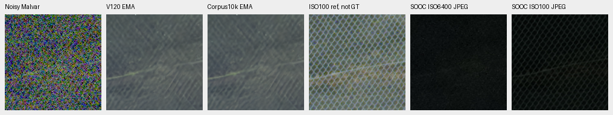

## Fixed ADC diagnostic and next evidence

After observing the regression, the existing unchanged WB-aware Malvar ADC
projection was applied to both models' saved outputs:48 physical corrections,
no model rerun, target fit or parameter search. Positive-noise outputs retain
their original bindings. This is an exploratory diagnostic, not a new default.

Faint PSNR improves to67.518889 for V120 and67.040912 for Corpus10k. The candidate
recovers0.17456 dB against its raw output, but remains0.47798 dB below the equally
corrected parent. All48 corrected outputs match valid measured CFA samples
exactly, maximum residual0 DN16. Their measured-site camera-RGB target MSE is
identical2.05781e-11, while missing-color MSE rises6.89184e-8→8.24497e-8.
Thus simple observed-sample consistency does not repair the interpolation loss.
[Fixed diagnostic scores](results/full-corpus-control10k-review-v1/fixed-adc-report.json).

The independent NumPy audit checks192 raw and64 diagnostic metric rows,120
original-source strata, all32 boards'11,366,400 pixel channels,22 triplet subsets
and32 flat rows. Maximum score disagreement is1.42e-14 dB. The initial audit's
missing script path and later variable-shadowing failure are retained; the
corrected audit completed without new inference. An earlier coverage assertion
correctly failed because native/paired source IDs were absent; the final audit
states that limitation instead of inventing visit counts.

The20k endpoint still needs complete427-photo/known/unseen camera panels and
its own native review; the100k arm needs20k/50k/100k learning curves. No midpoint
is inserted into the PSNR history, whose last complete three-panel comparison
remains through V131. More coverage alone has not yet improved faint fidelity.
A future matched test can separate reviewed-example density and execution from
source coverage; this midpoint does not establish which change caused the loss.
