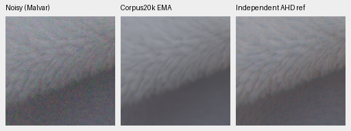
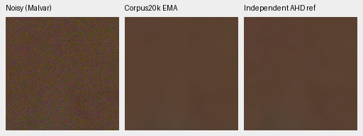

# Corpus20k: completed known/unseen camera panels

**The completed control improves the known-scene mean by0.03285 dB and worsens
the unseen-scene mean by0.04067 dB against V120.** All324 model/crop rows pass
independent audit; all nine native scene comparisons were actually viewed.
They show no convincing new fine reconstruction. V120 remains recommended.
The larger427-photo benchmark is still running, so no new history point is added.

This follows the [completed20k targeted review](full-corpus-control20k-review.md),
including both protected GFX families. It adds the complete fixed public camera
panels; it does not relabel those GFX references or constitute a new full-frame test.

[Summary and checkpoint bindings](results/full-corpus-control20k-camera-v1/summary.json) ·
[Known panel](results/full-corpus-control20k-camera-v1/known.json) ·
[Unseen panel](results/full-corpus-control20k-camera-v1/unseen.json) ·
[Independent audit](results/full-corpus-control20k-camera-v1/independent-audit.json) ·
[Actual viewing](results/full-corpus-control20k-camera-v1/actual-native-viewing.json) ·
[Frozen sources/receipts](results/full-corpus-control20k-camera-v1/publication.json) ·
[Archive/source verification](results/full-corpus-control20k-camera-v1/verification.json) ·
[All18 native PNGs and provenance](images/full-corpus-control20k-camera-v1/manifest.json).

## Weights, protocol and complete results

Corpus20k **EMA**, SHA256
`633053370bdfb455d738ce0e3af686cb61e8dcac7c501954eb3b2293738a3795`;
parent/current V120 EMA
`a9d9b6b4f974e24a6b11e5e740aab32314233a7f53c056cf37c7d2aac1c589fb`.
Training budget/data/durations are in the endpoint report:320,000 target slots,
all90,778 ordinary photo IDs, unchanged V120 architecture/loss,5% photographic
reviewed quota and25% each native/paired domains. Raw20k remains unreviewed.

The existing [qualified primary collector](full-corpus-primary-admission.md)
executed108 CPU restoration calls over54 canonical batches:24 known/30 unseen,
72/90 native crops per model,18 captures across4/5 scenes. Same retained
packed/variance/CFA/WB/matrix tensors, CPU IEEE FP32, contiguous B4/B1 and four
threads. Frozen local DINO executes54 times with54 checked replays. There is
no whole-scene branch in this scaling control. Targets enter metrics only.

Summed camera neural inference times are1,536.390s known/1,909.780s unseen,
excluding loading and metric computation. These concurrent CPU measurements
are separate from training time and are not isolated speed benchmarks.
The audit/render work adds **zero** neural/RAW/noise/GPU/optimizer calls.

Primary score uses the original32px border and measured-CFA reference mask.
Average nine crops per capture, two captures per scene, then equal scene means.
Independent aligned AHD RGB is auxiliary, **not exact RGB GT**. These small
reused development panels do not establish population-wide generalization.

| Measured-CFA PSNR, dB | V120 | Corpus20k | Difference |
| --- | ---: | ---: | ---: |
| Known, four scenes | 54.312718 | 54.345566 | +0.032849 |
| Unseen, five scenes | 54.008722 | 53.968049 | −0.040673 |

| Scene | Difference, dB |
| --- | ---: |
| Known:2pilesofplates | +0.030730 |
| Known:7D-1 | +0.048040 |
| Known:D60-2 | +0.053383 |
| Known:MuseeL-CopteArch-C500D | −0.000759 |
| Unseen:LucieB_3apples | −0.012761 |
| Unseen:LucieB_Coulicoco | −0.125242 |
| Unseen:LucieB_bedroom_tapestry | +0.022887 |
| Unseen:LucieB_stick_figurine | −0.042040 |
| Unseen:LucieB_top_of_Expedit | −0.046209 |

Known gains occur in three of four scenes; unseen regressions occur in four of
five. The result is mixed even before considering the targeted fine-band/color
costs. It supplies no basis for replacing V120 generally.

The [masked-error decomposition](results/full-corpus-control20k-camera-v1/decomposition-addendum.json)
separates channel means from centered spatial error on the exact measured-CFA
mask. Equal-scene arithmetic MSE changes as follows:

| Panel/term | V120 | Corpus20k |
| --- | ---: | ---: |
| Known: channel-mean MSE | 1.39402e-6 | 1.34966e-6 |
| Known: centered spatial MSE | 8.31062e-6 | 8.27170e-6 |
| Unseen: channel-mean MSE | 1.04282e-6 | 1.07194e-6 |
| Unseen: centered spatial MSE | 7.07697e-6 | 7.08236e-6 |

Channel means account for84.4% of the added **arithmetic** unseen MSE; spatial
error also rises. This is distinct from the mean-PSNR aggregation above and
is not a fine-band-only measurement or causal diagnosis. It reinforces the
need to track coarse color and fine fidelity separately.

## Native crops

Noisy Malvar → Corpus20k EMA → independent AHD reference. Every cell is160×160
original pixels, center ROI[176,176,160,160] of a512-native context, exposure1,
shared WB/matrix/clipped-sRGB transform; no resizing. The established selection
is the first capture/first crop of every fixed scene, independent of these scores.
Per-image manifests retain exact RAW hashes, absolute source coordinates,
shot/read conditioning, CFA, exposure, camera transform and both checkpoints.

Feathers, decorative strands and low-contrast edges remain soft and close to
V120. Letter/shelf edges remain smooth. Quiet crops show small broad tone/mottle
differences, without obvious new fine texture at this display. The independent
references retain noise/alignment/demosaicing limitations; they are not exact GT.
All nine complete comparisons, including both models, remain in the manifest.

## Audit and preserved failures

All54 fresh V120 prediction batches **and every original metric row** match
the earlier closed CPU controls exactly. Independent NumPy64 photometry/CFA
scores agree within5.18e-6 dB and2.23e-9 chroma/gradient error, under unchanged
5e-4 dB/2e-6 tolerances. Reference sample counts, source/crop alignment and
capture/scene aggregation are checked. Every native display pixel is regenerated;
all nine triplets are exact subsets of the actually viewed boards.

The first observer used two reduction threads; its exact-FP32-score check caught
the difference from the collector's four threads. Its source/log are preserved;
the corrected observer uses the declared original thread count. The frozen
renderer initially rejected a report path outside its snapshot root; recovery
writes fresh boards under `work/artifacts`, without changing safety settings,
frozen sources or the running primary job. The failed first board is preserved.

## Long-run and broader-detail follow-up

The original100k trajectory has retained its10k state, SHA256
`6cd409de7ac06d27e528fcd3c9e70944eb03fd75e74f1a59fb342359b5d765a2`,
with91 finite raw and91 EMA tensors,89 Adam states at10k, RNG and100k horizon.
[State audit](results/full-corpus-control20k-camera-v1/long100k-at10k.json) ·
[Source identity addendum](results/full-corpus-control20k-camera-v1/long-control-source-identity.json).
All10,000 recorded source/crop/data-seed rows match the control10k after checking
their different immutable order-header identities. Their first160,000 order
positions, all40 conditioning chunks and CPU/CUDA/Python RNG states match.
Native/paired per-example IDs remain unlogged; full GPU input witnesses remain
in the live phase until completion. This is not proof of every noise tensor's
equality, identical weights or a long-run quality gain. The learning-rate horizons
differ, and the100k horizon is still running.

The new **427-photo faint-ADC study** is also running:1708 deterministic image/CFA
observations per model in428 B4/B3 batches, with fresh matched V120/20k outputs.
All427 IDs are validation sources, disjoint from the current90,778-photo training
cohort; lifetime exposure is unknown. The unchanged simulator reproduces all16
legacy faint inputs/targets exactly before new forwards. Original-source masks
are retained instead of calling every contrast-reduced block originally weak.
An explicit [mask-wording clarification](results/full-corpus-control20k-camera-v1/faint-protocol-clarification.json)
preserves the frozen plan and names the legacy rendered-linear-RGB eligibility
rule before analysis. This is a new faint protocol, not a standard427 score.

The [complete588-color review](full-corpus-control20k-color-review.md) is now
audited/native-viewed: raw20k worst mean bias765.656 DN16 versus V12055.525;
exact Malvar/ADC bins reduce the20k maximum to17.325/17.767. Both full primary
photo jobs continue. Their complete
scores, independent audits, broad weak-band results and eligible history entries
remain pending; the [running-job cutoff](results/full-corpus-control20k-camera-v1/running-work-snapshot.json)
does not claim those results are finished.
