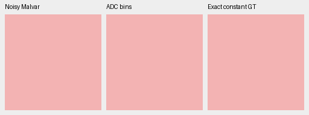
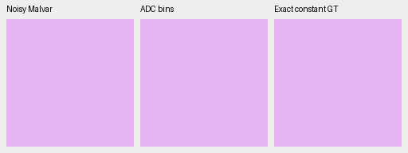
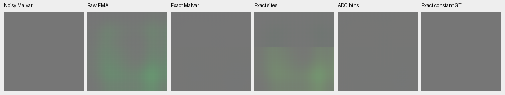
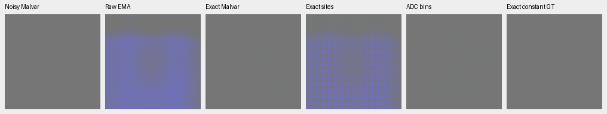

# Corpus20k: complete ADC-only color panel

**The full grid exposes a substantial20k color regression missed by the two-color
spot check.** Worst channel-mean error rises55.525→765.656 DN16 against V120.
Existing exact Malvar correction reduces the20k maximum to17.325 DN16;
ADC bins/Malvar reduces it to17.767. V120 remains the general recommendation.

On V120, the [new ADC-bin helper](adc-bin-consistency.md) slightly improves all
three aggregate color measures over exact Malvar: worst bias13.554→13.039 DN16,
worst centered RMS15.150→15.137, mean MSE−2.15%. On20k, mean MSE improves1.76%
versus exact Malvar while both adverse maxima worsen slightly. This supports
a useful calibrated zero-noise tradeoff, not universal dominance or a noisy
fine-detail improvement. No default or model configuration changes.

[All8-policy summary](results/full-corpus-control20k-color-v1/summary.json) ·
[All4,704 color rows and retained-output bindings](results/full-corpus-control20k-color-v1/report.json) ·
[Independent audit](results/full-corpus-control20k-color-v1/independent-audit.json) ·
[Actual viewing](results/full-corpus-control20k-color-v1/actual-native-viewing.json) ·
[Frozen executed sources/receipts](results/full-corpus-control20k-color-v1/publication.json) ·
[Archive/source verification](results/full-corpus-control20k-color-v1/verification.json) ·
[Native PNGs/provenance](images/full-corpus-control20k-color-v1/manifest.json).

## Exact scope and all policies

The pre-existing palette has147 colors/all four CFAs: **588 ADC-only inputs**,
CPU FP32 source quantizer,16-bit ADC/black0.03, shot/read0/0. The two EMA models
are V120 `a9d9b6b4f974e24a6b11e5e740aab32314233a7f53c056cf37c7d2aac1c589fb`
and Corpus20k `633053370bdfb455d738ce0e3af686cb61e8dcac7c501954eb3b2293738a3795`.
The [20k training report](full-corpus-control20k-review.md) records data/budget/
duration; this review changes no training or weights.

Fresh matched CPU IEEE FP32/contiguous B1/two-thread collection performs1,176
restoration calls,588 actual frozen DINO executions and588 checked replays.
Collection wall time is3,449.335s excluding model loading; it includes retained
output/identity checks and is not an isolated speed measurement. Full model
weights and CPU RNG are unchanged. All16 overlapping raw outputs match the
previous closed two-color native controls exactly.

All four fixed policies are applied to both models, with no parameter search:
raw, existing exact Malvar, existing exact measured-sites, and exact ADC-bin
Malvar. Physical analysis adds3,528 corrections and zero neural/RAW/noise/GPU/
optimizer calls. Target arrays are first decoded after input-only corrections.
Color statistics use the original unclipped camera-RGB160px ROI[48,48,160,160].

| Policy | Worst mean bias DN16 | Worst centered RMS DN16 | Mean camera-RGB MSE |
| --- | ---: | ---: | ---: |
| V120 raw | 55.525 | 24.873 | 1.93148e-8 |
| V120 +exact Malvar | 13.554 | 15.150 | 4.13851e-9 |
| V120 +exact sites | 37.741 | 24.607 | 1.23659e-8 |
| V120 +ADC bins | 13.039 | 15.137 | 4.04946e-9 |
| Corpus20k raw | **765.656** | **255.184** | 2.29922e-7 |
| Corpus20k +exact Malvar | 17.325 | 14.447 | 4.18392e-9 |
| Corpus20k +exact sites | 573.366 | 292.747 | 1.49901e-7 |
| Corpus20k +ADC bins | 17.767 | 14.453 | 4.11032e-9 |

Every color/CFA is equally weighted. Worst values can occur in different cases;
all identities accompany the summary. Raw20k's largest mean bias and spatial
RMS occur at hue285°, saturation0.50, peak0.90, GRBG. V120's raw maxima occur at
hue0°, saturation0.50, peak0.90, RGGB. These are not only extreme-saturation colors.

The earlier eight-input spot check was accurate for its selected colors, but
its13.7 DN16 maximum did not cover this larger tail. Exact-sites fitting repairs
measured channels while leaving severe unmeasured errors and visible CFA
checkerboards in error views. Measured-site consistency alone does not establish
correct full RGB. Malvar and bins suppress most of this bias/structure.

## Actual native adverse-tail views

All eight boards were actually inspected: both raw-adverse cases, both models,
true-color and enhanced error views. Each policy cell is160×160 original pixels,
ROI[48,48,160,160], exposure1, shared WB/matrix/clipped-sRGB display; no resizing.
The two cases are **post-hoc raw adverse-tail selections**, not newly selected
favorable validation examples. All588 inputs contribute to the numerical table.

Noisy Malvar → ADC bins/Malvar above20k EMA → exact constructed constant GT.
The palette is synthetic; these are exact constructed targets, not real-scene GT.

Standard8-bit views look close; they cannot establish16-bit accuracy. The error
companions map `0.18 + gain × (linear output − linear GT)` through clipped sRGB,
with gain32 for red/gain8 for purple, identical across both models/all policies
within a case. Targets enter this display only; clipping fractions are recorded.

The20k purple error view has broad blue/purple bias and mottled transitions.
Exact-sites produces strong red/cyan CFA structure; Malvar/bins are nearly
uniform gray. Their small mutual differences require unquantized metrics.
There is no fine target structure to reconstruct in these constant patches.

## Verification and remaining work

The independent NumPy-only audit recomputes all4,704 metric rows and aggregate
adverse-case identities, every pixel of eight native boards and four exact-subset
triplets. All1,176 bin-corrected outputs and targets re-encode to the original
CPU FP32 ADC codes; measured-camera squared error never increases. Missing
colors/rendered RGB have no corresponding bound. Full sources, failures and
calibration tests remain in this publication and the earlier implementation report.

This full color result does not substitute for photo/detail evaluation. The
[20k camera panels](full-corpus-control20k-camera-review.md) gain0.03285 dB known
and lose0.04067 unseen. Both standing GFX families still lack faithful new fine
crossings. The standard full427-photo benchmark and new427-source faint-ADC
study remain running, as does the original100k training trajectory. The faint
study uses original-source masks,all four CFAs and held-out IDs; no result is
claimed yet. No full-model history point or recommendation change is made.
