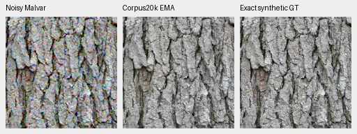
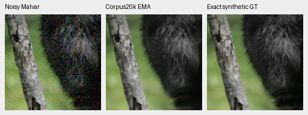

# Corpus 20k on the fixed 427-photo and camera panels

The Corpus 20k EMA raises fixed-panel photographic sRGB PSNR from
**37.04008 to 37.09079 dB** against V120, a **+0.05071 dB** gain. It
improves 420 of 427 source means, with positive mean changes in all seven
conditions. The known-camera mean improves by 0.03285 dB and the unseen
mean falls by 0.04067 dB. The [targeted native review](full-corpus-control20k-review.md)
shows weak grass, fine-band and color costs, and both standing GFX scenes
still lack convincing new fine crossings.
[Verified primary source and per-photo means](results/full-corpus-control20k-primary-v1/primary.json) ·
[Performance history](performance-history.md).

## Endpoint and measurement

The completed 20k control starts from V120 EMA and keeps the restoration
architecture and loss. It uses its own 20,000-update cosine schedule,
320,000 target slots and all 90,778 ordinary photo IDs, with the matched
recipe's reviewed crop quota and native/paired RAW mix. The scored
Corpus 20k EMA has SHA256
`633053370bdfb455d738ce0e3af686cb61e8dcac7c501954eb3b2293738a3795`.
The parent V120 EMA is
`a9d9b6b4f974e24a6b11e5e740aab32314233a7f53c056cf37c7d2aac1c589fb`.
[Training budget, recipe and worker timing](full-corpus-control20k-review.md#endpoint-and-actual-training).

The collector closes all 3,162 fixed batches, including 3,108 photo-suite
batches, 24 known-camera batches and 30 unseen-camera batches. The two
models use the same retained RAW, variance, CFA, WB and color transform in
CPU IEEE FP32. The three parent admission checks match all retained pixels
and scores exactly. The photo-suite score averages each source over all
seven noise/exposure conditions and four Bayer patterns, then gives each of
427 photos equal weight. The included synthetic records have their own
summary. Camera PSNR uses the measured CFA samples and weights scenes
equally. All 3,162 case receipts, canonical input bindings and model
identities were checked. An independent aggregation of the retained metric
rows reproduced the four photographic means to within `1e-11 dB`. Camera
means match the [published camera panels](full-corpus-control20k-camera-review.md)
exactly. The separate NumPy audit passed all 25,132 rows, with a largest
individual photo sRGB PSNR discrepancy of 0.000169 dB and maximum
measured-CFA camera discrepancy of 0.00000518 dB.
[Complete audit and weak-band evidence](results/full-corpus-control20k-detail-v1/publication.json).

| Fixed panel | V120 | Corpus 20k | Change |
| --- | ---: | ---: | ---: |
| Photo sRGB PSNR, 427 sources | 37.04008 | 37.09079 | +0.05071 |
| Photo camera-linear PSNR, 427 sources | 39.95386 | 39.98604 | +0.03218 |
| Known measured-CFA PSNR, 4 scenes | 54.31272 | 54.34557 | +0.03285 |
| Unseen measured-CFA PSNR, 5 scenes | 54.00872 | 53.96805 | −0.04067 |

The source bootstrap interval for the photographic sRGB gain is
`[+0.04622,+0.05483] dB`. ADC-only leads the seven condition means at
+0.11214 dB. The ISO12800 and shadow improvements are +0.02006 and
+0.01705 dB. The [per-condition table in the receipt](results/full-corpus-control20k-primary-v1/primary.json)
retains exact values. V131's 37.08008 dB mean comes from its own audited
V120 comparison on the same fixed panel.

## Weak detail across the photo panel

The matching [V131 analysis](v131-broad-primary.md#photo-score-gains-do-not-settle-weak-detail-quality)
uses the same 5,124 source/noise/CFA observations and 96,075 native
16×16 target blocks. The transform measures radial DCT frequencies
`[1/8,1/3)` cycles per pixel over the native interior. Blocks are
assigned to five bins using the exact target's relative band RMS.
The weakest bin contributes 326 sources. CFA observations are pooled
within source before source balancing.

| Weakest-bin prior | Projected target gain, V120 → 20k | Band-error RMS, V120 → 20k | Error change |
| --- | ---: | ---: | ---: |
| ADC-only | 0.946832 → 0.943291 | 0.000948336 → 0.000931396 | −1.786% |
| ISO100 | 0.785711 → 0.787451 | 0.001414642 → 0.001408232 | −0.453% |
| ISO12800 | 0.364763 → 0.364590 | 0.003181508 → 0.003179724 | −0.056% |

Band error falls in all 15 prior and strength cells. The ADC-only
weakest-bin improvement is larger than V131's 0.409% with the same
V120 reference. Its projection on the exact signal also falls more
than V131's, which shows a trade between lower error and slight
attenuation. At ISO12800 the weakest projection remains near 0.365
and the error change is small. This measurement covers one fine
frequency band. The native fine fence remains a separate check.
[All bins, source rows and masks](results/full-corpus-control20k-detail-v1/publication.json).

## Native detail and color

The photographed scenes in the full panel and the selected native
material, color-chart and GFX reviews serve different purposes. The
four-material faint ADC sRGB mean is 0.02061 dB below V120 and three
materials have higher fine-band error. The [reserved ADC color review](full-corpus-control20k-color-review.md)
reports a worst raw mean error of 765.7 DN16 against V120's 55.5 DN16.
Most of the added unseen-camera arithmetic error in the small camera
panel is channel-mean error. The general inference choice is
[V120 Small](current-model.md).

The two 160×160 native triplets show the exact constructed bark and fur
holdouts, RGGB draw 0, native ROI `[48,48,160,160]`, exposure ×1, ADC16
black fraction 0.03 and shot/read `0.00256/0.0000262144`. Each column
uses the same display transform. The existing full comparison boards bind
the exact source/ROI, noise, display and checkpoint for these retained
material comparisons from the scored EMA.
[Native provenance](images/full-corpus-control20k-review-v1/manifest.json).

The two [standing native GFX reviews](full-corpus-control20k-review.md#native-images-and-both-real-fences)
retain sky, building, foliage, the main coarse fence and both fine green
cab regions under both priors with both JPEGs. The independent ISO100
AHD and JPEG references are qualitative. The dedicated
[Q2/Sony/GFX50R panel](full-corpus-control20k-camera-review.md) has its
own independently viewed images.
