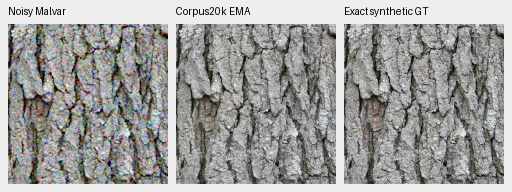
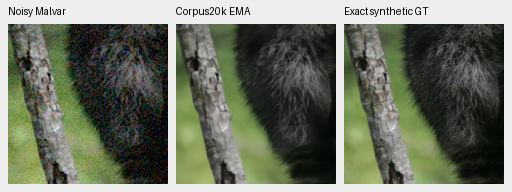
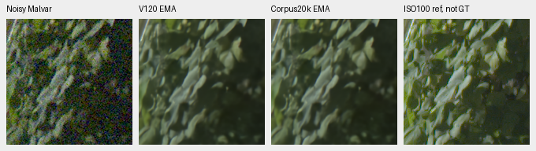
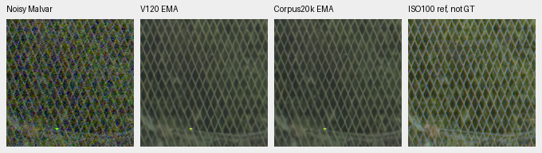
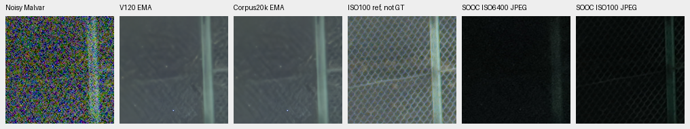

# Full-corpus control: completed 20k review

**The broader-data control completes a real pass over all90,778 photos and
recovers most of its10k faint-detail loss. It does not establish better general
fine-detail reconstruction.** Ordinary/shadow means improve slightly against
V120; faint ADC remains0.02061 dB lower, with mixed material results. Both real
fence families still lack convincing new faithful crossings. V120 remains the
general recommendation. The original 100k trajectory's
[matched 110-input review at 20k](full-corpus-long20k-native.md) is complete.
The long-schedule EMA lowers fine-band error for three materials and
loses 0.19124 dB mean faint sRGB PSNR versus the short schedule.

Training, the110-input numerical review and actual viewing of all26 native
boards are complete. The [complete camera follow-up](full-corpus-control20k-camera-review.md)
adds known +0.03285/unseen−0.04067 dB versus V120. Full427 photos are **running**,
followed by the queued broader weak-band audit. Complete three-panel coverage
is missing; no history point is added. The [scene-context benchmark](whole-scene-context-camera-review.md)
continues independently.

[Exact receipts/frozen executed sources](results/full-corpus-control20k-review-v1/publication.json) ·
[Archive/source verification](results/full-corpus-control20k-review-v1/verification-addendum.json) ·
[Completed training audit](results/full-corpus-control20k-review-v1/completed-training-audit.json) ·
[Independent native audit](results/full-corpus-control20k-review-v1/independent-native-audit.json) ·
[Actual native viewing](results/full-corpus-control20k-review-v1/actual-native-viewing.json) ·
[Native PNGs/provenance](images/full-corpus-control20k-review-v1/manifest.json) ·
[Running-job cutoff](results/full-corpus-control20k-review-v1/running-work-snapshot.json).

## Endpoint and actual training

Experiment `full-corpus-scaling-v3/control20k`, completed20,000 updates, **EMA**:
`633053370bdfb455d738ce0e3af686cb61e8dcac7c501954eb3b2293738a3795`.
Matched parent V120 EMA:
`a9d9b6b4f974e24a6b11e5e740aab32314233a7f53c056cf37c7d2aac1c589fb`.
The checkpoint contains91 raw/91 EMA tensors,89 finite Adam states at20k,
Python/CPU/CUDA RNG and the original20k horizon. Raw20k quality is unreviewed.
Official frozen DINOv3 ConvNeXt-Small remains
`691963f0f796aac860d818d59d9d14287a4675612829fbe9467c7f5df8ce5b14`.

The [declared recipe](full-corpus-scaling.md) retains V120 architecture/loss,
bin4→geometry→area2 clean targets, B16/BF16, seed70, `throughput-v1`, LR1e-5→1e-6
and100 warmup updates. Photographic draws use shuffled epochs and5% reviewed
quota over90,778 ordinary sources/33 reviewed regions. Native and paired RAW
retain25% each; Commons flat/procedural/weak targets remain present. Protected
GFX captures/JPEGs/siblings remain excluded; originals are read-only.

| Actual retained trajectory | Count |
| --- | ---: |
| Updates / target slots | 20,000 / 320,000 |
| Commons / native / paired batches | 10,046 / 4,965 / 4,989 |
| Photo visits / distinct photo IDs | 112,424 / 90,778 |
| Ordinary / reviewed photo visits | 106,823 / 5,601 |
| Ordinary IDs visited once / twice | 74,733 / 16,045 |
| Reviewed IDs | 33 |
| Smooth-field / procedural / weak-texture slots | 16,213 / 7,992 / 24,107 |
| Distinct source/cache crop boxes, before geometry | 106,855 |
| Complete250-update conditioning chunks | 80 |

Every ordinary source slot matches the bound permutation; its ID set equals
the entire declared training cohort. The first full epoch occurs at17,039.
All1,000 replayed source rows and four conditioning chunks match the abandoned
segment exactly. Native/paired distinct per-example IDs were not logged;
catalogue sizes106/32 do not establish actual visits. Crop boxes precede geometry
and overlap; source visits are neither lifetime novelty nor disjoint native pixels.

The [checkpoint recoveries](full-corpus-checkpoint-cpu-recovery.md) preserve the
original failures and complete6k/13k states. There were21,000 attempted updates,
including the abandoned/recomputed1k; the final trajectory contains20,000.
Reported retained-loop windows sum to **12,490.150s**, excluding initialization
and final validation/save of each contributing window. Attempted controller
phase wall times sum to **20,104.376s**, including stalls/replay/concurrency.
The successful final7k worker took4,388.382s. Missing failed-worker summaries
were not reconstructed. These are training measurements, separate from inference.

The100k arm resumes its original1k raw/EMA/Adam/RNG state
`e72da50252f1de4c76ecf7985d940d4094a6e8b7de0dca50269cc39eb0ba8c54`.
Actual new source indices and optimizer/checkpoint progress are
[sealed](results/full-corpus-control20k-review-v1/long100k-resume.json), with a
later live cutoff above. Its100k cosine horizon is retained; comparing its
milestones to this separately annealed control will not isolate compute alone.

## Matched numerical results

Both EMA models use CPU IEEE FP32, contiguous B1/two threads and identical
retained five-argument inputs. The110 observations require220 restoration calls,
110 actual local DINO executions and110 checked feature replays, taking
**626.509s**, excluding model loading. Full weights and CPU RNG remain unchanged.
All110 fresh V120 outputs are bit-exact to the previous closed CPU controls.
Targets enter scoring/display only. No new RAW decode, sensor draw, GPU neural
inference or optimizer step was needed for this review.

Four materials/all four CFAs, fixed160px ROI; shadow prediction and target receive
the same recorded compensation. These means are separate from the primary panels.

| Mean sRGB PSNR, dB | V120 | Corpus20k | Difference |
| --- | ---: | ---: | ---: |
| Ordinary ISO12800-prior | 32.304263 | 32.312787 | +0.008524 |
| Shadows, gains1/8 and1/32, two priors | 25.901971 | 25.912437 | +0.010466 |
| 2.5%-contrast, ADC-only | 67.480669 | 67.460059 | −0.020610 |

Faint mean improves **0.593704 dB over10k**. Against V120, bark gains0.05858 dB
and wood0.24844; fur loses0.24736 and grass0.14210. Camera-RGB faint PSNR falls
75.48216→75.34419 dB. Camera-RGB mean-bias MSE decreases, while centered spatial
MSE rises4.74412e-8→4.91472e-8. Linear/clipped-sRGB arithmetic MSE also contains
lower bias and higher spatial error; arithmetic-MSE and mean-PSNR comparisons
are different aggregations. [Decomposition](results/full-corpus-control20k-review-v1/faint-decomposition.json).

Faint-target lowest-contrast bin, DCT16 annulus1/8–1/3 cycles/pixel, averaged over CFAs:

| Source | Signed gain V120→20k | Band-error RMS DN16 V120→20k |
| --- | ---: | ---: |
| Bark | 0.99055→0.99440 | 10.9719→10.9684 |
| Fur | 0.95585→0.95604 | 5.0662→5.4713 |
| Grass | 0.99786→0.99826 | 6.7759→6.8738 |
| Wood | 0.97300→0.97672 | 3.2179→3.2811 |

Gain moves closer to one for all four, yet error worsens for three. Wood's PSNR
gain does not establish fine-band improvement. The separate120 original-source
strata preserve their original masks. Two preselected flat colors/all CFAs show
maximum mean bias15.0789→13.6928 DN16 but centered RMS4.6402→7.1299 DN16. These
eight inputs do not substitute for the full588-case color panel. The
[completed full color review](full-corpus-control20k-color-review.md) now finds
a much larger adverse tail: worst raw mean bias55.525→765.656 DN16 and centered
RMS24.873→255.184. Exact Malvar/bin corrections reduce the20k maximum bias
to17.325/17.767 DN16. The original spot-check numbers remain valid for those
eight inputs; they did not cover the tail.

## Native images and both real fences

Noisy Malvar → Corpus20k EMA → exact constructed GT. Each cell is160×160 original
pixels, ROI[48,48,160,160], exposure1, RGGB, shot0.00256/read0.0000262144,
ADC16/black0.03; shared WB/matrix/clipped-sRGB transform. Bark: Derek Ramsey,
CC BY-SA2.5; fur: Korall, CC BY3.0. Constructed GT is the retained synthetic
target, not an exact real-scene measurement. No crop pixels are resized.

Ordinary detail stays close to V120; deep shadows remain blurred/clumpy. All four
standard faint boards and their common contrast20 companions were viewed:
much10k attenuation is repaired, but fine fur/grass remain missing.

Main DSCF3879/3880: noisy → V120 → Corpus20k → separate ISO100/AHD reference.
Sky is smooth; building/foliage remain soft and coarse fence recovery is similar.

Extra DSCF3842/3835: noisy → V120 → Corpus20k → ISO100/AHD → ISO6400 JPEG →
ISO100 JPEG. Both left/right ROIs and nominal/fixed-nearby profiles were actually
viewed. Nominal largely erases the lattice; nearby conditioning is soft and
incomplete. No convincing faithful new crossings, despite some diagonal contrast.

Full coordinates/noise/exposure/checkpoint bindings accompany every PNG in the
manifest. Both GFX families use fixed established configurations and cached
inputs. Aperture, exposure time and moving subjects differ: ISO100/AHD/JPEG
images are qualitative references, **not exact GT or pixelwise scoring targets**.

## Follow-up and preserved failures

The unchanged exact-sample ADC/Malvar correction lowers selected flat bias but
worsens this20k faint mean67.46006→67.42407 dB. A new
[calibrated ADC-bin experiment](adc-bin-consistency.md) has bounded selected
gains/costs; it does not change this raw-model result or default inference.

The separate [427-photo faint ADC comparison](full427-faint-adc.md) uses
contrast-reduced natural scenes. ADC-bin projection lowers this checkpoint's
weakest-band RMS from 2.594 to 1.901 DN16, effectively matching projected V120.
The helper returns the positive-noise inputs underlying both real-scene reviews
unchanged.

The native reporter initially lacked a frozen helper module. The original
failure and a first recovery admission's copied-path mismatch are preserved.
Recovery v2 admits identical helper **bytes** from the sealed template and runs
the exact frozen reporter against unchanged110 collected inputs. Its artifacts
and independent audit complete; the recovery launch did not observe an OS exit
code, so none is invented. Future queue construction now includes the helper
closure. The running queue/source/primary worker were not edited or restarted.

The first completed-training audit rejected a trailing Python-repr summary in
the mixed log. Its source/log survive; v2 parses JSON records without changing
training receipts. Independent numeric/native checks agree within1.42e-14 dB;
all22 raw triplets are exact board subsets. Both camera panels now have a separate completed review. Full427 photos and
subsequent96,075-block analysis remain pending. V120/V131 remain the latest complete
three-panel history measurements; no old score is assigned to this endpoint.
