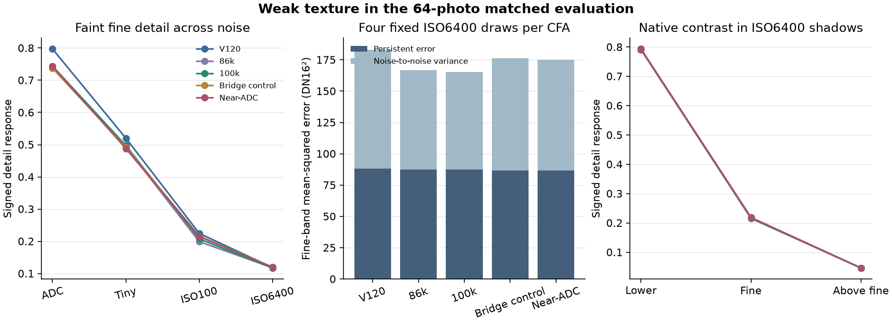
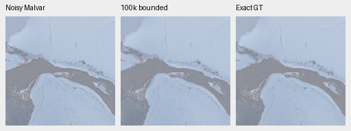
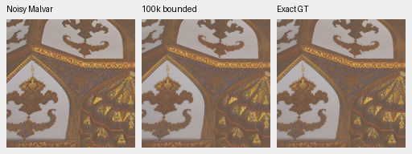

# Weak natural texture across the corpus checkpoints

Corpus 100k lowers ISO6400 fine-band RMS from **12.51 to
11.75 DN16** across the faintest stratum, with nearly the same
signed detail response as V120. Lower variation between noise
draws accounts for **95% of the MSE gain**. At zero and tiny
positive noise, the existing RAW measurement lifts give a
larger fine-band benefit than the learned checkpoint changes
alone. Fine GFX crossings remain incomplete.
[Complete results and native crops](results/full-corpus-faint-noise-v1/publication.json).

## Matched profile and controls

The fixed 64 photos are the same predeclared subset as the
[86k review](full-corpus-long86k-adc.md). All have four Bayer
orders and come from the 427-photo validation source list with
zero overlap with the declared training cohort. There are
512 matched batches and 2,048 observations per model. The
five models are V120, Corpus 86k, Corpus 100k, and both
800-update arms of the near-ADC continuation. Every model
uses its EMA in the same CUDA IEEE FP32 policy. All spectral
metrics use held-out photographic sources.

In the four faint conditions, the clean camera RGB target keeps
its per-channel spatial mean and 2.5% of original local contrast.
The ADC input is byte-identical to its historical observation
with FP64 code selection. All other observations use CPU FP32
Poisson/read draws through ADC16 with black fraction 0.03.
ISO6400 uses four independent noise draws per source and CFA.
The native-shadow condition keeps the original contrast under
one-eighth sensor exposure, then renders at ×8 for the PSNR and
native views. The other conditions use ×1.
[Source, model and execution bindings](results/full-corpus-faint-noise-v1/publication.json).

| Condition | Shot/read | Draws per source and CFA |
| --- | --- | ---: |
| ADC only | `0/0` | 1 |
| Tiny positive | `1e-8/1e-10` | 1 |
| ISO100 | `2e-5/1.6e-9` | 1 |
| ISO6400, faint | `0.00128/6.5536e-6` | 4 |
| ISO6400, native shadow | `0.00128/6.5536e-6` | 1 |

All photometry uses the central 240×240 native pixels. For the
spectral analysis, the original image chooses the valid blocks
with original luma 0.02–0.9 and fine-band RMS below 2% of
local mean. This includes the same 2,104 native 16×16 blocks
from 48 sources as the earlier 86k study. Fine band is
1/8–1/3 cycles per native pixel. Signed response is measured
along the exact target coefficients. Error uses unclipped
linear-sRGB luminance in full-scale DN16 before display exposure.
Four CFAs and all draws pool within each source prior to equal
source weighting. Source-paired intervals resample photographs.
[Source-balanced statistics](results/full-corpus-faint-noise-v1/summary.json).

## Learned restoration across noise

The table gives rendered sRGB PSNR over all 64 photos and
weakest-band linear-luma RMS over the 48 contributing sources.
The full five-model comparisons remain in the machine results.

| Condition | V120 PSNR / RMS | 86k PSNR / RMS | 100k PSNR / RMS | V120 → 100k signed detail response |
| --- | ---: | ---: | ---: | ---: |
| ADC only | 67.774 / 2.868 | 68.292 / 3.027 | 68.387 / 2.939 | 79.7% → 74.4% |
| Tiny positive | 67.007 / 4.510 | 67.752 / 4.433 | 67.722 / 4.408 | 52.0% → 49.7% |
| ISO100 | 61.039 / 8.255 | 61.239 / 7.552 | 61.298 / 7.771 | 22.5% → 20.8% |
| ISO6400, faint | 52.656 / 12.511 | 52.776 / 11.819 | 52.734 / 11.752 | 11.8% → 11.7% |
| ISO6400, native shadow | 30.229 / 34.031 | 30.297 / 33.880 | 30.301 / 33.908 | 21.6% → 21.7% |

At ISO6400, 100k lowers weakest-band RMS in 42 of 48 sources.
The source-paired interval for the mean difference is
−1.00 to −0.52 DN16. The rendered gain is 0.078 dB and its
interval includes zero. At native contrast in shadows, the
rendered gain is 0.072 dB across all 64 sources, with a
0.124 DN16 mean reduction in this fine band. Its increase in signed
detail response is only 0.16 percentage points.

The matched near-ADC continuation improves tiny-noise PSNR by
0.061 dB, with the paired interval including zero. Weakest-band
RMS rises by 0.009 DN16. There is a small fine RMS improvement
of 0.035 DN16 at faint ISO6400 versus its matched 800-update
control. Signed response is essentially unchanged. Its
reserved flat-color costs were measured separately.
[Paired intervals and source counts](results/full-corpus-faint-noise-v1/paired-model-comparison.json) ·
[Reserved near-ADC color review](near-adc-bridge-training.md#existing-measurement-corrections).

## Repeated-noise diagnostic

Each native block and CFA holds the clean target fixed. Four
independent sensor draws separate variation between observations
from persistent error in the expected restoration. The finite
sample squared bias estimate subtracts one fourth of the sample
variance from the squared average error. This estimate includes
phase, amplitude and other residual structured bias.
[Earlier decomposition and definitions](conditional-noise-response.md).

An independent FFT-DCT and pairwise cross-error formulation
reproduces the decomposition on five retained batches. Those
same exact ADC batches verify the historical CPU controls against
the new GPU runs. Maximum absolute sRGB PSNR differences are
0.000006 dB for V120 and 0.000004 dB for 86k. The physical ADC
helper preserves all re-encoded codes and improves or preserves
CFA sample error in these independent checks.
[Arithmetic and matched-input audit](results/full-corpus-faint-noise-v1/verification.json).

In the faintest ISO6400 fine band, estimated persistent error
falls from 88.21 to 87.30 DN16² between V120 and 100k.
Noise-to-noise variation falls from 95.05 to 77.91 DN16².
Persistently missing fine structure therefore remains on both
models even after averaging independent input draws. The
higher-band response of all five raw checkpoints stays very low
under native-contrast shadow conditioning.

## Existing RAW lifts at the two lowest priors

| Policy | ADC PSNR / weak RMS | Tiny-noise PSNR / weak RMS |
| --- | ---: | ---: |
| V120 with calibrated lift | 68.341 / 2.269 | 67.906 / 3.028 |
| 86k with calibrated lift | 68.811 / 2.208 | 68.672 / 2.962 |
| 100k with calibrated lift | 68.943 / 2.196 | 68.779 / 2.964 |
| Bridge control with bounded lift | — | 68.771 / 2.962 |
| Near-ADC with bounded lift | — | 68.801 / 2.960 |

The ADC column uses calibrated bin Malvar. Projected 100k
improves PSNR by 0.602 dB over projected V120 and has a
0.074 DN16 lower weakest-band RMS. At tiny positive noise,
the existing bounded lift increases 100k PSNR by 1.058 dB
and improves the weakest band in 40 of 48 sources. Mean
fine RMS drops from 4.408 to 2.964 DN16. The bounded near-ADC
and matched-control endpoints are nearly tied after correction.
These lifts have explicit sensor-noise limits.
The bounded lift returns the original prediction at zero and
ordinary noise in its representative checks.
[Bounded-lift replay and native cells](results/full-corpus-faint-noise-v1/tiny-lift.json).

## Native comparison scope

The native photo cells use ROI `[48,48,160,160]` in the archived
256-pixel field, RGGB and draw 0. Display transforms share the
source WB and matrix, use contrast ×20 for ADC, ×4 for faint
positive-noise views and ×1 for unattenuated shadows. The sensor
and display exposure remain linked by the table above. Every
native triplet uses noisy Malvar, 100k and the exact prepared
target. ADC triplets use ADC-bin Malvar. The separate tiny-noise
bounded replay uses matched ×20 contrast to expose fine texture.
At ISO6400 the thin line across the light field and some colored
roof ornament disappear when contrast is reduced to 2.5%.
The native-contrast shadows retain more of these shapes.
[Full provenance and all viewed boards](results/full-corpus-faint-noise-v1/viewing.json).

[ISO6400 faint pond comparison](images/full-corpus-faint-noise-v1/056ea4c22db1faea173e109d83ecba1df10a1e53-iso6400-comparison.png) ·
[ISO6400 faint roof comparison](images/full-corpus-faint-noise-v1/059947d9a94d2e5c6d21c270bd5d9204bd91b580-iso6400-comparison.png) ·
[ISO6400 native-contrast shadow roof](images/full-corpus-faint-noise-v1/059947d9a94d2e5c6d21c270bd5d9204bd91b580-natural-shadow-comparison.png).

The two native sources are the first two sorted eligible IDs,
`056ea4c22db1faea173e109d83ecba1df10a1e53` and
`059947d9a94d2e5c6d21c270bd5d9204bd91b580`. They are
credited to Reinhold Möller Ermell and مانفی. Crops are
modified by binning, contrast and exposure transforms,
simulated noise, processing and display conversion.
[Reichmannsdorfer Teich source](https://commons.wikimedia.org/wiki/File:Steigerwald_Reichmannsdorfer_Teich_Orthophoto-20260104-RM-162313.jpg) ·
[Emamzadeh Esmaeil roof source](https://commons.wikimedia.org/wiki/File:Emamzadeh_Esmaeil_roof.jpg) ·
[CC BY-SA 4.0](https://creativecommons.org/licenses/by-sa/4.0).

The standalone standing GFX experiments use the same learned
checkpoints with the declared camera noise priors. The earlier
boards were re-viewed. The smooth main sky and coarse crossings
remain visible. Building rails, fine leaves and the cab weave
are softer than their independent ISO100 or JPEG references.
[Corpus 100k native GFX review](full-corpus-long100k.md#native-gfx100s-review) ·
[Near-ADC native review](near-adc-bridge-training.md).

No checkpoint was trained for this photo panel. Its controlled
faint and shadow scores are separate from the fixed primary
photo and known/unseen camera benchmarks.
