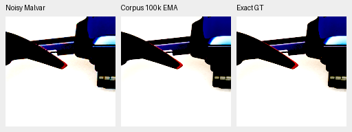
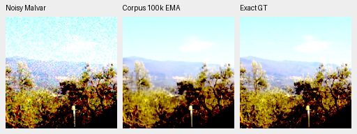

# Corpus 100k fine detail on the fixed photo panel

Corpus 100k lowers fine-band error across all 15 measured
noise and contrast cells. In the weakest contrast bin it recovers
more target-aligned structure at ADC-only and ISO100. At ISO12800
the recovered fraction stays near 36.5%, with a small reduction
in error. The broader PSNR gain therefore includes improved
high-noise restoration with little added response in the weakest
fine band.
[Fixed photo results](full-corpus-long100k.md#broader-evaluation) ·
[Audit and source-bound evidence](results/full-corpus-long100k-weak-band-v1/publication.json).

## Measurement

This comparison reuses the exact canonical sensor measurements,
target RGB and frozen CPU IEEE FP32 EMA predictions from the
full427 benchmark. An independent NumPy audit recomputes 25,132
photo and camera rows. Its largest difference from the retained
photographic sRGB PSNR is 0.000166 dB, and the measured-CFA
maximum is 0.00000561 dB. The audit binds the same checkpoint,
input hashes and border policy as the fixed score history.
[Independent audit](results/full-corpus-long100k-weak-band-v1/independent-primary-audit.json).

The fine-band replay measures linear luminance across native
16×16 blocks, using a radial DCT band from 1/8 to 1/3 cycles per
pixel. The established eligibility mask uses target luminance,
contrast and valid unclipped target RGB. The same 96,075 source
blocks and 5,124 source/noise/CFA observations enter each
comparison. Four Bayer layouts pool inside each source and noise
condition, followed by equal source weighting. The lowest contrast
bin covers band RMS below 2% of the block mean and has 326
contributing photographs. Whole-photo resampling uses the same draws
for both methods.

| Weakest contrast bin | V120 response | Corpus 20k response | Corpus 100k response | RMS DN16, V120 / 20k / 100k |
| --- | ---: | ---: | ---: | ---: |
| ADC-only | 94.68% | 94.33% | 95.22% | 62.15 / 61.04 / 60.52 |
| ISO100 prior | 78.57% | 78.74% | 79.47% | 92.71 / 92.29 / 91.60 |
| ISO12800 prior | 36.48% | 36.46% | 36.50% | 208.50 / 208.38 / 207.97 |

Relative to V120, the 100k response gains **0.54 percentage points**
at ADC-only (0.18–0.77) and **0.89 points** at ISO100 (0.67–1.11).
ISO12800 gives **+0.023 points**, with an interval of −0.227 to +0.210.
The corresponding fine-band RMS decreases by 2.62%, 1.20% and 0.26%.
At ISO12800 the absolute reduction is 0.53 DN16 (0.29–0.77).
The target-orthogonal band error falls by 1.38 DN16 at ADC-only.
Its ISO100 and ISO12800 intervals span zero.

Relative to Corpus 20k, Corpus 100k gains 0.89 points of target
response at ADC-only and 0.72 at ISO100, and the ISO12800 interval
again spans zero. It also lowers mean error in all 15 cells
versus the shorter schedule. These endpoints have different
training budgets and learning-rate horizons. The projections
measure one frequency and contrast range on exact photo targets.
The standing cameras still show incomplete fine cab crossings.
[V120 comparison](results/full-corpus-long100k-weak-band-v1/detail-v120.json) ·
[Corpus 20k comparison](results/full-corpus-long100k-weak-band-v1/detail-20k.json) ·
[All paired intervals](results/full-corpus-long100k-weak-band-v1/source-intervals.json).

## Native exact-target crops

Both triplets use native 160×160 pixels, RGGB, display exposure
×1 and contrast ×2 with shared transforms. The displayed EMA
checkpoint is
`87b96f3c487b9edaf1c477742b6c38f2a82cc6b20a94716d51cc8cf46a17a760`.
The ISO100 drone example uses shot/read `2e-5 / 1.6e-9` and
ROI `[96,80,160,160]`. It has the largest weak-bin reduction in
source-level RMS in this condition. The propeller and color bands
are slightly cleaner. The two model crops look close at native scale.
[Drone photograph by E bailey, CC BY-SA 4.0](https://commons.wikimedia.org/wiki/File:Veeniix_V11Pro_drone.jpg).

The ISO12800 foliage example uses shot/read
`0.00256 / 2.62144e-5` and ROI `[0,16,160,160]`. This is the
largest source-level weak-bin regression in the high-noise
condition. Fine foliage and distant detail remain soft compared
with the exact target. The gallery records the 16×16 score block
inside each crop and the original V120 comparisons.
[Photograph by PROPOLI87, CC BY-SA 4.0](https://commons.wikimedia.org/wiki/File:German_shepherd_enjoying_the_sun.jpg) ·
[Source coordinates, matched inputs and viewing](results/full-corpus-long100k-weak-band-v1/native-viewing.json).

The same checkpoint's standing GFX results show clean overcast sky,
coherent coarse crossings and soft thin cables, leaves and fine
cab mesh. Both cab profiles and JPEGs remain in that qualitative
comparison.
[Standing GFX](full-corpus-long100k.md#native-gfx100s-review).
