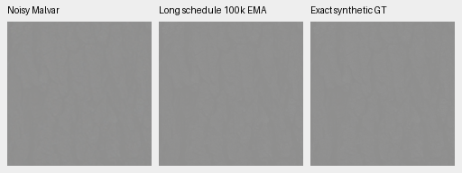
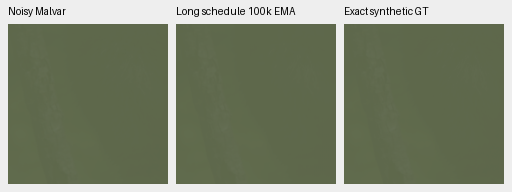

# Full-corpus 100k endpoint

The 100k EMA gains **0.575 dB** in faint ADC sRGB PSNR versus V120 on
the four retained materials and **0.006 dB** versus the 86k EMA.
Faint bark, fur and wood have lower fine-band error than V120. Grass
still has higher error, the orange flat-field spot check has more
mean color bias, and neither standing GFX comparison shows convincing
new fine crossings. **V120 Small remains the general recommendation.**
[Audited native comparisons](results/full-corpus-long100k-native-v1/publication.json).

## Training and corpus coverage

Experiment `full-corpus-scaling-v3 / long100k` continued from V120
Small EMA `a9d9b6b4f974e24a6b11e5e740aab32314233a7f53c056cf37c7d2aac1c589fb`.
The completed checkpoint is
`87b96f3c487b9edaf1c477742b6c38f2a82cc6b20a94716d51cc8cf46a17a760`.
It contains 91 raw and 91 EMA restoration tensors, Adam state for
89 parameters, and RNG state. All image and score comparisons here
use the EMA. The final phase resumed the original step 1,000 state.

The recipe uses native 256×256 Bayer crops, batch 16, BF16 throughput
training, fixed loss, frozen DINO, and a single cosine schedule from
`1e-5` to `1e-6` with 100 warmup updates. Commons draws use
shuffled photographic epochs alongside reviewed ROIs and procedural
patches. Native RAW simulation and measured paired crops each supply
about one quarter of training. The two measured worker loops total
**69,135.63 seconds (19 h 12 min 16 s)** for 100,000 updates and
1,600,000 target slots, including their own validation and saves. The
separate 20k control and intervening pauses are outside this duration.
[Bound checkpoint, controller receipt and timing](results/full-corpus-long100k-training-v1/publication.json) ·
[Recipe and admission](full-corpus-scaling.md).

| Actual coverage | Count |
| --- | ---: |
| Commons / native-simulated RAW / paired RAW batches | 49,970 / 25,016 / 25,014 |
| Commons ordinary / reviewed / procedural target slots | 531,903 / 27,905 / 239,712 |
| Distinct ordinary photos | 90,778 |
| Photos visited five / six times | 12,765 / 78,013 |

The five complete ordinary epochs finish at updates 17,039, 33,985,
51,009, 68,269 and 85,233. For the photos visited a sixth time, the
median newly covered area is 0.68% of the registered cache frame.
16,540 sixth crops add zero registered area. Repeat visits often
overlap earlier cache pixels. A post-run placement audit finds that
selecting the best of four positions at the same crop size raises
median newly covered area to 3.41%.
The recorded conditions include 119,898 ADC-only slots and zero
positive-noise slots at or below eight ADC codes RMS at full signal
with reference black 0.03. The subsequent matched continuation tests
this low-noise coverage gap.
[Actual source order, crop rectangles and conditioning audit](results/full-corpus-long100k-training-v1/source-audit.json) ·
[Sixth-visit placement audit](full-corpus-scaling.md#added-crop-area-at-the-sixth-visit) ·
[Matched near-ADC training](near-adc-bridge-training.md).

## Retained material and color panels

The fixed comparison uses V120, [long 86k](full-corpus-long86k-native.md)
and long 100k EMA on the same 110 inputs. Inference runs the learned
EMA directly at batch 1 with CPU IEEE FP32. The 110 new cases took
220.84 seconds excluding model load. An independent audit recomputed
288 material metrics, 180 band strata and 24 ADC spot measurements.
It verified the pixels on 26 boards and 22 triplet subsets, plus all
220 saved V120/86k predictions. All 26 comparison boards were viewed.
[Numerical and pixel audit](results/full-corpus-long100k-native-v1/independent-audit.json) ·
[Audit scope correction](results/full-corpus-long100k-native-v1/audit-scope-correction.json) ·
[Viewing record](results/full-corpus-long100k-native-v1/actual-native-viewing.json).

| Mean PSNR, dB | V120 | Long 86k | Long 100k |
| --- | ---: | ---: | ---: |
| Ordinary ISO12800 prior, sRGB | 32.30426 | 32.33177 | 32.33392 |
| Shadows, sRGB | 25.90197 | 25.95805 | 25.96247 |
| Faint ADC, sRGB | 67.48067 | 68.05013 | 68.05613 |
| Faint ADC, camera RGB | 75.48216 | 76.26335 | 76.37817 |

Fine-band RMS in DN16 for the four 2.5%-contrast fields, averaged
over all four Bayer layouts, measures 1/8–1/3 cycles per pixel.

| Faint material | V120 | Long 86k | Long 100k |
| --- | ---: | ---: | ---: |
| Bark | 10.972 | 9.658 | 9.656 |
| Fur | 5.066 | 4.451 | 4.319 |
| Grass | 6.776 | 6.917 | 6.881 |
| Wood | 3.218 | 2.845 | 2.768 |

At high noise, all three restorations still visibly soften fine grass
and fur. Across eight selected gray and orange ADC checks, worst
color bias is 23.28 DN16 at 100k, versus 20.58 at 86k and 15.08 for
V120. Worst centered RMS is 5.13 DN16, versus 5.35 and 4.64
respectively. The two selected flat boards show no obvious new
patchiness. The larger faint-photo subset and full flat palette
have separate results through 86k, where raw weak-band and color
errors are larger than the four-material panel suggests.
[100k native summary](results/full-corpus-long100k-native-v1/native-summary.json) ·
[86k broader ADC study](full-corpus-long86k-adc.md).

### Native synthetic crops

Noisy Malvar, 100k EMA and exact synthetic GT for the bark and fur
2.5%-contrast fields. Both are native RGGB draw 0, ROI
`[48,48,160,160]`, zero shot/read, ADC16 with black fraction 0.03
and exposure ×1. The linked comparison boards apply a shared ×20
contrast lift to the same native pixels.
[Source and display manifest](images/full-corpus-long100k-native-v1/manifest.json).

[Bark ×20](images/full-corpus-long100k-native-v1/bark-contrast0p025-adc-RGGB-contrast20.png) ·
[Fur ×20](images/full-corpus-long100k-native-v1/raccoon-fur-contrast0p025-adc-RGGB-contrast20.png).

## Native GFX100S review

The DSCF3879 ISO6400 sky stays smooth, and the coarse chain-link
crossings remain visible. The 100k output still softens small
building hardware, cables and darker foliage. The main captures
use `.00128/6.5536e-6` shot/read with exposure ×4 and the independent
DSCF3880 ISO100 AHD as the qualitative reference.
[Sky](images/full-corpus-long100k-native-v1/main-overcast-sky.png) ·
[Building](images/full-corpus-long100k-native-v1/main-building-detail.png) ·
[Foliage](images/full-corpus-long100k-native-v1/main-foliage.png) ·
[Coarse fence](images/full-corpus-long100k-native-v1/main-chain-link-fence.png).

The DSCF3842 ISO6400 cab crops show faint, soft strands under nominal
conditioning and more repeat modulation under the transferred
DSCF3879 profile, especially at right. Intersections remain
incomplete and the visible changes from 86k are small. There is no
obvious new color cast, and low-contrast irregularity persists.
The ISO100 DSCF3835 AHD and both camera JPEGs are independent
qualitative references with differing aperture, exposure and motion.
The common processed cab display uses exposure ×16.

| Cab profile | Shot/read | Native boards |
| --- | --- | --- |
| Nominal | `.00128/6.5536e-6` | [Left](images/full-corpus-long100k-native-v1/mesh-nominal-fine-green-mesh-left.png) · [Right](images/full-corpus-long100k-native-v1/mesh-nominal-fine-green-mesh-right.png) |
| Transferred DSCF3879 | `.0014635775921166604/1.0715704128646712e-6` | [Left](images/full-corpus-long100k-native-v1/mesh-profile3879-fine-green-mesh-left.png) · [Right](images/full-corpus-long100k-native-v1/mesh-profile3879-fine-green-mesh-right.png) |

## Broader evaluation

The fixed known and unseen camera panels are complete. The measured
CFA score uses the original reference mask and 32-pixel border, with
nine crops per capture, two captures per scene and equal scene
weights. The audit recomputed all 324 crop/model rows across 54 batches
and matched the saved values exactly. All nine first-capture native
comparison boards were viewed at 160×160. The independent AHD
reference is qualitative.

| Measured-CFA PSNR, dB | V120 | Short 20k | Long 100k |
| --- | ---: | ---: | ---: |
| Known, four scenes | 54.31272 | 54.34557 | 54.33708 |
| Unseen, five scenes | 54.00872 | 53.96805 | 53.97826 |

The long run gains **0.02436 dB** on the known panel and loses
**0.03046 dB** on the unseen panel versus V120. D60-2 contributes
the largest known gain at +0.10617 dB. The largest unseen loss is
−0.13612 dB on Coulicoco. The selected native camera crops look
close overall, with soft tapestry texture and largely similar
lettering and quiet shadow transitions.
[Complete camera results](results/full-corpus-long100k-camera-v1/publication.json) ·
[Native camera manifest](images/full-corpus-long100k-camera-v1/manifest.json) ·
[Short 20k comparison](full-corpus-control20k-camera-review.md).

The full 427-photo panel is collecting. Its benchmark uses IEEE FP32
on the CPU with matched V120 controls. V131 remains the latest
endpoint with all three comparable completed broad panels.
[Primary preflight and start receipt](results/full-corpus-long100k-training-v1/primary-start.json) ·
[Review admission](results/full-corpus-long100k-review-queue-v1/publication.json) ·
[Comparable PSNR history](performance-history.md).
