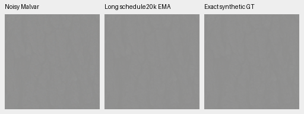
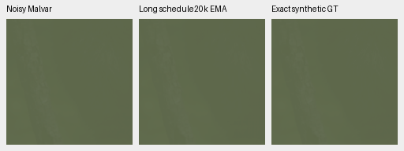

# Long-schedule 20k checkpoint review

At the same 20,000 updates, the long schedule lowers faint fine-band error
for **bark, fur, and wood** compared with both V120 and the short schedule.
Grass fine-band error increases. Mean faint sRGB PSNR falls by **0.19124 dB**
versus the short schedule, while camera-RGB PSNR gains **0.15853 dB**.
The real cab mesh still lacks convincing new crossings. V120 remains the
general inference recommendation.
[Audited results, native boards, and recorded sources](results/full-corpus-long20k-native-v1/publication.json).

## Matched checkpoints and inputs

The long EMA checkpoint is `a4e64a3b553e5e70683850bc93e6a99f1ad020d7b2c663936bad8098d604bf70`.
The 20k-horizon control is `633053370bdfb455d738ce0e3af686cb61e8dcac7c501954eb3b2293738a3795`.
Both use V120 Small EMA parent
`a9d9b6b4f974e24a6b11e5e740aab32314233a7f53c056cf37c7d2aac1c589fb`.
Through 20k, both trajectories record the same 320,000 training-example slots,
the same crop choices, data seeds and 80 conditioning chunks, and visits
to all 90,778 ordinary training photos. The long cosine schedule keeps a
higher learning rate at this checkpoint, with the original 100k horizon.
Its timed training loops through this point total 13,127.97 seconds.
[Training data, configuration, and actual source audit](full-corpus-scaling.md#long-schedule-20k-milestone).

The review uses 110 retained inputs. The three EMA models execute 330
CPU IEEE FP32 restoration calls at batch 1, including 110 actual DINO
executions and 220 feature replays. Inference takes 2,654.05 seconds
excluding load in this shared-host run. All 220 new V120 and short
control outputs match the previous inputs' restorations bit for bit.
The independent audit checks 288 material rows, 180 original-source
contrast strata, 24 flat-color rows, all 26 native boards, and all 22
triplets. Numeric and actual viewing reviews are complete.
[Independent audit](results/full-corpus-long20k-native-v1/independent-audit.json).

## Material and flat measurements

The material results average the same four sources and four Bayer
layouts. Faint ADC uses 2.5%-contrast targets under zero shot and read
conditioning. These retained targets support a comparison at the same
training budget. The [fixed primary panels](performance-history.md)
have separate coverage.

| Mean PSNR, dB | V120 | Short schedule | Long schedule |
| --- | ---: | ---: | ---: |
| Ordinary ISO12800 prior, sRGB | 32.30426 | 32.31279 | 32.31075 |
| Shadows, sRGB | 25.90197 | 25.91244 | 25.91331 |
| Faint ADC, sRGB | 67.48067 | 67.46006 | 67.26882 |
| Faint ADC, camera-RGB PSNR | 75.48216 | 75.34419 | 75.50272 |

The low-contrast band uses the same DCT16 annulus from 1/8 to 1/3 cycles
per pixel as the short-schedule review. Band RMS is in DN16 and the
metrics average the four CFA layouts.

| Faint source | Band RMS V120 | Band RMS short | Band RMS long | Signed gain V120 / short / long |
| --- | ---: | ---: | ---: | ---: |
| Bark | 10.972 | 10.968 | 10.796 | 0.99055 / 0.99440 / 0.99361 |
| Fur | 5.066 | 5.471 | 4.943 | 0.95585 / 0.95604 / 0.97048 |
| Grass | 6.776 | 6.874 | 7.180 | 0.99786 / 0.99826 / 1.02208 |
| Wood | 3.218 | 3.281 | 3.039 | 0.97300 / 0.97672 / 0.98448 |

The long schedule restores more of the fur and wood band, and grass
overshoots its projected target. Full faint sRGB PSNR still declines
versus the short schedule on bark, grass, and wood. The clipped-sRGB
arithmetic MSE increases by `9.53e-9` versus the short schedule;
`6.82e-9` of the increase is spatial and `2.71e-9` is channel-mean
error. The arithmetic decomposition and mean PSNR use different
aggregations. The eight flat-color spot checks also have higher worst
centered RGB RMS, 8.15 versus 7.13 DN16 for short and 4.64 for V120.
[Material and flat summary](results/full-corpus-long20k-native-v1/native-summary.json) ·
[Faint error decomposition](results/full-corpus-long20k-native-v1/faint-decomposition.json).

## Native crops

Noisy Malvar, long-schedule 20k EMA, and exact constructed GT, with
160×160 pixels per cell. The faint bark and raccoon-fur examples use
RGGB draw 0, ROI `[48,48,160,160]` in their respective 256 fields, ADC16
black fraction 0.03, zero shot/read, and exposure 1. Both triplets use
the same coordinates and rendering per source across methods. The
checkpoint hash is given above. The report also includes the corresponding
ordinary positive-noise and contrast-amplified comparisons.

The DSCF3879/3880 crops show similar sky, building, and foliage across the
three models. The coarse fence retains visible crossings. The nominal
DSCF3842/3835 cab mesh still loses most fine crossings. The transferred
noise profile retains soft, incomplete modulation, with subtle
differences between schedules. The separate ISO100/AHD and ISO100 JPEG
images are qualitative references with different aperture, exposure, and
motion. The ISO6400 JPEG shows the camera rendering of the input capture.
[Sky](images/full-corpus-long20k-native-v1/main-overcast-sky.png) ·
[Building](images/full-corpus-long20k-native-v1/main-building-detail.png) ·
[Foliage](images/full-corpus-long20k-native-v1/main-foliage.png) ·
[Coarse fence](images/full-corpus-long20k-native-v1/main-chain-link-fence.png) ·
[Cab left](images/full-corpus-long20k-native-v1/mesh-nominal-fine-green-mesh-left.png) ·
[Cab right](images/full-corpus-long20k-native-v1/mesh-nominal-fine-green-mesh-right.png) ·
[Transferred profile left](images/full-corpus-long20k-native-v1/mesh-profile3879-fine-green-mesh-left.png) ·
[Transferred profile right](images/full-corpus-long20k-native-v1/mesh-profile3879-fine-green-mesh-right.png) ·
[Full native provenance and viewing record](images/full-corpus-long20k-native-v1/manifest.json).
