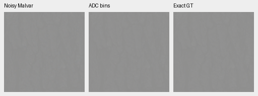
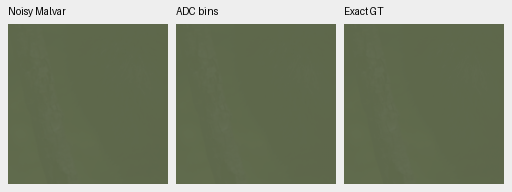
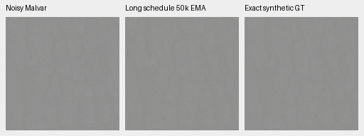
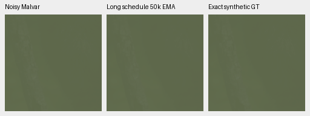

# Long-schedule 50k checkpoint review

At 50,000 updates, the long run raises mean ordinary and shadow sRGB
PSNR by **0.020 and 0.044 dB** over V120 on the retained material
panel. Faint sRGB recovers **0.154 dB** from long 20k and remains
**0.058 dB below V120**. All four faint materials have higher fine-band
RMS than V120. A bright orange ADC-only spot check develops severe
color bias and visible unevenness in two Bayer layouts. The native
GFX cab crops still lack convincing new fine crossings. V120 remains
the recommended model. [Audited measurements and native evidence](results/full-corpus-long50k-native-v1/publication.json).

The [later 86k review](full-corpus-long86k-native.md) repeats the same
inputs. Faint ADC fidelity improves and the large flat color shift clears.

## Checkpoints and observations

The 50k EMA comes from the original 100k trajectory with a B16 batch,
frozen DINO and its original cosine horizon. Its checkpoint SHA256 is
`1560138b11371f58f2df33c52f026f9bd941aa1e5f336c607cefcd0c0a04d431`.
The comparisons use V120 EMA
`a9d9b6b4f974e24a6b11e5e740aab32314233a7f53c056cf37c7d2aac1c589fb`
and long 20k EMA
`a4e64a3b553e5e70683850bc93e6a99f1ad020d7b2c663936bad8098d604bf70`.
The 50k state follows 800,000 target slots and 266,909 ordinary
photo draws from all 90,778 sources. The two measured training-loop
windows total 34,432.55 seconds through the 50k training log, before
that step's final validation and save.
[Training recipe, source coverage and timing](full-corpus-scaling.md#long-schedule-50k-milestone).

The review reuses 220 verified V120 and long-20k predictions and
executes 110 new CPU IEEE FP32 calls at batch 1. Collection reports
385.93 seconds excluding load. An independent audit recomputes
288 material metrics, 180 original-target band strata and 24 ADC
spot checks, and reproduces all 26 comparison boards at the pixel
level. All 26 boards were inspected. The standard full427 and
known/unseen camera panels have no result for this retained midpoint.
[Independent numerical and pixel audit](results/full-corpus-long50k-native-v1/independent-audit.json) ·
[Native viewing record](results/full-corpus-long50k-native-v1/actual-native-viewing.json) ·
[Standard panel coverage](performance-history.md).

## Material and flat-field results

| Mean PSNR, dB | V120 | Long 20k | Long 50k |
| --- | ---: | ---: | ---: |
| Ordinary ISO12800 prior, sRGB | 32.30426 | 32.31075 | 32.32396 |
| Shadows, sRGB | 25.90197 | 25.91331 | 25.94566 |
| Faint ADC, sRGB | 67.48067 | 67.26882 | 67.42286 |
| Faint ADC, camera RGB | 75.48216 | 75.50272 | 75.48221 |

Mean low-contrast 1/8–1/3 cycles/pixel RMS in DN16 across all four Bayer
layouts for each retained 2.5%-contrast field.

| Faint material | V120 | Long 20k | Long 50k |
| --- | ---: | ---: | ---: |
| Bark | 10.972 | 10.796 | 10.977 |
| Fur | 5.066 | 4.943 | 5.575 |
| Grass | 6.776 | 7.180 | 7.106 |
| Wood | 3.218 | 3.039 | 3.228 |

Fur loses the 20k gain and has more error than V120. Grass improves
slightly from long 20k with residual overshoot. On the bright orange
BGGR control, 50k reaches **1,490 DN16** maximum absolute channel-mean
error and **149 DN16** spatially centered RGB RMS. Long 20k gives 14.90
and 8.15 on that crop. The orange RGGB control shows a similar bias and
spatial error. The neutral gray crops remain close across models.
The eight spot checks cover two colors and four Bayer layouts.
[Per-material and flat summary](results/full-corpus-long50k-native-v1/native-summary.json) ·
[Orange BGGR crop](images/full-corpus-long50k-native-v1/flat-h030-s0.98-l0.90-BGGR.png).

## Calibrated ADC follow-up

Applying the existing [ADC-bin projection](adc-bin-consistency.md) to
saved 50k predictions lowers worst spot-check color bias from
**1,490 to 11.16 DN16**, with centered RMS falling from 148.52 to
7.39 DN16. The earlier exact Malvar correction reaches 10.64 DN16
bias and 7.39 DN16 RMS on the same grid. Both remove the visible
orange shift and unevenness. This follow-up covers 16 faint inputs
and eight flat inputs with their original CPU quantizers and zero
shot/read conditioning. The bin fits remain within the measured CFA
intervals and improve or preserve measured-site error on every case.

| Model and policy | Faint sRGB dB | Mean fine-band RMS, DN16 | Worst flat bias, DN16 |
| --- | ---: | ---: | ---: |
| V120 | 67.48067 | 6.5080 | 15.08 |
| V120 + ADC bins | 67.61383 | 5.8066 | 3.82 |
| Long 50k | 67.42286 | 6.7213 | 1,489.97 |
| Long 50k + exact Malvar | 67.65069 | 5.9171 | 10.64 |
| Long 50k + ADC bins | 67.72013 | 5.9185 | 11.16 |

The corrected 50k output scores better on faint sRGB than corrected
V120, with slightly higher mean fine-band error and higher flat
bias. All positive-noise inputs from both GFX scenes bypass the
operator exactly for both models and retain their viewed native
pixels. Four ADC boards were viewed. The two exact-target triplets
below use the same RGGB provenance and display as the raw triplets
in the native comparison section.
[Saved-output receipts](results/full-corpus-long50k-adc-spot-v1/publication.json) ·
[Orange BGGR](images/full-corpus-long50k-adc-spot-v1/flat-h030-s0.98-l0.90-BGGR-comparison.png) ·
[Orange RGGB](images/full-corpus-long50k-adc-spot-v1/flat-h030-s0.98-l0.90-RGGB-comparison.png).

## Native comparisons

The bark and fur triplets show noisy Malvar, 50k EMA and exact
constructed GT. Both use native RGGB draw 0, ROI `[48,48,160,160]`,
ADC16 black fraction 0.03, zero shot/read and display exposure 1.
The constituent pixels use the same coordinates and display for all
models. The contrast-amplified full comparison makes the 50k loss of
fine fur definition easier to see.

The DSCF3879 sky remains smooth and the coarse chain-link crossings
remain visible. Foliage and small building hardware stay soft. In
DSCF3842, the nominal profile leaves mostly smooth patches with a
few visible strands. The transferred profile retains soft repeat
structure, with incomplete intersections on both sides. The ISO100
AHD and JPEG references come from independent exposures with differing
aperture and motion. The camera JPEG of the noisy frame shows its
independent camera rendering.
[Sky](images/full-corpus-long50k-native-v1/main-overcast-sky.png) ·
[Building](images/full-corpus-long50k-native-v1/main-building-detail.png) ·
[Foliage](images/full-corpus-long50k-native-v1/main-foliage.png) ·
[Coarse fence](images/full-corpus-long50k-native-v1/main-chain-link-fence.png) ·
[Cab left](images/full-corpus-long50k-native-v1/mesh-nominal-fine-green-mesh-left.png) ·
[Cab right](images/full-corpus-long50k-native-v1/mesh-nominal-fine-green-mesh-right.png) ·
[Transferred left](images/full-corpus-long50k-native-v1/mesh-profile3879-fine-green-mesh-left.png) ·
[Transferred right](images/full-corpus-long50k-native-v1/mesh-profile3879-fine-green-mesh-right.png) ·
[Native coordinates, conditioning and display](images/full-corpus-long50k-native-v1/manifest.json).
