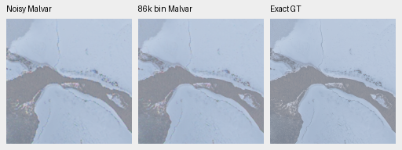
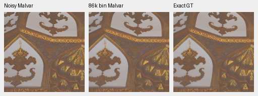

# Weak detail at 86k with calibrated ADC projection

On a fixed 64-photo faint ADC subset, raw 86k improves mean rendered
PSNR by **0.518 dB** over V120 and increases weakest-band error from
**2.868 to 3.027 DN16 RMS**. ADC-bin projection with Malvar lowers the
86k error to **2.208 DN16**, slightly below projected V120 at 2.269,
and improves PSNR on all 64 of the 86k predictions.
The complete 588-input flat-color grid exposes a large raw 86k bias that
the earlier two-color check missed. Bin Malvar reduces the worst case
from **1,429.92 to 12.87 DN16**.
[Complete measurements and native evidence](results/full-corpus-long86k-adc-panels-v1/publication.json).

## Fixed photo subset

The review selects 16 complete four-photo batches from the earlier
[427-photo faint ADC collection](full427-faint-adc.md) by a fixed SHA256
ordering of source-ID groups. The selection precedes 86k inference.
Every photograph retains all four Bayer orders, the original batch
shape, a 2.5%-contrast target, exposure ×1, zero shot/read, ADC16 and
black 0.03. The source quantizer uses CPU FP64 arithmetic. These 64
photos are a scoped subset of the faint simulation.

The checkpoint is the [86k EMA](full-corpus-long86k-native.md), SHA256
`17a93ce546ee1c3282374b4a020c713251becbf919414966bb7a58f306b5c555`.
The comparison reuses matched V120 EMA
`a9d9b6b4f974e24a6b11e5e740aab32314233a7f53c056cf37c7d2aac1c589fb`.
All 1,024 original V120 metric rows for the four established policies
reproduce the archived scores exactly. The 86k collector runs 64
CPU IEEE FP32, contiguous B4 calls. The score averages CFAs within each
source and then weights sources equally. Mean sRGB uses the native
240×240 interior. The weakest band covers 2,104 original-target blocks
from 48 sources with original RMS-to-mean contrast below 0.02 in the
1/8–1/3 cycles/pixel band. The measured prediction error uses the
contrast-reduced target.

| Policy | Mean sRGB PSNR | Weakest-band RMS DN16 | Signed response |
| --- | ---: | ---: | ---: |
| V120 raw | 67.774 dB | 2.868 | 0.797 |
| V120 bin Malvar | 68.341 dB | 2.269 | 0.961 |
| 86k raw | 68.292 dB | 3.027 | 0.740 |
| 86k exact Malvar | 68.782 dB | 2.233 | 0.968 |
| 86k exact sites | 68.601 dB | 2.394 | 0.851 |
| 86k bin Malvar | **68.811 dB** | **2.208** | 0.948 |
| 86k bin bilinear | 68.556 dB | 2.328 | 0.895 |
| 86k bin sites | 68.603 dB | 2.424 | 0.841 |

Raw 86k gains rendered PSNR on 59 of 64 sources and raises weakest-band
error on 28 of 48. Applying bin Malvar to 86k improves that band on 43
of 48 sources. Comparing both projected models, 86k improves rendered
PSNR on 61 of 64 sources and lowers the weakest-band error on 36 of 48.
Its mean signed response remains slightly lower than projected V120.
The source-paired bootstrap interval for the projected error difference
is −0.103 to −0.018 DN16 over these retained photos. The native crops
show clearer thin lines in some places, with residual softness in the
exact reference's finer structure.

## Isolating the interpolation step

All four bin modes clamp to the same nearest compatible value at each
measured CFA site. Malvar transfers the correction to missing channels
with cross-color terms. Bilinear transfer uses only measured residuals
of the same color. Site-only transfer leaves the missing channels at
their learned values. Old exact-site replacement uses ADC bin centers.
All four bin modes preserve the measured-code and measured squared-error
invariants under the declared codec. The default bin helper remains
Malvar, and all bin modes return positive-noise predictions unchanged.
[Implementation](../src/demosaic/adc_bins.py).

On the separate four-material spot panel, the bin Malvar lift improves
86k fine-band error from 5.968 to 5.543 DN16. Bin bilinear attains 5.904
and bin sites 5.821 DN16. At this smaller scale, bin sites gives the
highest rendered PSNR, 68.332 dB, versus 68.122 for bin Malvar. The
64-photo result favors bin Malvar on both measures. All 288 prior
spot-panel metric rows reproduce exactly when the extra modes are enabled.

## Full flat-color grid

The 147-color grid spans each hue, saturation and peak level from the
[20k calibration review](full-corpus-control20k-color-review.md) in all
four Bayer orders. Each flat uses exact constructed RGB, zero shot/read,
ADC16 with black 0.03 and an FP32 quantizer. The table reports the maximum
absolute camera-channel mean error and the maximum spatially centered
camera-RGB RMS, both measured over the fixed native 160×160 center.

| Policy | Worst bias DN16 | Worst centered RMS DN16 |
| --- | ---: | ---: |
| V120 raw | 55.52 | 24.87 |
| V120 bin Malvar | 13.04 | 15.14 |
| V120 bin bilinear | 13.04 | 14.52 |
| 86k raw | 1,429.92 | 280.30 |
| 86k exact Malvar | 13.17 | 11.59 |
| 86k exact sites | 719.75 | 450.50 |
| 86k bin Malvar | 12.87 | 11.59 |
| 86k bin bilinear | 12.87 | 11.07 |
| 86k bin sites | 720.00 | 450.35 |

The worst raw 86k bias occurs in bright yellow with hue 60°, saturation
0.98, peak 0.90 and RGGB. The 20k control reached 765.66 DN16 on the
same grid. The fixed display transform gives a subtle shift in the
86k yellow panel and nearly uniform color elsewhere. The larger
camera-linear bias before display clipping is visible in the
measurements. Site-only correction leaves a substantial color error.
Bilinear and Malvar both correct it, with lower worst spatial RMS for
bilinear on these constant inputs.
[Worst raw V120 case](images/full-corpus-long86k-adc-panels-v1/palette/h000-s0.50-l0.90-RGGB-comparison.png) ·
[Worst raw 86k case](images/full-corpus-long86k-adc-panels-v1/palette/h060-s0.98-l0.90-RGGB-comparison.png).

The experimental flat-aware mode uses bilinear wherever each Bayer
phase's observed codes are constant across a packed 3×3 neighborhood.
It uses Malvar elsewhere. Both models' outputs match bilinear exactly
on all 588 flats. On the 64 photos, 2.22% of packed locations meet
the constancy condition. The change in mean photo PSNR is under
0.0001 dB per model, and 86k's weakest-band error stays at 2.208
DN16. This is a local sensor-code check for the zero-noise case.

## Native photo crops

The photo triplets show noisy Malvar, 86k bin Malvar and the exact
contrast-reduced target. They use the first two source IDs in the
predeclared subset, RGGB, native 160×160 cells at `[48,48,160,160]`, zero
shot/read and exposure ×1. All panels have the same contrast-20 display
around the reference crop mean with shared WB and matrix. The first
crop contains faint cracks, and the second contains fine ornamental
trim. Both retain more of that structure with the projected fit.
[Source, model and display manifest](images/full-corpus-long86k-adc-panels-v1/manifest.json).

[Crack comparison](images/full-corpus-long86k-adc-panels-v1/faint/056ea4c22db1faea173e109d83ecba1df10a1e53-comparison.png) ·
[Trim comparison](images/full-corpus-long86k-adc-panels-v1/faint/059947d9a94d2e5c6d21c270bd5d9204bd91b580-comparison.png).

## How the result changes with noise

The positive-noise sweep retains the four faint material targets and
evaluates three shot/read profiles across all four Bayer layouts. Both
models receive the same 48 fresh draws, with CPU FP32 Poisson-Gaussian
corruption, the same camera transforms, exposure ×1, ADC16 and black
0.03. The small-positive profile tests behavior close to the ADC limit.
The ISO100 and ISO6400 profiles use the existing nominal coefficients.

| Shot/read | V120 sRGB | 86k sRGB | V120 fine RMS DN16 | 86k fine RMS DN16 |
| --- | ---: | ---: | ---: | ---: |
| `1e-8/1e-10` | 66.670 dB | 67.485 dB | 7.895 | 7.270 |
| `2e-5/1.6e-9` | 59.166 dB | 59.166 dB | 36.895 | 37.080 |
| `.00128/6.5536e-6` | 53.321 dB | 53.484 dB | 60.943 | 61.058 |

The 86k fine-band gain survives the smallest noise level. At the ISO100
and ISO6400 priors, fine-band error is slightly higher. The modest
rendered gain at ISO6400 does not extend to this band. At ISO100 both
native renders preserve bark fissures and large fur shapes, while many
fine bark ridges and individual strands stay soft. All four bin modes
bypass every positive-noise output in this sweep, giving 384 identity
checks across the two models. The two ISO100 boards and triplets use
native ROI `[48,48,160,160]`. The renderer wrote a stale ROI to their
original manifest. All 14 display cells were independently reproduced
from the actual coordinates.
[Native ROI addendum](results/full-corpus-long86k-adc-panels-v1/native-roi-correction.json).
[Noisy, V120, 86k and exact constructed bark target](images/full-corpus-long86k-adc-panels-v1/noise/bark-contrast0p025-iso100-prior-RGGB-comparison.png) ·
[Corresponding fur comparison](images/full-corpus-long86k-adc-panels-v1/noise/raccoon-fur-contrast0p025-iso100-prior-RGGB-comparison.png).

The [near-ADC conditioning follow-up](noisy-cfa-residual.md) tests
positive-noise measurement correction and exposes a larger bright-yellow
error with tiny positive conditioning. On matched RAW, the bias follows
the model's noise conditioning.

## Standing GFX review

All four bin modes return the original prediction object for the six
positive-noise inputs underlying the eight standing GFX boards, checked
for V120, 50k and 86k. The displayed sky, building, foliage, coarse
fence and both cab profiles retain their original 86k pixels. The fine
cab intersections remain incomplete. The independent ISO100 and camera
JPEG references remain the same.
[86k GFX native crops with both cab ROIs and noise profiles](full-corpus-long86k-native.md#native-gfx100s-review).
