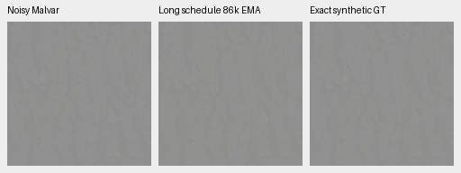
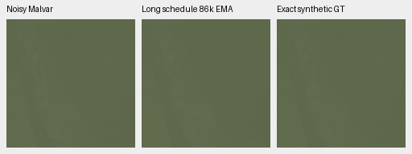

# Long-schedule 86k checkpoint review

The [completed 100k endpoint review](full-corpus-long100k.md) compares
this same checkpoint and V120 on identical inputs.

The 86k EMA improves faint ADC sRGB PSNR by **0.569 dB** over V120 on
the matched material panel. It lowers fine-band error on bark, fur and
wood, and the bright-orange flat-field failure at 50k largely clears.
Grass fine-band error remains slightly higher than V120. The real
fine cab fence still lacks clear new crossings.
[Audited measurements and native crops](results/full-corpus-long86k-native-v1/publication.json).

The [ADC and noise follow-up](full-corpus-long86k-adc.md) tests 64 held-out
faint photographs, the color palette and three positive-noise priors.
The larger ADC subset favors bin Malvar. At the ISO100 and ISO6400
priors, the four faint materials show little fine-band gain.

## Checkpoint and observations

The 86k state comes from the original 100k trajectory initialized with
V120 Small EMA, batch 16, frozen DINO and the original cosine schedule.
The rolling checkpoint was retained at update 86,000 and verified to
contain weights, EMA, optimizer state and RNG for that step. Its SHA256
is `17a93ce546ee1c3282374b4a020c713251becbf919414966bb7a58f306b5c555`.
It follows **1,376,000** target slots and **458,285** ordinary photo
draws. All 90,778 ordinary photos have a fifth visit and 4,395 have a
sixth. The recorded training loops total **59,528.24 seconds** through
the 86k training log, before final validation and saving for that update.
[Executed source audit](results/full-corpus-long86k-native-v1/source-audit.json) ·
[Checkpoint and training time](results/full-corpus-long86k-native-v1/training-timing.json).

Inference uses the learned EMA directly in CPU IEEE FP32 at batch 1.
The 110 new calls take **370.41 seconds** excluding load. The review
reuses 220 verified predictions from V120 EMA
`a9d9b6b4f974e24a6b11e5e740aab32314233a7f53c056cf37c7d2aac1c589fb`
and [long 50k](full-corpus-long50k-native.md) EMA
`1560138b11371f58f2df33c52f026f9bd941aa1e5f336c607cefcd0c0a04d431`.
The independent audit recomputes 288 material metrics, 180 band strata
and 24 ADC spot-check measurements. It verifies every native panel
pixel on 26 boards and all 22 triplet subsets. All 26 boards were viewed.
[Numerical and pixel audit](results/full-corpus-long86k-native-v1/independent-audit.json) ·
[Viewing record](results/full-corpus-long86k-native-v1/actual-native-viewing.json).

## Material and flat-field results

| Mean PSNR, dB | V120 | Long 50k | Long 86k |
| --- | ---: | ---: | ---: |
| Ordinary ISO12800 prior, sRGB | 32.30426 | 32.32396 | 32.33177 |
| Shadows, sRGB | 25.90197 | 25.94566 | 25.95805 |
| Faint ADC, sRGB | 67.48067 | 67.42286 | 68.05013 |
| Faint ADC, camera RGB | 75.48216 | 75.48221 | 76.26335 |

Mean 1/8–1/3 cycles/pixel RMS in DN16 across four Bayer layouts on the
retained 2.5%-contrast fields.

| Faint material | V120 | Long 50k | Long 86k |
| --- | ---: | ---: | ---: |
| Bark | 10.972 | 10.977 | 9.658 |
| Fur | 5.066 | 5.575 | 4.451 |
| Grass | 6.776 | 7.106 | 6.917 |
| Wood | 3.218 | 3.228 | 2.845 |

The 86k state improves the fine-band error on all four materials versus
50k. The biggest visible changes appear in the fixed contrast-amplified
faint fields. In the retained high-noise crops, fine grass and fur
remain much softer than their references. The ordinary and shadow mean
gains are small.

Across eight ADC-only flat checks, worst absolute channel-mean bias falls
from **1,489.97 to 20.58 DN16** between 50k and 86k, and worst centered
spatial RMS from **148.52 to 5.35 DN16**. The patchiness and color shift
of the 50k bright-orange BGGR output largely disappear. V120 remains
slightly better at 15.08 DN16 bias and 4.64 DN16 centered RMS.
[Per-material and flat summary](results/full-corpus-long86k-native-v1/native-summary.json) ·
[Orange BGGR](images/full-corpus-long86k-native-v1/flat-h030-s0.98-l0.90-BGGR.png).

## Native synthetic crops

The bark and fur triplets show noisy Malvar, 86k EMA and exact
constructed GT. Both use native RGGB draw 0, ROI `[48,48,160,160]`,
zero shot/read, ADC16 black fraction 0.03 and exposure ×1. The fixed
contrast-amplified method boards retain the same original pixels
and make the fainter structure easier to compare.
[Native source and rendering manifest](images/full-corpus-long86k-native-v1/manifest.json).

[Bark contrast comparison](images/full-corpus-long86k-native-v1/bark-contrast0p025-adc-RGGB-contrast20.png) ·
[Fur contrast comparison](images/full-corpus-long86k-native-v1/raccoon-fur-contrast0p025-adc-RGGB-contrast20.png).

## Native GFX100S review

The DSCF3879 ISO6400 sky stays smooth, and the coarse chain-link crossings
remain visible. Small building hardware, cables and fine leaves remain
soft. The main captures use `.00128/6.5536e-6` shot/read at exposure ×4,
with the independent DSCF3880 ISO100 AHD as a qualitative reference.
[Sky](images/full-corpus-long86k-native-v1/main-overcast-sky.png) ·
[Building](images/full-corpus-long86k-native-v1/main-building-detail.png) ·
[Foliage](images/full-corpus-long86k-native-v1/main-foliage.png) ·
[Coarse fence](images/full-corpus-long86k-native-v1/main-chain-link-fence.png).

The DSCF3842 fine cab crops retain a few faint strands under the nominal
profile. The transferred DSCF3879 profile shows more repeat structure,
especially on the right, with incomplete intersections and no convincing
new crossings. The ISO100 DSCF3835 AHD and both camera JPEGs are
qualitative references. Aperture, exposure time and motion differ across
the independent captures. The cab display uses exposure ×16.

| Cab profile | Shot/read | Boards |
| --- | --- | --- |
| Nominal | `.00128/6.5536e-6` | [Left](images/full-corpus-long86k-native-v1/mesh-nominal-fine-green-mesh-left.png) · [Right](images/full-corpus-long86k-native-v1/mesh-nominal-fine-green-mesh-right.png) |
| DSCF3879 profile | `.0014635775921166604/1.0715704128646712e-6` | [Left](images/full-corpus-long86k-native-v1/mesh-profile3879-fine-green-mesh-left.png) · [Right](images/full-corpus-long86k-native-v1/mesh-profile3879-fine-green-mesh-right.png) |

The 100k training run continues. Standard full427 and known/unseen camera
results are pending for this retained milestone.
The scoped result supports using 86k for weak-detail comparisons.
V120 remains the general inference recommendation.
[Comparable broad-panel coverage](performance-history.md).
