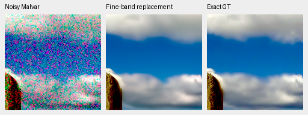
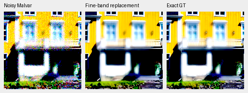

# Checking weak detail with every Bayer sample

Adding and subtracting the same simulated noise preserves every Bayer
location and avoids the interpolation artifacts of checkerboard splitting.
On 48 held-out photographs at ISO6400, checking a proposal on the
opposite perturbed view reduces fine-increment and flat error relative
to checking it on its own view. Above full-input Corpus 100k, the same
check adds **0.018 percentage points** of response with **0.014 DN16**
more increment error. Response calibration within the measured band
limits coarser changes. The half-strength mix still costs **0.65 DN16**
of fine-increment error for a **0.11 DN16** reduction in fine-flat
variation. Fine cab crossings remain incomplete.

[Machine results](results/full-sampling-detail-check-v1/publication.json) ·
[Frozen drivers and receipts](results/full-sampling-detail-check-v1/evidence.tar.xz) ·
[Native crop provenance](images/full-sampling-detail-check-v1/manifest.json).

## Full sampling and paired tests

The unchanged Corpus 100k EMA
`87b96f3c487b9edaf1c477742b6c38f2a82cc6b20a94716d51cc8cf46a17a760`
runs in CUDA IEEE FP32. Each pair uses the observed Bayer mosaic plus
and minus the same independent Gaussian perturbation. The added
variance follows the shot/read law with each CFA phase smoothed
separately by a 5 × 5 binomial kernel that excludes the center sample.
Both perturbed views keep every measured location. The model receives
twice the shot/read coefficients, and its inputs remain signed.
The average of a pair reconstructs the original raw values to rounding.

For Gaussian observations with known variance, equal-variance plus and
minus views are independent conditional on the clean signal. Estimated
variance, Poisson skew and clipping change that result. In the exact
camera simulation, mean raw levels from 0.003 to 0.50 have absolute
same-site correlations below 0.002 after perturbation. Near white the
correlation reaches −0.070 at 0.95 and −0.467 at 0.998. A nonzero
mixed third moment also survives away from clipping. The full-input
parent saw the original observation throughout, so its error can
remain correlated with the delivered correction. [Gaussian data fission method](https://arxiv.org/abs/2112.11079).

The check reads the guide's camera-green shape over 32-pixel windows
at stride 16. A fixed direction is fitted on all actually measured
green sites of either noisy view. A 1.5-standard-error soft threshold
guards the residual, with a 0.75 upper cap and a −0.5 lower cap for
the signed arm. Green detail is delivered along a neutral luminance
direction in camera RGB. Corrected windows overlap, taper at the
region edge and carry zero weighted DC. The delivery ROI is 160
pixels, and scoring uses the central 96 pixels. The fitted modes span
0.0625–0.140625 cycles/pixel and the scored fine band spans
0.125–0.333 cycles/pixel on the fixed 16-pixel blocks.

The inherited independent-draw panel covers natural, attenuated and
exact-flat targets at ISO400 and ISO6400. It uses the same 16 calibration
and 48 evaluation sources as the Bayer checkerboard test. Both splits
and every unperturbed parent measurement reproduce the preceding
study. [Complementary Bayer study](split-bayer-neural.md).

## What opposite-view checking changes

| ISO6400 held-out, unit strength | Fine response | Fine-increment RMS | Fine-flat RMS |
| --- | ---: | ---: | ---: |
| Corpus 100k | 65.729% | 155.719 DN16 | 5.371 DN16 |
| One pair averaged | 55.330% | 159.581 DN16 | 4.910 DN16 |
| One pair with same-view check | 55.537% | 159.928 DN16 | 5.529 DN16 |
| One pair with opposite-view check | 55.416% | 159.618 DN16 | 4.962 DN16 |
| Two pairs averaged | 55.330% | 158.935 DN16 | 4.357 DN16 |

One opposite-view check reduces increment error **0.310 DN16**
[0.173, 0.454] and flat RMS **0.567 DN16** [0.388, 0.762] versus
the same-view check, with 0.122 points less response. Two pairs keep
the response of one pair and reduce its increment error by another
0.646 DN16. The full-sampling average also retains more response and
far less flat variation than the quincunx half-input average
(47.623% and 42.669 DN16 on the same ISO6400 photos). The unperturbed
EMA retains 10.399 more response points than the full-sampling average.

For additions above the unperturbed EMA, the equal added flat budget
is 0.185 DN16. It is set by the smallest unit correction on 16
ISO6400 calibration photos, with a 0.25 DN16 ceiling. At this dose
the opposite-view check gains **0.0180 points** [0.0112, 0.0263]
and adds **0.0136 DN16** of fine-increment error [0.0079, 0.0191]
and **0.0411 DN16** of absolute flat RMS [0.0284, 0.0542]. The
signed variant changes increment error by −0.0011 DN16 and raises
flat RMS by 0.0181 DN16. At ISO400, the positive check gains
0.0083 points and adds 0.0062 DN16 of error. Bounds resample 48
whole source photographs.

## Restoring the response of the average

A separate calibration chooses one gain per arm and ISO using
only the 16 development sources, targeting the unperturbed EMA's
pooled fine response. Boosting the 32-pixel window shapes in the
two-pair average increases held-out ISO6400 lower-band response
from 94.27% to 134.80%. Fine-increment RMS rises to **172.14 DN16**
and fine-flat RMS to **11.90 DN16**. At ISO400 the same procedure
gives 75.10 DN16 of fine-increment RMS versus 72.42 for the EMA.

A second ISO6400 pass confines the replacement to a radial FFT band.
The raised-cosine transitions span 0.115–0.151 and 0.299–0.365 cycles
per native pixel. A 24-pixel margin and edge taper limit ringing.
The parent supplies the baseline image and chroma. A gain of 0.21266
calibrates the two-pair guide and 0.09611 calibrates the half-parent,
half-guide mix. Both gains are frozen before scoring held-out photos.

| ISO6400 held-out | Fine response | Fine-increment RMS | Fine-flat RMS |
| --- | ---: | ---: | ---: |
| Corpus 100k | 65.729% | 155.719 DN16 | 5.371 DN16 |
| Doubled prior, confined band | 62.182% | 178.875 DN16 | 9.145 DN16 |
| One pair, confined band | 65.529% | 160.268 DN16 | 6.372 DN16 |
| Two pairs, confined band | 65.431% | 159.422 DN16 | 5.863 DN16 |
| Half parent with two pairs, confined band | 65.594% | 156.371 DN16 | 5.264 DN16 |

The half mix changes lower-band response by +0.276 points. Its
fine-increment error rises 0.651 DN16 [0.250, 1.066], fine response
changes −0.135 points [−1.091, +0.753] and fine-flat RMS falls
0.106 DN16 [−0.331, +0.092]. This is a scope-limited inference
test with frozen weights and no new broad photo or measured-camera scores.

## Native exact-target triplets

Each cell uses native 160 × 160 pixels at `[48,48,160,160]` within
the 256-pixel query. Noisy Malvar, two-pair fine-band replacement and
exact GT use the same render. The ISO6400 profiles use shot/read
`0.00128/6.5536e-6`, capture ×0.33, black level 0.03, 16-bit ADC,
display ×3.0303 and contrast ×2.

**House of the Lake, Delos**, Bernard Gagnon, CC BY-SA 3.0. GRBG,
query `[138,248,256,256]`. The fine-increment error falls 2.108 DN16,
the best held-out source for the two-pair replacement. Soft transitions
remain near the darker foreground. [Source](https://commons.wikimedia.org/wiki/File:House_of_the_Lake,_Delos_02.jpg) ·
[All variants](images/full-sampling-detail-check-v1/exact/038-iso6400-independent-full-sampling-comparison.png).

**Björkboda manor**, Esquilo, CC BY-SA 3.0. BGGR, query
`[378,184,256,256]`. The fine-increment error rises 15.188 DN16,
the largest held-out increase. Bright siding, trim and dark edges
stay softer than the exact target. [Source](https://commons.wikimedia.org/wiki/File:Bj%C3%B6rkboda_herrg%C3%A5rd.jpg) ·
[All variants](images/full-sampling-detail-check-v1/exact/025-iso6400-independent-full-sampling-comparison.png).

## Standing GFX100S comparisons

The main DSCF3879/3880 comparisons use the original 512-pixel contexts
and display ×4. The averaged guide softens wire and leaf detail.
The 32-pixel boost adds dark outlines around coarse mesh and leaves.
The confined-band mix leaves the sky smooth and coarse crossings
coherent. Fine building wires and foliage remain soft.

The DSCF3842/3835 fine cab uses the original 768-pixel contexts at
display ×16 under both profiles. The uncorrected average softens the
right diagonals. The confined-band mix keeps more of them and
preserves the remaining left mottle and missing crossings. Its four
cab crops differ from the parent by 2.51–4.11 DN16 camera-RGB RMS.
Both native ROIs, the independent ISO100 AHD reference and both camera
JPEGs were viewed. The AHD view and JPEGs are qualitative references
with different aperture, exposure time and subject motion.

[Sky](images/full-sampling-detail-check-v1/standing/main-overcast-sky-main-overcast-sky.png) ·
[Building](images/full-sampling-detail-check-v1/standing/main-building-detail-main-building-detail.png) ·
[Foliage](images/full-sampling-detail-check-v1/standing/main-foliage-main-foliage.png) ·
[Coarse fence](images/full-sampling-detail-check-v1/standing/main-chain-link-fence-main-chain-link-fence.png).

| Cab prior, shot/read | Left | Right |
| --- | --- | --- |
| Nominal `0.00128/6.5536e-6` | [Native board](images/full-sampling-detail-check-v1/standing/mesh-nominal-fine-green-mesh-left.png) | [Native board](images/full-sampling-detail-check-v1/standing/mesh-nominal-fine-green-mesh-right.png) |
| Transferred `0.0014635775921166604/1.0715704128646712e-6` | [Native board](images/full-sampling-detail-check-v1/standing/mesh-profile3879-fine-green-mesh-left.png) | [Native board](images/full-sampling-detail-check-v1/standing/mesh-profile3879-fine-green-mesh-right.png) |
